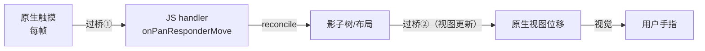
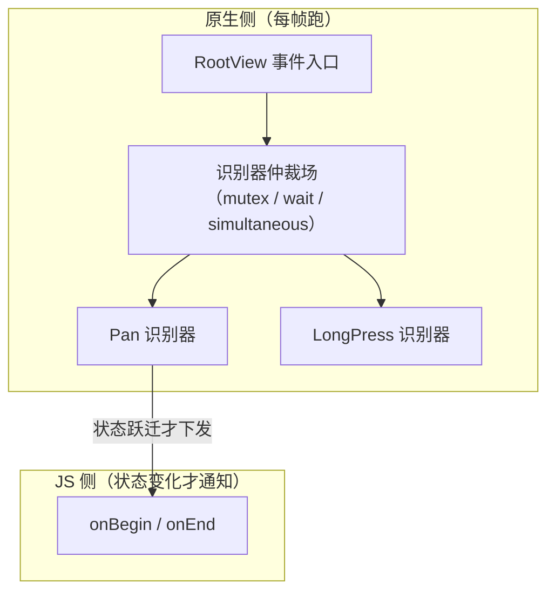

# Gesture Handler 原理化

> 01 篇的 Responder System 是"用 JS 模拟手势仲裁"——它把每个触摸事件都送过桥。react-native-gesture-handler（RNGH）反其道而行：**把手势识别整个搬回原生侧**。本篇拆它的架构动机、原生识别器如何驱动 React 组件，以及与 Reanimated worklet 的"零过桥"协作。

## 1. 动机：连续手势的过桥账

一个拖拽手势 = 每帧至少一个 touch 事件下行；若 handler 里 setState 更新位置，又有每帧一次视图更新上行。用模块四 03 的闭环模型：



每帧两次跨边界 + JS 线程排队不确定性 → **跟手延迟与掉帧是结构性的**，调代码只能缓解。RNGH 的答案：把"识别 + 位置更新"这条高频闭环留在原生，只把**状态变化**（开始/结束/失败）告诉 JS。

## 2. RNGH 架构：原生识别器 + 根视图上的"仲裁场"

关键机制（源码：`react-native-gesture-handler` 的 android/ios 目录）：

1. **原生识别器实例**：每个 `Gesture.Pan()` 等，都在原生侧创建对应识别器——Android 上是包装 `GestureDetector` 的 handler，iOS 上是 `UIGestureRecognizer` 子类（`RNGestureHandler` 系列）；
2. **挂载在根视图**：识别器 attach 到 root view 而非目标 view，配合注册表把命中测试与识别分离——因此 RNGH 能做到 `hitSlop`（命中区域外扩）与跨组件 `waitFor`（等待别人失败才认领）这类 Responder System 做不到的事；
3. **仲裁在原生**：多个识别器的互斥/并行/等待关系（`simultaneousWithExternalGesture`、`blocksExternalGesture`）在原生侧裁决，**不需要 JS 参与**——01 篇里 JS 协商的那套流程被原生短路。



## 3. 事件回调仍然过桥——除非接上 worklet

`onGestureEvent` 若是普通 JS 函数，**连续回调（translation/velocity）依旧走 Bridge/JSI 到 JS 线程**——识别在原生了，消费还在 JS。RNGH 与 Reanimated 的协作补上最后一环：

| 方案 | 事件数据去哪 | 更新视图的路径 |
|------|-------------|---------------|
| Responder + setState（01 篇） | JS（每帧过桥） | reconcile → 影子 → 挂载（每帧上行） |
| RNGH + JS handler | JS（每帧到 JS 线程） | 同上 |
| **RNGH + Reanimated worklet** | **UI 线程直调 worklet** | **worklet 写 shared value → 原生侧直接改视图属性** |

worklet 的原理（模块七 JSI 的应用）：回调函数被编译为可在原生线程执行的函数（Babel 转译 + JSI 注册），`sharedValue.value = x` 是 JSI 上的**原生值读写**——于是"手指 → 视图位移"的整条链路**一次都不进 JS 线程**：

```jsx
const x = useSharedValue(0);
const pan = Gesture.Pan().onChange((e) => {
  'worklet';
  x.value += e.changeX; // 在 UI 线程执行，直接驱动原生视图
});
```

## 4. 新 Gesture API 与新架构下的地位

- **声明式 API**（`Gesture.Pan().minDistance(10)`）取代旧的 `PanGestureHandler` 组件——配置在 JS 构建、在原生生效，组件树里不再需要包装组件；
- **新架构一等公民**：Fabric 下事件本身走 JSI 快速通道（模块七 02），RNGH 与其配合是官方推荐的手势基线——旧 Responder System 退化为兼容层；
- 滚动嵌套：RNGH 的识别器与原生 ScrollView 的手势协商也发生在原生侧（03 篇展开）。

## 5. 设计视角：一次"通道降级"的完整案例

把 RNGH 的取舍放回模块四 04 的五要素框架：

| 要素 | Responder System | RNGH（+worklet） |
|------|------------------|------------------|
| 通道 | Bridge 队列（每帧消息） | 原生识别器（高频）；JSI（低频状态） |
| 序列化 | 每帧 JSON 事件 | 状态跃迁才跨界；连续值走 shared value 引用 |
| 线程 | JS 线程消费 | **UI/原生线程消费** |
| 语义 | JS 协商仲裁 | 原生仲裁，JS 只收结果 |

同一个教训反复出现：**高频闭环要么原生闭环，要么别做闭环**。

## 小结

- RNGH 把三件事搬回原生：识别（原生识别器）、仲裁（根视图仲裁场）、高频更新（worklet + shared value）；
- JS 只接收状态跃迁与低频结果——每帧事件不再过桥，跟手性由架构保证而非代码技巧保证；
- `hitSlop` / `waitFor` / `simultaneous` 是原生仲裁场的直接产物，Responder System 做不到；
- RNGH + Reanimated 是"JSI 通道降级"的标准案例：高频走原生引用，低频才进 JS。
