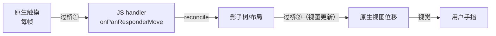
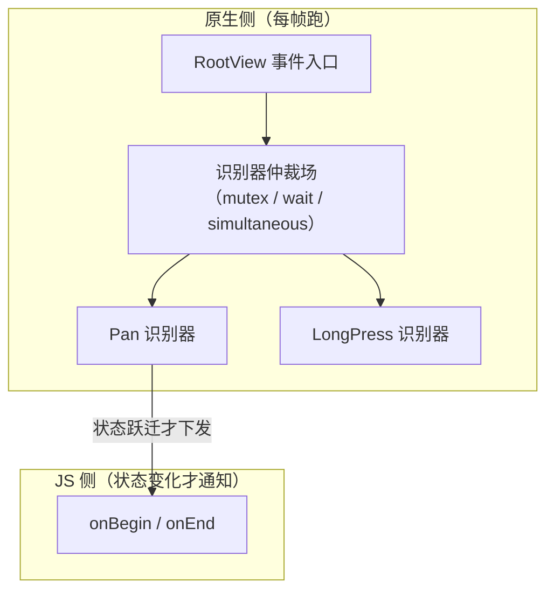
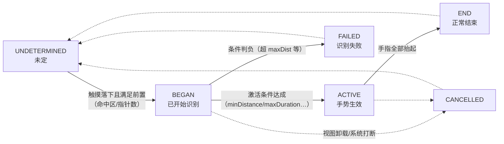

# Gesture Handler 原理化

> 01 篇的 Responder System 是"用 JS 模拟手势仲裁"——它把每个触摸事件都送过桥。react-native-gesture-handler（RNGH）反其道而行：**把手势识别整个搬回原生侧**。本篇拆它的架构动机、原生识别器如何驱动 React 组件，以及与 Reanimated worklet 的"零过桥"协作。

## 1. 动机：连续手势的过桥账

一个拖拽手势 = 每帧至少一个 touch 事件下行；若 handler 里 setState 更新位置，又有每帧一次视图更新上行。用模块四 03 的闭环模型：



每帧两次跨边界 + JS 线程排队不确定性 → **跟手延迟与掉帧是结构性的**，调代码只能缓解。RNGH 的答案：把"识别 + 位置更新"这条高频闭环留在原生，只把**状态变化**（开始/结束/失败）告诉 JS。

把这笔账再拆细一层（每帧的固定开销清单）：

| 每帧成本项 | 旧架构 | 新架构（JSI） |
|-----------|--------|---------------|
| 事件过界 | JSON 序列化 + 消息队列 | JSI 直调（无序列化税） |
| JS 处理 | 事件分发 + handler 执行 + setState 触发 reconcile | 同左（JS 线程仍参与） |
| 视图更新 | 影子树 diff 再过桥 | 同步提交（快但仍占线程） |
| 结论 | 每帧至少两次跨界 + JS 线程满载 | 跨界税降低，但闭环仍在 JS |

也就是说：**新架构让"过桥"变便宜了，但没有把闭环从 JS 挪走**——JS 线程一忙，手势照样卡。这就是 RNGH 在新架构时代依然是基线方案的原因。

## 2. RNGH 架构：原生识别器 + 根视图上的"仲裁场"

关键机制（源码：`react-native-gesture-handler` 的 android/ios 目录）：

1. **原生识别器实例**：每个 `Gesture.Pan()` 等，都在原生侧创建对应识别器——Android 上是包装 `GestureDetector` 的 handler，iOS 上是 `UIGestureRecognizer` 子类（`RNGestureHandler` 系列）；
2. **挂载在根视图**：识别器 attach 到 root view 而非目标 view，配合注册表把命中测试与识别分离——因此 RNGH 能做到 `hitSlop`（命中区域外扩）与跨组件 `waitFor`（等待别人失败才认领）这类 Responder System 做不到的事；
3. **仲裁在原生**：多个识别器的互斥/并行/等待关系（`simultaneousWithExternalGesture`、`blocksExternalGesture`）在原生侧裁决，**不需要 JS 参与**——01 篇里 JS 协商的那套流程被原生短路。



### 2.1 识别器状态机：六态一图

每个原生识别器都是一个独立状态机，状态集合对 JS 透出（`gesture.state`）：



| 状态 | 语义 | 触发 JS 回调 |
|------|------|--------------|
| `UNDETERMINED` | 初始态，尚未看到触摸 | — |
| `BEGAN` | 触摸落下、进入识别中，**还未生效** | `onBegin` |
| `ACTIVE` | 激活条件达成，手势正式接管 | `onStart` / `onUpdate`（连续） |
| `END` | 正常结束（抬起） | `onEnd` |
| `FAILED` | 条件判负（不激活，把机会让给别人） | `onFinalize` |
| `CANCELLED` | 外力打断（卸载/系统/被更强者抢） | `onFinalize` |

两个设计要点：

- **BEGAN 与 ACTIVE 分离**：BEGAN 只表示"我看见了触摸"，ACTIVE 才表示"我接管"。中间的判定窗口（如 Pan 的 `minDistance`）正是仲裁的缓冲带——多个识别器在这段时间里竞争，输的进 FAILED；
- **FAILED 是仲裁的语言**：一个识别器失败，等待它的识别器才有机会激活（`waitFor` 的实现基础）。失败不是错误，是"让贤"。

### 2.2 仲裁场内部：orchestrator 怎么裁决

Android 侧的仲裁核心是 `GestureHandlerOrchestrator`（简化示意）：

```java
// android/src/main/java/com/swmansion/gesturehandler/GestureHandlerOrchestrator.java（简化）
void onHandlerStateChanged(GestureHandler handler) {
  if (handler.getState() == GestureHandler.STATE_ACTIVE) {
    // 新王登基：其余仍 BEGAN 的识别器若与胜者互斥 → 置 FAILED / CANCELLED
    for (GestureHandler other : handlers) {
      if (other != handler && !canRunSimultaneously(other, handler)) {
        other.cancel();               // 或 fail()，取决于关系类型
      }
    }
    // 通知根视图：原生默认触摸处理（如 ScrollView）让位
    notifyActiveHandler(handler);
  }
  // awaitHandlers（waitFor 关系）：只在被等待者 FAILED 后才尝试激活
  tryActivateAwaitingHandlers();
}
```

读这段伪码的正确姿势不是抠实现，而是体会三件事：

1. **裁决是同步的、一帧内完成的**——没有跨线程协商，01 篇"仲裁在线程另一头"的延迟被整体消灭；
2. **互斥默认、并行要声明**——两个识别器默认不能同时 ACTIVE，`simultaneousWithExternalGesture` 是显式开例外；
3. **原生默认手势也坐在仲裁桌旁**——ScrollView 的滚动也是"一个识别器"，`activeOffsetX/Y` 这类参数就是在决定"何时判 Pan 赢、何时让 ScrollView 赢"。

iOS 侧的对应物是根视图上的拦截识别器（简化示意）：

```objc
// ios/RNGestureHandler/.../RCTRootViewGestureRecognizer.m（简化）
- (void)touchesBegan:(NSSet<UITouch *> *)touches withEvent:(UIEvent *)event {
  // 不自己消费，而是转交给 RNGH 的 handler 注册表
  [_gestureHandlerRegistry deliverTouches:touches withEvent:event];
}

- (BOOL)canPreventGestureRecognizer:(UIGestureRecognizer *)other {
  // RNGH 与系统识别器（如 UIScrollView 的 pan）协商优先级：
  // 有 RNGH handler 激活时返回 YES，把系统手势压下去
  return [self shouldTakePrecedenceOver:other];
}
```

两端实现不同、协议一致：**入口统一收到根视图，裁决统一在原生完成**——跨平台的心智负担被库吃掉了。

### 2.3 关系原语与组合 API

把常用关系整理成一张速查表：

| 关系 | API（Gesture 对象方法 / 静态组合） | 效果 |
|------|-----------------------------------|------|
| 等待 | `g.waitFor(ref)` | 被等待者 FAILED/END 后，g 才允许激活 |
| 并行 | `g.simultaneousWithExternalGesture(ref)` | 二者可同时 ACTIVE |
| 阻塞 | `g.blocksExternalGesture(ref)` | 我激活则对方不得激活（waitFor 的反向） |
| 竞争 | `Gesture.Race(g1, g2, …)` | 先激活者胜，其余失败 |
| 同活 | `Gesture.Simultaneous(g1, g2, …)` | 组内全部并行 |
| 主从 | `Gesture.Exclusive(g1, g2, …)` | 按序尝试：前者不能激活才轮到后者 |

组合 API 是关系原语的语法糖——`Race` 编译成互相 waitFor 的原生配置，JS 侧只负责"声明期"，**执行期没有 JS 的事**。

```jsx
const longPressRef = useRef(null);
const drag = Gesture.Pan()
  .activateAfterLongPress(200)          // 长按 200ms 后才激活（期间机会留给点击）
  .minPointers(1)
  .onUpdate((e) => { /* worklet */ });
const menu = Gesture.LongPress().withRef(longPressRef);
const outer = Gesture.Exclusive(menu, drag); // 先试菜单长按，不成才进入拖拽
```

### 2.4 与 ScrollView 的相处：activeOffset / failOffset

RNGH 手势放进 ScrollView 里最常见的问题是"拖不动/一拖就滚"。关键参数：

| 参数 | 语义 | 典型用法 |
|------|------|---------|
| `activeOffsetX/Y` | 位移超过该偏移才激活 | 横滑卡片：`[-10, 10]`，纵向滚动让给 ScrollView |
| `failOffsetX/Y` | 位移超过该偏移直接判负 | 横滑手势配 `failOffsetY`，竖着划就放弃 |
| `minDistance` | 激活所需最小位移 | 与 activeOffset 类似，语义是"从起点算" |

语义记住一句：**激活前的事件谁都能看，激活后 ScrollView 收到让位通知**——RNGH 根视图会通知原生滚动容器停止接管，这正是"仲裁在原生"的日常收益。

### 2.5 hitSlop 与跨视图手势：注册表带来的自由

因为"识别器挂根视图、靠注册表映射目标"，RNGH 的命中判定与视图层级解耦，长出两个 Responder System 给不了的能力：

- **`hitSlop` 四向外扩**（还支持 `horizontal/vertical/top…` 的单侧配置）：小按钮要"好点"，不必外面套一层透明 View；
- **手势在视图之外也能继续**：拖拽一旦激活，手指拖出组件边界、拖到屏幕边缘，事件流照常进识别器——01 篇里"手势与组件共存亡"的模型被打破。

这组能力的代价同样来自注册表：识别器与目标视图是**弱绑定**，视图卸载时手势要显式结束，否则处于 BEGAN/ACTIVE 的悬空识别器会干扰下一轮仲裁（`onFinalize` 清理的另一层意义）。

## 3. 事件回调仍然过桥——除非接上 worklet

`onGestureEvent` 若是普通 JS 函数，**连续回调（translation/velocity）依旧走 Bridge/JSI 到 JS 线程**——识别在原生了，消费还在 JS。RNGH 与 Reanimated 的协作补上最后一环：

| 方案 | 事件数据去哪 | 更新视图的路径 |
|------|-------------|---------------|
| Responder + setState（01 篇） | JS（每帧过桥） | reconcile → 影子 → 挂载（每帧上行） |
| RNGH + JS handler | JS（每帧到 JS 线程） | 同上 |
| **RNGH + Reanimated worklet** | **UI 线程直调 worklet** | **worklet 写 shared value → 原生侧直接改视图属性** |

worklet 的原理（模块七 JSI 的应用）：回调函数被编译为可在原生线程执行的函数（Babel 转译 + JSI 注册），`sharedValue.value = x` 是 JSI 上的**原生值读写**——于是"手指 → 视图位移"的整条链路**一次都不进 JS 线程**：

```jsx
const x = useSharedValue(0);
const pan = Gesture.Pan().onChange((e) => {
  'worklet';
  x.value += e.changeX; // 在 UI 线程执行，直接驱动原生视图
});
```

### 3.1 一段完整的"零过桥拖拽 + 惯性"

把惯性感（抬起后按速度衰减）也留在 UI 线程，才算是把 RNGH 用到位：

```jsx
import { Gesture, GestureDetector, GestureHandlerRootView } from 'react-native-gesture-handler';
import Animated, { runOnJS, useSharedValue, useAnimatedStyle, withDecay } from 'react-native-reanimated';

function DraggableCard({ onDropEnd }) {
  const x = useSharedValue(0);
  const y = useSharedValue(0);

  const pan = Gesture.Pan()
    .minDistance(6)
    .onUpdate((e) => {            // 每帧：UI 线程执行，JS 不参与
      'worklet';
      x.value += e.changeX;
      y.value += e.changeY;
    })
    .onEnd((e) => {               // 抬手：速度交给衰减动画，仍在 UI 线程
      'worklet';
      x.value = withDecay({ velocity: e.velocityX, deceleration: 0.998, clamp: [0, 300] });
      y.value = withDecay({ velocity: e.velocityY });
      runOnJS(onDropEnd)({ x: x.value, y: y.value }); // 真需要 JS 时，显式过界一次
    });

  const style = useAnimatedStyle(() => ({ transform: [{ translateX: x.value }, { translateY: y.value }] }));

  return (
    <GestureHandlerRootView>
      <GestureDetector gesture={pan}>
        <Animated.View style={[styles.card, style]} />
      </GestureDetector>
    </GestureHandlerRootView>
  );
}
```

对照 01 篇的 PanResponder 版本，差异一目了然：

| 环节 | PanResponder 版 | 本例 |
|------|----------------|------|
| 位移累积 | JS（事件排队时丢帧/抖动） | 原生 changeX 累积 |
| 速度估计 | JS 用时间戳算（排队即失真） | 原生按帧间差估计（`e.velocityX`） |
| 视图更新 | setState → reconcile → 提交 | shared value → 直写 props |
| 惯性动画 | Animated/定时器，回 JS 线程 | `withDecay` 在 UI 线程 |
| JS 线程参与 | 每帧全程 | 仅 onDropEnd 一次 |

### 3.2 worklet 的边界：什么必须回 JS

worklet 不是万能舱，跨界点要心里有数：

- **React 状态**：setState、context 更新必须在 JS 线程——用 `runOnJS(fn)(args)` 显式投递；
- **外部资源**：网络请求、存储、原生模块调用（非 Reanimated 封装的）都在 JS；
- **闭包快照**：worklet 捕获的是**创建时刻的值拷贝**（基本类型）——要"活的值"就用 SharedValue，这是新手最常撞的墙（04 篇第 5 节同款坑）；
- **调试体验**：worklet 里的 console.log 需要专门配置才能输出——日志缺失不代表没执行。

### 3.3 语义事件的载荷：按手势类型速查

| 手势 | 载荷字段（常见） | 说明 |
|------|-----------------|------|
| Pan | `translationX/Y`、`changeX/Y`、`velocityX/Y`、`absoluteX/Y`、`numberOfPointers` | 累计位移、帧增量、速度、绝对坐标都有，不用自己减 |
| Tap | `x/y`、`absoluteX/Y`、`numberOfPointers` | 无连续过程，一次性事件 |
| LongPress | `x/y`、`duration`、`numberOfPointers` | duration 是按住时长 |
| Pinch | `scale`、`velocity`、`focalX/Y` | 焦点坐标是双指中点 |
| Rotation | `rotation`、`velocity`、`anchorX/Y` | rotation 是累计角（弧度） |

对比 01 篇的原始 touch payload：语义事件**把"信号处理"的原生结果直接给了你**——速度不用估、位移不用累减、焦点不用求平均。这也是"识别下沉"带来的代码量削减：JS 侧从手势数学里解放出来，只写业务语义。

## 4. 新 Gesture API 与新架构下的地位

- **声明式 API**（`Gesture.Pan().minDistance(10)`）取代旧的 `PanGestureHandler` 组件——配置在 JS 构建、在原生生效，组件树里不再需要包装组件；
- **新架构一等公民**：Fabric 下事件本身走 JSI 快速通道（模块七 02），RNGH 与其配合是官方推荐的手势基线——旧 Responder System 退化为兼容层；
- 滚动嵌套：RNGH 的识别器与原生 ScrollView 的手势协商也发生在原生侧（03 篇展开）。

旧组件 API 与新 Gesture API 的对照（迁移时的换算表）：

| 旧 API（组件式） | 新 API（对象式） |
|------------------|------------------|
| `<PanGestureHandler onGestureEvent={…}>` | `Gesture.Pan().onUpdate(…)` + `GestureDetector` |
| `simultaneousHandlers` prop | `.simultaneousWithExternalGesture(ref)` |
| `waitFor` prop（ref 数组） | `.waitFor(ref)` |
| `onHandlerStateChange` 里 switch `Native.Events` | `onBegin/onStart/onEnd/onFinalize` 直接订阅 |
| 包装组件占组件树一层 | 纯对象，组件树零新增层级 |

新 API 的本质改进：**手势从"组件"降格为"值"**——可以被组合、被条件构造、被 hooks 生成，而不再要求你为每种手势在 JSX 里挖一个洞。

补充三点工程事实：

1. **根视图要求**：RNGH 需要根上有 `GestureHandlerRootView`（或等价配置）——仲裁场就挂在它上面；没有它，手势会退化到不可用（这是"装了库不生效"的头号原因）；
2. **`runOnJS(true)` 是逃生舱**：个别场景必须让某手势回调进 JS 线程（如要与某个只有 JS 实现的库协作），Gesture 对象级可配；
3. **手动激活**：`manualActivation` 把"要不要 ACTIVE"的裁决权交还给 worklet——自定义复杂判定（如"只有双指同向才激活"）不必 fork 识别器。

```jsx
const pinchLike = Gesture.Pan()
  .manualActivation((e, stateManager) => {
    'worklet';
    if (e.numberOfPointers >= 2) stateManager.activate();
    else stateManager.fail();
  });
```

## 5. 设计视角：一次"通道降级"的完整案例

把 RNGH 的取舍放回模块四 04 的五要素框架：

| 要素 | Responder System | RNGH（+worklet） |
|------|------------------|------------------|
| 通道 | Bridge 队列（每帧消息） | 原生识别器（高频）；JSI（低频状态） |
| 序列化 | 每帧 JSON 事件 | 状态跃迁才跨界；连续值走 shared value 引用 |
| 线程 | JS 线程消费 | **UI/原生线程消费** |
| 语义 | JS 协商仲裁 | 原生仲裁，JS 只收结果 |

同一个教训反复出现：**高频闭环要么原生闭环，要么别做闭环**。

## 6. 常见坑速查

| 症状 | 原因 | 出路 |
|------|------|------|
| 装了 RNGH 手势全无反应 | 根上没有 `GestureHandlerRootView` | 套在导航容器**之内**、根布局**之外**的合适层级 |
| ScrollView 里的横滑卡片"拖不动" | Pan 先于滚动激活（或反之） | `activeOffsetX` + `failOffsetY` 划清管辖带 |
| 手势时灵时不灵 | 识别条件重叠，仲裁结果随机 | 用 `waitFor` / `Exclusive` 显式声明优先级 |
| worklet 里读到的 state 是旧值 | 闭包捕获的是快照 | 改用 SharedValue 传递 |
| 拖拽中组件卸载报错 | 手势未结束视图没了 | `onFinalize` 里清理；检测状态 CANCELLED |
| 回调里 setState 后动画卡顿 | 又回到了 JS 闭环 | 更新走 shared value；业务结论才 `runOnJS` |
| 双击判定偶发失败 | 两个 Tap 手势未声明关系 | `Gesture.Exclusive(tap, doubleTap)` + `maxDelay`(Tap 的多击判定) |
| 拖到屏幕边缘手势"失踪" | 以为手势会随视图结束 | RNGH 激活后跨视图持续——属正常设计，注意 `onFinalize` 清理 |

## 7. 延伸阅读

- [01-触摸事件链路与手势仲裁](01-触摸事件链路与手势仲裁.md)：被替代的 Responder System 全貌；
- [04-动画系统原理](04-动画系统原理.md)：worklet 与 native driver 的动画侧对照；
- [../rn-新架构/01-JSI原理](../rn-新架构/01-JSI原理.md)：SharedValue 直读原生值的底层机制；
- [../rn-Bridge通信原理/04-跨语言通信的通用设计](../rn-Bridge通信原理/04-跨语言通信的通用设计.md)：通道降级的五要素框架。

## 小结

- RNGH 把三件事搬回原生：识别（原生识别器）、仲裁（根视图仲裁场）、高频更新（worklet + shared value）；
- JS 只接收状态跃迁与低频结果——每帧事件不再过桥，跟手性由架构保证而非代码技巧保证；
- `hitSlop` / `waitFor` / `simultaneous` 是原生仲裁场的直接产物，Responder System 做不到；
- RNGH + Reanimated 是"JSI 通道降级"的标准案例：高频走原生引用，低频才进 JS。

## 自测

1. RNGH 识别器的六个状态是什么？BEGAN 与 ACTIVE 的区别在哪，为什么这个区分对仲裁至关重要？
2. `waitFor`、`simultaneousWithExternalGesture`、`Gesture.Exclusive` 分别解决什么问题？各自的裁决发生在哪个线程？
3. 一段"拖拽 + 惯性"手势，从手指落下到动画停稳，JS 线程参与了几次？分别在哪一步？
4. worklet 闭包里读 React state 为什么拿到的是旧值？正确的传值方式是什么？
5. ScrollView 内的横向拖拽与纵向滚动冲突，`activeOffsetX` / `failOffsetY` 各自承担什么判定？
6. `onEnd` 和 `onFinalize` 的触发条件差异是什么？清理逻辑为什么应该放后者？
7. RNGH 的 `hitSlop` 与 Pressable 的 `hitSlop` 都是"扩大命中"，二者的执行层与适用场景有何不同？
8. 新 Gesture API 相比旧的组件式 API，最本质的改进是什么？为什么说手势从"组件"变成了"值"？
