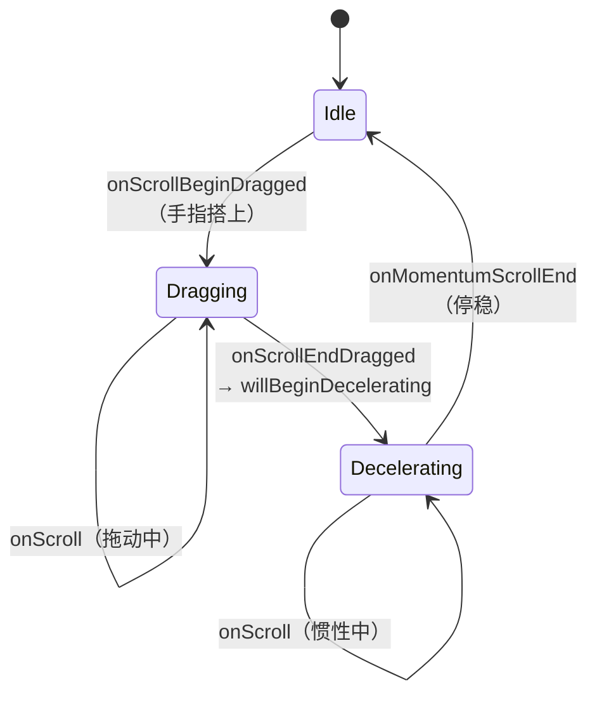
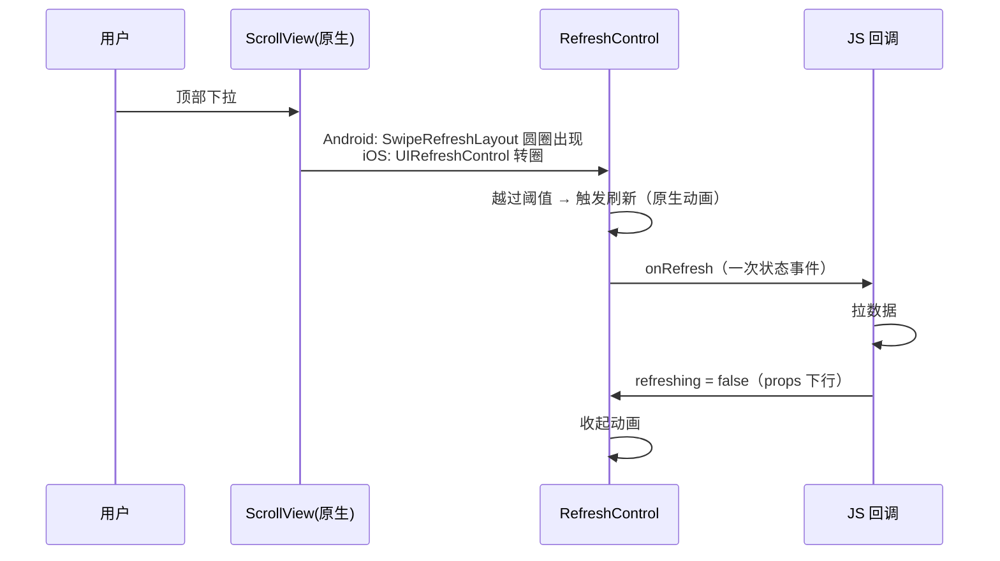

# 滚动与列表事件

> 滚动是 RN 里最高频的事件源：每帧都在产生偏移量。本篇拆三件事：`onScroll` 的产生与节流（`scrollEventThrottle` 的真实含义）、嵌套滚动的平台协商差异、以及下拉刷新这条完整链路。列表的**渲染**侧（虚拟化）在模块九，本篇只管"事件"。

## 1. onScroll 的产生与节流

先看 JS 侧到底拿到什么——`onScroll` 的 `nativeEvent` 核心字段：

| 字段 | 含义 | 用途 |
|------|------|------|
| `contentOffset.x/y` | 当前滚动偏移（逻辑像素） | 视差/吸顶的主输入 |
| `contentSize.width/height` | 内容总尺寸 | 算"还剩多少到底" |
| `layoutMeasurement.width/height` | 视口（滚动框）尺寸 | 分母 |
| `contentInset` | 内容内嵌（iOS 常非零） | 修正吸顶计算 |
| `velocity`（部分平台/版本） | 滚动速度 | 交互动效可用，别跨端依赖 |

一条通用公式：**距底部距离 = contentSize.height - layoutMeasurement.height - contentOffset.y**——翻页加载、无限滚动的判定全在这三个字段的组合上。

### 1.1 iOS：scrollEventThrottle 决定"每秒最多几次"

iOS 的滚动回调来自 `UIScrollViewDelegate`，天然每帧可用。RN 的 `RCTScrollView` 用 `scrollEventThrottle` 控制下发频率：

```jsx
<ScrollView scrollEventThrottle={16}> 
```

- 单位是 **毫秒间隔**，16 ≈ 每帧一次（60fps）；设 0/不设则**只在关键节点**（开始、结束、减速结束等）发事件，连续滚动中间段"哑火"——想要 sticky 头、滚动视差就必须设它；
- 它是**上限节流**：设备忙时可能更稀，不是保证值；
- 设成 1（每帧必发）的代价：每帧一条事件过桥（旧架构）→ 若 handler 里再 setState，就是模块四 03 的洪泛闭环。新架构下事件走 JSI 直调，成本降但 JS 线程仍被占用。

节流值的选择口径（定性）：

| 需求 | 建议 | 理由 |
|------|------|------|
| 吸顶/视差等逐帧动画 | 16 左右 | 少于每帧一次视觉上会顿 |
| 加载进度条/按钮显隐 | 100~200 量级 | 人眼对状态变化不敏感 |
| 只关心到没到底 | 不设（靠阶段事件） | 用 `onMomentumScrollEnd`/距离判定替代高频回调 |

### 1.2 Android：每帧回调 + 事件合并

Android 的 `onScrollChanged` 本身每帧触发，RN 侧做**事件合并（coalescing）**——中间值可丢弃，只保留最新偏移。这也是通用事件优化思路：**滚动回调只关心"现在到哪了"，历史值无意义，可安全合并**。

合并的判定靠**合并键（coalescing key）**：同一来源（同一个滚动视图）的滚动事件共享一个 key，派发队列里"同 key 只留最新"。示意（概念代码）：

```java
// Android 事件派发（概念示意）
eventDispatcher.dispatchEvent(new ScrollEvent(viewTag, latestOffset, coalescingKey));
// 同一 viewTag + coalescingKey 的事件在队列里被合并：
// 帧内产生 3 条 → JS 只收到 1 条（最新 offset）
```

| 平台 | 事件源 | 节流机制 | 默认行为 |
|------|--------|---------|---------|
| iOS | UIScrollViewDelegate | scrollEventThrottle（JS 侧设定） | 不设 = 只发关键节点 |
| Android | onScrollChanged | 系统每帧 + coalescing | 每帧一次（合并后） |

一张表看清两端差异的**本质**：iOS 把节流开关交给 JS（谁用谁设）；Android 在原生层固定合并（JS 拿不到中间值）。所以"为什么 Android 不需要 scrollEventThrottle"的答案不是"Android 不节流"，而是"节流策略内置了"。

新架构下这张表的结论不变，变的是通道成本：

- 滚动事件经 JSI 直达 JS，省掉 JSON 序列化（模块七 02）；
- 滚动属于**连续事件**，调度优先级低于点击这类离散事件——JS 忙时先保证点击响应，滚动回调可以被合并/推迟；
- 但"每帧进 JS 就占 JS 线程"的事实不变，高频联动仍应走原生消费（见 2.4 与 04 篇）。

### 1.3 滚动控制 API：双向的另一条车道

除了"原生 → JS"的事件，ScrollView 还有"JS → 原生"的控制命令（走命令通道，不是 props）：

```jsx
const ref = useRef(null);
ref.current.scrollTo({ x: 0, y: 200, animated: true }); // 滚到指定偏移
ref.current.scrollToEnd({ animated: true });            // 滚到底部
```

要点：

- **`animated: false` 是瞬时跳变**，不产生中间帧的 onScroll 连续流（只有终态相关事件）；
- 控制命令与用户手势可能**竞态**：命令滚动进行中用户搭手，原生按平台规则裁决（通常手势优先并取消动画）；
- 聊天"锚定底部"这类需求，优先考虑 `maintainVisibleContentPosition`（列表组件的锚定能力，部分平台/版本支持），比"收到消息就 scrollToEnd"稳定。

## 2. 滚动事件的阶段模型

`onScroll` 之外，ScrollView 还提供一组**阶段事件**，对应原生滚动状态机：



工程含义：

- **吸顶/吸底**用 `onScroll`（连续量）；**翻页加载**用 `onMomentumScrollEnd`（用户意图结束）而不是滚动中就触发；
- 拖拽 vs 惯性是两个物理阶段，原生侧来源不同（触摸 vs 动量），阶段事件正是把它们区分开的接口；
- 02 篇的 RNGH 与 ScrollView 的手势协商发生在 `Dragging` 之前——手指搭上的瞬间，原生已决定"这轮归谁"。

补两个阶段事件的细节：

- **抬手≠结束**：`onScrollEndDrag` 只是手指离开，惯性减速还在进行；真正的"这一轮结束"是 `onMomentumScrollEnd`。在 drag 结束时就复位 UI（如收起刷新提示）会在惯性期间闪烁；
- **不是每轮都有惯性**：短促拖动后立即静止时，两端是否发 momentum 事件的时机略有差异——跨端逻辑要容忍"没有 momentum 事件"的路径（以 drag end 兜底）。

### 2.1 分页与吸附：把"停哪"交给原生

轮播/分页场景，ScrollView 提供吸附（snap）系 props，把"松手后停在哪个位置"的判定放回原生：

| prop | 语义 |
|------|------|
| `pagingEnabled` | 按视口整页吸附（系统级翻页手感） |
| `snapToInterval` / `snapToOffsets` | 按固定间距/指定偏移吸附 |
| `snapToAlignment` | 吸附对齐方式（start/center/end） |
| `disableIntervalMomentum`（iOS） | 抬手即停，不做惯性滑行（开关/日历类） |

事件侧的联动价值：吸附的停稳点由原生决定，`onMomentumScrollEnd` 里读到的 offset 天然落在吸附点上——**用吸附替代"手写减速到目标"**，手感与线程占用双赢。

### 2.2 键盘与滚动的两个事件级开关

滚动容器还管两件与 05 篇联动的事，先占个位：

| prop | 取值 | 语义 |
|------|------|------|
| `keyboardDismissMode` | `none` / `on-drag`（+ iOS `interactive`） | 滚动开始时是否收起键盘；`interactive` 是 iOS 的"拖住键盘跟手下移" |
| `keyboardShouldPersistTaps` | `never`（默认）/ `handled` / `always` | 键盘弹出时，点滚动区内的组件：`never` 点击先收键盘不触发组件；`always`/`handled` 直接触发 |

`keyboardShouldPersistTaps` 是"表单页点提交按钮要点两次"的标准答案——第一次点在收键盘上，第二次才到按钮。详见 [05-键盘与TextInput链路](05-键盘与TextInput链路.md)。

### 2.3 尺寸事件：onLayout 与 onContentSizeChange

滚动家族还有两个低频但常被忽略的事件，与阶段事件互补：

| 事件 | 触发 | 典型用途 |
|------|------|---------|
| `onLayout` | 自身（滚动框）尺寸/位置变化 | 响应式重算（旋转屏、分栏） |
| `onContentSizeChange` | **内容**尺寸变化 | 聊天"新消息滚到底"、判断内容是否短于一屏（禁用滚动效果） |

它们与 onScroll 的组合公式（聊天场景）：`onContentSizeChange` 记下新内容高度 → `scrollTo({ y: newContentH - viewH })`——依赖的是本节开头的三个字段，而不是猜偏移。

### 2.4 用 Reanimated 消费滚动：闭环的第三种剪法

onScroll 里 setState 是模块四 03 的闭环；还有一条"不进 JS"的路——`useAnimatedScrollHandler` 把滚动回调变成 worklet：

```jsx
const y = useSharedValue(0);
const scrollHandler = useAnimatedScrollHandler((e) => {
  'worklet';
  y.value = e.contentOffset.y;      // UI 线程执行，不走 JS
});
const headerStyle = useAnimatedStyle(() => ({
  height: clamp(120 - y.value, 64, 120), // 吸顶高度动画，同样在 UI 线程
}));
<Animated.ScrollView onScroll={scrollHandler} scrollEventThrottle={16}>
```

与 04 篇的对应关系：这是"事件驱动动画"版的 worklet 闭环——滚动事件原生产生、worklet 原生消费、视图原生更新，JS 线程只在挂载时参与一次。**视差/吸顶类高频联动的首选路径**（04 篇展开动画侧原理）。

## 3. 嵌套滚动：两个平台两套协议

"横向列表套纵向列表""底部 Tab 手势接管滚动"是嵌套滚动的典型场景：

### Android：NestedScrolling 协议（显式协商）

Android 有正式的父子协商协议（`NestedScrollingParent/Child`）：

- 子ScrollView 每步滚动前先问父级"要消费多少"（`onNestedPreScroll`），父级吃掉一部分（如吸顶）后剩余归子；
- 到边界后还有 `onNestedFling` 决定动量归属；
- RN 的 `nestedScrollEnabled`（Android）就是把子 ScrollView 接入这套协议的开关。

协议的关键回调（Android ViewParent 接口，RN 原生侧实现于 `ReactScrollView` 一族）：

| 回调 | 时机 | 典型消费者 |
|------|------|-----------|
| `onStartNestedScroll` | 手势开始，父级决定"要不要参与" | 吸顶容器返回"竖向我参与" |
| `onNestedPreScroll` | 子滚动**前**，父先扣走一段 | 吸顶未完成时父吃掉 dy |
| `onNestedScroll` | 子滚动**后**，把消费/未消费量报给父 | 到顶后父接管继续滚（粘性头） |
| `onNestedPreFling` / `onNestedFling` | 惯性阶段归属协商 | 父决定要不要接管 fling |
| `onStopNestedScroll` | 手势结束 | 状态复位 |

读表的方法：**pre 系列是"父先拿"，post 系列是"父兜底"**——嵌套吸顶（父先吃）与嵌套接力（子到头父接着滚）分别对应前两个钩子。RN 侧业务代码不直接碰这些回调，但理解协议才能解释"nestedScrollEnabled 一开，内外滚动突然配合了"的现象。

### iOS：没有协议，靠约定与手势仲裁

iOS 无官方嵌套协议，通常靠：

- `simultaneousRecognition`（UIGestureRecognizer 并行识别）；
- delegate 层手写协商（外层在特定偏移前 `canCancelContentTouches` 抢占）；
- 或干脆用 RNGH 在原生仲裁场里声明关系（02 篇）——这也是 RNGH 在 iOS 嵌套场景地位高的原因：**它把无协议平台的协商显式化了**。

| | Android | iOS |
|--|---------|-----|
| 协商方式 | NestedScrolling 协议（系统级） | 手势仲裁 + delegate 约定 |
| RN 侧入口 | `nestedScrollEnabled` | RNGH / 自定义处理 |
- 同一需求两端实现路径不同，写跨端组件时要**按平台分支设计**（模块五 04 的文件层分支）。

### 3.1 一个对照案例：吸顶头部

同一个"头部随滚动收起"的需求，两端的实现路线：

| 步骤 | Android 路线 | iOS 路线 |
|------|-------------|----------|
| 头部未收起时竖滑 | 子列表 preScroll 给父，父吃掉 dy 移动头部 | 外层 scroll 先响应（命中在外层），滚到边界后 `canCancelContentTouches` 放行内层 |
| 头部收起后 | 父返回"不参与"，滚动全归子列表 | 内层 scroll 正常接管 |
| RN 侧写法 | `nestedScrollEnabled` + 原生协作 | RNGH 声明关系，或双层 ScrollView + 偏移联动 |

结论写进跨端组件的设计文档：**嵌套滚动的行为契约（谁先谁后、边界怎么交棒）要按平台分别定义**，JS 侧只做状态归一。

### 3.2 协商矩阵：常见嵌套组合的处理

把常见组合与两端可用手段列成矩阵（写跨端组件先查表）：

| 组合 | Android | iOS |
|------|---------|-----|
| 横向列表 × 纵向列表 | 方向不同天然不冲突；冲突时 RNGH `activeOffset` 划界 | 同左 |
| 纵向 × 纵向（吸顶/底板） | NestedScrolling（`nestedScrollEnabled`） | RNGH 或双层 ScrollView 手写联动 |
| BottomSheet 拖拽 × 内部滚动 | sheet 作为 NestedScrollingParent | RNGH 声明 sheet 与滚动的关系 |
| ViewPager/Tab 容器 × 页内滚动 | 系统容器自带协商 | 手势仲裁（RNGH 或 delegate） |

规律：**Android 侧尽量"接入系统协议"，iOS 侧尽量"用 RNGH 显式声明"**——两端各用其长，JS 层把行为契约抹平。

## 4. 下拉刷新：RefreshControl 的完整链路



三个细节：

1. **转圈动画完全原生**，等待期间没有一次跨边界通信——正确的下拉刷新不会因 JS 忙而卡住动画（若 `refreshing` 状态也放 JS 频繁切换则另说）；
2. `onRefresh` 是**一次性事件**，与连续的 onScroll 形成对照：低频语义事件适合过桥，高频连续量适合原生消费——模块六反复出现的分界线；
3. `refreshControl` 的位置由 ScrollView 原生布局决定，不受 JS 布局系统影响（RefreshControl 是 ScrollView 的原生附属，不是 JS 树的普通子节点）。

RefreshControl 的关键 props（两端差异都写明了）：

| prop | 平台 | 说明 |
|------|------|------|
| `refreshing` | 通用 | 受控开关：true 显示转圈；数据回来置 false 收起 |
| `tintColor` / `colors` | iOS / Android | 转圈颜色，两端 prop 名不同 |
| `progressViewOffset` | Android | 转圈竖向偏移（配沉浸式头部时必设） |
| `title` | iOS | 刷新时提示文案 |

两个行为契约：

- **`refreshing` 必须回写**：忘了置 false，转圈永远不收——这是受控组件语义在原生控件上的重演；
- **阈值与手势归属在原生**：下拉多深触发、触发后是否继续跟手，由 SwipeRefreshLayout / UIRefreshControl 决定，RN 无参数可调（要自定义行为就得换 RNGH 自己写）。

后者的"自己写"长这样（骨架）：Pan 识别器 + 负方向位移驱动一个 shared value，阈值判定在 worklet——RefreshControl 做的事就变成显式代码了。自定义的收益是完全可控的动画与文案，代价是失去原生控件白送的稳定性；除非有强定制需求，默认仍用 RefreshControl。

## 5. 把本篇接回全站

- 事件频率分界：**连续量（onScroll）原生消费/节流，语义事件（onRefresh/阶段事件）过桥给 JS**——模块四 03 闭环模型的"剪环"实践；
- 嵌套滚动的平台差异是"平台分支设计"的标准案例（模块五 04）；
- 滚动事件驱动列表虚拟化窗口计算（模块九 02）——onScroll 的节流参数直接影响虚拟化的响应灵敏度。
- 滚动与动画的结合（视差、吸顶动画化）在 [04-动画系统原理](04-动画系统原理.md) 的 native driver 与 Reanimated 部分继续。

延伸阅读：[01-触摸事件链路与手势仲裁](01-触摸事件链路与手势仲裁.md)、[05-键盘与TextInput链路](05-键盘与TextInput链路.md)、[../rn-性能优化原理/02-列表虚拟化原理](../rn-性能优化原理/02-列表虚拟化原理.md)。

## 6. 列表事件：FlatList 的三个钩子

列表（FlatList/SectionList，虚拟化原理在模块九 02）在滚动事件之上加了三个业务钩子：

| 钩子 | 触发时机 | 典型用途 |
|------|---------|---------|
| `onEndReached` | 距底部不足阈值 | 翻页加载 |
| `onEndReachedThreshold` | 阈值（以可视高度为单位） | 提前量控制 |
| `onViewableItemsChanged` | 可见项集合变化 | 曝光埋点/懒加载图片 |

事件侧的三个注意点：

1. **`onEndReached` 可能连续触发**：列表短于一屏或阈值过大时会重复进入——翻页逻辑要自带"加载中"闸门；
2. **`onViewableItemsChanged` 依赖滚动事件**：可见性判定吃的是（合并后的）最新偏移，参数（`viewAreaCoveragePercentThreshold` 等）决定"多算可见"；
3. **`windowSize` 影响的是渲染窗口**（默认 21，以"可视高度"为单位折算成屏数），与事件频率无关——但调小后"可见项"回调的节奏会变，埋点逻辑别假设窗口外的项"不可见回调一定没发生过"。

## 7. 常见坑速查

| 症状 | 原因层 | 出路 |
|------|--------|------|
| iOS 视差动画不动/跳变 | 没设 `scrollEventThrottle` | 设 16 量级；确认 onScroll 有连续流 |
| 吸顶组件抖动 | onScroll 里 setState 整页重渲染 | 状态局部化（模块九 03）；或改 Reanimated 滚动联动（04 篇） |
| 翻页重复触发 | onEndReached 无闸门 | 加载中/已到底标志位 |
| 嵌套列表内层滚不动 | Android 未开 nestedScrollEnabled；iOS 无协商 | 开关/平台分支/RNGH 声明关系 |
| 表单页按钮要点两次 | `keyboardShouldPersistTaps` 默认 never | 设 `handled`（05 篇） |
| scrollTo 后立即读偏移不一致 | 控制命令异步执行 | 在 onScroll 回调里确认到位再续逻辑 |
| 刷新圈不消失 | `refreshing` 没回写 false | 受控语义：数据完成后必置回 |
| inverted 列表滚动事件反直觉 | 偏移坐标系翻转 | iOS 用变换实现（offset 直接负向）；Android 用反排实现——写跨端逻辑前先在两端打日志确认 |
| 新消息没滚到底 | 用旧 contentSize 计算 | 在 `onContentSizeChange` 里取新高度再 scrollTo |
| 短内容也出滚动条/回弹 | 未判断一屏 | contentSize ≤ layoutMeasurement 时关 `scrollEnabled`（iOS 弹性） |

## 8. 综合案例：吸顶视差头部的三种实现

同一需求（滚动时头部缩到吸顶高度）的三条实现路线，把本篇知识点串起来：

| 维度 | A：onScroll + setState | B：Animated.event + native driver | C：Reanimated scrollHandler |
|------|------------------------|-----------------------------------|------------------------------|
| 事件频率 | 每帧进 JS | 每帧在原生（驱动节点图） | 每帧在 UI 线程（worklet） |
| 视图更新 | reconcile 全链 | 原生直改 transform | shared value 直写 |
| JS 线程占用 | 高（每帧 setState） | 低 | 低 |
| 依赖限制 | 无 | 只能驱动 transform/opacity（04 篇） | 无硬限制（布局属性付布局成本） |
| 适用 | 头部状态要进业务逻辑 | 纯视觉联动 | 跟手/复杂联动 |

```jsx
// B 路线骨架：Animated.Value 由原生滚动事件直接驱动，JS 零参与
// 注意：native driver 只能驱动 transform/opacity——高度联动要转成 scale 表达（04 篇的边界）
const y = new Animated.Value(0);
const scale = y.interpolate({ inputRange: [0, 120], outputRange: [1, 0.4], extrapolate: 'clamp' });
<Animated.ScrollView
  scrollEventThrottle={16}
  onScroll={Animated.event([{ nativeEvent: { contentOffset: { y } } }], { useNativeDriver: true })}>
  <Animated.View style={{ transform: [{ scale }] }} />
```

选型顺序即本篇结论的浓缩：**能用原生语义（snap/阶段事件）就不写 JS 判定；必须高频联动的，按 B→C 升级；只有业务逻辑真正需要滚动状态时，才让每帧进 JS。**

## 小结

- `scrollEventThrottle` 是 iOS 的**上限节流**（毫秒间隔），不设则中间段无事件；Android 侧系统每帧 + 合并；
- 阶段事件（beginDrag/endDrag/momentumEnd）映射原生滚动状态机，选对事件比在 onScroll 里猜状态可靠；
- 嵌套滚动：Android 有 NestedScrolling 协议，iOS 靠手势仲裁与约定，跨端组件需按平台分支设计；
- 下拉刷新是"原生动画 + 一次性 JS 事件"的教科书案例：高频视觉留在原生，低频语义才跨界。
- 列表三钩子（onEndReached/Threshold/Viewable）是滚动事件的业务化封装，自带竞态要设闸门。

## 自测

1. `scrollEventThrottle` 的单位是什么？设 0 与设 16 的行为差异是什么？为什么说它是"上限"而非"保证"？
2. Android 不需要 scrollEventThrottle 的真实原因是什么？
3. 翻页加载应该订阅哪个阶段事件？为什么不用 onScroll 里判断速度？
4. Android 的 `onNestedPreScroll` 与 `onNestedScroll` 分别对应"父先吃/父兜底"两种嵌套模式中的哪种？
5. 下拉刷新期间，JS 线程被长任务占满，转圈动画会卡吗？`refreshing` 置 false 会延迟吗？分别解释。
6. `onEndReached` 重复触发的两个典型条件是什么？闸门应该加在哪一层？
7. 吸附（snap）系 props 与 `onMomentumScrollEnd` 的关系是什么？为什么说"停稳点由原生决定"？
8. 吸顶视差头部三种实现（setState / native driver / Reanimated）各自的事件路径有什么差别？
