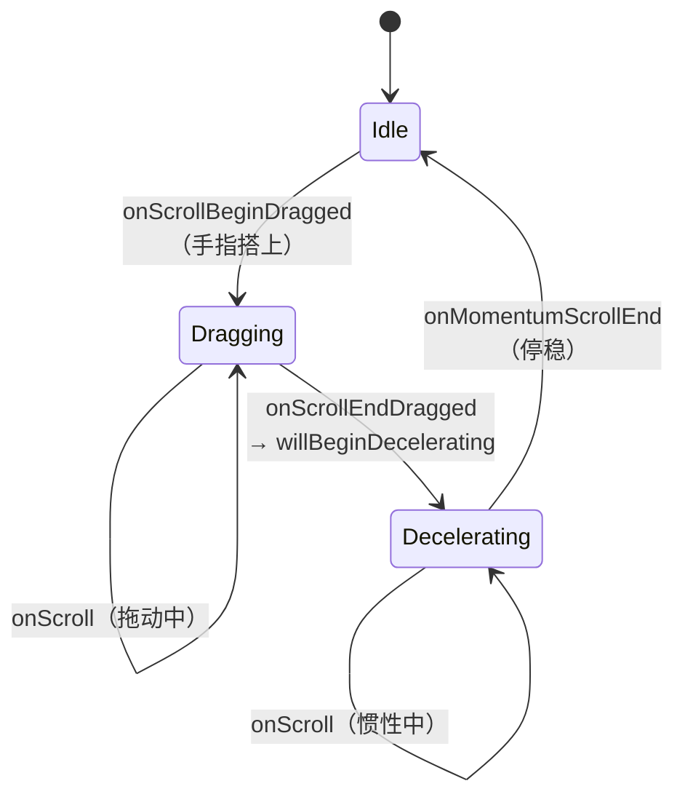
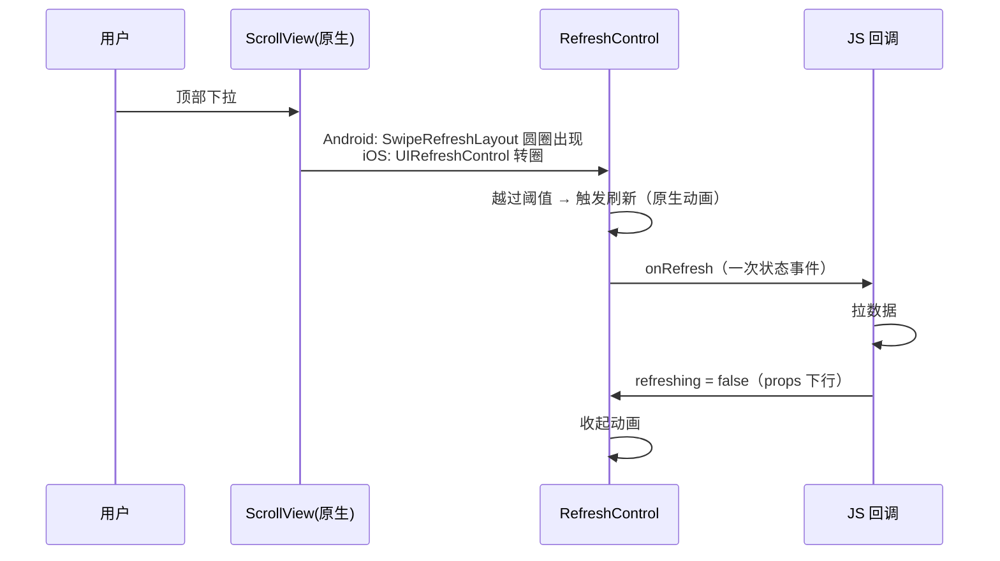

# 滚动与列表事件

> 滚动是 RN 里最高频的事件源：每帧都在产生偏移量。本篇拆三件事：`onScroll` 的产生与节流（`scrollEventThrottle` 的真实含义）、嵌套滚动的平台协商差异、以及下拉刷新这条完整链路。列表的**渲染**侧（虚拟化）在模块九，本篇只管"事件"。

## 1. onScroll 的产生与节流

### 1.1 iOS：scrollEventThrottle 决定"每秒最多几次"

iOS 的滚动回调来自 `UIScrollViewDelegate`，天然每帧可用。RN 的 `RCTScrollView` 用 `scrollEventThrottle` 控制下发频率：

```jsx
<ScrollView scrollEventThrottle={16}> 
```

- 单位是 **毫秒间隔**，16 ≈ 每帧一次（60fps）；设 0/不设则**只在关键节点**（开始、结束、减速结束等）发事件，连续滚动中间段"哑火"——想要 sticky 头、滚动视差就必须设它；
- 它是**上限节流**：设备忙时可能更稀，不是保证值；
- 设成 1（每帧必发）的代价：每帧一条事件过桥（旧架构）→ 若 handler 里再 setState，就是模块四 03 的洪泛闭环。新架构下事件走 JSI 直调，成本降但 JS 线程仍被占用。

### 1.2 Android：每帧回调 + 事件合并

Android 的 `onScrollChanged` 本身每帧触发，RN 侧做**事件合并（coalescing）**——中间值可丢弃，只保留最新偏移。这也是通用事件优化思路：**滚动回调只关心"现在到哪了"，历史值无意义，可安全合并**。

| 平台 | 事件源 | 节流机制 | 默认行为 |
|------|--------|---------|---------|
| iOS | UIScrollViewDelegate | scrollEventThrottle（JS 侧设定） | 不设 = 只发关键节点 |
| Android | onScrollChanged | 系统每帧 + coalescing | 每帧一次（合并后） |

## 2. 滚动事件的阶段模型

`onScroll` 之外，ScrollView 还提供一组**阶段事件**，对应原生滚动状态机：



工程含义：

- **吸顶/吸底**用 `onScroll`（连续量）；**翻页加载**用 `onMomentumScrollEnd`（用户意图结束）而不是滚动中就触发；
- 拖拽 vs 惯性是两个物理阶段，原生侧来源不同（触摸 vs 动量），阶段事件正是把它们区分开的接口；
- 02 篇的 RNGH 与 ScrollView 的手势协商发生在 `Dragging` 之前——手指搭上的瞬间，原生已决定"这轮归谁"。

## 3. 嵌套滚动：两个平台两套协议

"横向列表套纵向列表""底部 Tab 手势接管滚动"是嵌套滚动的典型场景：

### Android：NestedScrolling 协议（显式协商）

Android 有正式的父子协商协议（`NestedScrollingParent/Child`）：

- 子ScrollView 每步滚动前先问父级"要消费多少"（`onNestedPreScroll`），父级吃掉一部分（如吸顶）后剩余归子；
- 到边界后还有 `onNestedFling` 决定动量归属；
- RN 的 `nestedScrollEnabled`（Android）就是把子 ScrollView 接入这套协议的开关。

### iOS：没有协议，靠约定与手势仲裁

iOS 无官方嵌套协议，通常靠：

- `simultaneousRecognition`（UIGestureRecognizer 并行识别）；
- delegate 层手写协商（外层在特定偏移前 `canCancelContentTouches` 抢占）；
- 或干脆用 RNGH 在原生仲裁场里声明关系（02 篇）——这也是 RNGH 在 iOS 嵌套场景地位高的原因：**它把无协议平台的协商显式化了**。

| | Android | iOS |
|--|---------|-----|
| 协商方式 | NestedScrolling 协议（系统级） | 手势仲裁 + delegate 约定 |
| RN 侧入口 | `nestedScrollEnabled` | RNGH / 自定义处理 |
- 同一需求两端实现路径不同，写跨端组件时要**按平台分支设计**（模块五 04 的文件层分支）。

## 4. 下拉刷新：RefreshControl 的完整链路



三个细节：

1. **转圈动画完全原生**，等待期间没有一次跨边界通信——正确的下拉刷新不会因 JS 忙而卡住动画（若 `refreshing` 状态也放 JS 频繁切换则另说）；
2. `onRefresh` 是**一次性事件**，与连续的 onScroll 形成对照：低频语义事件适合过桥，高频连续量适合原生消费——模块六反复出现的分界线；
3. `refreshControl` 的位置由 ScrollView 原生布局决定，不受 JS 布局系统影响（RefreshControl 是 ScrollView 的原生附属，不是 JS 树的普通子节点）。

## 5. 把本篇接回全站

- 事件频率分界：**连续量（onScroll）原生消费/节流，语义事件（onRefresh/阶段事件）过桥给 JS**——模块四 03 闭环模型的"剪环"实践；
- 嵌套滚动的平台差异是"平台分支设计"的标准案例（模块五 04）；
- 滚动事件驱动列表虚拟化窗口计算（模块九 02）——onScroll 的节流参数直接影响虚拟化的响应灵敏度。

## 小结

- `scrollEventThrottle` 是 iOS 的**上限节流**（毫秒间隔），不设则中间段无事件；Android 侧系统每帧 + 合并；
- 阶段事件（beginDrag/endDrag/momentumEnd）映射原生滚动状态机，选对事件比在 onScroll 里猜状态可靠；
- 嵌套滚动：Android 有 NestedScrolling 协议，iOS 靠手势仲裁与约定，跨端组件需按平台分支设计；
- 下拉刷新是"原生动画 + 一次性 JS 事件"的教科书案例：高频视觉留在原生，低频语义才跨界。
