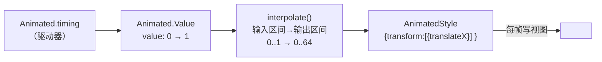
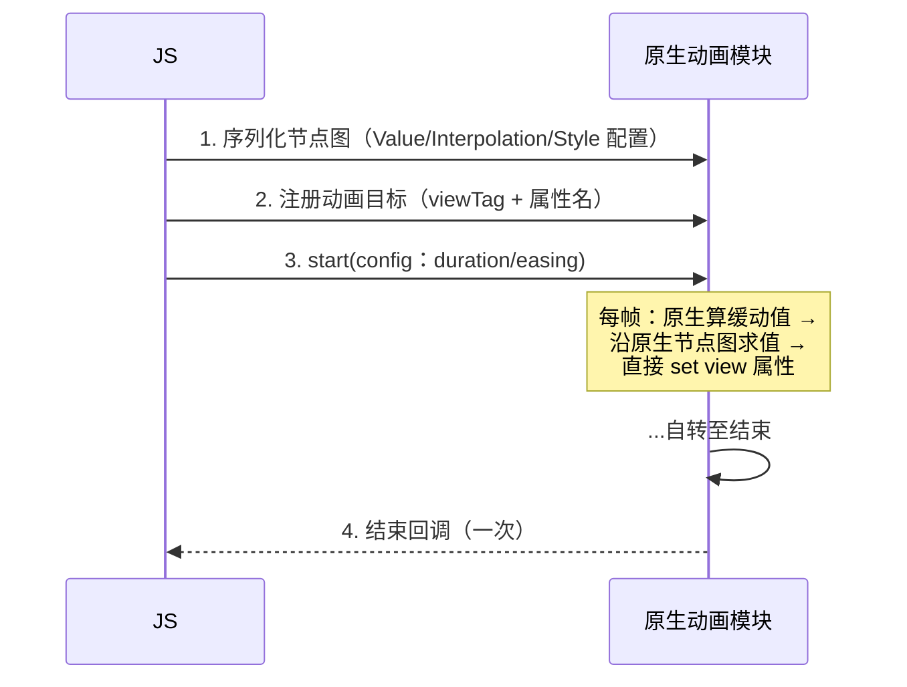
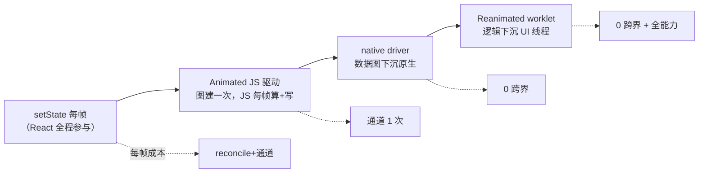

# 动画系统原理

> 动画 = **每帧都在发生的通信与渲染**，所以它是检验架构的试金石：同一个转场动画，写法不同会走完全不同的链路。本篇把 Animated 的节点图、`useNativeDriver` 的下沉机制、Reanimated 的 worklet 三层讲透——它们恰好是"模块三/四/六"知识的交汇处。

## 1. Animated 的核心：一张"值节点图"

Animated 不是让 setState 每帧跑一遍，而是先在 JS 里建一张**有向无环的值图**，动画只是驱动图的源头：



要点：

1. **图只建一次**，动画期间不再走 reconcile——props 不再由 React 每帧下发，这就是 Animated 与 `setState(每帧)` 的本质区别；
2. `Value + interpolate + 各种运算节点`都是图上的节点（`AnimatedAddition`、`AnimatedMultiplication`…），源码在 `Libraries/Animated/nodes/`；
3. `<Animated.View style={animatedStyle}>` 里的 style 不是普通对象，是图的"出口"。

## 2. 三种驱动器，三条链路

| 驱动方式 | 谁算每帧的值 | 值怎么写到视图 | 每帧跨边界次数 |
|---------|-------------|---------------|---------------|
| JS 驱动（默认） | JS 线程（rAF 节拍） | 旧架构 `setNativeProps` 直写 / 新架构同步视图更新 | 1 次（写视图） |
| `useNativeDriver: true` | **原生线程**（原生帧回调） | 原生直改 view 属性 | **0 次** |
| `Animated.event` + native driver | 原生事件直接喂原生节点图 | 同上 | 0 次 |

### 2.1 JS 驱动的账

rAF 每帧回调 → 缓动函数算值 → 沿图求值 → 终点节点写视图。绕开了 React，但**每帧都要 JS 线程活着**：一旦 JS 被 setState 风暴/长任务占住，动画立刻冻结（模块三 02"JS 线程是大脑"的直接体现）。旧架构下写视图还要过桥，双倍恶化（模块四 03）。

### 2.2 native driver：把整张图搬到原生

`useNativeDriver: true` 时启动前发生一次"搬家"：



为什么**只支持 transform / opacity**？因为原生侧写的是 view 属性——`transform/opacity` 不触发布局（GPU 合成即可），而 `width/height` 类属性每次写入都要重新布局。**约束不是 API 任性，是"绕过布局系统"这条路径的物理边界**。同理 `flexDirection` 这类布局属性永远不可原生驱动。

`Animated.event`（把 onScroll/gesture 值绑到 Value）配 native driver 后，事件在原生侧直接进节点图——连"事件下行"都省了，这就是模块六 02 之前 RNGH 时代的标准优化组合。

## 3. Reanimated：通道降级的终点形态

Reanimated 把"图搬家"升级成"**代码搬家**"：

```jsx
const x = useSharedValue(0);
const style = useAnimatedStyle(() => ({
  transform: [{ translateX: x.value }], // ← 这个函数整体跑在 UI 线程
}));
```

机制三件事（源码 `react-native-reanimated`）：

1. **worklet 化**：Babel 插件在构建期把标注的函数转成"可序列化函数"（代码字符串 + 闭包捕获表），运行时经 JSI 注册到原生，**在 UI 线程原生执行**（模块七 01 JSI 的上层应用）；
2. **SharedValue 是原生内存**：`.value` 读写直达 C++ `MutableValue` 对象（引用而非拷贝，模块四 04 的终点），任意线程写、UI 线程监听者被通知；
3. **写视图不经 React**：`useAnimatedStyle` 的求值结果由原生直接 updateProps 到 view——React 只在挂载时参与一次。

于是"手势 → 变换"完全闭环在 UI 线程（与模块六 02 的 RNGH 协作），JS 线程再忙也不影响 60fps。**Animated 的 native driver 是"数据图下沉"，Reanimated 是"逻辑下沉"**——后者因此没有"只支持 transform/opacity"的硬约束（布局类属性同样可写，只是要付布局成本）。

## 4. 选型谱系：一条线串起所有方案



选型口径：

- **状态动画**（值参与业务逻辑、频率低）：setState + 并发特性足够，别上重武器；
- **入场/退场/指示器**（transform/opacity、无手势）：Animated + `useNativeDriver: true`，一行配置收益最大；
- **手势跟手/复杂变换/布局动画**：Reanimated（配合 RNGH），这是当前官方基线。

## 5. 常见坑的原理答案

1. **`useNativeDriver` 报"不支持该属性"**：命中 2.2 的布局属性边界——换 Reanimated 或改用 transform 表达（如用 `scale` 替代 `width`）；
2. **JS 驱动动画"间歇性冻结"**：JS 线程被占（Profiler 看 JS 帧占用，模块九 01）——换 native driver 或清理 JS 长任务；
3. **native driver 动画结束回调延迟**：回调要跨线程回 JS，忙时排队——收尾逻辑别依赖精确时序；
4. **Reanimated 里误用非 worklet 依赖**：闭包捕获的是注册时的快照，跨线程读 JS 状态要用 SharedValue——报错信息里的 "worklet" 提示就是指这个。

## 小结

- Animated 的本质是**值节点图**：建图一次，动画只是驱动源，全程绕开 reconcile；
- 三种驱动的差异 = 每帧跨边界次数（JS 驱动 1 次、native driver 0 次、event+native 连事件都不过线）；transform/opacity 的限制是"绕过布局"路径的物理边界；
- Reanimated = worklet（逻辑下沉）+ SharedValue（引用共享）+ 直写 props，是模块四 04"通道降级"的终点形态；
- 选型按"状态动画 → native driver → Reanimated"升级，按业务逻辑参与度决定停在哪一级。
