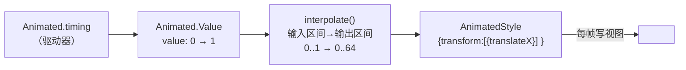
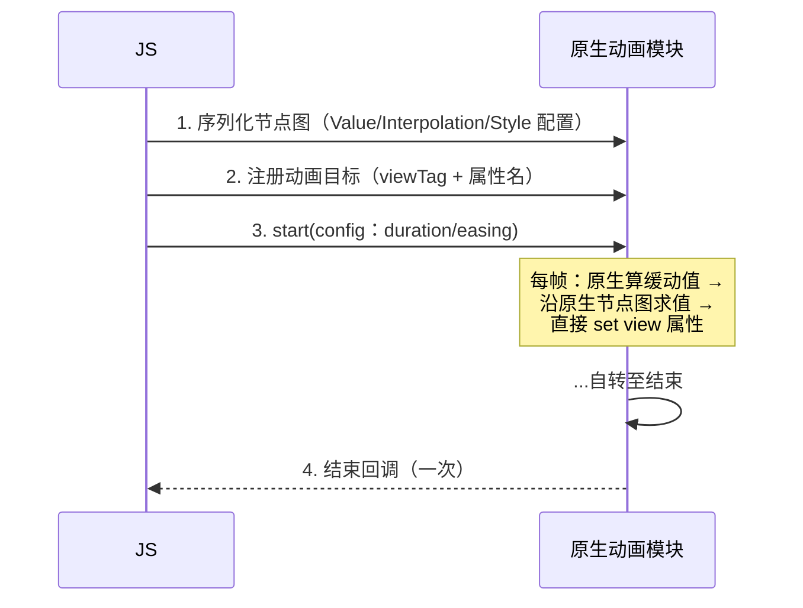
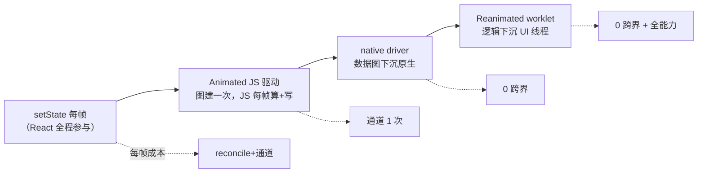

# 动画系统原理

> 动画 = **每帧都在发生的通信与渲染**，所以它是检验架构的试金石：同一个转场动画，写法不同会走完全不同的链路。本篇把 Animated 的节点图、`useNativeDriver` 的下沉机制、Reanimated 的 worklet 三层讲透——它们恰好是"模块三/四/六"知识的交汇处。

## 1. Animated 的核心：一张"值节点图"

Animated 不是让 setState 每帧跑一遍，而是先在 JS 里建一张**有向无环的值图**，动画只是驱动图的源头：



要点：

1. **图只建一次**，动画期间不再走 reconcile——props 不再由 React 每帧下发，这就是 Animated 与 `setState(每帧)` 的本质区别；
   （对照：setState 路线每帧要付 render + reconcile + 提交三段，且全在 JS）
2. `Value + interpolate + 各种运算节点`都是图上的节点（`AnimatedAddition`、`AnimatedMultiplication`…），源码在 `Libraries/Animated/nodes/`；
3. `<Animated.View style={animatedStyle}>` 里的 style 不是普通对象，是图的"出口"。

### 1.1 节点家族：图上都有谁

`Libraries/Animated/nodes/` 下的节点按职责分四类：

| 类别 | 节点 | 职责 |
|------|------|------|
| 源头 | `AnimatedValue` / `AnimatedValueXY` | 持有当前数值，被驱动器或事件写入 |
| 运算 | `AnimatedAddition` / `Subtraction` / `Multiplication` / `Division` / `Modulo` / `DiffClamp` | 两个节点做算术，输出仍是节点 |
| 映射 | `AnimatedInterpolation` | 区间映射（数值→数值/颜色/角度字符串） |
| 出口 | `AnimatedStyle` / `AnimatedTransform` / `AnimatedProps` | 把节点值装配成视图属性，挂到具体组件 |

驱动器（不是节点，是"往源头写值的人"）另有三种：

| 驱动器 | 值随时间的规律 | 关键参数 |
|--------|---------------|---------|
| `Animated.timing` | 缓动曲线 | `duration`、`easing`、`delay` |
| `Animated.spring` | 弹簧物理模型 | 刚度/阻尼/质量，或 bounciness/speed 组合 |
| `Animated.decay` | 初速度按系数衰减 | `velocity`、`deceleration` |

组合器（`parallel` / `sequence` / `stagger` / `delay` / `loop`）只编排**驱动器的启停时序**，不产生新节点——它们是"指挥"，不是"乐手"。

### 1.2 一次求值的传播：从源头到出口

值变化时，图按依赖方向传播（简化自 `AnimatedValue` 的更新逻辑）：

```js
// Libraries/Animated/nodes/AnimatedValue.js（简化）
_updateValue(value, flush) {
  this._value = value;
  if (flush) {
    _flush(this);            // 沿子节点向下找到所有 AnimatedProps（出口）
  }
  this.__callListeners(value); // addListener 注册的 JS 监听在此触发
}

function _flush(rootNode) {
  const leaves = new Set();
  findAnimatedStyles(rootNode, leaves);   // DFS 收集受影响的出口节点
  leaves.forEach((leaf) => leaf.update()); // 每个出口重新取值并写视图
}
```

三个可以直接读出来的结论：

- **只更新受影响的出口**：改一个 Value，只有依赖它的组件被写——没有"整树重渲染"；
- **中间节点不存值**：interpolate/加减节点在出口取值时**现算**（pull 模型），所以图再深也只是函数调用链；
- **`addListener` 是旁路**：它让 JS 看得到每帧的值，但也意味着每帧回 JS——native driver 下它会迫使原生每帧往 JS 发事件（2.2 节的隐藏成本）。

## 2. 三种驱动器，三条链路

| 驱动方式 | 谁算每帧的值 | 值怎么写到视图 | 每帧跨边界次数 |
|---------|-------------|---------------|---------------|
| JS 驱动（默认） | JS 线程（rAF 节拍） | 旧架构 `setNativeProps` 直写 / 新架构同步视图更新 | 1 次（写视图） |
| `useNativeDriver: true` | **原生线程**（原生帧回调） | 原生直改 view 属性 | **0 次** |
| `Animated.event` + native driver | 原生事件直接喂原生节点图 | 同上 | 0 次 |

### 2.1 JS 驱动的账

rAF 每帧回调 → 缓动函数算值 → 沿图求值 → 终点节点写视图。绕开了 React，但**每帧都要 JS 线程活着**：一旦 JS 被 setState 风暴/长任务占住，动画立刻冻结（模块三 02"JS 线程是大脑"的直接体现）。旧架构下写视图还要过桥，双倍恶化（模块四 03）。

JS 驱动的每帧流水（一帧之内）：

| 步 | 线程 | 动作 |
|----|------|------|
| 1 | JS | `requestAnimationFrame` 回调触发 |
| 2 | JS | 驱动器按已过时间算新值（缓动/弹簧积分） |
| 3 | JS | `_updateValue` → 沿图找到出口 |
| 4 | JS → 原生 | 出口节点把新属性写给视图（跨边界 1 次） |
| 5 | UI | 原生应用属性，等下一次屏幕刷新 |

第 1~3 步任何一步被抢占，这一帧就丢。所以"JS 驱动动画卡"的排查永远先看 JS 线程在忙什么，而不是先调动画参数。

### 2.2 native driver：把整张图搬到原生

`useNativeDriver: true` 时启动前发生一次"搬家"：



"搬家"对应的 JS → 原生调用序列（`NativeAnimatedHelper` 封装，简化）：

```js
// Libraries/Animated/NativeAnimatedHelper.js 的调用形态（简化）
API.createAnimatedNode(valueTag, { type: 'value', value: 0, offset: 0 });
API.createAnimatedNode(interpTag, { type: 'interpolation', inputRange: [0, 1], outputRange: [0, 64] });
API.connectAnimatedNodes(valueTag, interpTag);        // 建边：父 → 子
API.createAnimatedNode(styleTag, { type: 'style', style: { translateX: interpTag } });
API.createAnimatedNode(propsTag, { type: 'props', props: { style: styleTag } });
API.connectAnimatedNodeToView(propsTag, viewTag);     // 出口绑到具体原生视图
API.startAnimatingNode(animId, valueTag, { type: 'frames', frames, toValue: 1 }, endCallback);
```

原生侧收到后，在自己的节点管理器里**重建一张同构的图**，并由原生帧回调驱动（Android 侧简化示意）：

```java
// ReactAndroid/.../animated/NativeAnimatedNodesManager.java（简化）
public void runUpdates(long frameTimeNanos) {
  // ① 每个活跃的驱动器按帧时间推进，写入它的 ValueAnimatedNode
  for (AnimationDriver driver : mActiveAnimations) {
    driver.runAnimationStep(frameTimeNanos);
  }
  // ② 从被更新的节点出发做拓扑遍历，逐个 update()
  updateNodes(mUpdatedNodes);
  // ③ PropsAnimatedNode 把结果直接写到原生 View —— 不经 JS、不经 React
}
```

对照 1.2 节的 JS 版：**同一个算法，换了一个线程跑**。这就是"数据图下沉"的全部含义——配置一次性序列化过去，此后 JS 线程是否卡顿与动画无关。

为什么**只支持 transform / opacity**？因为原生侧写的是 view 属性——`transform/opacity` 不触发布局（GPU 合成即可），而 `width/height` 类属性每次写入都要重新布局。**约束不是 API 任性，是"绕过布局系统"这条路径的物理边界**。同理 `flexDirection` 这类布局属性永远不可原生驱动。

`Animated.event`（把 onScroll/gesture 值绑到 Value）配 native driver 后，事件在原生侧直接进节点图——连"事件下行"都省了，这就是模块六 02 之前 RNGH 时代的标准优化组合。

### 2.3 native driver 的边界清单

"图在原生"带来的约束不止属性白名单一条：

| 约束 | 原因 |
|------|------|
| 只能驱动非布局属性（transform/opacity 等） | 原生直写 view 属性，绕过了布局系统 |
| 同一个 Value 不能混用两种驱动 | 一张图只能住在一边：一旦 native 化，JS 侧不再持有真实值 |
| `value.__getValue()` / 同步读值不可靠 | 真值在原生，JS 侧是过期快照；要读用 `addListener` 或结束回调 |
| `addListener` 有成本 | 原生需每帧回发事件给 JS，抵消了部分收益 |
| `Animated.event` 的 `listener` 回调同理 | 可用，但它是"每帧回 JS"的旁路，别在里面 setState |
| 结束回调时序不精确 | 完成通知跨线程回 JS，JS 忙则排队 |

"混用驱动"是最常见的运行时报错来源：同一个 `Animated.Value` 先用 `useNativeDriver: true` 跑过，再拿去驱动 `height`（必须 JS 驱动），就会被拒绝——**解法是拆成两个 Value**，各走各的图。

### 2.4 动画与交互调度：InteractionManager

Animated 的驱动器默认会登记一个"交互句柄"，`InteractionManager.runAfterInteractions(fn)` 排的任务会等所有句柄释放后才执行：

```js
Animated.timing(v, { toValue: 1, duration: 300, useNativeDriver: true, isInteraction: true }).start();
InteractionManager.runAfterInteractions(() => {
  loadHeavyData(); // 转场动画结束后才跑，避免与动画抢 JS 线程
});
```

- 这是 JS 驱动时代的"让路"协议：重任务主动避开动画窗口；
- 循环动画（loading 转圈）要设 `isInteraction: false`，否则句柄永不释放，后面排队的任务全部饿死；
- native driver 下动画本身不怕 JS 忙，但这个协议对**同屏的其他 JS 驱动逻辑**仍有意义。

### 2.5 Animated.event：事件直接进图

`Animated.event` 的参数是一个"取值路径模板"，告诉原生从事件 payload 的哪个字段取数、写进哪个 Value：

```jsx
const y = useRef(new Animated.Value(0)).current;
const onScroll = Animated.event(
  [{ nativeEvent: { contentOffset: { y } } }],   // 路径：event.nativeEvent.contentOffset.y → y
  { useNativeDriver: true }
);
<Animated.ScrollView onScroll={onScroll} scrollEventThrottle={16} />
```

开了 native driver 后，这份路径模板也被发到原生：滚动事件产生时，原生直接按路径取值写入节点图，**事件根本不到 JS**。所以它的回调位置不能放任意函数——能下沉的只有"取字段"这种可序列化的描述；要跑任意逻辑，就是 Reanimated 的活了。

## 3. Reanimated：通道降级的终点形态

Reanimated 把"图搬家"升级成"**代码搬家**"：

```jsx
const x = useSharedValue(0);
const style = useAnimatedStyle(() => ({
  transform: [{ translateX: x.value }], // ← 这个函数整体跑在 UI 线程
}));
```

机制三件事（源码 `react-native-reanimated`）：

1. **worklet 化**：Babel 插件在构建期把标注的函数转成"可序列化函数"（代码字符串 + 闭包捕获表），运行时经 JSI 注册到原生，**在 UI 线程原生执行**（模块七 01 JSI 的上层应用）；
2. **SharedValue 是原生内存**：`.value` 读写直达 C++ `MutableValue` 对象（引用而非拷贝，模块四 04 的终点），任意线程写、UI 线程监听者被通知；
3. **写视图不经 React**：`useAnimatedStyle` 的求值结果由原生直接 updateProps 到 view——React 只在挂载时参与一次。

于是"手势 → 变换"完全闭环在 UI 线程（与模块六 02 的 RNGH 协作），JS 线程再忙也不影响 60fps。**Animated 的 native driver 是"数据图下沉"，Reanimated 是"逻辑下沉"**——后者因此没有"只支持 transform/opacity"的硬约束（布局类属性同样可写，只是要付布局成本）。

再强调一次"独立运行时"的含义：Reanimated 在 UI 线程维护的是一个**只装 worklet 的迷你 JS 环境**，不是把整个 App 的 JS 搬过去。它看不到 React 组件树、拿不到普通闭包之外的东西——所有"活的状态"必须经 SharedValue 这扇门进出。这个"贫瘠"恰是它快的原因：没有 GC 大堆、没有 reconcile、没有排队。

### 3.1 worklet 化：构建期到底改了什么

Babel 插件把带 `'worklet'` 标记（或被 Reanimated hooks 包裹）的函数改写成"函数 + 元数据"（概念示意）：

```js
// 源码
const style = useAnimatedStyle(() => ({ opacity: progress.value * maxOpacity }));

// 插件改写后的概念形态（示意，非逐字产物）
const _f = function () { return { opacity: progress.value * maxOpacity }; };
_f.__closure = { progress, maxOpacity };   // 闭包捕获表：这些值会被搬到 UI 运行时
_f.__workletHash = /* 代码哈希 */;
_f.__initData = { code: "function(){...}" }; // 函数体字符串：UI 运行时据此重建函数
```

于是 UI 线程上那个独立的 JS 运行时可以**按字符串重建函数、按捕获表重建闭包**。这解释了三条使用规则：

- 闭包里的普通值是**拷贝**（创建时刻的快照）——改了 React state 不会自动同步过去；
- 闭包里的 SharedValue 是**引用**——两边读写的是同一块原生内存；
- worklet 里调用的函数也必须是 worklet（或用 `runOnJS` 回 JS 线程），否则 UI 运行时里根本没有这个函数。

### 3.2 线程穿梭：四个原语

| API | 方向 | 用途 |
|-----|------|------|
| `runOnUI(fn)(args)` | JS → UI | 从 JS 侧主动在 UI 线程执行一段 worklet |
| `runOnJS(fn)(args)` | UI → JS | worklet 里回调 JS（setState、埋点、导航） |
| `useDerivedValue(fn)` | UI 内部 | 由其它 SharedValue 派生新值（自动追踪依赖） |
| `useAnimatedReaction(prepare, react)` | UI 内部 | 监听值变化做副作用（阈值触发等） |

动画函数（`withTiming` / `withSpring` / `withDecay` / `withSequence` / `withRepeat`）不是"启动器"而是**值的描述**：`x.value = withSpring(100)` 的意思是"x 的值由一个弹簧过程给出"，每帧的推进在 UI 线程完成。

### 3.3 Animated 与 Reanimated 的逐项对照

| 维度 | Animated + native driver | Reanimated |
|------|--------------------------|-----------|
| 下沉的是什么 | 节点图配置（数据） | 函数代码（逻辑） |
| 表达力 | 预定义节点的组合 | 任意 JS 表达式（条件、循环、函数调用） |
| 可驱动属性 | 非布局属性 | 任意属性（布局属性需付布局成本） |
| 手势联动 | `Animated.event` 映射字段 | worklet 内任意逻辑（配合 RNGH，02 篇） |
| 读当前值 | 异步/监听 | UI 线程同步读 `.value` |
| 布局动画 | 需另用 `LayoutAnimation` | 内置 entering/exiting/layout 过渡 |
| 运行时成本 | 无额外运行时 | UI 线程上多一个 JS 运行时 |
| 构建要求 | 无 | 需要 Babel 插件 |

最后两行是 Reanimated 的"入场费"：多一个运行时、多一步构建改写。它换来的是表达力——所以选型口径才是"按需升级"，而不是"一律上 Reanimated"。

### 3.4 另一条支线：LayoutAnimation

布局类变化（列表项增删、尺寸突变）还有第三种老办法——`LayoutAnimation`：

```js
LayoutAnimation.configureNext(LayoutAnimation.Presets.easeInEaseOut);
setExpanded(!expanded); // 下一次布局提交时，原生对"新旧布局差"自动补间
```

它的定位与前两者正交：**不描述值怎么变，只声明"下一次布局变化请帮我补间"**。补间发生在原生挂载层（模块五 03 的提交阶段），JS 不参与每帧。局限是控制粒度粗（全局作用于下一次提交、难以中断/编排），所以复杂场景被 Reanimated 的布局过渡取代，但"展开/收起"这类一行代码的需求它仍然划算。

## 4. 选型谱系：一条线串起所有方案



选型口径：

- **状态动画**（值参与业务逻辑、频率低）：setState + 并发特性足够，别上重武器；
- **入场/退场/指示器**（transform/opacity、无手势）：Animated + `useNativeDriver: true`，一行配置收益最大；
- **手势跟手/复杂变换/布局动画**：Reanimated（配合 RNGH），这是当前官方基线。

### 4.1 选型速答

| 需求一句话 | 推荐 | 一句话理由 |
|-----------|------|-----------|
| 按钮开关态变色/透明度 | Animated + native driver | 一行配置，JS 零参与 |
| 转场指示器（循环转圈） | 同上 + `isInteraction: false` | 不挡 runAfterInteractions |
| 手势跟手拖拽 + 抬手惯性 | RNGH + Reanimated（02 篇） | 高频闭环必须原生闭环 |
| 列表项增删的位置过渡 | Reanimated 布局过渡 / LayoutAnimation | 布局变化由挂载层补间 |
| 数值要参与业务逻辑（进度条%驱动请求） | setState/状态动画 | 值需要进 React，别绕开 |
| 滚动驱动视差 | useAnimatedScrollHandler（03 篇） | 事件原生消费 |
| 动画结束要精确衔接下一个动作 | 结束回调 + 容忍时序抖动，或 Reanimated 延时编排 | 跨线程回调不保证精确时刻 |

把这张表倒过来读就是反模式清单：**用 setState 做手势（太重）、用 Animated JS 驱动做转场（太脆）、给纯视觉联动上业务状态（太绕）**——三种"错位"覆盖了日常大半动画问题。

## 5. 常见坑的原理答案

下面每一条都能回溯到前文的机制段落——坑不是玄学，是机制的边角：

1. **`useNativeDriver` 报"不支持该属性"**：命中 2.2 的布局属性边界——换 Reanimated 或改用 transform 表达（如用 `scale` 替代 `width`）；
2. **JS 驱动动画"间歇性冻结"**：JS 线程被占（Profiler 看 JS 帧占用，模块九 01）——换 native driver 或清理 JS 长任务；
3. **native driver 动画结束回调延迟**：回调要跨线程回 JS，忙时排队——收尾逻辑别依赖精确时序；
4. **Reanimated 里误用非 worklet 依赖**：闭包捕获的是注册时的快照，跨线程读 JS 状态要用 SharedValue——报错信息里的 "worklet" 提示就是指这个。

5. **同一个 Value 混用 native 与 JS 驱动报错**：一张图只能住一边（2.3 节）——拆成两个 Value；
6. **循环动画之后 `runAfterInteractions` 永不执行**：交互句柄没释放（2.4 节）——循环动画设 `isInteraction: false`；
7. **动画中读 `value` 得到旧数**：native driver 下真值在原生——用监听/结束回调，或换 Reanimated 在 UI 线程同步读；
8. **组件卸载后动画回调触发 setState 警告**：结束回调跨线程晚到——卸载时 `stopAnimation()` 并在回调里判活。

### 5.1 为什么"明明开了 native driver 还是卡"

这是最容易误判的一类问题，按下表逐项排除：

| 现象 | 真正的原因 | 验证方法 |
|------|-----------|---------|
| 动画启动瞬间卡一下 | 启动前 JS 在做重活（渲染新页面），"搬家"指令排在后面 | 看启动时刻 JS 线程占用；把重活挪到动画后 |
| 全程掉帧，JS 线程很闲 | 卡在 **UI 线程**：视图层级过深、离屏渲染、阴影/圆角/大图合成 | 用原生工具看 UI 线程与 GPU 耗时（模块九 05） |
| 掉帧且伴随布局 | 动画同时触发了布局（同屏有 JS 驱动的尺寸变化） | 排查是否有并行的 setState/布局属性动画 |
| 仅低端机卡 | 合成层过大、过度绘制 | 减小动画视图面积，必要时栅格化 |

要点：**native driver 只解决"JS 线程卡"这一种病**。动画的帧最终由 UI 线程和 GPU 交付——UI 线程自己忙（布局、绘制、合成），再怎么下沉也救不回来。先归因到线程（模块九 01），再选药。

## 6. 延伸阅读

- [02-GestureHandler原理化](02-GestureHandler原理化.md)：手势与 worklet 的协作，"手指 → 变换"闭环的另一半；
- [03-滚动与列表事件](03-滚动与列表事件.md)：滚动驱动动画的三种实现对照；
- [../rn-JS引擎与线程模型/02-四线程模型](../rn-JS引擎与线程模型/02-四线程模型.md)：动画帧在哪些线程之间交接；
- [../rn-Bridge通信原理/03-Bridge瓶颈量化](../rn-Bridge通信原理/03-Bridge瓶颈量化.md)：每帧过桥为什么是结构性成本；
- [../rn-新架构/01-JSI原理](../rn-新架构/01-JSI原理.md)：SharedValue 与 worklet 运行时的底座。

## 小结

- Animated 的本质是**值节点图**：建图一次，动画只是驱动源，全程绕开 reconcile；
- 三种驱动的差异 = 每帧跨边界次数（JS 驱动 1 次、native driver 0 次、event+native 连事件都不过线）；transform/opacity 的限制是"绕过布局"路径的物理边界；
- Reanimated = worklet（逻辑下沉）+ SharedValue（引用共享）+ 直写 props，是模块四 04"通道降级"的终点形态；
- 选型按"状态动画 → native driver → Reanimated"升级，按业务逻辑参与度决定停在哪一级。
- native driver 只治"JS 线程卡"；UI 线程自身的布局/绘制/合成压力要用原生工具另行归因。

## 自测

1. Animated 的节点图里，中间节点（interpolate、加减）存不存值？出口节点取值时发生了什么？
2. `useNativeDriver: true` 启动前，JS 向原生发送了哪几类指令？动画过程中每帧跨边界几次？
3. native driver 为什么不能驱动 `width`？同一个 `Animated.Value` 为什么不能既驱动 `opacity`（native）又驱动 `height`（JS）？
4. worklet 闭包中的普通变量与 SharedValue 在跨线程时分别是什么语义（拷贝/引用）？由此会导致什么典型 bug？
5. `x.value = withSpring(100)` 这行代码执行后，弹簧的每帧推进发生在哪个线程？JS 线程此时卡住会影响它吗？
6. 开了 native driver 动画仍掉帧，且 JS 线程空闲——下一步应该看哪个线程、怀疑哪些因素？
7. 循环 loading 动画为什么要设 `isInteraction: false`？不设会饿死谁？
