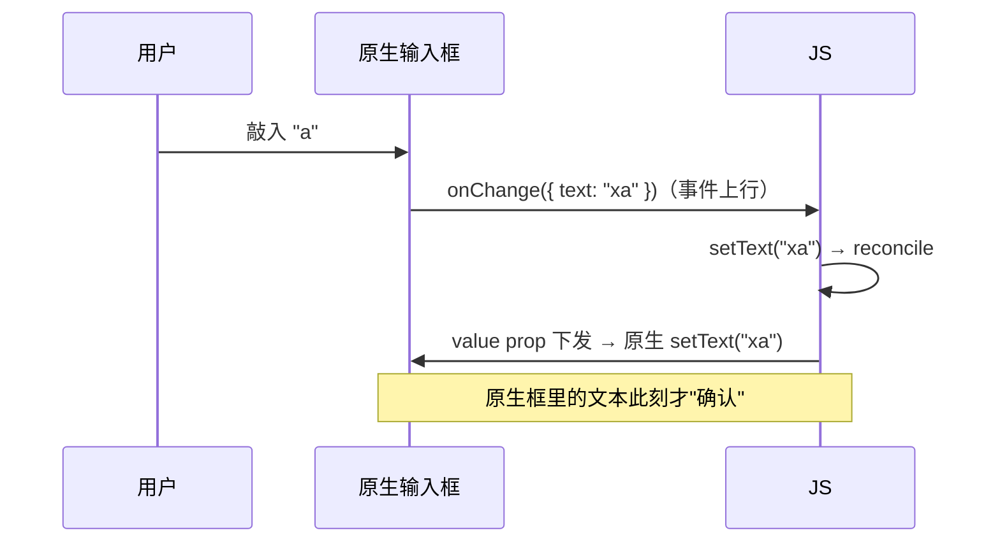

# 键盘与 TextInput 链路

> TextInput 是 RN 里**双向数据流最重的组件**：每击一次键，都走一遍"原生 → JS → 原生"的往返。它也是 State 通道（模块十 03）的教科书案例。本篇拆受控组件的代价、IME 组合态、键盘事件与避让链路——打字卡顿的归因从此有据可查。

## 1. 受控组件：一次击键的完整往返

受控（`value + onChangeText`）的语义：**React state 是唯一事实源，原生只是显示终端**。代价也随之而来：

1. **每击键一次完整往返**：事件上行 + props 下行，双通道都过（模块四 03 的闭环模型最小实例）；
2. **延迟 = 往返耗时**：JS 线程忙时，上行事件排队，表现为"打字跟不上手"；
3. 竞态窗口：往返期间用户又敲了下一个字符——原生先显示（乐观），JS 确认后可能"回跳"。

**非受控**（`defaultValue` + blur 时取值）把往返从"每击键"降到"每次提交"，是表单类输入的标准降负手段；代价是失去实时校验/联动。

## 2. State 通道：为什么原生还留一份"自己的文本"

模块十 03 讲过 State 的定义——**事实源在原生的上行状态**。TextInput 是最大用户：影子树上挂着一个 `MostRecentEventCount` 与原生文本状态，用于：

1. **乱序丢弃**：每次 onChange 带事件序号，setState 下发的 `value` 携带"我确认到第几号"——序号落后的更新被原生忽略，防止旧值覆盖新输入（这就是受控竞态的官方缓解机制）；
2. **IME 组合态**：中文/日文输入时，拼音候选阶段原生处于"组合态（marked text）"，这段文本**不当作最终输入**——受控 value 若在组合期间强制下发，会把拼音拆散（打中文被"劈开"的经典 bug 多源于此）。原生 State 保存组合态，正是为了让 JS 的 value 只作用于已确认文本。

> 原则：**组合态归原生，已确认文本才归 React**——跨这条线强同步，IME 必出问题。

## 3. 键盘事件：Keyboard 模块的链路

键盘的显示/隐藏是**窗口级事件**，与输入框解耦：

| 事件 | iOS | Android |
|------|-----|---------|
| `keyboardWillShow` | ✓（交互前，可做跟手动画） | ✗（无对应系统信号） |
| `keyboardDidShow` | ✓ | ✓（`layout` 后） |
| `Will/DidHide`、`frameChange` | ✓ / ✓ | 部分（只有 Hide/Show） |

- iOS 有"will"阶段：键盘视图动画开始前发事件，事件带 `endCoordinates`（目标 frame）与 `duration/easing`——**跟手避让动画只有在 will 事件上才做得出来**；
- Android 只有 did：软键盘是 window 尺寸变化，通常交给系统 `windowSoftInputMode` 处理（见下节）；
- 事件里带 `target`（触发的输入框 tag），多输入框场景据此区分。

## 4. 键盘避让：两条平台路线

### Android：系统级 `adjustResize` / `adjustPan`

Android 的经典做法是清单级配置：`adjustResize` 让**整个 window 被压短**，RN 的 `useWindowDimensions()` 随之变化，布局系统自然"抬升"——避让免费获得，代价是整页重布局。新版本还支持 `WindowInsetsAnimationCallback` 的逐帧联动（原生层能力）。

### iOS：自己补 —— KeyboardAvoidingView

iOS window 不自动压缩，于是有了 `KeyboardAvoidingView`：监听 `keyboardWillShow`，用事件的 `endCoordinates + duration/easing` 对自己做一个**同参数的位移动画**（`behavior: padding/height/position` 三种补偿方式）。理解它之后，那些"跳一下才对齐"的 bug 都能归因：用了 `DidShow`（动画参数丢失→瞬跳）、没算 `keyboardVerticalOffset`（导航栏高度）、或 ScrollView 嵌套时同时被内容 inset 抬了两次。

| | Android | iOS |
|--|---------|-----|
| 首选 | `adjustResize`（系统） | KeyboardAvoidingView / 自监听 will 事件 |
| 动画参数 | 系统 inset 动画 | 事件自带 duration/easing |
| 常见坑 | 全屏主题下 resize 失效 | offset 没配 / 与 SafeArea 叠加 |

## 5. 打字卡顿：归因 checklist

输入卡顿 = 击键往返链路上任何一段变慢，按序排查：

1. **JS 线程占用**（最常见）：每击键都触发 reconcile，若输入框 state 放在页面级（模块九 03 法则一），每键重渲染整页——先局部化 state，再 Profiler 看 commit 耗时；
2. **每击键的重逻辑**：onChangeText 里做联想请求/大计算——防抖或移到 `useDeferredValue`/`useTransition`（Fabric 并发，模块九 03）；
3. **受控往返本身的延迟**：低端机 + 旧架构时，考虑非受控化（defaultValue + onSubmitEditing/blur 提交）；
4. **IME 组合态被强同步破坏**：检查是否有代码在组合期间用 value 重写下发（第 2 节）；
5. **键盘遮挡导致每键触发布局**：避让动画改用 transform 而非 height（模块六 04 的布局属性代价）。

## 6. 把本篇接回全站

- 往返链路 = 模块四 03 闭环模型的每日实练场；序号/State 机制 = 模块十 03"三通道"中 State 的真实工业实现；
- 键盘事件的 will/did 之分、平台避让差异，都是"平台分支设计"的标准案例（模块五 04）；
- 卡顿归因全部落回模块九的方法论：先定位线程与通道，再动手。

## 小结

- 受控 TextInput = 每击键一次"事件上行 + props 下行"的完整往返，延迟结构决定手感；
- 原生 State 保存组合态与事件序号：**组合态归原生、确认文本归 React**，跨线强同步是 IME bug 之源；
- 键盘事件 iOS 有 will（带动画参数）、Android 只有 did——避让策略因此分岔：系统 adjustResize vs 自监听补偿；
- 打字卡顿排查顺序：JS 线程占用 → 每键重逻辑 → 受控往返 → IME 强同步 → 避让布局抖动。
