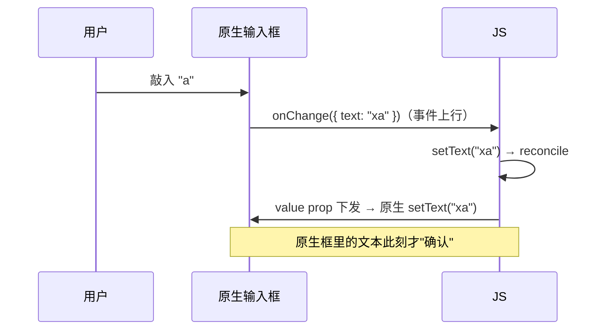
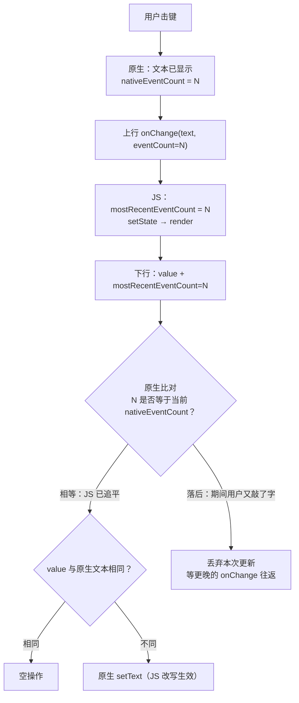
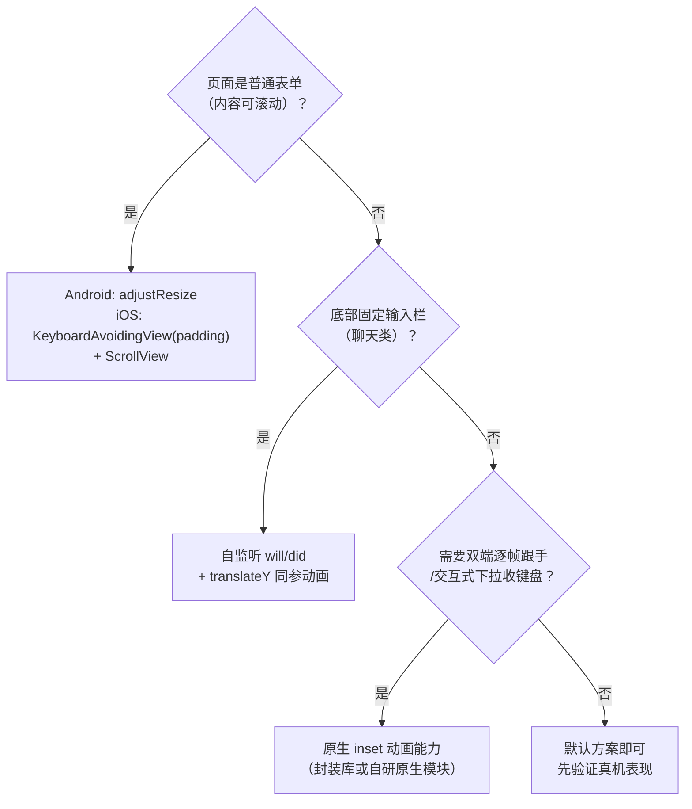

# 键盘与 TextInput 链路

> TextInput 是 RN 里**双向数据流最重的组件**：每击一次键，都走一遍"原生 → JS → 原生"的往返。它也是 State 通道（模块十 03）的教科书案例。本篇拆受控组件的代价、IME 组合态、键盘事件与避让链路——打字卡顿的归因从此有据可查。

## 1. 受控组件：一次击键的完整往返



受控（`value + onChangeText`）的语义：**React state 是唯一事实源，原生只是显示终端**。代价也随之而来：

1. **每击键一次完整往返**：事件上行 + props 下行，双通道都过（模块四 03 的闭环模型最小实例）；
2. **延迟 = 往返耗时**：JS 线程忙时，上行事件排队，表现为"打字跟不上手"；
3. 竞态窗口：往返期间用户又敲了下一个字符——原生先显示（乐观），JS 确认后可能"回跳"。

**非受控**（`defaultValue` + blur 时取值）把往返从"每击键"降到"每次提交"，是表单类输入的标准降负手段；代价是失去实时校验/联动。

### 1.1 逐步旅程表：一次击键经过的每一站

| 步 | 线程 | 发生地 | 做什么 |
|----|------|--------|--------|
| 1 | UI | 系统输入法 → 原生输入框 | 字符写入原生控件（`EditText` / `UITextField`），**屏幕立即显示** |
| 2 | UI | 原生文本监听器 | 捕获"文本变了"，本地事件计数器 +1 |
| 3 | UI → JS | 事件通道 | 发 `topChange`，载荷含 `text` 与 `eventCount` |
| 4 | JS | TextInput 组件 | 记下 `mostRecentEventCount`，调用 `onChange` / `onChangeText` |
| 5 | JS | 业务代码 | `setText(...)` → render → reconcile |
| 6 | JS → UI | props/命令通道 | 下发 `value` 与"我已确认到第 N 号事件" |
| 7 | UI | 原生输入框 | 比对序号：不落后且文本确有差异才 `setText`，否则忽略 |

读这张表要抓住一个反直觉的事实：**第 1 步屏幕就已经显示了字符**，后面 2~7 步是"事后对账"。受控的本质不是"JS 批准后才显示"，而是"原生先显示、JS 随后有权改写"。所以：

- JS 不改写（value 与原生一致）→ 第 7 步是空操作，用户无感；
- JS 改写（过滤/格式化）→ 第 7 步发生一次原生 `setText`，用户会看到字符"出现后被替换"——延迟越大，闪烁越明显。

### 1.2 原生侧的两段关键代码

Android：文本监听器负责上行，`maybeSetText` 负责下行时的序号校验（简化示意）：

```java
// ReactAndroid/.../views/textinput/ReactTextInputManager.java（简化）
private class ReactTextInputTextWatcher implements TextWatcher {
  @Override
  public void onTextChanged(CharSequence s, int start, int before, int count) {
    // 上行：带上自增的事件序号
    mEventDispatcher.dispatchEvent(
        new ReactTextChangedEvent(mEditText.getId(), s.toString(),
                                  mEditText.incrementAndGetEventCounter()));
  }
}

// ReactAndroid/.../views/textinput/ReactEditText.java（简化）
public void maybeSetText(ReactTextUpdate update) {
  // 下行：JS 确认的序号落后于原生当前序号 → 这是一次"过期更新"，丢弃
  if (update.getJsEventCounter() < mNativeEventCount) {
    return;
  }
  // 序号对得上，才真正改写输入框内容（并尽量保住光标位置）
  getText().replace(0, length(), update.getText());
}
```

iOS：同样的"计数 + 校验"结构（简化示意）：

```objc
// Libraries/Text/TextInput/RCTBaseTextInputView.mm（简化）
- (void)textInputDidChange {
  _nativeEventCount++;                       // 上行前自增
  if (_onChange) {
    _onChange(@{ @"text": self.attributedText.string,
                 @"eventCount": @(_nativeEventCount) });
  }
}

- (void)setAttributedText:(NSAttributedString *)attributedText {
  NSInteger eventLag = _nativeEventCount - _mostRecentEventCount;
  if (eventLag == 0 && ![attributedText isEqualToAttributedString:self.backedTextInputView.attributedText]) {
    self.backedTextInputView.attributedText = attributedText;   // 无滞后才写
  }
  // eventLag > 0：JS 的这次更新基于旧文本，忽略，等它追上来
}
```

两端代码放在一起看，结论很清楚：**序号机制是双平台同构的协议**，不是某一端的补丁（第 2 节展开其语义）。

### 1.3 受控与非受控：一张对照表

| 维度 | 受控（`value` + `onChangeText`） | 非受控（`defaultValue` + ref 取值） |
|------|-------------------------------|-----------------------------------|
| 事实源 | React state | 原生输入框 |
| 每击键的 JS 工作 | 事件处理 + setState + reconcile | 可以为零（不订阅 onChange 时） |
| 实时校验/格式化/联动 | 天然支持 | 需要额外订阅事件 |
| JS 忙时的手感 | 往返延迟可感知 | 不受影响（原生自己显示） |
| 程序化改值 | 改 state | `ref.current.setNativeProps({ text })` / `clear()` |
| 典型场景 | 搜索框、金额格式化、验证码 | 长表单、备注、聊天输入 |

```jsx
// 非受控：击键不进 React，提交时才取值
const ref = useRef(null);
const textRef = useRef('');
<TextInput
  ref={ref}
  defaultValue=""
  onChangeText={(t) => { textRef.current = t; }}   // 只写 ref，不触发渲染
  onSubmitEditing={() => submit(textRef.current)}
/>
```

折中做法是这段代码展示的"半受控"：仍订阅 `onChangeText`，但只写 ref 不 setState——保留了取值能力，去掉了每键重渲染。

## 2. State 通道：为什么原生还留一份"自己的文本"

模块十 03 讲过 State 的定义——**事实源在原生的上行状态**。TextInput 是最大用户：影子树上挂着一个 `MostRecentEventCount` 与原生文本状态，用于：

1. **乱序丢弃**：每次 onChange 带事件序号，setState 下发的 `value` 携带"我确认到第几号"——序号落后的更新被原生忽略，防止旧值覆盖新输入（这就是受控竞态的官方缓解机制）；
2. **IME 组合态**：中文/日文输入时，拼音候选阶段原生处于"组合态（marked text）"，这段文本**不当作最终输入**——受控 value 若在组合期间强制下发，会把拼音拆散（打中文被"劈开"的经典 bug 多源于此）。原生 State 保存组合态，正是为了让 JS 的 value 只作用于已确认文本。

> 原则：**组合态归原生，已确认文本才归 React**——跨这条线强同步，IME 必出问题。

### 2.1 序号对账的完整流程

把"乱序丢弃"画成判定流：



JS 侧配合的那一半（简化示意）：

```js
// Libraries/Components/TextInput/TextInput.js（简化）
const _onChange = (event) => {
  const text = event.nativeEvent.text;
  props.onChange?.(event);
  props.onChangeText?.(text);
  setLastNativeText(text);
  setMostRecentEventCount(event.nativeEvent.eventCount); // 记住"我看到第几号"
};

useLayoutEffect(() => {
  // 渲染后发现 value 与原生文本不一致 → 带着序号下发改写命令
  if (lastNativeText !== props.value && typeof props.value === 'string') {
    viewCommands.setTextAndSelection(inputRef.current, mostRecentEventCount, props.value, selStart, selEnd);
  }
}, [mostRecentEventCount, props.value, lastNativeText]);
```

这套机制保证的是**不乱序**，不保证**不延迟**：快速输入时"丢弃 → 等下一轮"会让 JS 的改写（如格式化）晚几拍才生效。所以重格式化逻辑（手机号分段、金额千分位）在慢设备上会出现"先原样显示、稍后跳成格式化结果"——这是协议的固有行为，不是 bug。

### 2.2 IME 组合态：两端的原生表示

| | iOS | Android |
|--|-----|---------|
| 组合态的表示 | `markedText`（带标记区间的临时文本） | composing span（带下划线的组合区间） |
| 确认时机 | 选词/空格后 `unmarkText` | `commitText` 替换组合区间 |
| 组合期间的 change 事件 | 会发（文本确实在变） | 会发 |
| 被外部 `setText` 打断的后果 | 标记区间丢失，候选栏关闭 | 组合区间被清，输入法状态重置 |

最后一行就是"打中文被劈开"的机理：组合期间每敲一个拼音字母都会上行 onChange，如果 JS 侧**改写了文本**（哪怕只是 trim、转大写、截断长度），下行的 `setText` 就会打断输入法的组合会话。

安全写法的三条规则：

1. **组合期间不改写**：格式化/过滤逻辑放到失焦（`onEndEditing`）或提交时做，或至少保证对组合中的文本是恒等变换；
2. **长度限制用 `maxLength` prop**，不要在 `onChangeText` 里 `slice`——前者由原生在确认文本上执行，后者会截断正在组合的拼音；
3. **别在 onChangeText 里做异步后回写**：异步结果回来时用户早已输入了更多内容，回写等于拿旧文本覆盖（即使序号机制挡住一部分，体验也已受损）。

### 2.3 TextInput 事件全家福

| 事件 | 触发 | 备注 |
|------|------|------|
| `onChange` / `onChangeText` | 文本变化 | 后者只给字符串，是前者的便捷版 |
| `onKeyPress` | 按键（在 onChange 之前） | 拿到的是键名；软键盘与硬键盘覆盖度因平台而异 |
| `onSelectionChange` | 光标/选区变化 | 做 @提及、富文本工具栏时用 |
| `onContentSizeChange` | 多行输入内容尺寸变化 | 自适应高度输入框的依据 |
| `onFocus` / `onBlur` | 获得/失去焦点 | 键盘显隐通常紧随其后，但二者是独立事件 |
| `onSubmitEditing` | 按下回车/提交键 | 行为由 `submitBehavior`（或旧的 `blurOnSubmit`）决定 |
| `onEndEditing` | 结束编辑 | 适合放"最终格式化" |

频率分层与全模块一致：`onChange` / `onSelectionChange` 是高频（每击键），其余是低频语义事件。**高频事件里只做轻操作**，这条纪律在输入框上尤其要紧，因为它直接决定打字手感。

## 3. 键盘事件：Keyboard 模块的链路

键盘的显示/隐藏是**窗口级事件**，与输入框解耦：

| 事件 | iOS | Android |
|------|-----|---------|
| `keyboardWillShow` | ✓（交互前，可做跟手动画） | ✗（无对应系统信号） |
| `keyboardDidShow` | ✓ | ✓（`layout` 后） |
| `Will/DidHide`、`frameChange` | ✓ / ✓ | 部分（只有 Hide/Show） |

- iOS 有"will"阶段：键盘视图动画开始前发事件，事件带 `endCoordinates`（目标 frame）与 `duration/easing`——**跟手避让动画只有在 will 事件上才做得出来**；
- Android 只有 did：软键盘是 window 尺寸变化，通常交给系统 `windowSoftInputMode` 处理（见下节）；
- 事件里带 `target`（触发的输入框 tag），多输入框场景据此区分。

### 3.1 事件载荷与订阅 API

键盘事件对象的字段：

| 字段 | 含义 | 平台差异 |
|------|------|---------|
| `endCoordinates` | 键盘动画结束后的 frame（`screenX/screenY/width/height`） | 通用，避让计算的主输入 |
| `startCoordinates` | 动画开始前的 frame | iOS |
| `duration` | 键盘动画时长 | iOS 有效；Android 上无有效动画参数 |
| `easing` | 键盘动画曲线 | 同上 |
| `isEventFromThisApp` | 是否由本 App 触发 | iOS（分屏/多任务时区分） |

```jsx
useEffect(() => {
  const show = Keyboard.addListener('keyboardWillShow', (e) => {
    // e.endCoordinates.height：键盘高度；e.duration / e.easing：与系统键盘同步的动画参数
    animateBy(e.endCoordinates.height, e.duration, e.easing);
  });
  const hide = Keyboard.addListener('keyboardWillHide', (e) => animateBy(0, e.duration, e.easing));
  return () => { show.remove(); hide.remove(); };   // 订阅对象自带 remove
}, []);

Keyboard.dismiss();        // 收起键盘（等价于让当前输入框失焦）
Keyboard.isVisible();      // 当前是否可见
Keyboard.metrics();        // 当前键盘 frame（不可见时为空）
```

两个容易写错的点：

- **`will` 事件在 Android 上不触发**——只订阅 `keyboardWillShow` 的代码在 Android 上是死代码。跨端写法是按平台选事件名（iOS 用 will、Android 用 did）；
- **键盘高度不是常量**：切换输入法、开关候选栏、外接硬键盘、分屏都会变。永远用事件里的 `endCoordinates`，不要写死或缓存。

## 4. 键盘避让：两条平台路线

### Android：系统级 `adjustResize` / `adjustPan`

Android 的经典做法是清单级配置：`adjustResize` 让**整个 window 被压短**，RN 的 `useWindowDimensions()` 随之变化，布局系统自然"抬升"——避让免费获得，代价是整页重布局。新版本还支持 `WindowInsetsAnimationCallback` 的逐帧联动（原生层能力）。

### iOS：自己补 —— KeyboardAvoidingView

iOS window 不自动压缩，于是有了 `KeyboardAvoidingView`：监听 `keyboardWillShow`，用事件的 `endCoordinates + duration/easing` 对自己做一个**同参数的位移动画**（`behavior: padding/height/position` 三种补偿方式）。理解它之后，那些"跳一下才对齐"的 bug 都能归因：用了 `DidShow`（动画参数丢失→瞬跳）、没算 `keyboardVerticalOffset`（导航栏高度）、或 ScrollView 嵌套时同时被内容 inset 抬了两次。

| | Android | iOS |
|--|---------|-----|
| 首选 | `adjustResize`（系统） | KeyboardAvoidingView / 自监听 will 事件 |
| 动画参数 | 系统 inset 动画 | 事件自带 duration/easing |
| 常见坑 | 全屏主题下 resize 失效 | offset 没配 / 与 SafeArea 叠加 |

### 4.1 KeyboardAvoidingView 的三种 behavior

| behavior | 补偿方式 | 效果 | 适用 |
|----------|---------|------|------|
| `padding` | 给自己加 `paddingBottom = 键盘遮挡高度` | 内容区被"顶起"，子元素重新布局 | iOS 上最常用，配 flex 布局的页面 |
| `height` | 把自己的 `height` 减去遮挡高度 | 容器变矮 | 固定高度容器 |
| `position` | 整体 `bottom` 上移 | 内容整体平移，不重新分配内部空间 | 底部固定输入栏 |

```jsx
<KeyboardAvoidingView
  style={{ flex: 1 }}
  behavior={Platform.OS === 'ios' ? 'padding' : undefined}   // Android 交给 adjustResize
  keyboardVerticalOffset={headerHeight}>                      // 导航栏等"屏幕顶到本视图顶"的距离
  <ScrollView keyboardShouldPersistTaps="handled">{/* 表单 */}</ScrollView>
  <Footer />
</KeyboardAvoidingView>
```

它的计算逻辑只有一行：**遮挡高度 = 自身底边 Y − 键盘顶边 Y**（小于 0 则不补偿）。由此可推出所有常见症状：

- `keyboardVerticalOffset` 没配 → 自身 frame 的 Y 少算了导航栏，遮挡高度偏小，输入框被挡一截；
- 外层已有 `adjustResize` 又套 KAV → 窗口先缩了一次，KAV 再补一次，出现多余空白（Android 上 `behavior` 应留空）；
- 页面不是从屏幕底边开始布局（有底部 Tab）→ 遮挡高度多算了 Tab 的高度，需要相应扣减。

### 4.2 Android 的 windowSoftInputMode

```xml
<!-- android/app/src/main/AndroidManifest.xml -->
<activity
  android:name=".MainActivity"
  android:windowSoftInputMode="adjustResize" />
```

| 取值 | 行为 | RN 侧表现 |
|------|------|-----------|
| `adjustResize` | 窗口可用高度缩小 | 根视图重新布局，`flex: 1` 的页面自动让出键盘空间 |
| `adjustPan` | 窗口不缩，整体上推到焦点输入框可见 | 无重布局，但顶部内容被推出屏幕，RN 侧拿不到"可用高度变了" |
| `adjustNothing` | 什么都不做 | 完全交给应用自己处理（自监听 + 手动补偿） |

选择口径：表单页用 `adjustResize`（布局语义清晰）；全屏沉浸/游戏类页面用 `adjustNothing` 自己接管。`adjustPan` 的问题是它绕过了 RN 的布局系统——视图被系统平移，但 JS 侧的布局数据没变，测量与命中容易出现偏差。

随着系统推进边到边（edge-to-edge）显示，键盘越来越多地以 **inset** 的形式告知应用，而不是直接改窗口尺寸——这意味着"靠 adjustResize 白拿避让"的前提在新系统形态下需要重新确认，以所用 RN 版本与目标系统的实际行为为准。

### 4.3 自己实现：监听 will 事件 + 同参动画

理解了原理，手写一个底部输入栏的跟手避让并不复杂：

```jsx
function useKeyboardOffset() {
  const offset = useRef(new Animated.Value(0)).current;
  useEffect(() => {
    const showEvt = Platform.OS === 'ios' ? 'keyboardWillShow' : 'keyboardDidShow';
    const hideEvt = Platform.OS === 'ios' ? 'keyboardWillHide' : 'keyboardDidHide';
    const to = (value, e) =>
      Animated.timing(offset, {
        toValue: value,
        duration: e?.duration || 0,          // iOS：与系统键盘同时长；Android：无参数则直接到位
        useNativeDriver: true,               // 用 translateY 表达，不触发布局（04 篇）
      }).start();
    const s = Keyboard.addListener(showEvt, (e) => to(-e.endCoordinates.height, e));
    const h = Keyboard.addListener(hideEvt, (e) => to(0, e));
    return () => { s.remove(); h.remove(); };
  }, [offset]);
  return offset;
}

// 使用：<Animated.View style={{ transform: [{ translateY: offset }] }}><InputBar /></Animated.View>
```

这段代码把本篇与 04 篇接了起来：**避让用 transform 表达 + native driver**，键盘每帧上升时不触发任何布局，也不占 JS 线程。它也暴露了 Android 的短板——没有 will 事件与动画参数，只能在键盘到位后"补一步"；要做到 Android 上逐帧跟手，需要原生层的 inset 动画回调能力（社区有封装该能力的键盘控制库可选）。

### 4.4 避让方案决策流



## 5. 打字卡顿：归因 checklist

输入卡顿 = 击键往返链路上任何一段变慢，按序排查：

1. **JS 线程占用**（最常见）：每击键都触发 reconcile，若输入框 state 放在页面级（模块九 03 法则一），每键重渲染整页——先局部化 state，再 Profiler 看 commit 耗时；
2. **每击键的重逻辑**：onChangeText 里做联想请求/大计算——防抖或移到 `useDeferredValue`/`useTransition`（Fabric 并发，模块九 03）；
3. **受控往返本身的延迟**：低端机 + 旧架构时，考虑非受控化（defaultValue + onSubmitEditing/blur 提交）；
4. **IME 组合态被强同步破坏**：检查是否有代码在组合期间用 value 重写下发（第 2 节）；
5. **键盘遮挡导致每键触发布局**：避让动画改用 transform 而非 height（模块六 04 的布局属性代价）。

### 5.1 常见坑速查

| 症状 | 原因 | 出路 |
|------|------|------|
| 中文输入拼音被拆散 | 组合期间 JS 改写了文本 | 格式化移到失焦/提交；长度限制用 `maxLength` |
| 输入后光标跳到末尾 | 受控改写触发原生 `setText`，选区重置 | 避免每键改写；必须改写时同步管理 `selection` |
| 快速输入丢字/回跳 | JS 往返慢，旧值回写 | 状态局部化；减轻 onChangeText；必要时半受控 |
| 键盘弹出时页面"跳一下" | 用了 did 事件或没用系统动画参数 | iOS 用 will 事件 + 事件自带 duration/easing |
| 输入框被键盘挡住一截 | `keyboardVerticalOffset` 未计入导航栏 | 用导航库提供的 header 高度 |
| Android 上出现多余空白 | adjustResize 与 KAV 双重补偿 | Android 的 `behavior` 留空 |
| 表单按钮要点两次 | 第一次点击被用来收键盘 | ScrollView 设 `keyboardShouldPersistTaps="handled"`（03 篇） |
| 只在 iOS 生效的避让 | 只订阅了 will 事件 | 按平台选择事件名 |
| 多行输入框高度抖动 | 用 height 动画 + 每键布局 | 依据 `onContentSizeChange` 设高度，避让走 transform |

## 6. 把本篇接回全站

- 往返链路 = 模块四 03 闭环模型的每日实练场；序号/State 机制 = 模块十 03"三通道"中 State 的真实工业实现；
- 键盘事件的 will/did 之分、平台避让差异，都是"平台分支设计"的标准案例（模块五 04）；
- 卡顿归因全部落回模块九的方法论：先定位线程与通道，再动手。

延伸阅读：

- [03-滚动与列表事件](03-滚动与列表事件.md)：`keyboardDismissMode` / `keyboardShouldPersistTaps` 两个滚动侧开关；
- [04-动画系统原理](04-动画系统原理.md)：避让动画为什么要用 transform + native driver；
- [../rn-原理实战/03-Fabric原生组件开发](../rn-原理实战/03-Fabric原生组件开发.md)：Props / Event / State 三通道的完整实现；
- [../rn-性能优化原理/03-渲染与状态优化](../rn-性能优化原理/03-渲染与状态优化.md)：状态局部化与并发特性；
- [../rn-渲染原理/04-样式DPI与平台适配](../rn-渲染原理/04-样式DPI与平台适配.md)：平台分支的工程手段。

## 小结

- 受控 TextInput = 每击键一次"事件上行 + props 下行"的完整往返，延迟结构决定手感；
- 原生 State 保存组合态与事件序号：**组合态归原生、确认文本归 React**，跨线强同步是 IME bug 之源；
- 键盘事件 iOS 有 will（带动画参数）、Android 只有 did——避让策略因此分岔：系统 adjustResize vs 自监听补偿；
- 打字卡顿排查顺序：JS 线程占用 → 每键重逻辑 → 受控往返 → IME 强同步 → 避让布局抖动。
- 序号机制保证不乱序、不保证不延迟：原生先显示、JS 事后对账，改写越重闪烁越明显。

## 自测

1. 受控 TextInput 中，字符是"JS 批准后才显示"还是"原生先显示、JS 事后可改写"？这对格式化类需求意味着什么？
2. `eventCount` / `mostRecentEventCount` 解决的是什么竞态？原生在什么条件下会丢弃一次 `value` 更新？
3. 为什么在 `onChangeText` 里做 `text.slice(0, 10)` 会破坏中文输入，而 `maxLength={10}` 不会？
4. iOS 的 `keyboardWillShow` 比 `keyboardDidShow` 多提供了什么？为什么跟手避让只能基于前者？
5. `KeyboardAvoidingView` 的遮挡高度是怎么算出来的？`keyboardVerticalOffset` 修正的是哪一项？
6. Android 上 `adjustResize` 与 `adjustPan` 对 RN 布局系统的影响有什么本质不同？
7. 避让动画为什么推荐用 `translateY` 而不是改 `height` / `paddingBottom`？
8. 打字卡顿时，排查的第一步为什么是"JS 线程占用"而不是"换非受控"？
