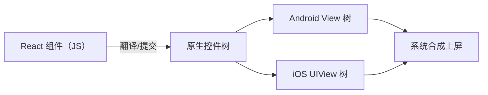
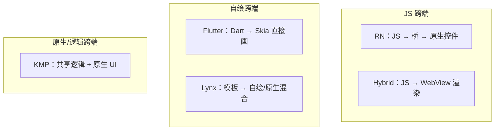
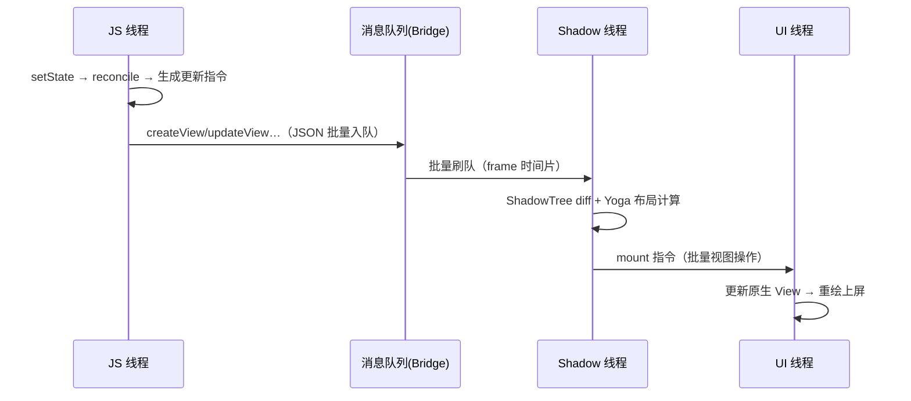
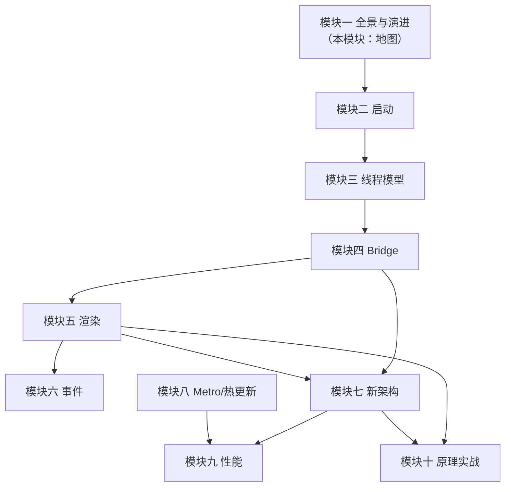

# RN 全景与技术本质

> 一句话定义：**React Native = 用 React 写 UI，用原生控件渲染，靠一条跨语言通道把两者粘在一起。** 本篇把这个定义拆成三个承诺，并与主流跨端方案对照，建立全站的第一张地图。

## 1. RN 的三个核心承诺

### 1.1 JS 开发体验

业务代码用 JavaScript（或 TS）编写，React 组件模型、Hooks、状态管理生态全部可用。开发期配合 Metro 提供热更新（HMR），改一行代码不用重新编译原生工程。

这条承诺的边界同样要说清：

- **"不用重编原生"仅限 JS/TS 改动**——动了原生代码（新模块、改 Podfile/Gradle）照样要走完整原生构建；
- **热更新的正式形态是 Fast Refresh**（0.61 起，[03 篇](03-版本演进时间线.md)的时间线里有它的位置）：保留组件状态的热替换，比整页 reload 的体验高一档；
- **开发期工装是进程级的**：dev 菜单、红屏、Metro 连接——这些居民在 brownfield 场景的处置是[模块十二 01](../rn-混合开发/01-原生工程集成与生命周期.md)的专门话题。

### 1.2 原生渲染

RN **不渲染 DOM，也不自绘像素**。`<View />` 在 Android 上最终是一个 `android.view.View`，在 iOS 上是一个 `UIView`。滚动条、输入法、无障碍、系统手势——全部是平台原生行为。



"原生渲染"带来的两面性：

| 得到 | 付出 |
|------|------|
| 原生观感与默认动效（滚动惯性、键盘行为开箱即得） | 双端行为差异要自己抹平（同一组件两端的默认表现不完全一致） |
| 无障碍、输入法、系统手势跟随平台演进 | 样式能力是平台子集（Web CSS 的很多概念在 RN 不存在） |
| 系统级优化红利（平台渲染管线的每次升级都自动受益） | 渲染问题要下钻到平台层排查（读崩溃栈/trace 需要原生知识，模块九） |

#### 一个判别小实验：原生渲染的"体感证据"

不确定某个页面是原生渲染还是自绘？两个无需工具的判别法：

1. **长按选择文本**：原生 `Text` 参与系统的文本选择/菜单（两端行为不同但都"像系统"）；自绘方案画出来的文字通常选不中、菜单是应用自绘的；
2. **看无障碍/读屏**：原生控件的语义对系统读屏天然可达；自绘内容要么手动桥接语义、要么读屏读不到。

这两个判别法反过来也是工程提醒：**选择"原生渲染"同时就选择了"免费获得系统级文本与无障碍能力"**——这些能力在自绘方案里都是要花钱（额外开发）买的。

### 1.3 桥接通信

JS 引擎与原生运行时是两个世界，一切跨越边界的调用（调相机、发通知、读传感器）都要过一条"桥"。**这条桥的形态（异步 JSON vs 同步 C++ 接口）正是新旧架构的分水岭**，也是本站模块四与模块七的主角。

桥上的双向流量先各给一个预告（细节在后两个模块）：

- **下行（JS → 原生）**：视图操作指令（createView/updateView…）与模块方法调用——指令级 diff 让流量正比于"变化量"而非树大小（模块五 01）；
- **上行（原生 → JS）**：触摸/滚动事件与模块回调——高频事件的上行是旧架构掉帧的经典来源（模块四 03 的闭环模型）。

### 1.4 三个承诺之间的张力

三个承诺不是免费叠加，两两之间都有张力，理解张力就理解了 RN 的设计取舍：

| 张力对 | 矛盾点 | RN 的取舍 |
|--------|--------|----------|
| JS 体验 × 原生渲染 | JS 世界与原生世界隔着语言与线程边界 | 引入桥：用"异步 + 批量"换"两边各自简单"——代价成为十年的演进主线 |
| JS 体验 × 桥接通信 | JS 想同步拿到结果（measure、模块返回值），桥只给异步 | 旧架构：回调/Promise 包异步；新架构：JSI 直调，同步成为可能（模块七） |
| 原生渲染 × 桥接通信 | 高频视觉更新（动画、滚动）若都过桥，桥成为帧率天花板 | 通道降级路线：native driver / worklet 把高频段留在原生（模块六 04） |

一句话：**RN 的历史就是把这三对张力逐一解开的历史**——[03 篇](03-版本演进时间线.md)的每个版本节点都能对号入座。

## 2. 与 Web React 的同与不同

| 维度 | React（Web） | React Native |
|------|-------------|--------------|
| 声明式 UI | JSX → DOM | JSX → 原生控件 |
| 渲染器 | react-dom | react-native（内置 react-reconciler 定制） |
| 布局 | CSS / 浏览器布局引擎 | Yoga（C++ flexbox 实现） |
| 事件 | DOM 事件流 | 原生触摸 → 桥 → 合成事件 |
| 样式 | CSS 体系 | JS 对象，无级联、无单位（默认 dp/pt） |
| 打包 | Webpack/Vite 等 | Metro |
| 路由 | 浏览器 URL / 路由库 | 无 URL 概念，导航栈由库（React Navigation 等）与原生容器表达 |
| 更新发布 | 随时部署 | 走应用商店或 OTA 热更新（模块八 02） |

关键认知：**React 是"UI = f(state)"的编程模型，与渲染目标无关**。`react-dom` 与 `react-native` 是同一套 reconciler 协议的两个宿主实现——这正是模块五要展开的内容。

### 2.1 "同一编程模型"的工程含义

把上面这行认知展开成对团队的日常意义：

- **React 功力全额迁移**：Hooks、状态管理、组件设计模式、测试思路（模块十一）——在 RN 里的写法与 Web 几乎一致；
- **宿主概念不迁移**：DOM API、CSS 选择器、浏览器事件模型在 RN 不存在——从 Web 过来的工程师要换的恰是这层"平台常识"；
- **一份核心逻辑可以两端复用**：业务规则、协议编解码、状态机这类"非 UI 代码"可以抽成共享包，Web 与 RN 各接各的渲染层——这也是 monorepo 里常见 RN + Web 共存的形态；
- **调试与生态是两套**：React DevTools 两边共用，但 Chrome 的元素/网络面板换成 RN DevTools 与原生工具链（模块十 04）。

### 2.2 最容易踩的"Web 直觉"清单

从 Web 带过来的这些直觉在 RN 会直接翻车：

- "改样式立刻生效"——RN 的样式更新走渲染管线，不是浏览器同步改 CSS（[02 篇](02-从View到像素的旅程.md)的旅程）；
- "事件会冒泡，我在父级接"——RN 触摸事件没有 DOM 那样的冒泡模型，是另一套协商仲裁（模块六 01）；
- "overflow/层级/z-index 语义同 CSS"——只有子集，且两端有差异（模块五 04）；
- "可以做 SEO/ SSR"——没有 DOM 与 URL，这些概念不存在。

### 2.3 一段代码看"同与不同"

同一个受控输入组件，两端的写法与宿主行为对照：

```tsx
// Web（react-dom）
<input value={text} onChange={e => setText(e.target.value)} />

// React Native
<TextInput value={text} onChangeText={setText} />
```

相同的部分：受控组件模型（value 受 state 驱动、事件回写 state）、组件的声明式结构——**React 的部分一模一样**。

不同的部分藏在宿主行为里：

- `onChange` 对应 DOM change 事件，`onChangeText` 直接给字符串——事件载荷的形态由宿主定义；
- Web 的输入由浏览器内核托底，RN 的输入要跨"原生输入法 → 事件上行 → state 回写 → 下行更新"整条链（模块六 05 专门拆这条链）；
- 键盘避让、焦点管理、选中态——Web 里浏览器管的事，RN 里要么组件内置要么自己接。

这就是"同一编程模型、不同宿主常识"的最小样本：**语法层迁移零成本，语义层迁移要重学**。

## 3. 跨端方案对比

| 方案 | UI 渲染 | 通信 | 代表 | 特点 |
|------|--------|------|------|------|
| **RN** | 原生控件 | Bridge / JSI | RN 0.7x | 原生观感，JS 生态，桥是历史瓶颈也是演进主线 |
| **Flutter** | Skia/Impeller 自绘 | Dart FFI（同进程同语言） | Flutter 3.x | 像素级一致，包体大，Dart 生态相对独立 |
| **Hybrid（WebView）** | WebView 渲染 | JSBridge | Cordova/Ionic | 复用 Web 全生态，受 WebView 性能与碎片化限制 |
| **Lynx** | 自绘 + 原生混合 | 双线程模板 | 字节 | 模板化渲染，主打首屏与直播互动场景 |
| **KMP / 原生** | 各平台原生 UI | 共享 Kotlin 逻辑 | Compose Multiplatform | 逻辑跨端、UI 可不跨端 |

三类本质区别画成一张图：



**选型判断题**：要像素级跨平台一致性 → 自绘系；要原生观感 + 团队有 React 储备 → RN；要 Web 团队最低成本 → Hybrid；只共享业务逻辑 → KMP。

### 3.1 三个观察维度：渲染权、逻辑权、通道

五类方案的差异可以压到两个正交问题上：

| 维度 | 问的问题 | 光谱 |
|------|---------|------|
| 渲染权 | 谁画像素？ | 原生控件（RN/KMP）↔ 自绘引擎（Flutter/Lynx）↔ 浏览器内核（Hybrid） |
| 逻辑权 | 业务逻辑跑在哪个运行时？ | JS 引擎（RN/Hybrid）↔ Dart VM（Flutter）↔ 各平台原生（KMP 的共享 Kotlin） |

第三个衍生维度是**通道成本**：渲染权与逻辑权分离越远，跨语言/跨线程的税越重——RN 的 Bridge/JSI 演进史（[03 篇](03-版本演进时间线.md)）就是这条税的减免史；Flutter 把两权合进同一运行时，通道税趋近于零，代价是放弃原生控件与 JS 生态。

用这三维去看任何新出的跨端方案，都能快速定位它站在哪、付出什么：

- 要像素级一致 → 必须收渲染权（自绘）；
- 要 JS 生态 → 必须收逻辑权（JS 引擎）；
- 两权都要 → 通道必然存在，剩下的只是通道的形态之争。

### 3.1.1 RN 与 Flutter 的逐项对照

两权三维之外，工程决策还看这些维度（定性对照，不排优劣）：

| 维度 | RN | Flutter |
|------|----|---------|
| UI 一致性 | 跟随平台（两端有差异） | 像素级一致（同一渲染引擎） |
| 语言与生态 | JS/TS，Web 生态全额复用 | Dart，生态相对独立 |
| 动态化/热更新 | 成熟（OTA，模块八 02） | 受平台政策约束更多（以各商店条款与官方方案为准） |
| 包体 | 基础运行时 + bundle | 引擎自带渲染器，起步包体偏大 |
| 原生能力接入 | 写原生模块过桥（模块四/七） | 写 platform channel（同样是通道，形态不同） |
| 排障栈深 | JS → 桥 → 原生三层（本站主线） | Dart → channel → 原生两层 |
| 团队迁移 | 有 React 储备的团队近乎零成本学语法 | 需要接受新语言与其工具链 |

注意第三行：**热更新能力是 RN 被选中的高频理由**，也是模块八整模块的分量所在；同时它受应用商店政策约束——任何热更新方案都要在合规框架内做（模块八 02/05 的发布纪律）。

### 3.2 RN 生态里的"自绘补丁"

主架构是原生渲染，但 RN 生态并不排斥自绘：Skia 的 RN 绑定（社区维护的 react-native-skia 一类）把 Canvas 式的 2D 绘制带进 RN，配合动画库做高性能特效；SVG 也由社区库以自绘/原生路径实现。它们是"组件内的自绘岛"，不改变页面主体是原生控件的事实——**渲染权的选择可以下沉到组件粒度**，这是 RN 灵活性的一部分（特殊场景的取舍详见[04 篇](04-RN生态与选型建议.md)）。

### 3.3 RN 在真实产品里的位置

多家公司在公开技术分享中讲过 RN 的规模化落地——Meta 自家产品、Microsoft、Shopify、Discord、Coinbase 等都是常被引用的名字（具体形态与规模以各自的公开分享为准，此处不引数字）。看这些案例时值得记的不是"谁在用"，而是**它们用 RN 的方式各不相同**：

- 有的全 App 押注（团队与工具链围绕 RN 建设）；
- 有的作为原生 App 内的业务块嵌入（brownfield，模块十二的主场）；
- 有的只用在迭代最快的运营/内容面上。

同一技术在不同组织里承担不同角色——这正说明"该不该用 RN"不是技术单选题，[04 篇](04-RN生态与选型建议.md)会把判断维度展开。

## 4. RN 的一条调用链预告

以一次 `setState` 后按钮变色为例，旧架构下的完整旅程（后续模块逐段展开）：



每一步都可能成为性能瓶颈，也可能成为理解 bug 的钥匙——这就是"学原理"的意义。

### 4.1 每一步的归属与典型问题

| 旅程步骤 | 归属模块 | 典型问题 |
|---------|---------|---------|
| setState → reconcile | 模块五 01 / 模块九 03 | 多余 re-render、引用不稳定 |
| 指令 JSON 入队/刷队 | 模块四 | 序列化税、批量时机 |
| ShadowTree + Yoga | 模块五 02/03 | 深嵌套布局风暴 |
| mount 原生视图 | 模块五 03 / 模块九 02 | 挂载批过大、列表重建 |
| 重绘上屏 | 平台渲染管线 | 过度绘制、大图解码 |

这张表就是全站的"故障索引"：任何一个 RN 现象，先在这张表上找到它的环节，再去对应模块取细节。

### 4.2 新架构下的同一旅程

同一个"按钮变色"在新架构（Fabric/JSI）下的对照——步骤数变少、边界变直：

| 环节 | 旧架构（4 节） | 新架构 |
|------|---------------|--------|
| JS → 原生的通道 | 消息队列 + JSON 批量 | JSI 同步 C++ 调用（无序列化） |
| Shadow 层 | Shadow 线程的独立树 | C++ ShadowTree，clone-on-write |
| 布局时机 | Shadow 线程异步算 | commit 阶段同步算（可中断、带优先级） |
| mount | 固定批投递到 UI 线程 | 按优先级调度 |

细节留给模块七（[Fabric 渲染管线](../rn-新架构/02-Fabric渲染管线.md)），这里只记结论：**旅程的驿站没变（还是那四站），驿站之间的路从"邮局寄信"变成了"专线直达"**。

### 4.3 反向旅程：一次点击的预告

渲染是"JS → 像素"的正向旅程；事件是它的逆行（模块六的主场），同一张地图上标注：


正逆两条旅程在 JS 线程交汇——这也是模块九性能归因里"滚动闭环"的骨架：事件上行与渲染下行共用帧预算，任何一方向超载，另一方向都跟着遭殃。

## 5. 本站地图

- **纵向主线（旧架构）**：模块二启动 → 模块三线程 → 模块四 Bridge → 模块五渲染 → 模块六事件
- **横向对照（新架构）**：模块七 JSI/Fabric/TurboModules，与主线逐段对照
- **工程外围**：模块八 Metro 与热更新、模块九性能归因
- **收束**：模块十 mini-react-native 复刻

### 5.1 三条建议的阅读路线

- **按序读**（默认路线）：地图（本模块）→ 主线 → 新架构 → 工程 → 复刻——每一模块消费前面的模型；
- **问题驱动读**：带着一个线上问题来，先查 4.1 的故障索引表定位环节，跳到对应模块，再顺藤补前置知识；
- **动手派读**：直接进模块十的 mini-react-native，卡在哪里回哪里——复刻会把"读过"暴露成"没懂"。

无论哪条路线，[02 篇](02-从View到像素的旅程.md)的"一行代码到像素"都值得先走一遍——它是所有模块共享的那条主干道的鸟瞰图。

### 5.2 模块依赖关系图

哪些模块是哪些的前置，一张图说清（箭头 = "依赖其模型"）：



读法提示：模块三（线程模型）是被依赖最多的节点——**如果只预习一个模块再去干活，选它**。

## 6. 术语速查表

全站高频术语的三十秒索引（每个词条的完整展开在括号里的模块）：

| 术语 | 一句话解释 |
|------|-----------|
| Bridge（旧架构通道） | JS 与原生之间的异步 JSON 消息队列（模块四） |
| JSI | 引擎无关的 C++ 接口层，同步直调的基础（模块七 01） |
| Fabric | 新架构渲染管线：C++ ShadowTree + 同步布局（模块七 02） |
| TurboModules | 新架构模块系统：懒加载 + Codegen 绑定（模块七 03） |
| Codegen | TS spec → 双端绑定代码的 IDL 编译器（模块七 04） |
| Hermes | RN 默认 JS 引擎：AOT 字节码 + 无 JIT（模块三 01/03） |
| Yoga | C++ flexbox 布局引擎（模块五 02） |
| Shadow Tree | 布局中间树：连接 React 树与原生视图树（模块五 01） |
| Metro | RN 官方打包器（模块八 01） |
| Fast Refresh | 保留状态的模块级热替换（模块八/十） |
| OTA / 热更新 | 不走商店的 bundle 更新（模块八 02/05） |
| Brownfield | 原生为主、RN 嵌入的混合形态（模块十二） |
| hostConfig | reconciler 的宿主配置合同（模块五 01、模块十 07） |
| worklet | 在原生线程（UI 线程）执行的 JS 小函数（模块六 02/04） |
| hbc | Hermes 字节码文件格式（模块三 03） |
| interop 层 | 新架构上兜底运行旧模块的兼容通道（模块七 03/06） |
| 虚拟化窗口 | 长列表只渲染可见区间附近的机制（模块九 02） |

## 小结

- RN 的本质：JS 编写、原生渲染、桥接通信，三者缺一不可。
- 桥的形态是新旧架构的分水岭：异步 JSON（Bridge）→ 同步 C++（JSI）。
- React 与渲染目标解耦，`react-native` 是 reconciler 的一个宿主实现。
- 跨端方案的三维定位：渲染权 × 逻辑权 × 通道成本——RN 的十年演进就是通道税的减免史。
- 从 Web 带来的平台直觉（样式即时生效/事件冒泡/overflow 语义）是最先要清零的一层。
- 三个承诺两两之间存在张力（体验×渲染、体验×通道、渲染×通道），RN 的版本演进史就是逐对解压的历史。
- 4.1 的"故障索引表"与 6 节的"术语速查表"是本篇留给后续阅读的两件常备工具。

## 自测

1. 用一句话向新同事解释 RN 与 Web React 的关系；再说出三个"Web 直觉在 RN 失效"的例子。
2. "渲染权、逻辑权、通道成本"三维下，RN、Flutter、Hybrid、KMP 各占什么位置？RN 新架构改的是哪一维？
3. RN "原生渲染"承诺的得到与付出各列三条；哪一条付出直接解释了"RN 团队需要原生排障能力"？
4. 默画 4 节的调用链（六个步骤），并给每一步标上"可能出什么问题"。
5. 一个团队说"我们要像素级一致的跨端 UI"，按 3.1 的框架分析它应该选哪类方案、会放弃什么。
6. 用两个"无需工具的判别法"判断一个 App 页面是否原生渲染，并解释这两个方法为什么成立（它们各自检查的是渲染承诺的哪个侧面）。
7. 对照 1.4 的三对张力，说明 native driver 动画（模块六 04）解的是哪一对、怎么解的。
