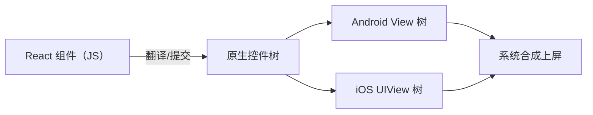
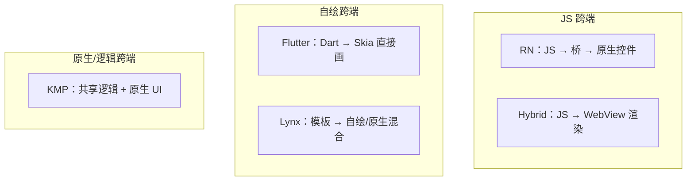
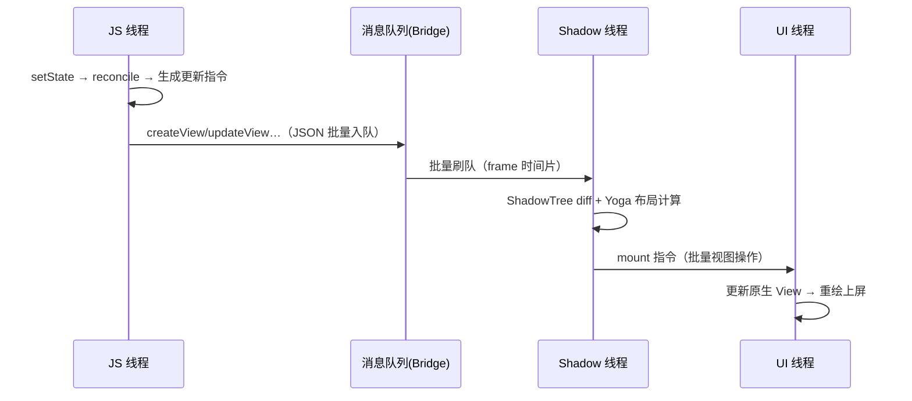

# RN 全景与技术本质

> 一句话定义：**React Native = 用 React 写 UI，用原生控件渲染，靠一条跨语言通道把两者粘在一起。** 本篇把这个定义拆成三个承诺，并与主流跨端方案对照，建立全站的第一张地图。

## 1. RN 的三个核心承诺

### 1.1 JS 开发体验

业务代码用 JavaScript（或 TS）编写，React 组件模型、Hooks、状态管理生态全部可用。开发期配合 Metro 提供热更新（HMR），改一行代码不用重新编译原生工程。

### 1.2 原生渲染

RN **不渲染 DOM，也不自绘像素**。`<View />` 在 Android 上最终是一个 `android.view.View`，在 iOS 上是一个 `UIView`。滚动条、输入法、无障碍、系统手势——全部是平台原生行为。

### 1.3 桥接通信

JS 引擎与原生运行时是两个世界，一切跨越边界的调用（调相机、发通知、读传感器）都要过一条"桥"。**这条桥的形态（异步 JSON vs 同步 C++ 接口）正是新旧架构的分水岭**，也是本站模块四与模块七的主角。

## 2. 与 Web React 的同与不同

| 维度 | React（Web） | React Native |
|------|-------------|--------------|
| 声明式 UI | JSX → DOM | JSX → 原生控件 |
| 渲染器 | react-dom | react-native（内置 react-reconciler 定制） |
| 布局 | CSS / 浏览器布局引擎 | Yoga（C++ flexbox 实现） |
| 事件 | DOM 事件流 | 原生触摸 → 桥 → 合成事件 |
| 样式 | CSS 体系 | JS 对象，无级联、无单位（默认 dp/pt） |
| 打包 | Webpack/Vite 等 | Metro |

关键认知：**React 是"UI = f(state)"的编程模型，与渲染目标无关**。`react-dom` 与 `react-native` 是同一套 reconciler 协议的两个宿主实现——这正是模块五要展开的内容。

## 3. 跨端方案对比

| 方案 | UI 渲染 | 通信 | 代表 | 特点 |
|------|--------|------|------|------|
| **RN** | 原生控件 | Bridge / JSI | RN 0.7x | 原生观感，JS 生态，桥是历史瓶颈也是演进主线 |
| **Flutter** | Skia/Impeller 自绘 | Dart FFI（同进程同语言） | Flutter 3.x | 像素级一致，包体大，Dart 生态相对独立 |
| **Hybrid（WebView）** | WebView 渲染 | JSBridge | Cordova/Ionic | 复用 Web 全生态，受 WebView 性能与碎片化限制 |
| **Lynx** | 自绘 + 原生混合 | 双线程模板 | 字节 | 模板化渲染，主打首屏与直播互动场景 |
| **KMP / 原生** | 各平台原生 UI | 共享 Kotlin 逻辑 | Compose Multiplatform | 逻辑跨端、UI 可不跨端 |

三类本质区别画成一张图：

**选型判断题**：要像素级跨平台一致性 → 自绘系；要原生观感 + 团队有 React 储备 → RN；要 Web 团队最低成本 → Hybrid；只共享业务逻辑 → KMP。

## 4. RN 的一条调用链预告

以一次 `setState` 后按钮变色为例，旧架构下的完整旅程（后续模块逐段展开）：

每一步都可能成为性能瓶颈，也可能成为理解 bug 的钥匙——这就是"学原理"的意义。

## 5. 本站地图

- **纵向主线（旧架构）**：模块二启动 → 模块三线程 → 模块四 Bridge → 模块五渲染 → 模块六事件
- **横向对照（新架构）**：模块七 JSI/Fabric/TurboModules，与主线逐段对照
- **工程外围**：模块八 Metro 与热更新、模块九性能归因
- **收束**：模块十 mini-react-native 复刻

## 小结

- RN 的本质：JS 编写、原生渲染、桥接通信，三者缺一不可。
- 桥的形态是新旧架构的分水岭：异步 JSON（Bridge）→ 同步 C++（JSI）。
- React 与渲染目标解耦，`react-native` 是 reconciler 的一个宿主实现。
