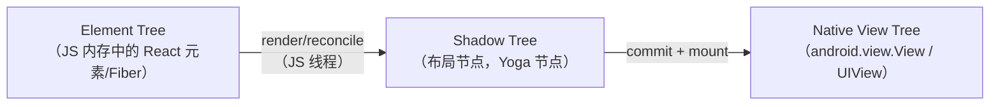
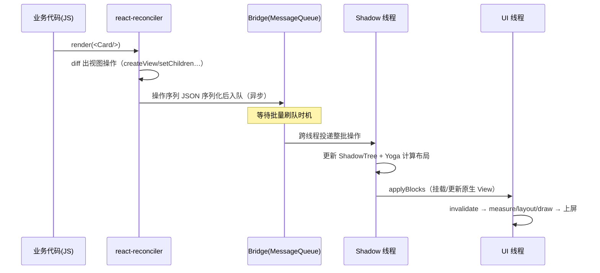
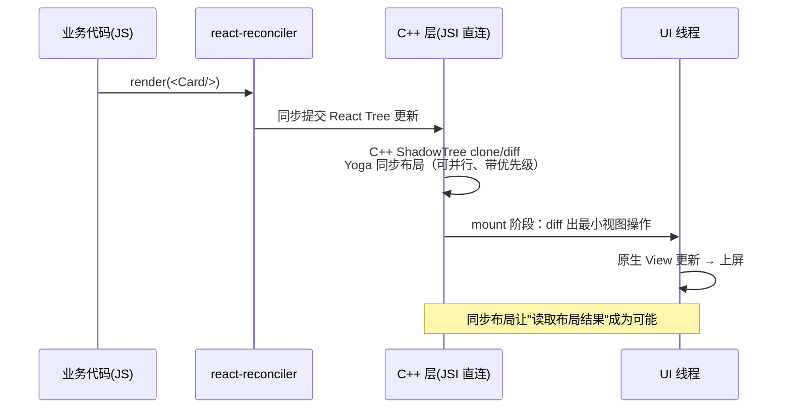

# 从 View 到像素的旅程

> 把 `<View style={{ backgroundColor: 'tomato' }} />` 渲染到屏幕，新旧架构各要走一条不同的路。本篇只画全景、不抠细节——每个环节在后续模块都有整篇展开。

## 1. 出发点：一段最普通的代码

```jsx
function Card() {
  return (
    <View style={styles.card}>
      <Text>hello</Text>
    </View>
  );
}
```

JSX 只是 `React.createElement(View, {style}, children)` 的语法糖。从这行代码到屏幕上的番茄色圆角矩形，要穿过**三棵树**和**一条通道**。

## 2. 三棵树



| 树 | 住在哪 | 谁维护 | 回答的问题 |
|----|--------|--------|-----------|
| Element/Fiber Tree | JS 引擎堆 | React（reconciler） | 界面"应该"长什么样（声明式描述） |
| Shadow Tree | Shadow 线程（旧）/ C++ 层（新） | RN 渲染器 | 界面"占多大、在哪"（布局结果） |
| Native View Tree | UI 线程 | 平台系统 | 界面"怎么画"（真实控件） |

## 3. 旧架构路线（Bridge 时代）



要点速记：

1. **JS 不直接碰原生控件**——所有操作变成消息（模块四）。
2. **布局不在 UI 线程算**——Yoga 在 Shadow 线程完成（模块五）。
3. **每个环节都是异步的**——`setState` 返回时画面还没变。

## 4. 新架构路线（Fabric 时代）



变化集中在通道与布局时机：

- Bridge 消息队列 → **JSI 同步 C++ 调用**（模块七）。
- Shadow Tree 挪进 C++，clone-on-write，支持并发优先级（React 18 的 lane）。
- `measure` 类 API 从"下一帧回调"变成可同步返回。

## 5. 两条路线的对照表

| 环节 | 旧架构 | 新架构 |
|------|--------|--------|
| 通道 | Bridge（异步 JSON） | JSI（同步 C++） |
| Shadow Tree | Java/OC 对象，Shadow 线程 | C++ 对象，clone-on-write |
| 布局 | Shadow 线程异步 | commit 阶段同步（可中断、按优先级） |
| 事件优先级 | 无 | lane 模型，交互优先渲染 |
| 读取布局 | 异步 `measure(callback)` | 可同步 `measure` |
| 原生模块 | Native Modules（全量注册） | TurboModules（懒加载 + Codegen） |

## 6. 把旅程折叠成一句

> **JS 决定"是什么"，Shadow 层决定"在哪"，原生层决定"怎么画"；旧架构用消息队列串起三层，新架构用 C++ 接口层把三层缝在同一时间线里。**

后续模块的阅读顺序，就是沿这条旅程逐段放大：模块二先讲"车是怎么发动的"（启动），模块三讲"发动机"（引擎与线程），模块四讲"桥"，模块五讲三棵树，模块六讲反向旅程（事件），模块七讲新路，模块八九十回到工程。

## 小结

- 三棵树：Element（描述）→ Shadow（布局）→ Native（绘制），逐层翻译。
- 旧架构：每层之间异步批量、JSON 序列化；新架构：C++ 直连、同步布局。
- 理解任何 RN 渲染问题，先定位它发生在哪棵树、哪个线程。
