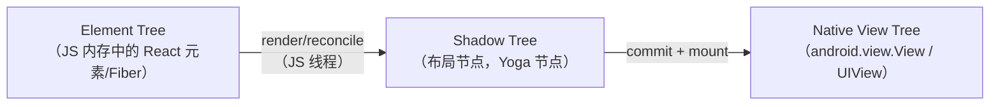
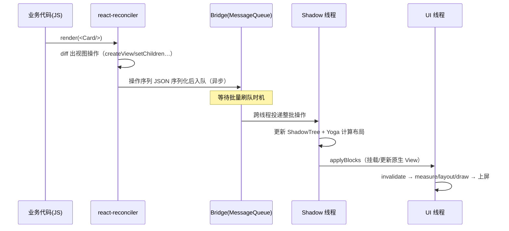
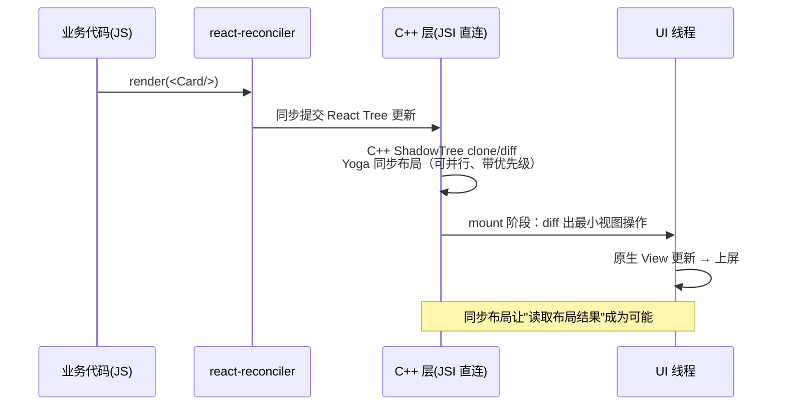
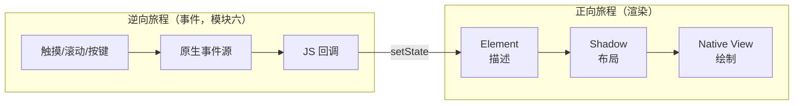

# 从 View 到像素的旅程

> 把 `<View style={{ backgroundColor: 'tomato' }} />` 渲染到屏幕，新旧架构各要走一条不同的路。本篇只画全景、不抠细节——每个环节在后续模块都有整篇展开。

## 1. 出发点：一段最普通的代码

```jsx
function Card() {
  return (
    <View style={styles.card}>
      <Text>hello</Text>
    </View>
  );
}
```

JSX 只是 `React.createElement(View, {style}, children)` 的语法糖。从这行代码到屏幕上的番茄色圆角矩形，要穿过**三棵树**和**一条通道**。

### 1.1 createElement 产物：一张"描述"而不是一个"东西"

把编译产物写全，看清出发点的真实形态：

```js
// JSX 编译后的等价物（示意：Babel/转换器输出，Metro 转换阶段完成，见模块八 01）
import { createElement } from 'react';
import { View, Text } from 'react-native';

const cardElement = createElement(
  View,                 // type：宿主组件（最终映射到原生控件）或函数组件引用
  { style: styles.card },
  createElement(Text, null, 'hello'),
);
```

返回值是一个**普通 JS 对象**，字段大致是 `{ type, props, key, ref }`——它只描述"要什么"，不包含任何实例：

| 字段 | 含义 | 与渲染的关系 |
|------|------|-------------|
| `type` | 组件类型（宿主组件的字符串引用 / 函数组件的函数引用） | 决定后续由谁处理：reconciler 递归调用函数，或交给渲染器 |
| `props` | 属性包（含 `children` 与 `style`） | 后续 diff 的比较对象；props 不变则子树可能整段跳过 |
| `key` | 列表身份标识 | 决定复用判断——错了会引发整棵子树重建（模块九 02） |
| `ref` | 命令式句柄入口 | 绕过声明式管线的小后门，能不用就不用 |

三个推论值得先记下：

1. **element 是一次性的**：每次 render 重新创建，用完即弃——所以"三棵树"里必须有更长寿的树来承载数据（第 2 节）；
2. **宿主组件此刻只是"名字"**：`View` 在 JS 侧只是对"我要一个原生容器"的声明，翻译成哪端的控件是渲染器（模块五）的事；
3. **从 JSX 到 element 的转换发生在构建期**：运行时没有 JSX——这份转换由 Metro 的转换阶段完成（[模块八 01 · Metro 三阶段与 Bundle 结构](../rn-Metro打包与热更新/01-Metro三阶段与Bundle结构.md)）。

## 2. 三棵树



| 树 | 住在哪 | 谁维护 | 回答的问题 |
|----|--------|--------|-----------|
| Element/Fiber Tree | JS 引擎堆 | React（reconciler） | 界面"应该"长什么样（声明式描述） |
| Shadow Tree | Shadow 线程（旧）/ C++ 层（新） | RN 渲染器 | 界面"占多大、在哪"（布局结果） |
| Native View Tree | UI 线程 | 平台系统 | 界面"怎么画"（真实控件） |

### 2.1 为什么必须是三棵：一棵都省不掉

初学者最常见的问题是"两棵不够吗"。把每棵树的存在理由摊开，会发现它们各自解决一个不可合并的问题：

| 树 | 存在的理由 | 若被合并进别棵会怎样 |
|----|-----------|---------------------|
| Element/Fiber | 每次 render 都重建的"最新意图"，承载 React 的全部状态与调度语义 | 并进 Shadow：React 状态与布局数据耦合，并发渲染（可中断、可丢弃）无处安放 |
| Shadow | 长寿的布局中间态，承载 Yoga 输入输出，可以异步/并行计算 | 并进 Element：布局成本被迫挤进 JS 线程的 render 里（旧架构 Shadow 线程存在的意义消失） |
| Native View | 平台真实对象，承接系统手势/绘制/无障碍 | 并进 Shadow：跨语言线程直接持有 UI 对象，线程安全与平台约束都不允许 |

一句话：**三棵树对应三个不可调和的约束——React 的调度语义（JS）、布局的计算成本（C++/Shadow）、平台的线程纪律（UI 线程）**。树的数量不是历史偶然，是约束的投影。

### 2.2 三棵树的时序特征

| 特征 | Element/Fiber | Shadow | Native View |
|------|--------------|--------|-------------|
| 创建频率 | 每次 render 全量重建（轻对象） | 首次挂载创建，更新时按需修改（旧）/克隆（新） | 最贵：跨语言创建、参与平台渲染 |
| 生命周期 | 与一次 render 同寿 | 与组件在树上存在同寿 | 与视图上屏同寿，销毁走平台回收 |
| 可变性 | 不可变（新 element 替换旧的） | 旧架构可变；新架构 clone-on-write | 由 mount 指令驱动变更 |

读这张表的收获是**性能问题的第一问**："这次变化动了哪棵树、动了多少？"——只动 Element（render 了但 props 没变）成本最低；动到 Shadow（要重布局）居中；动到 Native View（要挂载/更新真实控件）最贵。后续所有性能章节（模块九）都是围绕这个问题展开的量化。

三棵树的逐棵深拆在[01 · 三棵树与 Reconciler](../rn-渲染原理/01-三棵树与Reconciler.md)，本篇只建立全景。

### 2.3 Shadow 树的"搬家史"

三棵树里唯一搬过家的是 Shadow 树——它的住址变迁就是新旧架构的分界线之一：

| 阶段 | Shadow 树住在哪 | 实现语言 | 与 JS 的通信 |
|------|----------------|---------|-------------|
| 旧架构（Paper） | 独立 Shadow 线程 | Android: Java / iOS: OC（各端各一套） | Bridge JSON 批量 |
| 新架构（Fabric） | C++ 层（跨端共用一份实现） | C++（ReactCommon） | JSI 同步调用 |

搬家的动因不在"性能"单点上：

1. **双端两套 Shadow 实现意味着行为漂移**——同一份布局语义在 Java 与 OC 各实现一遍，维护成本高、一致性差；
2. **JSON 通道把"树的更新"限制成整批快照**——并发渲染需要的"细粒度、可中断"更新无法表达；
3. **C++ 层是实现三端共享（iOS/Android/桌面）与 JSI 直连的唯一交汇点**——这也是 [03 篇](03-版本演进时间线.md)讲"新架构三件套必须一起上"的原因之一。

读全景图时把这条搬家史叠上去：**新架构不是推倒重来，而是把三棵树模型里最"贵"的那棵（Shadow）从"两端各自的实现"收编成"一份 C++ 实现 + 直连通道"**。

## 3. 旧架构路线（Bridge 时代）



要点速记：

1. **JS 不直接碰原生控件**——所有操作变成消息（模块四）。
2. **布局不在 UI 线程算**——Yoga 在 Shadow 线程完成（模块五）。
3. **每个环节都是异步的**——`setState` 返回时画面还没变。

### 3.1 一次更新的逐步走查

把时序图放大成逐步表——每一步标出"在哪条线程、成本从哪来"。这张表是旧架构一切性能归因的骨架：

| 步 | 发生什么 | 线程 | 成本来源 |
|----|---------|------|---------|
| 1 | `setState` 触发 re-render，组件函数重跑，产出新 element 树 | JS | 组件计算本身（模块九 03） |
| 2 | reconciler diff 新旧 Fiber，产出视图操作指令（createView/updateView/removeChild…） | JS | diff 计算；指令量 ∝ 变化量 |
| 3 | 指令**序列化为 JSON**，入 MessageQueue 队列 | JS | 序列化税（模块四 03） |
| 4 | 批量刷队时机到达，整批消息跨线程投递 | JS → Shadow | 一次跨语言拷贝 |
| 5 | Shadow 线程反序列化，更新 Shadow Tree，Yoga 布局 | Shadow | 布局计算（模块五 02） |
| 6 | 布局结果随 mount 指令投递 UI 线程 | Shadow → UI | 又一次跨线程批量 |
| 7 | 原生 View 挂载/更新，平台 measure/layout/draw | UI | 平台渲染管线 |

两个结构性观察：

1. **三次跨线程投递（3/4、5/6）都发生在同一条链上**——旧架构的"慢"不是某一步慢，是链路里固定的搬运次数多；
2. **步骤 2→3 之间没有回头路**：指令一旦入队，即使 UI 状态又变了，这一批也会照常执行——无法让路给更高优先级的变化（这正是第 4 节 lane 模型要解决的）。

### 3.2 批量：为什么多次 setState 只过一次桥

旧架构的 Bridge 不是"每条消息一发就送"，而是**批量刷队**：JS 侧把一个时间片内的多条指令攒进 MessageQueue，到刷队时机整批序列化、一次投递。所以同一个事件处理器里连写三个 `setState`，桥上只有**一批**消息——批内合并是旧架构送给开发者的唯一免费午餐。

但批量救不了两个场景：

- **跨事件的连续更新**（每帧都有状态变化，比如滚动驱动的 UI）——批再大也是每帧一批，序列化税按帧付（模块四 03 的量化视角）；
- **"写后读"**——批量异步意味着`setState` 之后立刻想读"渲染结果"（measure、布局位置）拿到的必然是旧值，只能注册回调等下一轮。

这两个场景就是后来 native driver 动画（模块六 04）与新架构同步能力（模块七）的出题现场。

## 4. 新架构路线（Fabric 时代）



变化集中在通道与布局时机：

- Bridge 消息队列 → **JSI 同步 C++ 调用**（模块七）。
- Shadow Tree 挪进 C++，clone-on-write，支持并发优先级（React 18 的 lane）。
- `measure` 类 API 从"下一帧回调"变成可同步返回。

### 4.1 clone-on-write：一份"可以随时快照"的树

新架构 Shadow Tree 的关键设计是**不可变修订（revision）**：每次 commit 不是原地改树，而是**只克隆被改动的那条路径**，其余子树与新树共享（结构共享）。于是：


这份设计同时兑换出三样东西：

1. **一致性读**：`measure` 这类同步读取拿到的是某一个完整 revision——读到的是"某一刻的完整真相"，而不是"改到一半的中间态"；
2. **可中断/可丢弃**：一个低优先级 commit 做到一半被高优更新打断，直接扔掉半成品 revision 从新输入重来，已挂载的旧 revision 毫发无损；
3. **双缓冲对比**：mount 阶段在"已挂载 revision"与"新 revision"之间 diff，天然得到最小视图操作集。

机制细节在[Fabric 渲染管线](../rn-新架构/02-Fabric渲染管线.md)，本篇记结论即可。

### 4.2 commit 与 mount：两段式提交的分工

新架构把"提交"拆成两段，节奏完全不同：

| 段 | 发生在哪 | 同步性 | 优先级 |
|----|---------|--------|--------|
| commit（树构建 + 布局） | C++ 层，JSI 同步调用进入 | 同步开始，可中断让路 | lane 模型：交互类更新插队 |
| mount（视图操作） | C++ mount 层 → UI 线程 | 按帧预算投递 | 高优 mount 先行 |

这解释了第 5 节对照表里"读取布局可同步"与"事件优先级"两行的来源：**同步性是 commit 段送的礼，优先级是两段共用的 lane 调度送的礼**。也顺带回答一个高频疑问——"新架构是全同步了吗？"不是：commit 同步开始，但 mount 依然要过 UI 线程按帧执行；变的不是"异步消失"，而是"异步从强制变成了可控"。

### 4.3 首帧与更新帧：同一旅程的两种节奏

第 3/4 节的时序其实画的是"更新帧"。**首帧（冷启动后的第一次渲染）走的也是同一张地图，但路上多了一位乘客——bundle 执行**：

| 节奏 | 旅程差异 | 性能要点 |
|------|---------|---------|
| 首帧（冷启动） | 启动链路先把 bundle 读取、解析、执行完（模块二 03），才有第一个 element 树可渲染；然后走完整的 ①–④ | 旅程前多了"bundle 就绪"段——启动优化（[模块二 04](../rn-启动流程原理/04-启动优化原理.md)）与渲染优化是两本账 |
| 更新帧 | bundle 已就绪，直接从 setState/re-render 进入 | 只付 diff + 布局 + mount 的成本 |

这条区分解释了两个常见现象：

1. **"启动慢"不等于"渲染慢"**：首帧延迟的大头常在 bundle 就绪之前的段（解析、执行、模块注册），此时渲染管线还一帧都没画过——归因先分清"就绪前的等待"与"就绪后的渲染"（模块二 04 的分段模型）；
2. **更新帧的性能口径与启动完全不同**：更新帧争的是单帧预算（模块九 01），启动争的是整条串行链的长度——同一个人在这两个场景里要回答的问题不一样。

## 5. 两条路线的对照表

| 环节 | 旧架构 | 新架构 |
|------|--------|--------|
| 通道 | Bridge（异步 JSON） | JSI（同步 C++） |
| Shadow Tree | Java/OC 对象，Shadow 线程 | C++ 对象，clone-on-write |
| 布局 | Shadow 线程异步 | commit 阶段同步（可中断、按优先级） |
| 事件优先级 | 无 | lane 模型，交互优先渲染 |
| 读取布局 | 异步 `measure(callback)` | 可同步 `measure` |
| 原生模块 | Native Modules（全量注册） | TurboModules（懒加载 + Codegen） |

### 5.1 对照表的读法：驿站不变，路在变

逐行看这张表会发现一个规律：**左列（旧架构）与右列（新架构）描述的是同一批"职能"，差别全部在"通道形态与时序"上**。Element/Shadow/Native 三棵树的分工没有变、reconciler 的 diff 职责没有变、Yoga 算布局这件事没有变——变的是：

| 职能 | 不变的部分 | 变化的部分 |
|------|-----------|-----------|
| 描述界面 | React 组件模型 | 无 |
| 算布局 | Yoga（C++ flexbox） | 计算时机（异步段 → commit 段同步） |
| 产出视图操作 | diff 出最小操作集 | 操作由哪棵树对比产生（Shadow diff → revision diff） |
| 跨界传输 | 必须跨 JS/C++ 边界 | 通道形态（JSON 队列 → JSI 直调） |

这就是本站反复强调的学习口径：**先记驿站（三棵树模型），再记路（架构版本）**。模型是长期稳定的坐标系，架构版本是坐标系上移动的历史——所以本篇的标题叫"旅程"而不是"某版本的实现细节"。

## 6. 把旅程折叠成一句

> **JS 决定"是什么"，Shadow 层决定"在哪"，原生层决定"怎么画"；旧架构用消息队列串起三层，新架构用 C++ 接口层把三层缝在同一时间线里。**
>
> 展开说：这条折叠句里的"三层"就是三棵树的职能折叠，"消息队列"与"C++ 接口层"就是两条路线的全部差异所在。看懂这句，再看 §3/§4 的两张时序图，就只是同一句话的两种画法。

后续模块的阅读顺序，就是沿这条旅程逐段放大：模块二先讲"车是怎么发动的"（启动），模块三讲"发动机"（引擎与线程），模块四讲"桥"，模块五讲三棵树，模块六讲反向旅程（事件），模块七讲新路，模块八九十回到工程。



### 6.1 逆行预告：事件怎么回到 JS

渲染是"JS → 像素"的单程票，但界面是双向的——手指一点，事件要逆着这条旅程回到 JS。逆行的站点与正向相同、方向相反：

1. **原生侧起源**：触摸/滚动/按键由系统派发给对应的原生 View（这一步完全在 UI 线程）；
2. **原生预处理**：RN 的原生层在此决定"这个事件要不要发给 JS、以什么粒度发"——滚动事件被合并节流、纯原生可消化的行为不出站（模块六 01/03）；
3. **上行通道**：旧架构走 Bridge 异步投递（高频事件是旧架构掉帧的经典来源，模块四 03）；新架构经 JSI 直达 C++ 再入 JS（模块七 02）；
4. **JS 消费**：回调更新 state——**从这一刻起，又汇入本篇的正向旅程**。

两条旅程在 JS 线程交汇，这正是模块九"滚动闭环"归因模型的骨架：**事件上行与渲染下行共用同一条帧预算，任何一方向超载，另一方跟着遭殃**。读后续模块时，随时可以回到本篇这张双程图对号入座。

## 7. 常见误区

| 误区 | 事实 | 一句话纠正 |
|------|------|-----------|
| "JSX 里的 `<View>` 就是原生 View" | JSX 编译后只是普通对象（element），原生对象要到 mount 段才诞生 | element 是"描述"，View 是"实物"，中间隔着两棵树 |
| "setState 是同步刷新" | 两条路线下都不同步：旧架构强制异步批处理；新架构 commit 同步开始但 mount 仍按帧调度 | 依赖"改完立刻可见"的代码在两条路线上都是错的 |
| "新架构全同步了" | commit 可同步、读取可同步，但 mount 与绘制仍在 UI 线程按帧执行 | 变的是"异步可控"，不是"异步消失" |
| "三棵树是旧架构的历史设计" | 三棵树在新架构下依然成立，变的只是树间的通道与时序 | 模型是坐标系，架构是坐标系的移动史 |
| "布局在 UI 线程算（跟平台一样）" | RN 的布局在 Shadow 段（旧）/commit 段（新）算好，UI 线程只是消费结果 | UI 线程卡顿 ≠ 布局慢，先归因线程（模块三 02） |
| "一次 setState 对应一次跨桥" | 旧架构批量刷队，同 tick 多次 setState 合并成一批 | 批量合并是旧架构的内置优化，别拿"每条消息一过桥"算成本 |
| "新架构下 Shadow 线程没了所以不用懂线程" | 线程没有消失：JS 线程、C++ 层、UI 线程的分工依然存在，只是边界更直 | 线程模型（模块三 02）在新架构下依然是归因的第一把尺子 |
| "element 树变了 Shadow 树一定全变" | 新架构按改动路径克隆、mount 按最小操作集执行；props 未变的子树整段复用 | 成本正比于"变化量"，不是"树大小" |

## 8. 动手验证

- **看清 element 的对象形态**：在任意组件里 `console.log(<View />)`（直接渲染 JSX 表达式的返回值），确认它只是 `{ type, props, … }` 的普通对象；
- **感受异步**：旧架构工程里在 `onPress` 中 `setState` 后立刻 `console.log(state)`，再在 `useEffect` 里打第二次——对比两处读到的时间点（新架构工程可对比同步 `measure` API 的可用性，模块七）；
- **数驿站**：随手挑一个线上界面，按"哪部分在 JS 决定、哪部分靠布局、哪部分是纯原生行为"把元素分三类——分不出来的时候，就是回读模块五的信号；
- **对照两条路线**：同一个列表滚动 demo 分别在旧/新架构工程跑，用 Perfetto 抓 trace（方法见[模块九 05](../rn-性能优化原理/05-性能剖析操作手册.md)），观察 JS→Shadow→UI 三段的活动时序差异——结论以你的工程与设备为准。

## 9. 本篇与后续模块的地图

本篇刻意"只画全景"，每个环节的整篇展开：

| 旅程环节 | 本篇位置 | 展开篇目 |
|---------|---------|---------|
| Element → 指令 | §1/§3 步 1–2 | [模块五 01 · 三棵树与 Reconciler](../rn-渲染原理/01-三棵树与Reconciler.md) |
| 批量过桥 | §3 步 3–4 | [模块四 01 · Bridge 本质与消息队列](../rn-Bridge通信原理/01-Bridge本质与消息队列.md) |
| Shadow + Yoga | §3 步 5 | [模块五 02 · Yoga 布局引擎](../rn-渲染原理/02-Yoga布局引擎.md) |
| mount 上屏 | §3 步 6–7 | [模块五 03 · 视图提交与批量挂载](../rn-渲染原理/03-视图提交与批量挂载.md) |
| 反向旅程（事件） | §6 预告 | [模块六 01 · 触摸事件链路与手势仲裁](../rn-事件系统原理/01-触摸事件链路与手势仲裁.md) |
| 新架构通道 | §4 | [模块七 01 · JSI 原理](../rn-新架构/01-JSI原理.md)、[02 · Fabric 渲染管线](../rn-新架构/02-Fabric渲染管线.md) |
| 事件上行 | §6.1 | [模块六 01 · 触摸事件链路与手势仲裁](../rn-事件系统原理/01-触摸事件链路与手势仲裁.md) |
| 高频事件的出路 | §3.2 | [模块六 04 · 动画系统原理](../rn-事件系统原理/04-动画系统原理.md) |
| 首帧前的旅程 | §4.3 | [模块二 04 · 启动优化原理](../rn-启动流程原理/04-启动优化原理.md) |
| 版本历史 | §5.1 | [03 篇 · 版本演进时间线](03-版本演进时间线.md) |

## 小结

- 三棵树：Element（描述）→ Shadow（布局）→ Native（绘制），逐层翻译。
- 旧架构：每层之间异步批量、JSON 序列化；新架构：C++ 直连、同步布局。
- 理解任何 RN 渲染问题，先定位它发生在哪棵树、哪个线程。
- 三棵树各有不可合并的存在理由（调度语义 / 布局成本 / 线程纪律）——树的数量是约束的投影，不是历史偶然。
- 性能归因的第一问永远是"这次变化动了哪棵树"：Element 最便宜、Shadow 居中、Native View 最贵。
- 新架构的两段提交（commit 同步可中断 + mount 按帧调度）兑换出一致性读、可丢弃的半成品与最小 mount 集——异步从"强制"变成"可控"。
- 事件是旅程的逆行：原生起源 → 原生预处理 → 上行通道 → JS 消费，终点重新汇入正向旅程；双程共用帧预算。

## 自测

1. createElement 返回的对象有哪些字段？为什么说 element 是"一次性的描述"？（→ 1.1）
2. 三棵树各自解决什么不可合并的问题？把 Shadow 合并进 Element 树会牺牲什么？（→ 2.1）
3. 旧架构一次更新的七步走查里，三次跨线程投递分别发生在哪两步之间？（→ 3.1）
4. 为什么同一个事件处理器里三次 setState 只过一次桥？批量救不了哪两个场景？（→ 3.2）
5. clone-on-write 兑换了哪三样东西？"读到某一刻的完整真相"依赖设计的哪一点？（→ 4.1）
6. commit 与 mount 的分工各是什么？"新架构是全同步"错在哪里？（→ 4.2）
7. 对照表里"不变的职能"有哪四项？为什么学习口径是"先记驿站、再记路"？（→ 5.1）
8. Shadow 树为什么从"双端各一套实现"搬进 C++ 层？这条搬家史解释了新旧架构的哪条分界线？（→ 2.3）
9. 首帧与更新帧走的是同一张地图吗？差异段在哪、为什么"启动慢"不能直接归因为"渲染慢"？（→ 4.3）
10. 事件逆行经过哪四个站点？为什么说"事件上行与渲染下行共用帧预算"？（→ 6.1）
