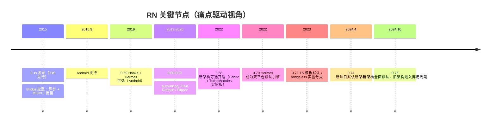
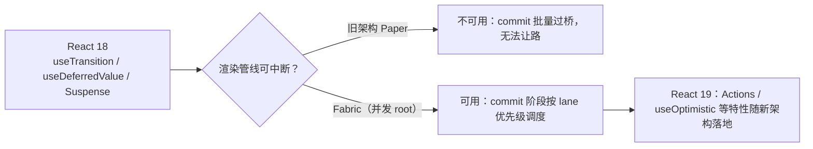

# 版本演进时间线

> RN 的十年，本质上是一部**"如何一步步摆脱 Bridge"**的历史。每个关键版本都在还一笔旧架构的债：异步、序列化、不可同步、注册全量。读时间线不是为了背版本号，而是看懂"痛点 → 解法"的因果链。

## 1. 一张时间轴

> 版本号是路标不是教材：记住四个支点——**0.59（Hermes 可选）、0.68（新架构可选）、0.74（新项目默认）、0.76（全面默认）**——时间线就立起来了。

### 1.1 怎么读这张时间轴：支点、节奏与因果

读版本史的三个方法，先立在这里：

1. **认支点，不背全表**：RN 的版本发布节奏很快，逐版记忆既不可能也无用。支点版本是"某件事的性质变了"的节点——0.59 引入新引擎、0.68 引入新架构、0.74/0.76 完成默认化。中间版本多半是支点的铺路石；
2. **看节奏差**：工程效率类改进（autolinking、Fast Refresh）落地快、采用快，因为它们不改变架构契约；架构类改进（JSI/Fabric/TurboModules）从可用（0.68）到默认（0.76）走了数年——**架构迁移的慢是结构性的，不是执行不力**（第 3 节逐个解释）；
3. **抓因果链**：每个支点都能还原成"痛点 → 解法"的一行（第 2 节的表就是这条因果链的索引）。读的时候始终问：这个版本在还哪笔债？债主是谁（用户体感、开发者体验、还是生态维护者）？

三个方法合起来就是本篇的写作结构：时间轴给坐标，逐代拆解给动因（2.1），历史包袱给深层原因（第 3 节），React 并发落地给版本之外的依赖维度（第 4 节）。

### 1.2 演进的闭环：痛点如何变成版本

把十年时间线抽象成一个循环，每个支点都是跑完一圈的结果：

这个闭环解释了两个"看起来矛盾"的现象：

1. **为什么官方一边加功能一边改架构**——加功能（工程效率侧）跑快循环，改架构跑慢循环，两条循环并行推进；
2. **为什么有些痛点"喊了很多年才解决"**——痛点必须先被归因到原理层（哪一段的什么机制），才可能进入慢循环的队列。喊得响但归因不清的诉求，会一直排队。

读后续模块时带着这个闭环：每个模块讲的"机制"都是某次循环里 D 环节的产物，而模块九讲的"归因方法"就是 C 环节的方法论。

## 2. 痛点 → 解法对照表

| 时期 | 痛点 | 版本与解法 | 原理落点 |
|------|------|-----------|---------|
| 2015–2018 | Bridge 异步/序列化税显现；启动慢；长列表卡 | 0.59 引入 Hermes（Android 可选）：预编译字节码省掉解析 | 模块三 |
| 2019–2020 | 工程效率：手动 link、改代码全量 reload | 0.60 autolinking；0.61 Fast Refresh（保留状态的热替换） | 模块八、模块十 |
| 2020–2021 | 调试与可观测弱 | 0.62 起 Flipper 内置（0.76 又被 RN DevTools 取代） | 模块十 |
| 2021–2022 | 旧架构天花板：无法同步调用、事件洪泛 | 0.68 新架构可选：JSI / Fabric / TurboModules | 模块七 |
| 2022–2023 | 引擎碎片（JSC/V8/Hermes 并存） | 0.70 Hermes 默认：统一字节码与工具链 | 模块三 |
| 2023–2024 | 新架构成熟度与迁移成本 | 0.74 新项目默认；interop 层兜底旧模块 | 模块七 |
| 2024.10– | Bridge 删除进入倒计时 | 0.76 Bridgeless 默认：JSI 直连，无 MessageQueue | 模块七 |

### 2.1 逐代拆解：每代的关键变化与动因

把时间轴切成五个时代，逐代回答三个问题：**这一代的关键变化是什么？动因是什么？给下一代留了什么伏笔？**（只陈述公开可查的定性事实，细节以官方发布说明为准。）

#### 时代一（2015–2018）：Bridge 定型期

**关键变化**：RN 诞生，iOS 先行，同年扩展到 Android；Bridge 的"异步 + JSON + 批量"三件套在第一年就定型，此后多年未动。

**动因**：2015 年的核心目标是**让 Web/React 人才最快写出能用的移动 App**。在这个目标下，"消息 + 序列化"是当时最稳妥的跨语言方案（见 3.1 的约束分析）；相比之下"同步直调"要解决线程安全、引擎耦合等硬问题，短期做不对。**第一代的"债"就是这么欠下的：用通道的次优，换落地速度的最优。**

这一代的主要工作是把两端能力对齐、把基础组件铺满——性能问题（启动解析、长列表、动画掉帧）随使用规模放大而显现，成为下一代的出题人。

#### 时代二（2019–2020）：工程效率期

**关键变化**：0.59 在 Android 引入 Hermes（可选）；0.60 autolinking；0.61 Fast Refresh；0.62 起 Flipper 内置。

**动因逐条看**：

| 变化 | 动因 | 为什么能快速普及 |
|------|------|----------------|
| Hermes（Android 可选） | 启动时的源码解析税：JSC 每次启动都要 parse 全量 JS（3.2 展开） | 可选开关，不动架构契约，风险可控 |
| autolinking | 手动 link 要两端各改一遍配置文件，升级 RN 时每个原生库都要重接——**机械劳动 × 依赖数量**的爆炸 | 纯构建期改进，运行时零变化 |
| Fast Refresh | 旧 live reload 整页刷新丢状态，调 UI 时反复手补状态 | 开发期机制，不进产物 |
| Flipper 内置 | 调试靠 console.log 撑着，可观测性欠账已久 | 独立工具，可选 |

这一代的共性：**全部不改变架构契约**——所以落地阻力小、普及快。它们证明了一件事：在架构债还清之前，工程效率路线的红利是可观的；但架构债本身（异步、序列化、不可中断）这一代无解。

#### 时代三（2021–2022）：新架构预备与可选期

**关键变化**：0.68 新架构可选开启（Fabric + TurboModules 实验版）；0.70 Hermes 成为双平台默认引擎。

**动因**：旧架构的天花板被反复撞到——无法同步调用、事件洪泛、并发渲染无处安放（模块四 03/模块七 05 的对照分析）。React 18 的并发特性进一步把"渲染管线必须可中断"变成硬需求。0.68 只能"整体 opt-in"而非单选（3.3 展开）；Hermes 先行默认化，则是因为它是新架构工具链（字节码、调试协议）的地基——**引擎统一走在新架构前面，是在为后者清场**。

#### 时代四（2023–2024）：新架构默认化期

**关键变化**：0.71 TS 模板默认、bridgeless 实验分支；0.74 新项目默认新架构；0.76 新架构全面默认、Flipper 被 React Native DevTools 取代。

**动因逐条看**：

| 变化 | 动因 |
|------|------|
| 0.71 TS 模板默认 | TS 已是社区事实标准，默认模板不再需要"选型"这一步 |
| 0.71 bridgeless 实验 | 去 Bridge 是新架构的终态形态，先以实验分支收集兼容性问题 |
| 0.74 新项目默认新架构 | interop 层成熟，旧原生模块可以在新架构下兜底运行（模块七 03），增量迁移的风险降到可控 |
| 0.76 全面默认 + DevTools 取代 Flipper | 维护两套架构的双份成本不可持续；调试工具链对齐 CDP（Chrome DevTools Protocol）生态，与 Web 端共享工具心智 |

这一代的策略是**默认值驱动的渐进迁移**：不强制存量项目立刻改，但让每一个新项目生在新架构上——生态的比重随新项目累积自然倾斜。

#### 时代五（0.76 之后）：弃用周期

**关键变化**：旧架构进入官方弃用周期（时间表以官方公告为准）；生态库的新架构兼容成为硬门槛。

**定性判断**：这一代的核心工作不是新功能，而是**生态长尾的收束**——社区库逐个声明新架构支持、存量项目排期迁移、interop 层逐步退役（依赖点见 [04 篇](04-RN生态与选型建议.md)的库健康度清单）。对应到工程动作：评估自家依赖的兼容面，在弃用时间表关闭窗口前完成迁移（迁移方法在[模块七 06 · 迁移工程实践](../rn-新架构/06-迁移工程实践.md)）。

### 2.2 四个支点版本精读

逐个支点展开"变了什么、为什么是它、对开发者意味着什么"：

#### 支点一：0.59 —— Hermes 亮相（Android 可选）

- **变了什么**：RN 第一次内置了"自家引擎"选项。Hermes 的路线是放弃 JIT、改用 AOT 字节码 + 低内存运行时（原理在[模块三 03](../rn-JS引擎与线程模型/03-Hermes深潜：字节码与GC.md)）；
- **为什么是它**：移动端的真实约束与桌面不同——iOS 禁 JIT 让 JSC 的最大优势失效，而"每次启动全量解析源码"的成本随 bundle 增长线性放大。引擎层是当时还没被动过的最大一块低垂果实；
- **开发者视角**：一个开关的事，收益落在启动段。但"可选"意味着生态分裂——JSC/V8/Hermes 并存的碎片时代由此开始，直到 0.70 才收束。

#### 支点二：0.68 —— 新架构 opt-in

- **变了什么**：JSI/Fabric/TurboModules 第一次作为一个整体可供开启（实验形态）。通道从异步 JSON 换成 JSI 同步调用，Shadow 树进 C++，模块系统换 Codegen + 懒加载；
- **为什么是它**：React 18 并发特性对渲染管线的硬需求到了临界点；且旧架构的同步调用天花板在复杂 App 里反复被撞（模块四 03 的瓶颈量化）；
- **开发者视角**：可以先开、可以不开——opt-in 的定位是给先行者探路与给生态库准备兼容。**此刻的合理策略是"读文档、试 demo、不动生产"**。

#### 支点三：0.74 —— 新项目默认新架构

- **变了什么**：新建项目默认启用新架构；存量项目仍可维持旧架构；
- **为什么是它**：interop 层成熟到能把旧模块兜底跑起来，增量迁移的最低风险路径成立；同时 0.71 以来的 bridgeless 实验收集了足够的兼容性问题样本；
- **开发者视角**：**新项目从第一天就生在新架构上**——教程、库文档、默认模板全部开始围绕新架构重写。存量项目的迁移决策从"要不要"变成"什么时候、怎么排期"。

#### 支点四：0.76 —— 全面默认与 Bridgeless

- **变了什么**：新架构（含 bridgeless 形态）全面默认；旧架构进入弃用周期；Flipper 移除，React Native DevTools 接棒；
- **为什么是它**：双架构并行的维护成本到了不可持续点——每个新特性都要在新旧两套管线里实现并测试；工具链切换则是对齐 CDP 生态、砍掉一条独立维护的调试工具线；
- **开发者视角**：`RCTBridge`/`MessageQueue` 这类旧架构对象退出了主路径（理解它们仍有价值——那是新架构每个设计的"为什么"）；调试心智向 Web 工具（CDP）收敛，模块十的调试章节以此为基准。

四个支点连起来的叙事线：**引擎先行（0.59/0.70）→ 通道换血（0.68）→ 默认值驱动迁移（0.74/0.76）**。每一步都在缩小"新旧并存"的范围，直到旧架构只剩弃用倒计时。

## 3. 三个"历史包袱"的具体来历

### 3.1 为什么 Bridge 一开始就是异步 JSON

2015 年的约束：JSC 与原生线程模型差异大、移动端跨线程共享内存风险高。**"消息 + 序列化"是最保守也最容易做对的方案**——代价是模块四讲的序列化税与强制异步。这不是设计失误，是当时的工程理性。

### 3.2 为什么 Hermes 花了十年才成默认

JSC 在桌面 Safari 是顶级引擎，但在 App 里：无 JIT 收益（iOS 禁 JIT）、每次启动都要解析源码。Hermes 的答案激进但昂贵：**放弃 JIT，换 AOT 字节码 + 低内存**。0.59 先在 Android 试点，0.70 才双平台默认——引擎替换牵动调试器、性能工具、三方库 ABI，慢是必然的。

### 3.3 为什么新架构要拆成三件套一起上

JSI（通道）、TurboModules（模块系统）、Fabric（渲染）互为依赖：没有 JSI 就没有同步调用；没有 TurboModules 的静态类型，JSI 绑定写不安全；没有 Fabric 的 C++ ShadowTree，JSI 也只能"快在通道上、慢在渲染里"。**这就是 0.68 只能整体 opt-in、无法单选一件的原因。**

### 3.4 生态迁移为什么总比核心迁移慢一拍

时间线上有个规律值得单看：**核心宣布默认化（0.74/0.76）到生态普遍跟进，中间有一段可观的时间差**。原因不在某一方"不积极"，而在生态的结构：

| 生态角色 | 迁移阻力 | 说明 |
|---------|---------|------|
| 核心仓库 | 低 | 自己的地盘，一次性完成 |
| 一线社区库（导航/手势/动画等） | 中 | 维护者活跃、有测试覆盖，但要在新旧架构间双支持一段时间 |
| 长尾小库 | 高 | 维护者可能已不在；没有原生知识的使用者改不动 |
| 企业存量代码 | 最高 | 原生模块混着多年前的写法，迁移是工程排期问题而非技术问题 |

interop 层的存在意义就是填这段时间差：它让"还没迁移的旧模块"能先在新架构上跑起来（模块七 03/06），把生态迁移从"一刀切"变成"按库排期"。**读版本时间线时，把"核心默认化"理解为发令枪，而不是终点线**——枪响之后的长跑在生态侧。

### 3.5 为什么 Fast Refresh 这类改进"又快又稳"

把 3.3 的"为什么慢"反过来问"为什么快"，能看清一条判据：**改动是否触碰架构契约**。Fast Refresh、autolinking 这类改进：

1. 不改变运行时的通信模型（Bridge 还是那条 Bridge）；
2. 不要求生态库配合改造（构建期/开发期自足）；
3. 失败面小——最坏情况退回旧行为（关掉开关）。

而触碰契约的改动（换引擎、换通道、换渲染器）牵动两端运行时、工具链、生态 ABI，退路复杂。**"改得深的东西必然落得慢"不是悲观论，是排期依据**：判断一个 RN 改进能不能快速用上，先看它落在契约的哪一侧。

### 3.6 为什么"删除 Bridge"比"新增 JSI"更难

时间线上有一处不对称值得注意：JSI 作为新能力加入（0.68 opt-in）到 bridgeless 默认（0.76）走了数年，而当初 Fast Refresh 只用一版就转正。不对称的原因在"删除"的特殊性：

| 阶段 | 新增 JSI（0.68–） | 删除 Bridge（0.71–0.76） |
|------|------------------|------------------------|
| 技术工作 | 实现新通道，新旧并存 | 确认**所有**存量用法不再依赖旧通道 |
| 生态工作 | 可选，没人被强制 | 每个仍在用旧 API 的库/代码都必须处理 |
| 兜底手段 | interop 层兜旧模块 | interop 本身也要逐步退役 |
| 风险形态 | 新东西不工作（局部） | 旧东西突然不工作（全局、随机位置） |

删除的风险是"长尾的"：不知道哪片云有雨——某个三年没升级的库在某个冷门路径上调了一次旧 API。所以官方路径是**先默认化、后物理删除**：0.76 起 bridgeless 默认，MessageQueue 从主路径消失，但完整的物理删除留给弃用周期收尾。**迁移工程里同理：新增总是比下线容易，排期时给"删除"留的时间要远多于"新增"。**

## 4. React 18 / 19 并发特性在 RN 的落地路径

Web React 的并发能力依赖**可中断的渲染管线**，而旧架构的 Bridge 批处理天然不可中断：

要点：

1. **并发特性的载体是 Fabric**——`useTransition` 在旧架构上退化为立即执行；
2. React 19 的函数组件 Actions、`useOptimistic` 等能力进入 RN，前提都是 0.76+ 的并发 root；
3. 这也解释了模块九"渲染与状态优化"里，为什么并发 API 的讨论要绑定新架构版本号。

### 4.1 RN 版本与 React 版本：松耦合的两条线

容易混淆的一点：**RN 的版本号与 React 的版本号是两条独立的发布线**，RN 每个大版本会捆绑一个配套的 React 版本，但两者的演进节奏不同步。工程上要记住的对齐关系只有一条：

| 想用的 React 能力 | 真正的前置条件 | 检查方法 |
|------------------|---------------|---------|
| 基础 Hooks、组件模型 | 任意 RN 版本 | 无 |
| 并发渲染（可中断、lane 优先级） | Fabric 并发 root 生效 | 确认新架构已启用（0.76+ 默认） |
| `useTransition`/`useDeferredValue` 生效 | 同上——旧架构上退化为立即执行 | 行为验证：高优更新是否能让路 |
| `useOptimistic` 等 React 19 特性 | 0.76+ 的并发 root | 同上 |

换算成排查口诀：**并发特性"不生效"先查架构开关，再查 React 版本**——载体（Fabric）不满足时，升级 React 版本不会带来任何并发行为。

### 4.2 "看似可用"陷阱：为什么并发 API 在旧架构上"能跑"

一个隐蔽的认知坑：在旧架构上写 `useTransition`，代码**不报错、能执行**——只是语义退化成了立即执行。这类"能跑但不生效"的 API 最危险：

- 编译期与运行期都不会提醒你"这个能力在当前架构上不可用"；
- 团队可能基于"我用了并发 API"的假设做交互设计（如让输入不被重渲染阻塞），而真实行为并没有这个保证；
- 迁移到新架构后行为突然变化——不是迁移引入了 bug，是迁移让"一直缺位的语义"到位了。

工程上的对策是**把"依赖并发语义的关键路径"记入迁移验证清单**：新架构开启后，专门验证这些路径的让路行为是否符合预期（验证方法见模块九 03）。

## 5. 用时间线校准学习与选型

- **读源码先问版本**：网上大量教程默认旧架构（MessageQueue / RCTBridge），0.76 后这些代码已不在主路径上——本站模块四讲 Bridge 是为了理解动机，不是照抄实现；
- **迁移规划看支点版本**：0.74（新项目默认）与 0.76（全面默认 + 旧架构弃用）是两个决策阈值；
- **工具链跟着版本走**：Flipper 在 0.76 被移除，取代者是 CDP 直连的 React Native DevTools（模块十）。

### 5.1 判断资料新旧的四条速查

时间线最实用的场景之一是**判断一篇教程/一份答案还有没有参考价值**。按这四条快查：

| 信号 | 判定 | 处理 |
|------|------|------|
| 出现 `react-native link` | 旧工程指南（0.60 前） | 只读思路，操作步骤换成 autolinking 现实 |
| 出现 `RCTBridge`/`MessageQueue` 细节 | 旧架构实现讲解 | 0.76 后不在主路径，用于理解动机（本站模块四的定位） |
| 出现 `react-test-renderer` | 弃用中的测试写法 | 现行为独立 test-renderer 包（模块十一 01） |
| 出现 Flipper 配置 | 0.76 前的调试方案 | 换 React Native DevTools（模块十 04） |

反面同理：资料里出现 JSI/TurboModule spec/bridgeless 字样，基本可判定为新架构时代的产物，其结论对 0.76+ 工程直接适用。**资料的"架构时代"比它的发布日期更能预测它的可用性。**

### 5.2 时间线对四个工程决策的直接影响

把时间线翻译成决策表——每项工程决策都有一条"时间线依据"：

| 工程决策 | 时间线依据 | 现在的合理答案（定性） |
|---------|-----------|---------------------|
| JS 引擎策略 | 0.70 起 Hermes 双平台默认 | 随默认走；"换引擎"从优化手段变成异常排查项 |
| 调试工具选型 | 0.76 移除 Flipper、引入 RN DevTools | 新工具链为基准，旧资料只补历史背景 |
| 新项目模板 | 0.71 起 TS 模板默认、0.74 起新架构默认 | 新项目无脑用默认模板，不要手动回退 |
| OTA 兼容策略 | 新架构改变 bundle 的原生依赖面 | runtime version 指纹要把新架构因素算进去（模块八 05） |
| 依赖引入门槛 | 0.76 后生态新架构兼容成硬门槛 | 健康度清单第一条（[04 篇](04-RN生态与选型建议.md)） |

这张表的用法：做决策时先问"我的 RN 版本在时间线的哪个位置"——**同一个问题在不同支点前后答案不同**。例如"要不要开 Hermes"在 0.70 前是真决策、之后是检查项；"要不要用新架构"在 0.74 前是选择题、0.76 后是必修题。

反过来，这也给"读别人工程"提供了坐标感：看到一个工程里手动配置 Hermes 开关、手动 link 原生库，不用问就知道它来自哪个时代——时间线是给工程"断代"的碳十四。

## 6. 升级实践：怎么跟上时间线

时间线对存量工程的现实问题是"怎么升级"。定性原则（具体操作以官方升级指引为准）：

1. **小步快走**：从近期版本逐个升到目标版本，不要跨多个大版本跳跃——每一步的破坏性变更都有发布说明可查，跳跃会把多个变更混在一起无法归因；
2. **支点版本重点看**：升级路径上遇到 0.68/0.70/0.74/0.76 这类支点，单独对待——涉及新架构开关、默认引擎、默认模板的变化，回归重点与普通版本不同；
3. **升级脚本与 diff 对照**：官方提供的升级辅助工具给出配置文件 diff，人工复核比自动覆盖稳（尤其 Podfile/Gradle 这类两端配置）；
4. **升级必跑两套回归**：功能回归（E2E 关键路径，模块十一 02）+ 性能抽样对比（启动分位数，模块二 04 的防回归机制）——升级引入的启动回归是渐进的，不对比发现不了；
5. **锁定依赖兼容矩阵**：升级 RN 大版本时同步核对每个原生依赖的声明支持范围——这条是 [04 篇](04-RN生态与选型建议.md)健康度清单的日常兑现。

### 6.1 两种典型升级剧本（定性）

| 剧本 | 适用 | 关键动作 | 风险点 |
|------|------|---------|--------|
| 追平式：老工程直接升到当前稳定版 | 长期未升级、依赖面简单的项目 | 一次到位 + 全量回归；过程中依赖官方升级 diff 逐文件核对 | 跨越多个支点版本，回归面大；好在一次性付清技术债 |
| 逐级式：沿版本序列小步升级 | 依赖面复杂、有大量原生模块的项目 | 每级跑回归再前进；支点版本（0.68/0.70/0.74/0.76）单独验证 | 周期长，期间要维持多条分支的发布 |

两个剧本共同的成败项都在**依赖矩阵**：升级前先把每个原生依赖的"声明支持的 RN 版本 + 新架构兼容性"列成清单，有缺口先解决缺口再动主版本。brownfield 工程（模块十二）还要把宿主 App 的发版节奏算进排期——RN 升级不是纯前端工程的时间表。

## 7. 常见误区

| 误区 | 事实 | 一句话纠正 |
|------|------|-----------|
| "越新越好，直接升最新版" | 升级的收益要对照自家依赖兼容矩阵与回归成本 | 升级是工程决策，不是时尚决策 |
| "新架构是个可选优化，不开也没事" | 0.76 起旧架构进入弃用周期，不开的代价随时间递增 | opt-in 的窗口在关闭，迁移是必答题 |
| "Hermes 是性能优化技巧" | 0.70 起它是默认引擎、新架构工具链的地基 | 它是"默认状态"，"没开"才是需要解释的异常 |
| "React 18/19 升级就自动获得并发" | 并发特性的载体是 Fabric 并发 root，不是 React 版本 | 先查架构开关，再谈 React 版本（→ 4.1） |
| "autolinking/Fast Refresh 这类改进说明演进很快" | 快的全是不触碰架构契约的改进；触碰契约的都走了数年（→ 3.5） | 用"是否触碰契约"预测落地速度 |
| "迁移指南照抄旧架构教程改改就行" | 通道、模块注册、渲染器三处全是新写法 | 找新架构时代的资料（→ 5.1 的速查表） |
| "并发 API 不报错就是在生效" | 旧架构上 `useTransition` 等会退化为立即执行，语义静默缺位 | 把并发语义依赖记入迁移验证清单（→ 4.2） |
| "0.76 之后 Bridge 相关知识作废" | MessageQueue 退出主路径，但它是新架构每个设计的"为什么" | 降级为"动机教材"，不是删除（本站模块四的定位） |

## 8. 与模块内其他篇目的关系

- 上游：[01 · RN 全景与技术本质](01-RN全景与技术本质.md)——三个承诺的张力是整条时间线的动力来源；
- 并排：[02 · 从 View 到像素的旅程](02-从View到像素的旅程.md)——时间线改变的正是那张旅程图上"驿站之间的路"；
- 下游：[04 · RN 生态与选型建议](04-RN生态与选型建议.md)——时间线落到选型上就是"库健康度第一条：新架构兼容"；
- 展开篇目：Hermes 细节在[模块三 03](../rn-JS引擎与线程模型/03-Hermes深潜：字节码与GC.md)，新架构三件套在[模块七 01/02/03](../rn-新架构/01-JSI原理.md)，迁移实操在[模块七 05/06](../rn-新架构/05-新旧架构对比与迁移.md)；
- 工程联动：启动优化的防回归机制（[模块二 04](../rn-启动流程原理/04-启动优化原理.md)）消费本篇的"版本对比"思想，OTA 的 runtime version（[模块八 05](../rn-Metro打包与热更新/05-OTA更新工程实践.md)）把版本兼容变成发布工程的一部分。

## 小结

- 时间线的骨架是四个支点：0.59 / 0.68 / 0.74 / 0.76，因果链是"还 Bridge 的债"；
- 每个解法都有原理落点：Hermes→模块三、新架构三件套→模块七、Fast Refresh→模块八/十；
- React 18/19 并发特性在 RN 的可用性由 Fabric 决定，不是由 React 版本单独决定。
- 五个时代的推进逻辑：定型（欠债）→ 工程效率（不碰契约的红利）→ 预备可选（引擎先行清场）→ 默认化（interop 铺路）→ 弃用周期（生态长尾收束）；
- 架构类改进必然比工程效率类慢——是否触碰架构契约，是预测落地速度的第一判据；
- "核心默认化"是发令枪不是终点线：生态长尾的迁移时间差由 interop 层兜底；
- 升级实践五条：小步快走、支点版本重点看、diff 人工复核、两套回归、锁定依赖兼容矩阵；
- 演进是"使用规模 → 痛点 → 归因 → 机制 → 生态消化"的闭环：慢循环（架构）与快循环（工程效率）并行推进；
- "删除"比"新增"难：物理删除 Bridge 留给弃用周期收尾，排期给删除留的时间要多于新增。

## 自测

1. 四个支点版本各"性质变了"什么？各自的痛点与解法是什么？（→ 1/2）
2. 时代二的四项改进（Hermes/autolinking/Fast Refresh/Flipper）为什么能快速普及？它们的共性是什么？（→ 2.1 时代二）
3. "三件套必须一起上"的依赖关系是什么？为什么 0.68 不能让开发者单选 Fabric？（→ 3.3）
4. Hermes 引擎默认化为什么走在新架构前面？"清场"清的是什么？（→ 2.1 时代三）
5. 生态迁移比核心迁移慢一拍的结构原因是什么？interop 层填的是哪段时间差？（→ 3.4）
6. "触碰契约的改动落得慢"——用这条判据解释为什么 bridgeless 从实验（0.71）到默认（0.76）走了数年。（→ 3.5/2.1 时代四）
7. 想用 `useTransition` 的两个前置检查顺序是什么？为什么升 React 版本不等于获得并发？（→ 4.1）
8. 判断资料可用性的四条速查信号是什么？哪条信号说明资料"用于理解动机而非照抄实现"？（→ 5.1）
9. 升级 RN 版本的五条定性原则是什么？为什么升级必跑两套回归？（→ 6）
10. "追平式"与"逐级式"两种升级剧本各适合什么项目？共同的成败项是什么？（→ 6.1）
11. 用"演进的闭环"图解释：为什么有些痛点"喊了很多年才解决"？归因环节对应本站哪个模块？（→ 1.2）
12. 把你现在项目的 RN 版本放到五个时代里定位：它停在哪个时代？下一个值得升的支点版本是哪个，跳过它要付出什么代价？
