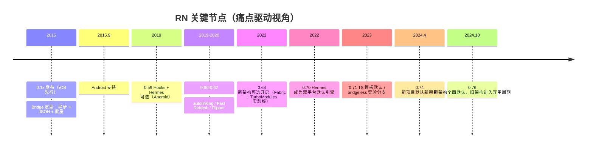
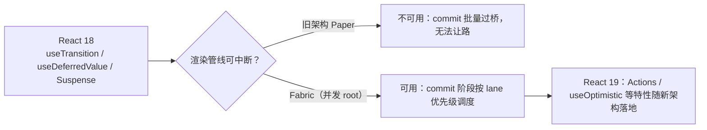

# 版本演进时间线

> RN 的十年，本质上是一部**"如何一步步摆脱 Bridge"**的历史。每个关键版本都在还一笔旧架构的债：异步、序列化、不可同步、注册全量。读时间线不是为了背版本号，而是看懂"痛点 → 解法"的因果链。

## 1. 一张时间轴

> 版本号是路标不是教材：记住四个支点——**0.59（Hermes 可选）、0.68（新架构可选）、0.74（新项目默认）、0.76（全面默认）**——时间线就立起来了。

## 2. 痛点 → 解法对照表

| 时期 | 痛点 | 版本与解法 | 原理落点 |
|------|------|-----------|---------|
| 2015–2018 | Bridge 异步/序列化税显现；启动慢；长列表卡 | 0.59 引入 Hermes（Android 可选）：预编译字节码省掉解析 | 模块三 |
| 2019–2020 | 工程效率：手动 link、改代码全量 reload | 0.60 autolinking；0.61 Fast Refresh（保留状态的热替换） | 模块八、模块十 |
| 2020–2021 | 调试与可观测弱 | 0.62 起 Flipper 内置（0.76 又被 RN DevTools 取代） | 模块十 |
| 2021–2022 | 旧架构天花板：无法同步调用、事件洪泛 | 0.68 新架构可选：JSI / Fabric / TurboModules | 模块七 |
| 2022–2023 | 引擎碎片（JSC/V8/Hermes 并存） | 0.70 Hermes 默认：统一字节码与工具链 | 模块三 |
| 2023–2024 | 新架构成熟度与迁移成本 | 0.74 新项目默认；interop 层兜底旧模块 | 模块七 |
| 2024.10– | Bridge 删除进入倒计时 | 0.76 Bridgeless 默认：JSI 直连，无 MessageQueue | 模块七 |

## 3. 三个"历史包袱"的具体来历

### 3.1 为什么 Bridge 一开始就是异步 JSON

2015 年的约束：JSC 与原生线程模型差异大、移动端跨线程共享内存风险高。**"消息 + 序列化"是最保守也最容易做对的方案**——代价是模块四讲的序列化税与强制异步。这不是设计失误，是当时的工程理性。

### 3.2 为什么 Hermes 花了十年才成默认

JSC 在桌面 Safari 是顶级引擎，但在 App 里：无 JIT 收益（iOS 禁 JIT）、每次启动都要解析源码。Hermes 的答案激进但昂贵：**放弃 JIT，换 AOT 字节码 + 低内存**。0.59 先在 Android 试点，0.70 才双平台默认——引擎替换牵动调试器、性能工具、三方库 ABI，慢是必然的。

### 3.3 为什么新架构要拆成三件套一起上

JSI（通道）、TurboModules（模块系统）、Fabric（渲染）互为依赖：没有 JSI 就没有同步调用；没有 TurboModules 的静态类型，JSI 绑定写不安全；没有 Fabric 的 C++ ShadowTree，JSI 也只能"快在通道上、慢在渲染里"。**这就是 0.68 只能整体 opt-in、无法单选一件的原因。**

## 4. React 18 / 19 并发特性在 RN 的落地路径

Web React 的并发能力依赖**可中断的渲染管线**，而旧架构的 Bridge 批处理天然不可中断：

要点：

1. **并发特性的载体是 Fabric**——`useTransition` 在旧架构上退化为立即执行；
2. React 19 的函数组件 Actions、`useOptimistic` 等能力进入 RN，前提都是 0.76+ 的并发 root；
3. 这也解释了模块九"渲染与状态优化"里，为什么并发 API 的讨论要绑定新架构版本号。

## 5. 用时间线校准学习与选型

- **读源码先问版本**：网上大量教程默认旧架构（MessageQueue / RCTBridge），0.76 后这些代码已不在主路径上——本站模块四讲 Bridge 是为了理解动机，不是照抄实现；
- **迁移规划看支点版本**：0.74（新项目默认）与 0.76（全面默认 + 旧架构弃用）是两个决策阈值；
- **工具链跟着版本走**：Flipper 在 0.76 被移除，取代者是 CDP 直连的 React Native DevTools（模块十）。

## 小结

- 时间线的骨架是四个支点：0.59 / 0.68 / 0.74 / 0.76，因果链是"还 Bridge 的债"；
- 每个解法都有原理落点：Hermes→模块三、新架构三件套→模块七、Fast Refresh→模块八/十；
- React 18/19 并发特性在 RN 的可用性由 Fabric 决定，不是由 React 版本单独决定。
