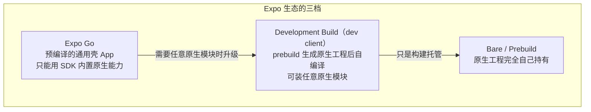
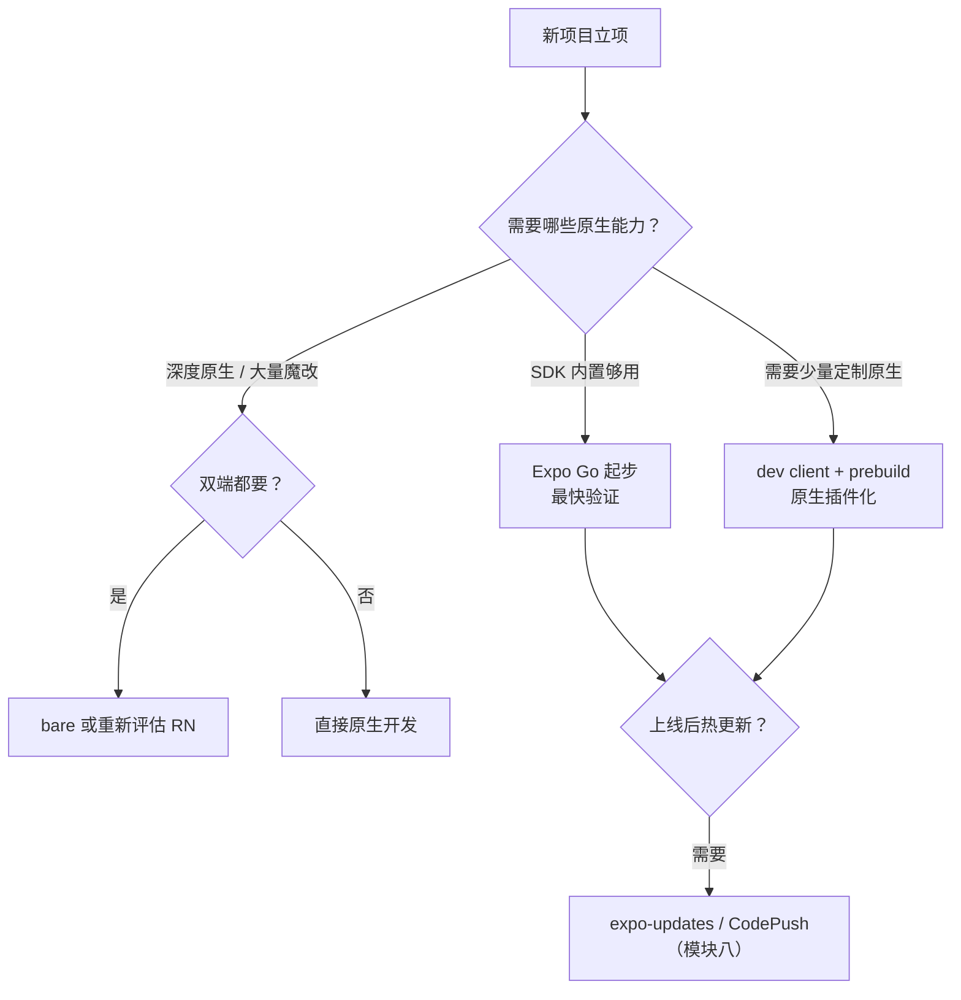

# RN 生态与选型建议

> 原理学习最终要回答工程问题：**Expo 还是 bare？这个社区库敢不敢上生产？这个项目该不该用 RN？** 本篇把这些决策还原为原理可解释的判断，而不是口碑与信仰。

## 1. Expo：三档工作流的真实边界

Expo 不是"另一个框架"，而是**围绕 RN 的一层工程化托管**。理解它的关键是一张所有权地图：

| 能力 | Expo Go | dev client | bare |
|------|---------|-----------|------|
| 运行任意原生模块 | ✗（只限 SDK 内置） | ✓ | ✓ |
| 原生代码调试（Xcode/AS） | ✗ | ✓ | ✓ |
| EAS 云构建 / 热更新（expo-updates） | ✓ | ✓ | ✓ |
| 原生工程手工魔改 | ✗ | 受限（prebuild 会重新生成） | 完全自由 |

关键概念是 **prebuild / CNG（Continuous Native Generation）**：`ios/`、`android/` 目录由 `app.json` + 插件配置**生成**而非手工维护，类似前端的 lockfile。选 Expo 的实质是**选择"原生工程是产物"还是"原生工程是源码"**。

## 2. 社区库健康度 checklist

引入一个带原生代码的库，就是引入一条**随 RN 版本重编译的依赖链**。评估清单按权重排序：

1. **新架构支持**：README 是否声明 Fabric / TurboModules / interop 兼容（0.76+ 的硬门槛）；
2. **发版节奏**：最近一次发版是否跟上了近两个 RN 大版本；长期不更新的原生库大概率在新架构上断；
3. **issue 响应**：维护者是否还在 triage（看最近 90 天的 issue 动静）；
4. **代码体检**：依赖了哪些原生 SDK？是否会拖慢启动（模块二）或常驻线程（模块三）；
5. **可替代性**：纯 JS 实现或官方 `react-native` 内置能力能否覆盖（少一个原生依赖永远优于多一个）。

> 原理视角：每个原生模块都参与**启动时的模块注册**（旧架构）或 Codegen 构建（新架构），"小库"不等于"零成本"。

## 3. 什么时候不该用 RN

诚实列出 RN 的劣势区，每条都能还原到原理：

| 场景 | 原理根因 | 缓解手段 |
|------|---------|---------|
| 极端动画/转场（每帧驱动大量属性） | 帧预算内跨边界次数有限（模块三线程模型） | Reanimated worklet 全原生侧执行；仍不够则是 Skia/自绘方案边界 |
| 重度原生能力（相机深度定制、BLE、后台服务） | 原生模块维护成本 ∝ 平台数 × RN 版本数 | 用 dev client + 自研模块可控；纯依赖社区则成本反噬 |
| 团队无原生排障能力 | 崩溃在线上永远落在原生层（符号表、线程栈） | 接受学习成本，或选 Web 容器方案 |
| 单平台 App | 跨端收益为零，RN 只剩开销 | 直接原生开发 |

## 4. 一个选型决策流

## 5. 给原理学习者的三条建议

1. **读生态先读架构版本**：一个库的文档若还停留在 `link` 命令与 Bridge 时代，它的参考价值要打折；
2. **Expo 的能力边界本身就是原理考题**：Expo Go 为什么装不了任意原生模块？（壳 App 里没有你的原生代码）——能答出这题，模块四/七就通了；
3. **选型输出物是一张依赖成本表**，而不是一句"用/不用"：每个原生依赖标注"新架构兼容 / 维护活跃 / 可替换"。

## 小结

- Expo 三档（Go / dev client / bare）的本质是**原生工程所有权**的分档，prebuild/CNG 是核心机制；
- 社区库健康度第一条是新架构兼容性——它是原理层面的硬门槛，不是流行度问题；
- RN 的劣势场景都能还原到线程模型与跨边界成本（模块三、四），选型判断因此可解释、可复盘。
