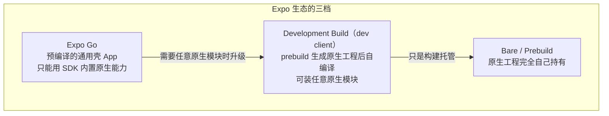
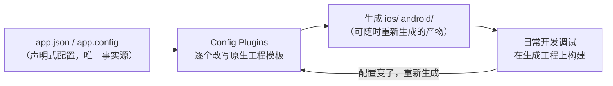
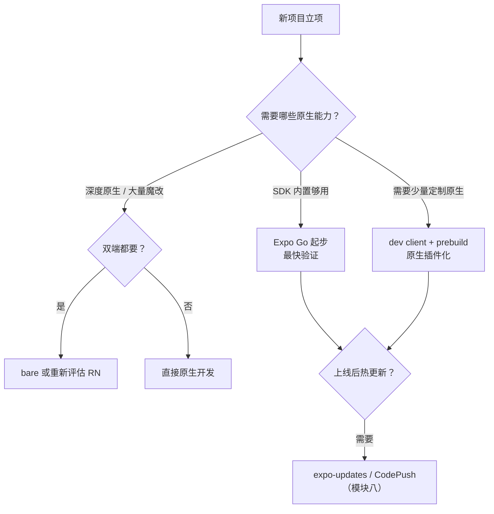
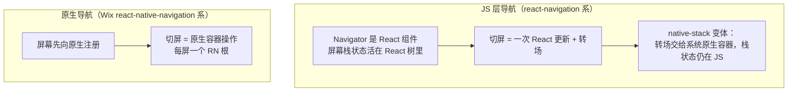

# RN 生态与选型建议

> 原理学习最终要回答工程问题：**Expo 还是 bare？这个社区库敢不敢上生产？这个项目该不该用 RN？** 本篇把这些决策还原为原理可解释的判断，而不是口碑与信仰。

## 1. Expo：三档工作流的真实边界

Expo 不是"另一个框架"，而是**围绕 RN 的一层工程化托管**。理解它的关键是一张所有权地图：

| 能力 | Expo Go | dev client | bare |
|------|---------|-----------|------|
| 运行任意原生模块 | ✗（只限 SDK 内置） | ✓ | ✓ |
| 原生代码调试（Xcode/AS） | ✗ | ✓ | ✓ |
| EAS 云构建 / 热更新（expo-updates） | ✓ | ✓ | ✓ |
| 原生工程手工魔改 | ✗ | 受限（prebuild 会重新生成） | 完全自由 |

关键概念是 **prebuild / CNG（Continuous Native Generation）**：`ios/`、`android/` 目录由 `app.json` + 插件配置**生成**而非手工维护，类似前端的 lockfile。选 Expo 的实质是**选择"原生工程是产物"还是"原生工程是源码"**。

### 1.1 prebuild 的机制：原生工程如何变成"构建产物"

把 CNG 类比成 lockfile 只是起点，值得把"生成—再生"的闭环完整走一遍：

三个推论：

1. **配置是唯一事实源**：图标、权限、启动屏、URL scheme 这类"原生琐碎活"全部上移进配置与插件——换机器、换人，`prebuild` 一次就能重建出等价的原生工程；
2. **手改生成物会被覆盖**：再跑一次 prebuild，手工魔改的部分可能被冲掉。所以"要定制"只有两条正路：能用配置表达的写成 config plugin（留在托管内），表达不了的直接持有原生工程（bare）——两条路在 §4 决策流里对应不同出口，**没有"先改了再说"的第三条**；
3. **升级成本的形态变了**：托管档升级 = 升 SDK + 重新生成；bare 档升级 = 手工合并原生工程 diff（模块七 05/06 的迁移账）。前者把升级成本从"人肉合并"换成"配置表达能力"——代价是你的所有定制必须能被插件表达。

这也顺带回答一个高频焦虑："Expo 会不会锁死我？"——托管档的锁死点只有一处：**配置的表达力**。表达不了的出口是 bare（渐进降级），而不是弃用整套生态。

### 1.2 为什么 Expo Go 装不了任意原生模块：把 §5 的考题做完

那道原理考题值得展开到二进制层面：

- Expo Go 是一个**预编译的通用壳 App**：它包含哪些原生模块、注册表里有什么，在**编译壳的那一天就定死了**（注册表机制见[模块四 02 · NativeModules 调用链](../rn-Bridge通信原理/02-NativeModules调用链.md)）；
- 引入第三方原生模块时，进 bundle 的只有 **JS 侧的接口包装层**——对应的原生实现根本不在壳的二进制里。旧架构下 `NativeModules.X` 查表落空拿到 undefined、一调就抛；新架构下 TurboModule 解析失败（[模块七 03 · TurboModules](../rn-新架构/03-TurboModules.md)）。**拦住你的不是权限系统，是二进制里没有那段代码**；
- dev client 的原理因此一目了然：把你的第三方原生模块**编进壳**，壳从"通用"变成"专属"，JS 侧代码一行不改、原生侧查表命中。所谓"升级到 dev client"，原理上就是换一个包含了你依赖的原生编译产物。

一个实操推论：在 Expo Go 里跑通只验证了 JS 侧；集成新原生库的正确次序是**先在 dev client 真机跑通，再讨论要不要兼容 Expo Go**——多数场景不必兼容，也不该为了兼容往回退。

### 1.3 构建与热更新：托管管线的两条延伸

三档共享同一套延伸管线，但约束不同——这两条延伸正好是模块八的工程面：

| 环节 | 托管路径 | bare 路径 | 定性差异 |
|------|---------|----------|---------|
| 构建 | EAS 云构建（证书/签名材料托管在云） | 本机 Xcode/Android Studio 或自建 CI | 云构建把"环境一致性"外包出去；本地构建控制力全在自己手里 |
| OTA 热更新 | expo-updates | 同样可用 | 前提一致：OTA 推的是 JS 与资源，**推不了原生**（模块八 05） |
| 多环境 | 配置 profile 驱动多份变体 | 自维护 target/flavor | 托管把"环境变体"也变成配置问题 |

OTA 那一行值得再压一层：无论哪档，**原生模块的升级永远走应用市场渠道**（原生代码只能随安装包更新）——所以"依赖里原生模块越多，OTA 的覆盖面越小"，这是热更新边界在选型账本上的投影（详见[模块八 05 · OTA 更新工程实践](../rn-Metro打包与热更新/05-OTA更新工程实践.md)）。

### 1.4 起步档位的三条经验

把 §4 决策流的落点再具体化成三条可操作的经验（均为定性判断，按项目特征取用）：

1. **验证期优先 Expo Go，集成期升 dev client**：产品假设还没验证时，最快的反馈循环是最大的杠杆；第一个真原生需求出现的那一刻，就是升档的信号——不要为了"以后可能用到"提前升档，也不要为了"省一次升档"在 Go 里硬绕；
2. **升档不是重写**：Go → dev client 只增加"生成 + 编译原生工程"这一步，业务代码不动——这是 CNG 设计送给迁移的礼物，也解释了为什么"从 Expo 开始"几乎没有沉没成本；
3. **bare 的入场券是原生工程维护能力**：持有原生工程 = 接受每次 RN/SDK 升级的 diff 合并与双端排障（模块十二的能力清单）——没有这能力就停在 dev client，让 prebuild 帮你维护生成物。

三条的共同底层：**档位是流动的，代价发生在"流动时"而不是"停在时"**——所以选档位的本质是选"预计要流动几次"。

## 2. 社区库健康度 checklist

引入一个带原生代码的库，就是引入一条**随 RN 版本重编译的依赖链**。评估清单按权重排序：

1. **新架构支持**：README 是否声明 Fabric / TurboModules / interop 兼容（0.76+ 的硬门槛）；
2. **发版节奏**：最近一次发版是否跟上了近两个 RN 大版本；长期不更新的原生库大概率在新架构上断；
3. **issue 响应**：维护者是否还在 triage（看最近 90 天的 issue 动静）；
4. **代码体检**：依赖了哪些原生 SDK？是否会拖慢启动（模块二）或常驻线程（模块三）；
5. **可替代性**：纯 JS 实现或官方 `react-native` 内置能力能否覆盖（少一个原生依赖永远优于多一个）。

> 原理视角：每个原生模块都参与**启动时的模块注册**（旧架构）或 Codegen 构建（新架构），"小库"不等于"零成本"。

### 2.1 把 checklist 落成一张依赖成本表

checklist 的正确用法不是逐条打钩，而是**每引入一个原生依赖，沉淀一行成本表**，随代码库一起演进、复盘时有据可查。下面按依赖类别示范判断方式（结论列是写法示范，不针对任何具体库）：

| 依赖类别（示例） | 原生面 | 新架构兼容 | 维护活跃 | 可替代性 | 成本结论的写法 |
|----------------|--------|-----------|---------|---------|--------------|
| 手势/动画类 | 双端接管手势系统与渲染指令 | 看其对新架构的适配声明 | 大生态通常活跃 | 难替代（内置 Animated 表达力有限） | "核心依赖：锁定版本、跟随升级、纳入每次 RN 升级的验证集" |
| 相机/媒体类 | 深度绑定平台 SDK，权限面大 | 常是重灾区 | 参与方多、碎片化 | 需求深时难替代 | "逐项核对需求覆盖，避免同类库叠加" |
| 存储/键值类 | 薄封装，原生面小 | 迁移成本低 | 活跃度高 | 可替代性高 | "低风险引入，确认同步/异步语义即可" |
| 小众协议/硬件类 | 单端甚至单机型适配 | 不确定 | 长期低响应 | 可能要自研 | "按自研预算评估，不按开源依赖评估" |

读表口径：**"可替代性"决定谈判空间，"新架构兼容"决定生死**——前者贵了可以换实现议价，后者断了没有议价余地。

### 2.2 原生依赖的三类隐性成本

开头那条原理注脚展开成三本账：

1. **启动期**：旧架构的模块注册是启动链路上的全量动作（[模块二 04 · 启动优化原理](../rn-启动流程原理/04-启动优化原理.md)）；新架构换成 Codegen 的编译期动作（[模块七 04 · Codegen](../rn-新架构/04-Codegen.md)）。无论哪档，"多一个原生模块"都在启动或构建链路上多一笔；
2. **运行期**：自带线程的库（音视频、后台任务、加解密）常驻内存与调度——[模块三 02 · 四线程模型](../rn-JS引擎与线程模型/02-四线程模型.md)的账本里它们各占一行；
3. **维护期**：RN 每次大版本升级，**每个原生依赖都要重编译、重适配一遍**。成本是乘法：依赖数 × 平台数 × 版本跨度——这就是 checklist 把"新架构支持"放第一条的原因，也是[03 篇 · 版本演进时间线](03-版本演进时间线.md)里新旧架构迁移的主要摩擦面。

## 3. 什么时候不该用 RN

诚实列出 RN 的劣势区，每条都能还原到原理：

| 场景 | 原理根因 | 缓解手段 |
|------|---------|---------|
| 极端动画/转场（每帧驱动大量属性） | 帧预算内跨边界次数有限（模块三线程模型） | Reanimated worklet 全原生侧执行；仍不够则是 Skia/自绘方案边界 |
| 重度原生能力（相机深度定制、BLE、后台服务） | 原生模块维护成本 ∝ 平台数 × RN 版本数 | 用 dev client + 自研模块可控；纯依赖社区则成本反噬 |
| 团队无原生排障能力 | 崩溃在线上永远落在原生层（符号表、线程栈） | 接受学习成本，或选 Web 容器方案 |
| 单平台 App | 跨端收益为零，RN 只剩开销 | 直接原生开发 |

### 3.1 反向推演：什么项目 RN 是"对"的

劣势表的反面不是"其余全都对"，而是一组可识别的特征。满足得越多，RN 的收益面越大：

- **界面语汇常规**：列表、表单、图文、详情——全部落在"声明式 UI + flex 布局"的舒适区（模块五）；
- **业务高频迭代**：需求以周为单位变化，热更新与跨端复用的杠杆真实存在（模块八）；
- **团队 JS 资产厚**：现成的组件库、类型体系、工程师池可以直接复用；
- **多端同构是刚需**：跨端收益是乘数——这也是 [01 篇 · RN 全景与技术本质](01-RN全景与技术本质.md)里"RN 的本质是工程杠杆"的判断基础。

反向读这张清单：**一条都不占的项目，即使"能用 RN"，也是"能用而不划算"**——这就是 §3 表格最后一行"单平台 App"的推论来源。选型沟通时把两组表并排放：劣势表回答"凭什么不用"，特征表回答"凭什么用"——两问都有原理答案，讨论就不会滑向信仰之争。

### 3.2 "Web 容器方案"是什么：缓解列里那个选项的展开

劣势表"团队无原生排障能力"一行的缓解列写着"或选 Web 容器方案"，值得展开说清它放弃了什么、换来了什么：

- **形态**：整个 App 或业务模块跑在系统 WebView 里（自建壳或 Hybrid 框架），业务代码是 Web 技术栈——原生排障需求被压缩到壳本身那一小圈；
- **换来**：崩溃面缩小（Web 层错误不砸进程）、更新天然灵活（网页自更新）、团队纯 Web 技能栈即可交付；
- **代价**：WebView 里的 UI 不再走 RN 的渲染管线（模块五整篇失效）、手势与系统能力全靠桥接、体验上限受 WebView 约束——**它不是"更安全的 RN"，是另一条技术路线**，进入前要按同样的特征表（3.1）重新推演一遍。

对照读法：RN 把"原生层"保留在依赖里但由框架维护，Web 容器把"原生层"压缩到壳里但付出渲染上限——两者对"团队无原生能力"的缓解方式不同，选哪个取决于业务对原生体验的敏感度。

## 4. 一个选型决策流

### 4.1 决策流回答"骨架"，器官在后面四节

§4 的决策流停在工程形态层（Expo 档位、用不用 RN），但一个 RN 项目的完整技术栈还有四个"器官级"选择：状态、导航、动画、存储。它们的选型逻辑与 §2 的 checklist 不同——**不是"敢不敢用"，而是"哪种模型与业务形态互锁"**。§6–§9 逐类推演，先立一条贯穿四节的总纲：

> **RN 的生态选型都在回答同一个问题：这笔成本付在 JS 线程、原生线程，还是构建期？** 状态库付在 JS 线程的 re-render，导航库付在"屏幕栈由谁持有"，动画库付在每帧的跨边界次数，存储库付在同步 I/O 是否阻塞 JS。

四类选择彼此还有依赖顺序：导航定了"屏幕边界"，状态定了"边界内怎么流动"，动画与存储再各按需选档——**先骨架（§4），后导航与状态，最后动画与存储**，是和架构演进同构的选型次序。

## 5. 给原理学习者的三条建议

1. **读生态先读架构版本**：一个库的文档若还停留在 `link` 命令与 Bridge 时代，它的参考价值要打折；
2. **Expo 的能力边界本身就是原理考题**：Expo Go 为什么装不了任意原生模块？（壳 App 里没有你的原生代码）——能答出这题，模块四/七就通了；
3. **选型输出物是一张依赖成本表**，而不是一句"用/不用"：每个原生依赖标注"新架构兼容 / 维护活跃 / 可替换"。

## 6. 状态管理：选型即"订阅粒度"的推演

状态库是纯 JS 依赖，与原生架构无关——但它与 **React 的渲染成本**强耦合：状态通知的范围决定 re-render 的范围，re-render 的范围决定 JS 线程的帧预算消耗（[模块九 03 · 渲染与状态优化](../rn-性能优化原理/03-渲染与状态优化.md)）。所以 RN 视角的状态选型，第一维度不是 API 顺不顺手，是**订阅粒度**。

### 6.1 三种数据流模型

| 模型 | 代表生态（定性） | 订阅粒度 | 心智 | 结构性代价 |
|------|----------------|---------|------|-----------|
| 单向数据流 · 全局单 store | Redux 系 | selector 级（粒度取决于怎么写） | 所有变更显式经过 action/reducer，可预测可追溯 | 样板多（官方 Toolkit 写法已大幅削减）；粒度写粗则整片 re-render |
| 响应式 · 自动细粒度订阅 | MobX 系 | 属性级（observable 自动追踪） | "用到才订阅"，粒度天然细 | 依赖关系隐式、难以静态审查；与 React 单向数据流心智有摩擦 |
| 原子化 · 自底向上 | Jotai / Zustand 一类轻量库 | atom / hook 级 | 状态拆成小单元自由组合 | "拆多细"本身成为设计负担；约定弱时容易各写各的 |

三种模型没有优劣，只有**与业务形态的互锁**：变更需严格审计（资金、权限类）→ 显式 action 流；状态高度独立、交互密集 → 原子化；表单/图表类细粒度联动 → 响应式。

### 6.2 与 React 并发渲染的接缝：外部 store 的快照一致性问题

状态库都活在 React 之外（store 自己持有状态，React 只是订阅者），于是有一个绕不开的接缝：

- React 18 起的并发渲染**可以中断一次渲染再重来**，重来的那一段可能基于新的状态——如果外部 store 在两次取值之间更新了，同一次渲染里不同组件可能读到**不一致的快照**（社区通称 tearing）；
- React 给外部 store 的官方对接原语是 `useSyncExternalStore`：约束订阅读到的快照与本次渲染一致。**一个库的订阅入口是否走这层官方接缝**，就是并发渲染兼容性的定性判断点——不需要记版本号，看代码即可。

原理视角：这是[模块三 04 · 同步与异步的边界](../rn-JS引擎与线程模型/04-同步与异步的边界.md)的 React 内部版——**一次渲染内部的一致性，靠"读快照"这个动作被约束在正确的时机**。

### 6.3 服务端状态与客户端状态分开算账

很多"状态管理难题"其实是**缓存问题**：数据来自服务端，要处理加载/失败/重试/失效/去重。让客户端 store 硬扛服务端状态，等于用状态机手写一遍缓存层。通行做法是把服务端状态交给专门一层（TanStack Query 系，定性能力：请求去重、缓存与后台刷新），store 只剩真正的本地状态——**两层各司其职，store 的复杂度断崖式下降**。

### 6.4 选型推演的四问

不给答案，给推法（按顺序问）：

1. **变更的形状**：变更是否需要严格审计？是 → 显式 action 流优先；
2. **订阅的形状**：是否高频更新、大子树（图表、实时数据）？是 → 细粒度订阅优先；
3. **团队的形状**：成员水平方差大 → 强约定优先；小而强 → 自由度高的轻量库；
4. **调试的形状**：是否依赖时间旅行/动作回放类 DevTools（Redux 生态的公开能力）？是 → 生态配套权重上调。

四问的答案常常互相冲突（要审计又要细粒度）——冲突时回到总纲算账：**审计是低频的组织成本，re-render 是每帧的运行成本**，运行成本贵的优先让路。

### 6.5 先分层，再选库

状态选型最常见的返工原因是"用一个库扛所有状态"。先做一层划分（这一步不需要任何库）：

| 状态层 | 内容 | 天然归属 |
|--------|------|---------|
| 服务端状态 | 列表、详情、用户资料 | 请求缓存层（6.3） |
| 全局客户端状态 | 登录态、主题、全局开关 | 轻量全局 store |
| 局部 UI 状态 | 输入中、展开收起、临时选择 | 组件本地 `useState` |

划分完会发现：**真正需要"状态库"的往往只有第二层**——第一层交给缓存层，第三层留在组件里。库的选择因此从"全局信仰问题"缩小成"全局层用什么模型"的局部问题，试错成本也随之骤降。

## 7. 导航：屏幕栈由谁持有

导航库的分野比状态库更"结构化"：**屏幕栈与转场由 JS 持有还是原生持有**。这个决定波及混合开发、热更新与系统手势的每个接缝——所以导航比状态更接近"立项时定、中途不换"的一类。

### 7.1 两条路线的架构对照

| 维度 | JS 层导航 | 原生导航 |
|------|----------|---------|
| 屏幕栈持有者 | JS（React 树的一部分） | 原生容器（每屏一个 RN 根） |
| 与渲染管线的关系 | 导航状态变化就是一次 React 更新，走渲染旅程那条链（可回读[02 篇 · 从 View 到像素的旅程](02-从View到像素的旅程.md)） | 导航动作绕开 JS 渲染，直接动原生容器 |
| 热更新边界 | 导航逻辑在 bundle 里，**OTA 可改**（模块八 05） | 容器行为在原生侧，**OTA 改不了** |
| 混合栈接缝 | 原生页嵌 RN 需要桥接与栈状态同步 | 原生容器与 RN 屏幕同体系，接缝自然（[模块十二 02 · 混合导航与通信边界](../rn-混合开发/02-混合导航与通信边界.md)） |
| 系统贴合度 | 依赖库对系统手势/返回的适配层 | 直接用系统容器，贴合度高 |
| deep link 配置位置 | URL→路由的映射配置在 JS 侧 | 需同时维护原生侧注册（混栈项目的链接表是双份账） |

### 7.2 选型推演

1. **纯 RN App**：JS 层导航是生态主流（社区组件、文档、工具链围绕它），导航状态进 bundle 让 OTA 覆盖面最大——默认选项；
2. **混合栈重的项目**（原生壳 + RN 模块，模块十二）：原生导航让"原生页与 RN 页互推"落在同一套栈语义里；JS 层导航做混合栈需要额外桥接与状态同步，接缝成本随栈复杂度上升；
3. **对系统转场/边缘手势敏感的项目**：原生容器贴合天然更高；JS 路线可退一步选 native-stack 变体把转场交还系统，但栈语义仍在 JS。

一条定性提醒：**"JS 导航性能差"是过时的口碑**——转场交给系统容器（native-stack）之后，转场动画的成本与原生导航同一量级；真正的分野回到"栈状态与 OTA/混合接缝"，这才是值得立项时想清楚的点。

## 8. 动画：每帧成本付在哪条线程

动画选型的原理框架在[模块六 04 · 动画系统原理](../rn-事件系统原理/04-动画系统原理.md)已经搭好：**每帧的成本付在哪条线程、要不要跨边界**。生态选项就是这条框架上的几个档位——动画库与手势库还要配套选：**两者必须同侧执行**，否则手势驱动动画又回到每帧跨边界。

### 8.1 档位表：从 JS driver 到 worklet

| 档位 | 机制（定性） | 每帧跨边界？ | 适用 |
|------|-------------|-------------|------|
| Animated + JS driver | 每帧在 JS 算插值再下发 | 是（每帧） | 简单一次性动效 |
| Animated + native driver（useNativeDriver） | 参数一次性预下发，插值循环在原生侧跑 | 否（除启动那一次） | 不参与布局的属性（transform/opacity 一类） |
| Reanimated worklet | 动画逻辑编译成在 **UI 线程**执行的 worklet，与手势系统同侧联动 | 否 | 手势逐帧联动、复杂交互动画 |
| 声明式封装（Moti 一类） | 建在 Animated/worklet 之上的声明式薄层 | 随其底层 | 常规动画的快速书写 |
| Lottie | 回放设计工具导出的动画描述文件 | 描述固定，渲染在原生侧 | 设计稿还原、无运行时交互 |

### 8.2 选型推演

判据只有两条，且都是原理判据：

1. **要不要与手势逐帧联动？**要 → 必须与手势仲裁同侧执行（worklet 档）；JS driver 的每帧跨边界在跟手场景必掉帧（模块六 01/04 的时序归因）；不要 → 上一档够用，不必上重武器；
2. **动画属性参与布局吗？**参与（宽高类）→ 每帧触发布局失效（模块五 02 的缓存失效链），换 transform 表达；不参与 → native driver / worklet 均可。

一句话：**动画选型不是"哪个库流畅"，是"哪个档位让每帧不跨边界"**——档位选对，库与库的差异才退化为实现细节。反过来的推论也成立：如果一个项目的动画需求全落在"不跟手、不参与布局"的区间，那么任何动画库都改变不了什么——先改档位，再谈库。

### 8.3 手势与动画的配套：一次决定两侧

§8 开头说"动画库与手势库必须同侧"，这里把配套关系展开成对照（手势系统原理见模块六 02）：

| 组合 | 每帧路径 | 定性结论 |
|------|---------|---------|
| 内置手势（RN 自带） + JS driver 动画 | 每帧：手势 → JS → 桥 → JS 算插值 → 桥 → 原生 | 原型可用；跟手场景结构上掉帧 |
| GestureHandler + Reanimated worklet | 手势与插值都在 UI 线程，JS 只收终值 | 跟手场景的结构正解（模块六 02/04） |
| GestureHandler + JS driver | 手势在原生、动画在 JS：每帧两次跨边界 | 结构最差的组合，避免 |

判断口径不变：**看每帧跨边界次数**。手势库与动画库不是两个独立选型——选了其一，另一侧的档位就被锁定了大半。

## 9. 存储：按数据形态选阶梯

存储选型的第一问不是"哪个库"，是**数据的形态与访问模式**：数据量、要不要查询、读写时机、能否接受同步 I/O。按阶梯从低到高：

### 9.1 存储阶梯

| 阶梯 | 代表（定性） | 形态 | 关键特征 | 边界 |
|------|-------------|------|---------|------|
| 异步键值 | AsyncStorage 一类 | 字符串键值 | API 简单、随 RN 可用 | 异步序列化消耗 JS 线程；无索引无查询；大 value 拖慢序列化 |
| 同步键值 | MMKV 一类 | 字符串/二进制键值 | C++ 实现、经 JSI 同步访问、可选加密 | **同步 API 占用 JS 线程时间片**——小键值极快，塞大对象等于把 I/O 搬进帧预算 |
| 关系型 | SQLite 绑定（官方 expo-sqlite 与社区实现） | 表 + SQL | 索引、事务、结构化查询 | SQL 心智成本；schema 迁移自己管 |
| 关系型 + 数据层 | WatermelonDB 一类 | SQLite 之上的模型层 | 面向大数据量列表的懒加载与离线同步设计 | 引入整套数据层心智，小数据量不划算 |
| 对象型 | Realm | 对象数据库 | 对象即数据；厂商提供设备同步能力（按需评估） | 引擎黑盒程度高，排障依赖其工具链 |

### 9.2 判据推演

1. **几十个偏好项**（主题、开关、会话 token）→ 异步键值足矣；若"首帧就要读到"成为硬需求（启动屏直接要值）→ 同步键值档；
2. **结构化数据 + 条件查询** → 直接上关系型，别用键值存 JSON 再全量解析——全量解析既是启动成本也是内存成本；
3. **离线优先 / 大列表本地库** → 关系型 + 数据层（懒加载把内存账转移到查询时刻，与[模块九 02 · 列表虚拟化原理](../rn-性能优化原理/02-列表虚拟化原理.md)的内存观对齐）；
4. **任何同步存储**都记同一条边界：**同步 I/O 从 JS 帧预算里扣**（模块三 02）——把大 value 塞进同步键值库，等于把冷启动和滚动一起押上。

### 9.3 加密与合规的定性维度

存储还常被合规需求推一把：敏感字段要不要加密、密钥放哪、能不能随 App 卸载清除。这些问题的选型含义是**能力在哪个档位天生存在**（如同步键值档普遍自带加密开关，键值/关系型需要自建加密层）——合规是立项时的硬约束，比性能更早把选项淘汰掉，所以它排在判据推演之前问。

## 10. 常见误区

| 误区 | 事实 | 一句话纠正 |
|------|------|-----------|
| "Expo = 用不了原生库" | Expo Go 才有此限制；dev client / prebuild 后任意原生模块可编进壳 | 限制在壳的编译产物，不在"Expo"这个名字 |
| "prebuild 生成物可以随手改" | 再生成会覆盖手工改动；要定制走 config plugin 或 bare | 配置上移，或退出托管，别打游击 |
| "状态库是信仰问题" | 订阅粒度直接决定 re-render 范围与帧预算消耗 | 用"订阅粒度 × 变更频率"推演，不用嗓门 |
| "导航库可以随时换" | 屏幕栈持有者决定混合栈接缝与 OTA 边界，迁移是结构级成本 | 立项时定，别中途换 |
| "JS 导航一定性能差" | 转场交给系统容器（native-stack）后与原生同量级；分野在栈状态的归属 | 按维度对照，不按口碑 |
| "动画库选'最流畅'的" | 流畅与否取决于每帧是否跨边界（档位），不是库名 | 先选档位，再选库 |
| "同步存储一定更快" | 同步省了等待，却把 I/O 计入 JS 线程；大 value 场景反伤帧预算 | 同步/异步的选择跟数据量走 |
| "小众库先跑起来再说" | 新架构断层 + 低响应维护 = 把债记到升级日 | 引入前过 §2 的 checklist |

## 11. 把选型写成可复盘的记录：一张 ADR 骨架

选型最怕的不是选错，是**当时为什么这么选没人记得**。工程界的通行做法是 Architecture Decision Record（ADR）：每个重大选型一条短记录。RN 项目里值得写 ADR 的时刻，恰好就是本篇的各节决策点：

| 字段 | 内容 | 对应本篇 |
|------|------|---------|
| 背景 | 什么约束逼出这个决策 | §1 档位 / §3 场景 |
| 候选与权衡 | 列出被放弃的选项与放弃理由 | §6–§9 各推演节 |
| 决策 | 一句话结论 | 决策流（§4）的出口 |
| 反悔条件 | 什么信号出现时要重新评估 | 依赖成本表（2.1）的恶化行 |

四字段的价值在最后两行：**"反悔条件"把选型从一次性判断变成带触发器的监控**——比如"当某依赖连续两个 RN 大版本未适配新架构时，启动替换评估"。复盘时对着的不再是记忆，是记录；这与"选型判断可解释、可复盘"（小结）是同一条原则的工程化落点。

## 小结

- Expo 三档（Go / dev client / bare）的本质是**原生工程所有权**的分档，prebuild/CNG 是核心机制；
- 社区库健康度第一条是新架构兼容性——它是原理层面的硬门槛，不是流行度问题；
- RN 的劣势场景都能还原到线程模型与跨边界成本（模块三、四），选型判断因此可解释、可复盘。

## 自测

1. Expo 三档的分界变量是什么？prebuild/CNG 把什么变成了"产物"？手改生成物的两条正路是什么？（→ 1.1）
2. Expo Go 装不了任意原生模块的机制原因是什么？"升级到 dev client"在原理上改变了哪一步？（→ 1.2）
3. expo-updates 能推什么、不能推什么？这如何约束原生依赖的数量？（→ 1.3）
4. 原生依赖的三类隐性成本各发生在哪个阶段？为什么"新架构支持"是 checklist 第一条？（→ 2.2）
5. 依赖成本表里哪一列决定谈判空间、哪一列决定生死？（→ 2.1）
6. "什么项目 RN 是对的"四个特征是什么？与 §3 劣势表是什么关系？（→ 3.1）
7. 状态库的快照不一致（tearing）问题如何产生？useSyncExternalStore 在接缝上扮演什么角色？（→ 6.2）
8. 为什么"服务端状态"不该塞进客户端 store？（→ 6.3）
9. JS 层导航与原生导航的分野如何影响 OTA 边界与混合栈接缝？"JS 导航性能差"错在哪？（→ §7）
10. 动画选型的两条原理判据是什么？为什么说"档位先于库"？（→ §8）
11. 同步键值存储在什么数据形态下从"快"变成"坑"？合规约束在存储选型里排在第几问？（→ §9）
