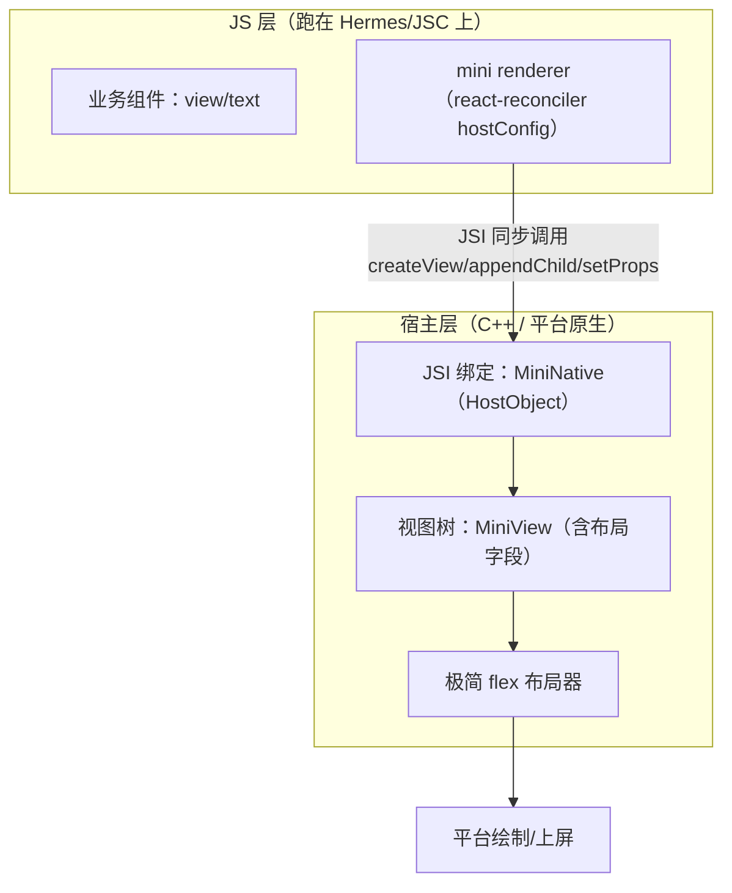
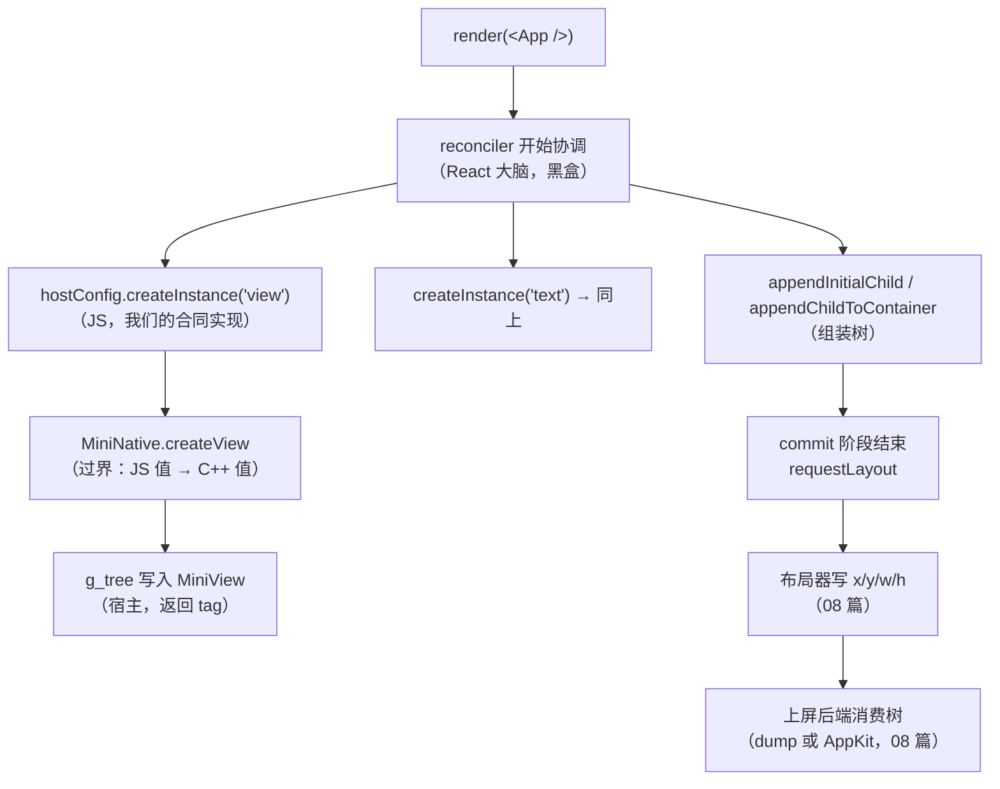

# mini-react-native 总览

> 检验原理的最好方式是复刻。目标：写一个 **mini-react-native**——几十行 JS 组件代码 + react-reconciler 自定义渲染器 + 一层 JSI 原生绑定，让 `<view><text>hello</text></view>` 真的渲染成原生控件。本篇做总设计与里程碑拆解，细节在后续篇目逐步落地。

## 0. 本篇怎么读：子系列地图

本模块（模块十）共 9 篇，分三条线：**总览与实战入门（01–04）、mini-rn 走读（05）、mini-rn 全量工程（06–09）**。本篇是整张地图的入口：

| 篇目 | 角色 | 什么时候读 |
|------|------|-----------|
| [01 · 总览](01-mini-react-native总览.md)（本篇） | 目标、架构、里程碑、思考题 | 动手前通读一遍 |
| [02 · 自定义 TurboModule 全流程](02-自定义TurboModule全流程.md) | 非 UI 原生能力的工程化通道 | 想对照"真 RN 怎么暴露原生方法"时 |
| [03 · Fabric 原生组件开发](03-Fabric原生组件开发.md) | Props/Event/State 三通道组件 | 想对照"真 RN 怎么暴露原生视图"时 |
| [04 · 调试工具链原理](04-调试工具链原理.md) | Metro/DevTools/CDP/原生联调 | 全站收官；mini-rn 也用得上（lldb/node --inspect） |
| [05 · 落地实现](05-mini-react-native落地实现.md) | M0–M5 逐里程碑走读（节选代码） | 跟着本篇的里程碑表逐个做 |
| [06 · 宿主工程与视图原语](06-宿主工程与视图原语.md) | M0–M1 全量 C++ 工程 | 做完 M0/M1 想要"可抄的全文"时 |
| [07 · 渲染器与更新管线](07-渲染器与更新管线.md) | M2–M3 全量 hostConfig + 批处理实验 | 做 M2/M3 时 |
| [08 · 布局器与上屏后端](08-布局器与上屏后端.md) | M4–M5 两遍布局 + AppKit 上屏 | 做 M4/M5 时 |
| [09 · 事件回路与收官自测](09-事件回路与收官自测.md) | 事件上行闭环 + 全系列自测 | 收官时 |

两种读法都成立：

- **跟做型**：01 → 05 → 06 → 07 → 08 → 09，每篇做完验收再前进；02/03/04 作为"真 RN 侧的对照组"穿插阅读；
- **查阅型**：直接进 06–08 抄工程，遇到"为什么这样设计"再回 01/05 找决策记录，遇到调试问题进 04。

系列内互引的规则：**05 是"为什么"，06–09 是"是什么（全量代码）"**——05 讲决策与走读，06–09 给出可编译的完整文件与验收输出，两者描述同一套代码，行号与函数名保持一致。

### 0.1 前置知识自查：系列依赖的正文模块

mini-rn 不是从零开始——它反复调用模块一~九的结论。开工前用这张表自查，"想不起"的行请先回对应模块补课：

| 依赖模块 | 系列里用到的知识点 | 用在哪 |
|---------|-------------------|--------|
| 模块二（启动流程） | runApplication 之后一切交互从事件开始 | 09 篇"从单向到回路"的动机 |
| 模块三（JS 引擎与线程） | 四线程模型、GC 与 Handle 体系、同步异步边界 | 08 篇布局归宿主、09 篇持久引用 |
| 模块四（Bridge 通信） | "只有编号没有对象"、跨语言通用设计五要素 | 全系列 tag 身份、06 篇 N-API 对照 |
| 模块五（渲染原理） | 三棵树、Yoga、两级批处理 | 07 篇 hostConfig、08 篇两遍布局 |
| 模块六（事件系统） | 触摸事件链路、动画原生闭环 | 09 篇事件队列、03 篇动画归原生 |
| 模块七（新架构） | JSI 引用通道、Fabric 管线、TurboModule、Codegen | 06 篇对照、02/03 篇全程 |
| 模块八（Metro） | 模块封装 `__d` 与 HMR | 04 篇 Fast Refresh |
| 模块九（性能） | Profiler 数据源、why did render | 04 篇 DevTools、07 篇更新风暴 |

如果这张表里有一半是陌生的话，推荐顺序是先做 M0/M1（几乎不依赖正文），做到 M2 再回模块五 01，做到 M4 再回模块五 02——**mini-rn 的里程碑顺序本身就是正文模块的"按需复习"序列**。

## 1. 目标与非目标

**目标**（复刻 RN 的三根支柱）：

1. 自定义 React 渲染器：`render(<App />)` 驱动"原生"树；
2. 一条跨语言通道：JS 操作直达宿主层（JSI 风格，同步）；
3. 最小布局：宿主侧算出 x/y/w/h（Yoga 的极简替代）。

三根支柱分别对应 RN 的三个核心子系统：渲染器（`react-reconciler` 定制，模块五 01）、跨语言通道（JSI/TurboModule，模块七 01/03）、布局（Yoga，模块五 02）。mini 版每一根都砍到最小但**不缺席**——缺席任何一根，"复刻"就退化成"玩具"：没有渲染器就没有 React 生态，没有通道就只能打印日志，没有布局就只能看树结构看不到几何。

**非目标**（避免无底洞）：

- 不做 Bridge/MessageQueue（直接用 JSI，正好对照新旧架构差异）；
- 不做完整 CSS：只支持 `flexDirection/padding/margin/width/height/color/fontSize`；
- 不做动画、手势、多端：宿主先选一个（macOS 用 AppKit 或 iOS 模拟器最顺手；Android 模拟器亦可）。

每条非目标都是刻意砍掉的，砍的理由值得写明：

- **不做 Bridge**：Bridge 的全部价值在"异步批量",而我们恰好要体验"同步直调"是什么感觉（模块四 01 的对照才有了实感）。mini-rn 里唯一带"旧架构味道"的是 props 走 JSON 序列化——这是刻意的教学残留（05 篇 M1、06 篇都标注了这个偷懒点）；
- **CSS 只做七个子集**：布局器的复杂度随属性数超线性增长，`flex:1` 一来就要引入约束求解（09 篇扩展挑战 1 就是让你亲手撞上这堵墙）；七个属性已覆盖"排一排、嵌一嵌、留白"的全部典型场景；
- **不做手势/动画**：事件回路只做"上行一次点击"的最小闭环（09 篇），动画在 03 篇的 Fabric 组件里以"原生侧闭环"的形态出现，不进 mini-rn 主线。

## 2. 三层架构



对照真 RN：JS 层对应 `Libraries/Renderer`，宿主层对应 Fabric 的 C++ `ShadowNode + ComponentDescriptor`——只是把百万行换成三百行。

### 2.1 每层职责与边界上的数据形态

分层的关键不是"画三个框"，而是**每个框对相邻框承诺了什么、数据过界时长什么样**：

| 层 | 职责 | 对下层的调用形态 | 过界后的数据形态 |
|----|------|----------------|----------------|
| 业务组件 | 只描述"想要什么"（声明式） | 不直接调宿主，只 return 元素 | React 元素树（纯 JS 对象） |
| mini renderer | 把元素树的变化翻译成指令 | `MiniNative.createView(type, props)` 等 | 指令 + 序列化 props（JSON 字符串） |
| JSI 绑定 | 参数解包、类型转换、注册表维护 | 直接读写宿主数据结构 | C++ `std::string` / `int tag` / `nlohmann::json` |
| 视图树 | 唯一事实源：结构 + 样式 + 几何 | 不调外部，被布局器遍历 | `MiniView{tag,type,props,children,x,y,w,h}` |
| 布局器 | 从样式算几何 | 只读树、只写 x/y/w/h | 布局结果直接写回节点字段 |
| 上屏后端 | 树 → 平台控件 | 按 tag 查表、set frame | 平台视图（NSView/UIView/终端文本） |

注意两条铁律的雏形已经藏在表里：**宿主对象不过界**（JS 侧只有 tag 编号，模块四 01）、**布局结果不过界回 JS**（x/y/w/h 写在宿主树里，JS 从不需要读它——这也是 08 篇"布局在宿主侧"的第三条理由）。

### 2.2 一条指令的旅程（以 createView 为例）

以 `createView('text', '{"value":"hello"}')` 为例，数据在三层间的完整形态变化：

1. **JS 层**：reconciler 调 hostConfig 的 `createInstance`，参数是 JS 字符串 `'text'` 与 `JSON.stringify(props)` 的结果——一个 JSON 字符串；
2. **过界**：N-API/JSI 把 JS 值解包成 C++ 值——字符串变 `std::string`，编号变 `int`；这一步没有魔法，就是"引擎数据结构 → 宿主数据结构"的逐字段拷贝（06 篇第 4 节有逐条对照表）；
3. **宿主层**：分配 tag、往 `g_tree` 写入一个 `MiniView` 节点、把 JSON 字符串解析成内存里的 json 对象存进节点——从此 props 以宿主形态存在，JS 侧那份只是"上一帧的快照"；
4. **回程**：返回值只有 tag 一个数字。JS 拿到的是编号，不是引用——"只有编号没有对象"从第一条指令就开始生效。

后面 07 篇会看到这条旅程的完整版本（reconciler 在什么时机调它、为什么同一条指令会被批量合并），08 篇会看到旅程的终点（tag 如何变成屏幕上的像素）。

### 2.3 首帧全链路：三层如何被串成一次渲染

把三层放进一次首帧渲染的时序里，能看清"谁在什么时候调谁"（这条链在 07 篇会逐回调展开）：



三个观察点，做完 M2 再回看会更有感觉：

- **reconciler 的协调（B）与宿主指令（C–G）是两个阶段**：先在内存里把整棵新树的"计划"算完，再一次性 commit——这就是"两班倒"的第一班；
- **宿主只在 commit 阶段被触碰**：协调期间出错（组件抛异常），宿主树完全不知情——这正是 React"可中断渲染不打扰宿主"的根基（模块五 01）；
- **requestLayout 是 commit 的收尾动作**而不是独立事件——07 篇实验会证明：一帧内多次 commit 也可以共享一次 layout。

## 3. 关键部件的"一行心跳"

每个部件的最小可用形态（先闻味道，实现见里程碑）：

```js
// ① hostConfig 的 createInstance：不复用 props 对象，直接下发自定义视图操作
createInstance(type, props) {
  const tag = MiniNative.createView(type, JSON.stringify(props)); // JSI 直调宿主
  return { tag, type };
},

// ② 宿主侧 HostObject：JSI 的门轴（C++ 伪码）
class MiniNativeHostObject : public jsi::HostObject {
  jsi::Value get(jsi::Runtime &rt, const jsi::PropNameID &name) override {
    if (name.utf8(rt) == "createView") return makeFunction(&createViewImpl);
    // appendChild / setProps / requestLayout ...
  }
};

// ③ 业务代码：React 满血可用（useState/useEffect）
const App = () => {
  const [n, setN] = useState(0);
  useEffect(() => { const t = setInterval(() => setN(x => x + 1), 1000); return () => clearInterval(t); }, []);
  return <view style={{ padding: 8 }}><text>count: {n}</text></view>;
};
render(<App />);
```

三段代码各藏一个"系列级考点"，值得先点名：

- **① 为什么 `JSON.stringify` 而不是直接传对象**：真 JSI 的做法是把 `jsi::Object` 引用传过去、宿主侧遍历字段（模块七 01），全程零序列化；我们传字符串是刻意的退化——它让"新旧架构分界"变成一段可以指认的代码（05 篇 M1 的"偷懒点要自觉"）。N-API 里也完全可以做到传对象后逐字段读取，这个"改回引用通道"的作业留在 06 篇的欠账表里；
- **② HostObject 的 `get` 是"按需返回函数"**：JS 第一次访问 `MiniNative.createView` 时才拿到函数对象——这就是"懒加载"在绑定层的最小形态（对照 TurboModule 首次访问才实例化，02 篇第 2 节）；
- **③ 业务代码完全不知道宿主存在**：没有 `NativeModules`、没有平台分支——这行代码换成真 RN 工程原样能跑（把 view/text 换成 View/Text 即可）。**"业务层无感"是自定义渲染器成功的判据**，也是 M3 验收时要用的心态：如果你发现业务代码里混进了 tag 或宿主细节，说明 hostConfig 的封装漏了。

## 4. 里程碑（M0–M5）

| 里程碑 | 交付 | 验证 | 对应正文模块 |
|--------|------|------|-------------|
| **M0 跑起来** | Hermes/JSC 宿主进程 + global 注入 MiniNative | JS 调 `MiniNative.log('hi')` 打到原生控制台 | 模块三、七 |
| **M1 视图原语** | createView/appendChild/setProps/removeChild 走 JSI | 宿主侧能打印出树结构 | 模块七 |
| **M2 渲染器** | react-reconciler hostConfig 打通 createInstance/appendChild/commitUpdate | `render(<view>…)` 首帧上屏 | 模块五 |
| **M3 状态与更新** | setState → diff → updateView 通路 | 计数器每秒刷新 | 模块五 |
| **M4 布局器** | 极简 flex（一维 column/row + padding/margin） | 嵌套 view 的 x/y 正确 | 模块五 Yoga |
| **M5 文本与收尾** | text 度量（平台 API）、双平台编译开关 | hello world 完整闭环 | — |

每个里程碑独立可运行、可提交——这就是"复刻"与"读完"的区别。

里程碑之间是严格的依赖链，不存在跳跃式开工——前一级的验收输出就是后一级的输入：


依赖关系的具体含义：

- 没有 M0 的通道，M1 的原语无处落（JS 调不到宿主）；
- 没有 M1 的树，M2 的指令没有作用对象（hostConfig 的 createInstance 无处 create）；
- 没有 M2 的 reconciler，M3 的 setState 不会变成任何指令（React 找不到宿主）；
- 没有 M3 的更新通路，M4 的布局只能验证首帧（脏标记需要更新流来触发）；
- 没有 M4 的几何，M5 的上屏只能摆控件摆不出位置（frame 全是 0）。

### 4.0 代码规模预算

"三百行"不是修辞，是可以对账的预算表（各篇验收时可逐项核对）：

| 部件 | 所在文件 | 规模（约） | 出处 |
|------|---------|-----------|------|
| 宿主视图树 + 全部原语 + 树导出 | mini_native.cc | < 130 行 C++ | 06 篇小结 |
| hostConfig + React 入口 | renderer.js | ~80 行 JS | 07 篇小结 |
| 两遍布局器 | mini_native.cc 追加 | ~40 行 C++ | 08 篇小结 |
| 业务组件 + 帧循环/事件队列 | app.js | 几十行 JS | 09 篇 |

规模预算的意义在于**防止"顺手做完整"的冲动**：加一个属性"就几行"，加着加着 mini 就变成一个大而全的烂尾楼。预算超了，先问"这个能力能不能用现有七属性组合出来"，不能就写进欠账表留给对照篇目。

### 4.1 每个里程碑的完成判据与常见卡点

里程碑表给的是"交付物"，这里补"怎么算完成 + 最容易卡住的地方"（详细排错见对应篇目）：

| 里程碑 | 完成判据（ stricter 版） | 最常见卡点 |
|--------|------------------------|-----------|
| M0 | `require` 产物后 `log` 能打印，且**进程退出码为 0**（没有隐藏崩溃） | 编译产物与 Node 架构不匹配；注册宏名与产物名不一致（06 篇第 8 节） |
| M1 | dump 出的树结构与挂载顺序一致；重复 setProps 是**增量合并**而非整体覆盖 | 传参顺序搞反（parent/child）；tag 0 根视图没建（06 篇 `EnsureRoot`） |
| M2 | `render(<view><text>hello</text></view>)` 后树里恰好两个节点 | 文本节点处理——总览占位写法在 07 篇被修正（`createTextInstance` 建 text 实例而非抛错） |
| M3 | 计数器每秒一刷，且**一秒内宿主只见一次终态**（批处理） | `prepareUpdate` 恒返回真值导致更新风暴（07 篇第 5 节） |
| M4 | 手算坐标与 dump 输出**逐位一致**（08 篇给了可复算样例） | 主轴/交叉轴在 row/column 下互换搞混；padding 加在错误的遍历里 |
| M5 | 同一份 C++ 核心，dump 后端与 AppKit 后端输出同一套坐标 | 坐标系翻转（AppKit 原点在左下，08 篇第 5 节） |

### 4.2 宿主选型：设计稿与落地稿的务实差异

本篇架构图按"真 RN 形态"画的是 Hermes/JSC + JSI；**落地时（05 篇起）做了一个务实替换：用 Node.js + N-API 当 JSI 的替身**。理由与影响：

- 两者同为"引擎嵌入边界"：`napi_env ↔ jsi::Runtime`、`napi_value ↔ jsi::Value` 语义同构（05 篇第 0 节有逐行对照表）；
- Node 免去"自己起 Hermes runtime、接命令行、桥模块加载"的工程量，M0–M4 当天可跑；
- 代价是通道细节略有差异（句柄生命周期、错误传播），这些差异本身被当作教学内容写进了 06 篇第 4 节；
- M5 的"接真平台"替换点不受影响：C++ 视图树与布局器不关心引擎是谁（08 篇的 AppKit 后端证明了这一点）。

所以读后续篇目时要有预期：**架构图与代码在"层与职责"上严格一致，在"引擎与绑定 API"上以 05/06 篇的 N-API 版为准**。

> 子系列导航：05 篇逐里程碑走读；06–08 篇是 M0–M5 的**全量工程实现**（宿主 / 渲染器 / 布局上屏）；09 篇补事件上行闭环并收官自测。

## 5. 预埋的三个思考题

做的时候会自然撞上，撞上时回对应模块重读：

1. **M2**：commitUpdate 里如果直接同步调宿主，一帧内 N 次更新会怎样？要不要攒批？（→ 模块五"两班倒 commit"的由来）
2. **M3**：JS 里 `instance` 对象存的是什么？tag？为什么不能直接存宿主对象引用？（→ 模块四"只有编号没有对象"）
3. **M4**：布局在 JS 算还是在宿主算？各自的线程/延迟代价？（→ 模块五 Yoga 与模块三线程模型）

三个思考题的"官方验证场"都在后续篇目里，撞上时别硬想，直接去做实验：

- 思考题① → [07 篇第 4 节的批处理实验](07-渲染器与更新管线.md)：一个开关切换 sync/batch 两种模式，亲手数 `requestLayout` 的打印次数；
- 思考题② → [06 篇第 4 节](06-宿主工程与视图原语.md)的 N-API/JSI 对照表 + [09 篇自测第 1 题](09-事件回路与收官自测.md)：跨边界持有对象会撞上句柄生命周期；
- 思考题③ → [08 篇第 1 节](08-布局器与上屏后端.md)：三条理由全部可以在"宿主侧布局"的实现里直接体验（比如把布局挪回 JS 会发生什么，可以作为反例实验）。

## 6. 与真实 RN 的对照表（做完后自测）

| 我写的 | RN 里的对应物 | 差距主要在哪 |
|--------|--------------|-------------|
| hostConfig | ReactFabric hostConfig（`ReactFabric-prod.js`） | props 预算化 diff（`ReactNativeAttributePayload`） |
| MiniNative HostObject | TurboModule /BindingsInstaller | Codegen 类型绑定、懒加载 |
| MiniView 树 | C++ ShadowNode + COW | clone-on-write、并发优先级 |
| 极简 flex | Yoga | 完整规范 + 缓存失效 + 文本测量 |
| （未做）Bridge | MessageQueue | 全部（这是新旧架构的分界线） |

逐行解读"差距主要在哪"（这些差距就是从 mini-rn 通向真 RN 源码的台阶）：

- **props diff**：我们的 `diffProps` 是引用比较 + 键并集（07 篇），每次渲染 style 新对象就恒变；真 RN 把 props 编译成定长的属性结构体，按位比较，diff 成本与属性个数成正比且无嵌套对象问题——工程上这叫"用编译期结构换运行期速度"；
- **Codegen**：我们的 MiniNative 全靠手写注册（06 篇 `Init` 里一行一个 `exports.Set`）；真 RN 用 TS spec 生成双平台绑定（02/03 篇全程实战）——手写版让你看清"注册表本来就是个对象表"，生成版解决"几百个模块手写必错"的规模问题；
- **COW**：我们的 `removeChild` 连子树一起删（06 篇欠账表）；真 RN 的 ShadowNode 不可变、改树靠克隆路径——这是并发渲染（一边渲染一边响应事件）的前提，mini-rn 单线程用不上，但 09 篇扩展挑战 3 让你补一个最简版；
- **Yoga**：两遍布局法（08 篇）覆盖无弹性场景；flex 比例需要约束求解，这正是 Yoga 作为一个"库"而不是"百行代码"的理由（09 篇扩展挑战 1）。

## 7. 环境准备（动手前 10 分钟）

mini-rn 主线（05–09 篇）的工具链清单，全部就绪后再开工，能避免 90% 的"环境型卡点"：

| 依赖 | 用途 | 检查方式 |
|------|------|---------|
| Node.js（LTS） | 宿主进程与 JS 引擎 | `node -v` 能出版本号 |
| node-gyp + node-addon-api | 编译 N-API 插件 | `npm i` 后 `npm run build:native` 产出 `.node` |
| 平台编译链 | macOS 上是 Xcode Command Line Tools | `clang --version` 有输出 |
| Python | node-gyp 的构建脚本依赖 | `python3 --version` |
| Xcode（可选） | 08 篇 AppKit 上屏后端 | 能建 macOS App 工程即可 |

两个高频环境坑，先记下来（06 篇第 8 节有完整排查表）：

1. **架构不匹配**：Apple Silicon 上若终端与 Node 架构不一致，编译出的 `.node` 会在 `require` 时直接报 dlopen 类错误——重装/切换到与终端同架构的 Node 再编；
2. **Python 版本**：node-gyp 对 Python 大版本有要求，报错通常直指 `gyp`——按报错提示装对应版本即可，不必深究。

## 8. 名词速查

系列里反复出现的术语，一张表钉住（首次出现的篇目在括号里）：

| 术语 | 一句话定义 | 容易混淆的点 |
|------|-----------|-------------|
| tag | 宿主分配的节点编号，跨边界唯一身份（M1） | 不是数组下标，是注册表键 |
| instance | hostConfig 返回的纯数据对象 `{tag, type, props}`（M2） | 不是宿主对象，宿主对象不过界 |
| hostConfig | reconciler 的"平台合同"，一堆回调（M2） | 合同条款按需调用，缺了才报错 |
| HostObject | JSI 侧"原生对象"抽象：JS 属性访问落到 C++ `get`（本篇 ②） | N-API 对应形态是 exports 对象表 |
| N-API / JSI | 两个引擎嵌入边界 API；前者 Node 稳定 ABI，后者 RN 的 C++ 抽象（05 篇） | 不是竞品，是同一角色的两个实现 |
| ShadowNode | 真 RN 的 C++ 影子节点（对照 MiniView） | mini 版没有 COW，也不可并发 |
| 两遍布局 | 后序 Measure + 先序 Place（08 篇） | "两遍"指两次全树遍历，不是两次渲染 |
| mount / 上屏 | 树 → 平台控件的落地阶段（08 篇） | 我们的 dump 树也是"后端"之一 |
| 上行事件 | 宿主 → JS 的回调通路（09 篇） | 与"指令下行"相对，合起来才是回路 |

## 8.5 对照组说明：02/03/04 与 mini-rn 的关系

02/03/04 三篇不含在 M0–M5 里，但它们是 mini-rn 的"真身对照"——mini 里的每个手写部件，在真 RN 里都有工程化版本：

| mini-rn 里的手写物 | 真 RN 的工程化对应 | 对照篇目 |
|-------------------|------------------|---------|
| `Init` 里逐行 `exports.Set` 注册 | Codegen 从 TS spec 生成注册 | [02 篇](02-自定义TurboModule全流程.md) |
| `log/createView` 等函数直调 | TurboModule 的 JSI HostObject | [02 篇](02-自定义TurboModule全流程.md) |
| `createView + setProps + requestLayout` 三件套 | Fabric 组件的 Props/Event/State 三通道 | [03 篇](03-Fabric原生组件开发.md) |
| `dumpTree` + printf 排错 | Metro WS / DevTools / CDP 全套工具链 | [04 篇](04-调试工具链原理.md) |
| `EmitEvent` 手动触发事件 | 原生组件事件发射器 | [03 篇](03-Fabric原生组件开发.md) |

推荐节奏：做完 M1 读 02（你会突然看懂 `__turboModuleProxy` 在干嘛）；做完 M5 读 03（三通道全见过面）；09 篇收官后读 04（工具链的前置知识刚好集齐）。

## 9. FAQ：三个常被问的问题

**Q1：为什么不直接嵌 Hermes，那不是更"真"吗？**
更真，但 M0 的工程量会从"一个 .gyp 文件"膨胀到"拉 Hermes 源码、接 runtime、自己实现模块加载器"。本系列的教学重心在**通道语义与树管线**，不在引擎引导流程；N-API 版把全部精力留给了前者。想看引擎引导的真身，去模块二（启动流程）——那是另一个专题。

**Q2：学 N-API 对写真 RN 有用吗？**
有，且直接。真 RN 的 JSI 绑定、TurboModule 的 C++ 层、以及大量混合工程里的自研原生库，思维方式与 N-API 同构：值过界、生命周期归属、错误传播、线程规则。06/09 篇把这套规则在迷你环境里全部踩过一遍。

**Q3：mini-rn 写完能用于生产吗？**
不能，也无意于此。它缺动画、手势、无障碍、列表虚拟化、错误边界……每一个都是真 RN 的一个子系统的存在理由。mini-rn 的产出是**判断力**：以后看到 RN 的任何一行设计，你能说出"它在解决我遇到过的问题"。

**Q4：宿主为什么最后选了 macOS/AppKit，而不是 iOS 或 Android？**
三者都可行（05 篇 M5 列了替换点）。选 AppKit 的理由：开发机就是 macOS，免模拟器/真机的部署环节，改一行 C++ 重编即见；且 AppKit 的坐标系翻转（08 篇第 5 节）是个极好的"平台适配层"教材。想换成 iOS/Android，只需替换 08 篇的"后端 B"胶水文件，C++ 核心不动——可插拔后端就是为这个自由度设计的。

**Q5：为什么选 react-reconciler 而不是自己写调度？**
自己写调度 = 重新发明 React（diff、优先级、批处理、Suspense……），工作量与教学价值完全不成比例。用 reconciler 恰好把边界画在最有价值的位置：**React 的大脑是黑盒但合同（hostConfig）是白盒**——你被迫理解"React 到底要求宿主提供什么"，这正是模块五 01 的核心问题。

## 自测（做完 09 篇再回来）

1. 不看架构图，画出三层并标出每层对下层的调用形态；
2. 三根支柱各自对应 RN 的哪个子系统？砍掉哪一根损失最大，为什么？
3. 三个思考题各自的"验证场"在哪个篇目？（答案都在第 5 节的链接里）
4. `JSON.stringify(props)` 这个"偷懒点"对照的是哪种旧架构做法？还债篇目是哪个？
5. 里程碑 M2 与 M3 的验收差异是什么？（提示：M3 多了"一秒内只见终态"）

## 小结

- mini-react-native = 自定义渲染器 + JSI 通道 + 极简布局，三百行覆盖 RN 三根支柱。
- 里程碑 M0–M5 每步可运行，问题预埋引导回正文模块。
- 复刻的价值不在"能用"，而在让模块三/四/五/七的每个设计决策变成"我也遇到过"。
- 本篇是地图：01 定方向、05 讲决策、06–09 给全量代码；做不动时回这里看"完成判据"，卡住时按篇目找"常见卡点"。
