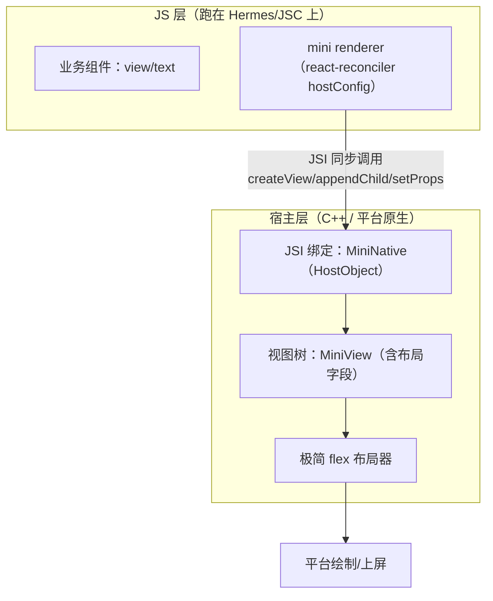

# mini-react-native 总览

> 检验原理的最好方式是复刻。目标：写一个 **mini-react-native**——几十行 JS 组件代码 + react-reconciler 自定义渲染器 + 一层 JSI 原生绑定，让 `<view><text>hello</text></view>` 真的渲染成原生控件。本篇做总设计与里程碑拆解，细节在后续篇目逐步落地。

## 1. 目标与非目标

**目标**（复刻 RN 的三根支柱）：

1. 自定义 React 渲染器：`render(<App />)` 驱动"原生"树；
2. 一条跨语言通道：JS 操作直达宿主层（JSI 风格，同步）；
3. 最小布局：宿主侧算出 x/y/w/h（Yoga 的极简替代）。

**非目标**（避免无底洞）：

- 不做 Bridge/MessageQueue（直接用 JSI，正好对照新旧架构差异）；
- 不做完整 CSS：只支持 `flexDirection/padding/margin/width/height/color/fontSize`；
- 不做动画、手势、多端：宿主先选一个（macOS 用 AppKit 或 iOS 模拟器最顺手；Android 模拟器亦可）。

## 2. 三层架构



对照真 RN：JS 层对应 `Libraries/Renderer`，宿主层对应 Fabric 的 C++ `ShadowNode + ComponentDescriptor`——只是把百万行换成三百行。

## 3. 关键部件的"一行心跳"

每个部件的最小可用形态（先闻味道，实现见里程碑）：

```js
// ① hostConfig 的 createInstance：不复用 props 对象，直接下发自定义视图操作
createInstance(type, props) {
  const tag = MiniNative.createView(type, JSON.stringify(props)); // JSI 直调宿主
  return { tag, type };
},

// ② 宿主侧 HostObject：JSI 的门轴（C++ 伪码）
class MiniNativeHostObject : public jsi::HostObject {
  jsi::Value get(jsi::Runtime &rt, const jsi::PropNameID &name) override {
    if (name.utf8(rt) == "createView") return makeFunction(&createViewImpl);
    // appendChild / setProps / requestLayout ...
  }
};

// ③ 业务代码：React 满血可用（useState/useEffect）
const App = () => {
  const [n, setN] = useState(0);
  useEffect(() => { const t = setInterval(() => setN(x => x + 1), 1000); return () => clearInterval(t); }, []);
  return <view style={{ padding: 8 }}><text>count: {n}</text></view>;
};
render(<App />);
```

## 4. 里程碑（M0–M5）

| 里程碑 | 交付 | 验证 | 对应正文模块 |
|--------|------|------|-------------|
| **M0 跑起来** | Hermes/JSC 宿主进程 + global 注入 MiniNative | JS 调 `MiniNative.log('hi')` 打到原生控制台 | 模块三、七 |
| **M1 视图原语** | createView/appendChild/setProps/removeChild 走 JSI | 宿主侧能打印出树结构 | 模块七 |
| **M2 渲染器** | react-reconciler hostConfig 打通 createInstance/appendChild/commitUpdate | `render(<view>…)` 首帧上屏 | 模块五 |
| **M3 状态与更新** | setState → diff → updateView 通路 | 计数器每秒刷新 | 模块五 |
| **M4 布局器** | 极简 flex（一维 column/row + padding/margin） | 嵌套 view 的 x/y 正确 | 模块五 Yoga |
| **M5 文本与收尾** | text 度量（平台 API）、双平台编译开关 | hello world 完整闭环 | — |

每个里程碑独立可运行、可提交——这就是"复刻"与"读完"的区别。

> 子系列导航：05 篇逐里程碑走读；06–08 篇是 M0–M5 的**全量工程实现**（宿主 / 渲染器 / 布局上屏）；09 篇补事件上行闭环并收官自测。

## 5. 预埋的三个思考题

做的时候会自然撞上，撞上时回对应模块重读：

1. **M2**：commitUpdate 里如果直接同步调宿主，一帧内 N 次更新会怎样？要不要攒批？（→ 模块五"两班倒 commit"的由来）
2. **M3**：JS 里 `instance` 对象存的是什么？tag？为什么不能直接存宿主对象引用？（→ 模块四"只有编号没有对象"）
3. **M4**：布局在 JS 算还是在宿主算？各自的线程/延迟代价？（→ 模块五 Yoga 与模块三线程模型）

## 6. 与真实 RN 的对照表（做完后自测）

| 我写的 | RN 里的对应物 | 差距主要在哪 |
|--------|--------------|-------------|
| hostConfig | ReactFabric hostConfig（`ReactFabric-prod.js`） | props 预算化 diff（`ReactNativeAttributePayload`） |
| MiniNative HostObject | TurboModule /BindingsInstaller | Codegen 类型绑定、懒加载 |
| MiniView 树 | C++ ShadowNode + COW | clone-on-write、并发优先级 |
| 极简 flex | Yoga | 完整规范 + 缓存失效 + 文本测量 |
| （未做）Bridge | MessageQueue | 全部（这是新旧架构的分界线） |

## 小结

- mini-react-native = 自定义渲染器 + JSI 通道 + 极简布局，三百行覆盖 RN 三根支柱。
- 里程碑 M0–M5 每步可运行，问题预埋引导回正文模块。
- 复刻的价值不在"能用"，而在让模块三/四/五/七的每个设计决策变成"我也遇到过"。
