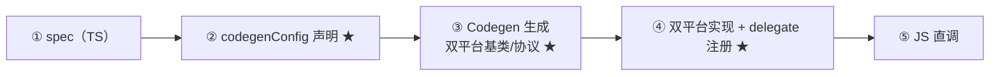

# 自定义 TurboModule 全流程

> 模块七 03/04 讲了 TurboModules 与 Codegen 的原理，本篇**亲手走一遍**：从 TS spec 到双平台实现再到 JS 调用。样例选一个真实有用的模块——原生侧埋点上报 `NativeAnalytics`：`logEvent(name, params)` 打日志并 Promise 回执，`getConstants` 暴露启动配置。

## 0. 全流程地图：五步与三处"检查点"

先给全景，后面逐步展开。整条流水线五步，其中三处是最容易出问题的检查点（星标）：



| 步骤 | 产物 | 检查点：怎么确认这步成了 |
|------|------|------------------------|
| ① 写 spec | `specs/NativeAnalytics.ts` | TS 编译通过（但这只查 JS 类型，不查 codegen 可表达性） |
| ② 声明 codegen | `package.json` 的 `codegenConfig` | 构建后 generated 目录里有产物（★） |
| ③ 生成 | Android 抽象类 / iOS 协议头文件 | 能 import/`#import` 到生成的类型 |
| ④ 实现与注册 | Kotlin 类 / ObjC++ 类 + delegate | 编译通过 + 运行时能按名字取到实例（★） |
| ⑤ JS 调用 | 业务代码 import | 同步方法有返回值、Promise 能 resolve |

星标的逻辑：**②③ 是"契约有没有被工具看见"，④ 是"契约有没有被运行时接上"**——排查问题时先分清卡在哪一类，能省一半时间（第 6 节展开）。

## 1. 目标接口（先定契约）

```ts
// specs/NativeAnalytics.ts
import type { TurboModule } from 'react-native';
import { TurboModuleRegistry } from 'react-native';

export interface Spec extends TurboModule {
  logEvent(name: string, params: Object): Promise<void>; // 异步：落盘有 IO
  getPlatform(): string;                                  // 同步：纯取值（模块三 04）
  readonly constants: { flushIntervalMs: number } | object;
}

export default TurboModuleRegistry.getEnforcing<Spec>('Analytics');
```

逐行拆解这份 spec，每一行都在回答一个工程问题：

- **`extends TurboModule`**：标记这是个模块 spec 而非组件 spec——Codegen 靠继承结构区分 `modules` 与 `components` 两种产物（组件版见 [03 篇](03-Fabric原生组件开发.md)）；
- **`logEvent(name: string, params: Object)`**：参数类型落在支持集内（第 5 节的表格）。注意 `params` 用 `Object` 而不是具体接口——具体接口（带字段的对象类型）也支持，但埋点参数天然是开放的，收窄反而碍事；
- **返回 `Promise<void>`**：异步契约。Codegen 会把它翻译成"resolve/reject 两个回调"的原生签名——**TS 里的一个返回类型，跨语言后展开成参数表末尾的两个 block**，这是 spec→原生签名最重要的形态变化；
- **`getPlatform(): string`**：同步方法。原生侧直接返回值，JS 侧拿到的是值本身而非 Promise——调用形态的差异**在 spec 上就已注定**，实现侧无法改变它；
- **`readonly constants`**：只读属性会被生成为常量导出，实例化时一次性读出（模块七 03 的"常量时机"）。写成 `| object` 是为了让 TS 接受"运行时未必有完整结构"的宽松形态，Codegen 只关心它是对象；
- **`getEnforcing<Spec>('Analytics')`**：泛型参数给 JS 侧类型提示，字符串参数是**运行时查找键**——它必须与原生 `getName()` 严格一致（大小写敏感）。与 `get<Spec>()` 的区别：`get` 找不到返回 null（模块可选），`getEnforcing` 找不到直接抛——埋点模块属于"缺了就该炸"的依赖，用 enforcing 是刻意的。

声明 codegen 输入（`package.json`）：

```json
{ "codegenConfig": { "name": "AppSpecs", "type": "modules", "jsSrcsDir": "./specs" } }
```

三个字段各有讲究：

- **`name`**：产物库的名字。iOS 侧生成头文件的 import 路径会带上它（下文 `#import <AppSpecs/NativeAnalyticsSpec.h>`），Android 侧生成的包名同样由它派生——所以改这个名字是**双平台 breaking change**，定了就别动；
- **`type: "modules"`**：声明这个 codegen 配置产出模块绑定。组件 spec 走 `components`（03 篇），两者可以共存为多入口；
- **`jsSrcsDir: "./specs"`**：告诉 Codegen 去哪扫 spec 文件。目录里**所有**被 export 的 spec 都会被处理——这就是"契约目录"的由来：一个目录管全部原生契约，review 时一眼看全。

同步/异步的取舍在本篇不是风格问题：`logEvent` 走 Promise 因为要等原生落盘；`getPlatform` 同步因为它只是读一个值——**"需要等谁"的边界（模块三 04）在 spec 上直接落形**。

### 1.1 一个反例：同步/异步选错的代价

假设把 `logEvent` 写成同步（返回 `void`，原生内部开线程落盘）：

- JS 侧拿不到"落盘完成"的信号——`.then(() => 上报下一条)` 的顺序逻辑无法表达；
- 落盘失败只能吞掉或打日志——错误处理通道（reject）直接消失。

反过来把 `getPlatform` 写成 Promise：

- 每次调用都产生一次微任务调度，纯取值操作被异步化；
- 调用方代码被迫 `.then`，同步分支（如初始化时决定平台分支）被迫改成异步链。

两条都是真实项目里出现过无数次的"接口设计回旋镖"——**spec 是跨语言契约，改它就是同时改三处（TS、双平台签名）**，所以第一版就要想清楚"这个方法等不等 IO"。

## 2. Android 实现（Kotlin）

`pod install` / gradle sync 后，Codegen 在 `build/generated/` 生成 `NativeAnalyticsSpec` 抽象类，实现它：

```kotlin
// android/app/src/main/java/com/rnlearn/AnalyticsModule.kt
import com.facebook.react.bridge.Promise
import com.rnspecs.NativeAnalyticsSpec

class AnalyticsModule : NativeAnalyticsSpec() {   // ← Codegen 生成的基类
  override fun getName() = "Analytics"

  override fun logEvent(name: String, params: Any?, promise: Promise) {
    Thread {                       // 重 IO 别占调用线程
      writeToFile(name, params)    // 伪代码：落盘/上报
      promise.resolve(null)
    }.start()
  }

  override fun getPlatform(): String = "android"
  override fun getConstants(): Map<String, Any> = mapOf("flushIntervalMs" to 5000)
}
```

注意三点：基类签名由 Codegen 决定（参数类型错了**编译不过**——模块四 02 的运行时炸消失）；`getName` 必须与 JS 端 `getEnforcing('Analytics')` 一致；模块首次被访问才实例化（模块七 03 的懒加载）。

### 2.1 这段 Kotlin 的逐点讲解

- **`params: Any?` 的由来**：spec 里的 `Object` 在 Android 侧生成 `Any?`（对应 bridge 的 ReadableMap 或原生 Map 形态，取决于字段结构）——JS 传 `null` 也合法，所以实现里要按可空处理；
- **`Promise` 参数是 spec 里 `Promise<void>` 的展开**：返回类型变成了**参数表末尾的 promise 对象**——这正是第 1 节说的"一个 TS 返回类型展开成两个回调"在 Android 侧的样子；
- **`Thread { ... }.start()`**：裸线程只为示意"别占调用线程"。真实项目里更常见的是注入/复用一个专用 executor（线程创建本身有成本，埋点高频时裸线程会成为新瓶颈）；iOS 侧对应物是下面的串行 dispatch_queue——**"重活挪出调用线程"在两个平台各有一个惯用解**；
- **`promise.resolve(null)` 在后台线程调用是安全的**：resolve 内部会把回调调度回 JS 执行上下文，不需要我们自己切线程——这是生成的 Promise 桥接送我们的礼物；对应地，**reject 也要记得用**：`writeToFile` 失败时应 `promise.reject(code, message)` 而不是吞异常，否则 JS 侧的 `.catch` 永远沉默；
- **`getConstants()` 的键**：`"flushIntervalMs"` 必须与 spec 里 `constants` 的字段名一致——常量是按键取的，拼错就是 JS 侧 `undefined`，且**没有任何编译期或运行期报错**（这是常量通道与函数通道最大的差别：函数错在编译，常量错在运行时静默）。

注册（新架构入口）：

```kotlin
// AnalyticsPackage / TurboModuleManagerDelegate 的解析处
override fun getModule(name: String): Module? =
  if (name == "Analytics") AnalyticsModule() else null
```

注册代码只有三行，但它是检查点★：**运行时按名字查表能命中**才算接通。注意 `getModule` 每次被调用都 `AnalyticsModule()`——实际工程中配合模块缓存（同名的第二次查询命中已建实例），这也是"懒加载 + 单例"的标准组合（模块七 03）。

### 2.2 gradle 链路：spec 怎么变成可 import 的类

从保存 spec 到 Kotlin 文件能 import `NativeAnalyticsSpec`，中间隔着一整条构建链，出问题时需要知道产物在哪一步生成：

1. **发现**：gradle sync 阶段，RN 的 gradle 插件读 `package.json` 的 `codegenConfig`，找到 `jsSrcsDir` 目录；
2. **生成**：Codegen 任务跑在构建早期，把 TS spec 翻译成 Java/Kotlin 抽象类 + C++ 胶水，落在 `build/generated/` 下（包含"generated"字样的目录）；
3. **编译**：app 模块编译时把 generated 源码一并编入——所以你的实现类能 import 到它；
4. **打包**：C++ 胶水编进 so，与 Java/Kotlin 类一起进 APK。

排查口诀：**spec 改了没生效 → 先删构建缓存重新 sync**（generated 目录有时不会因 TS 变更自动失效）；**import 不到生成类 → 去 `build/generated/` 里翻，没有就是第 1 步断了**（codegenConfig 的路径/名字写错）。

### 2.3 线程模型小结：一次 logEvent 的线程旅程

把线程视角单独拎出来（这是双端行为差异的头号来源）：

| 时刻 | Android | iOS |
|------|---------|-----|
| JS 调用进入原生 | 运行在 JS 调用所在的执行上下文 | 同左 |
| 落盘（重 IO） | 我们自建的 `Thread` / executor | 自建串行 `_ioQueue` |
| resolve 回调兑现 | 由 Promise 桥接调度回 JS 上下文 | 同左 |
| 常量读取 | 实例化时机一次读出 | 同左 |

三条纪律从中自然流出：

1. **调用线程别做重活**——同步方法里做 IO 等于把 JS 卡死（JS 调用是同步直调，模块三 04 的边界在"谁等谁"）；
2. **后台线程可以调 resolve/reject**，但**不要**在后台线程随手碰 UI 或其他模块的内部状态——原生侧的线程安全规则并未消失；
3. **落盘顺序有要求就用串行队列**——iOS 的 `_ioQueue` 与 Android 的单线程 executor 是同一个思想。

## 3. iOS 实现（ObjC++）

Codegen 生成 `NativeAnalyticsSpec.h` 协议，`.mm` 实现：

```objc
// ios/AnalyticsModule.mm
#import <AppSpecs/NativeAnalyticsSpec.h>

@interface AnalyticsModule : NSObject <NativeAnalyticsSpec>
@end

@implementation AnalyticsModule {
  dispatch_queue_t _ioQueue;   // 自带串行队列，重 IO 隔离（模块七 03）
}
RCT_EXPORT_MODULE(Analytics)   // 名字对齐 JS 端

- (instancetype)init {
  if (self = [super init]) { _ioQueue = dispatch_queue_create("analytics.io", NULL); }
  return self;
}

- (void)logEvent:(NSString *)name params:(NSDictionary *)params
            resolve:(RCTPromiseResolveBlock)resolve
             reject:(RCTPromiseRejectBlock)reject {
  dispatch_async(_ioQueue, ^{
    [self writeToFile:name params:params];
    resolve(nil);
  });
}

- (NSString *)getPlatform { return @"ios"; }
- (NSDictionary *)getConstantsToExport { return @{ @"flushIntervalMs": @5000 }; }
@end
```

在 `RCTTurboModuleManagerDelegate` 里按名字返回实例（与 Android 对称）。

### 3.1 与 Android 版的逐点对照

把两份实现并排看，"同一契约、两套惯用法"的结构一目了然：

| 关注点 | Android（Kotlin） | iOS（ObjC++） |
|--------|------------------|---------------|
| 契约来源 | `NativeAnalyticsSpec` 抽象类（继承） | `NativeAnalyticsSpec` 协议（实现） |
| 模块名 | `getName() = "Analytics"` | `RCT_EXPORT_MODULE(Analytics)` |
| 异步重活 | 后台线程 / executor | 串行 `dispatch_queue` |
| Promise 形态 | `Promise` 参数对象 | `resolve`/`reject` 两个 block |
| 常量 | `getConstants(): Map` | `getConstantsToExport: NSDictionary` |
| 注册 | delegate `getModule(name)` | delegate 按名字返回实例 |

三个 iOS 特有的注意点：

- **`.mm` 而非 `.m`**：文件要同时看得见 ObjC 协议与 C++ 生成物（生成的绑定层是 C++/ObjC++ 混编），纯 `.m` 会 link 不上；
- **`#import <AppSpecs/...>` 的 `AppSpecs`**：就是 `codegenConfig.name`——第 1 节说"改库名是双平台 breaking change"，在 iOS 的落点就是这行 import；
- **`_ioQueue` 是串行队列**：串行保证落盘顺序（埋点的顺序语义），也天然做了去并发——如果埋点有"先来先到"要求，别顺手改成并发队列（`DISPATCH_QUEUE_CONCURRENT`）。

## 4. JS 侧调用

```ts
import NativeAnalytics from '../specs/NativeAnalytics';

NativeAnalytics.getPlatform();                       // 同步返回，无 Promise
NativeAnalytics.logEvent('page_view', { id: 1 })     // Promise
  .then(() => console.log('flushed'));
```

两个调用形态的差异要盯住：`getPlatform()` 表达式的值就是字符串（可以 `const p = NativeAnalytics.getPlatform()`）；`logEvent(...)` 的值是 Promise，**调用成功 ≠ 落盘成功**——then 里的代码才是"完成之后"。再补两个实战形态：

```ts
// 失败路径：reject 的落点（第 2 节说过，原生要记得 reject）
NativeAnalytics.logEvent('checkout', { sku: 'A1' })
  .then(() => queue.shift())
  .catch((e) => retryLater(e));        // 没有 catch 的 Promise 是静默黑洞

// 常量的消费：字段名拼错 = undefined（静默）
const interval = NativeAnalytics.constants?.flushIntervalMs ?? 5000;
```

全链路复盘（对照模块七 03 时序图）：首次 import → `__turboModuleProxy('Analytics')` → 原生实例化 → JSI HostObject 注入 → 此后每次调用是 C++ 直调，`logEvent` 的 Promise 由原生 executor 回调兑现——**全程无 JSON、无队列**。

这条"全程无 JSON"值得再强调一次：旧架构里同样的调用要经历 JS 对象 → JSON 序列化 → 队列 → 反序列化 → 原生（模块四 01）；新架构里 JS 参数直接以 JSI 值形态被 C++ 逐字段读取。**你在 mini-rn 里手写的 `JSON.stringify(props)`（[06 篇](06-宿主工程与视图原语.md)的刻意偷懒点）在真 RN 的 TurboModule 里已经不存在**——两相对照，就是新旧架构在"模块调用"这一层的全部差异。

## 5. 类型系统的边界（写 spec 前先读）

| 支持 | 不支持（常见误用） |
|------|-------------------|
| string / number / boolean | 联合类型 `a \| b` |
| 只读对象 `{ readonly k: string }` / 数组 | 泛型、可选属性（部分场景）、索引签名扩散 |
| Promise\<T\> / 回调 `(x: T) => void` | 对象里放函数属性（用回调参数表达） |
| `readonly constants` | class / enum（用常量对象） |

误用不产生警告，是 **codegen 阶段直接失败**（模块七 04）——报错定位到字段，改成可表达的形式即可。另一个纪律：**Promise 只 resolve 一次**，原生侧重复 resolve 在 release 下是未定义行为。

### 5.1 边界背后的"为什么"与改写示范

Codegen 的类型集不是任意裁剪，而是**"能静态生成双平台签名的最小集"**——每条不支持的理由都是"生成的签名没法定形"：

- **联合类型 `a | b`**：Kotlin/ObjC 里没有天然对应物（原生侧得生成分支代码或装箱类型，签名爆炸）→ 改写：拆成两个方法，或用带判别字段的对象；
- **泛型**：生成代码时无法实例化 → 改写：为每个实际类型写一份具体 spec（代码生成的世界里，"复制"比"抽象"便宜）；
- **对象里的函数属性**：对象走值序列化路径、函数走回调注册路径，两者混在一个属性表里会让生成的属性访问器无法定形 → 改写：把函数提为方法（回调参数正是为此存在的合法形态）；
- **class / enum**：运行时结构（原型链、枚举映射）无法跨语言 → 改写：`readonly constants` 对象承载枚举值，语义靠命名约定。

一个容易踩的"半支持"：**可选属性**。部分场景可用，但当可选字段出现在"会被原生遍历"的对象里时，原生侧要处理"键不存在"——这与平台 Map 语义有出入。保守纪律：**契约对象写字段就写全，"可能没有"用联合成两份 spec 表达**。

### 5.2 从报错到修复的对照表

| codegen 报错场景（定性） | 触发写法 | 改写 |
|------------------------|---------|------|
| 联合类型不支持 | `mode: 'light' \| 'dark'` | `setLightMode()` / `setDarkMode()` 或 `{ isDark: boolean }` |
| 泛型不支持 | `get<T>(key: string): T` | 为实际需要的每个 T 写具体方法 |
| 函数属性不支持 | `{ onStart: () => void }` 作参数 | `logEvent(name, params, onStart?: () => void)` 回调参数 |
| 枚举不支持 | `enum Level { ... }` | `readonly levels: { debug: number, ... }` |
| 索引签名不支持 | `[k: string]: number` | 定长键的对象 |

## 6. 验证与排错路线

1. 构建后先查 `build/generated/`（Android）/ Pods 的 generated 头文件（iOS）——spec 没被生成 = codegenConfig 没接上；
2. 运行时 `getEnforcing` 抛"module not found"：查 `getName`/名字是否一致、delegate 是否返回实例；
3. 调用无反应：确认方法没被编到旧 `NativeModules` 代理上（`import NativeModules` 走的是 Interop 形态，能力受限）；
4. 双端行为差异：先怀疑常量/线程（Android 默认在哪个 executor、iOS 自己的 queue），再怀疑业务代码。

### 6.1 症状速查表

把四条路线展开成按症状索引的表格（排查时从症状列进入）：

| 症状 | 最可能的原因 | 验证方式 |
|------|-------------|---------|
| generated 目录里没有产物 | codegenConfig 路径/名字写错；spec 没被 export | 对照第 1 节三个字段的含义逐个检查 |
| 编译期：实现类签名不匹配 | spec 改了但没重新生成 | 重新 sync/pod install，看 generated 是否更新 |
| 编译期：import 不到 Spec 类 | 库名改了（iOS import 路径、Android 包名变了） | 全局搜旧名字 |
| 运行时：module not found | `getName` 与 `getEnforcing('...')` 不一致；delegate 没注册 | 两处名字逐字符对比 |
| 运行时：调用静默无效果 | 走了 Interop 代理（`NativeModules.Analytics`） | 检查 import 来源是 spec 文件还是 NativeModules |
| 运行时：常量 undefined | 常量键名不一致 | 对照 `getConstants`/`getConstantsToExport` 与 spec 字段 |
| Promise 永不 resolve | 原生忘调 resolve；或后台线程异常早退 | 原生侧加日志确认 resolve 路径执行 |
| 双端行为不一致 | 线程模型差异（executor vs queue）；常量一份没更新 | 分别打两端的原生日志对照 |

### 6.2 调试这个模块：断点落在哪一层

三层各有一种断法（原理详见 [04 篇](04-调试工具链原理.md)）：

- **JS 层**：RN DevTools（CDP 直连 Hermes）断在调用点——确认"调用发出去了、参数是什么形态"；
- **原生方法层**：Android Studio 断在 `logEvent` 内（Kotlin 断点）；Xcode 断在 `.mm` 的方法里——确认"参数过界后长什么样、线程是谁"（看断点停住时的线程面板，能直接验证第 2/3 节的线程分析）；
- **绑定层（进阶）**：断在生成的胶水代码里——看到 JSI 值 → 原生值的逐字段转换，这是模块七 01 的"引用通道"最直观的现场。

混合断点（JS 与原生同时挂断点）是排查"参数过了界就变味"类问题的终极手段。

## 7. 与 mini-rn 系列的对照

本篇的 TurboModule 与 mini-rn 手写的 `MiniNative` 是同一事物的"工程化版 vs 裸机版"：

| mini-rn（06/09 篇） | 真 RN TurboModule（本篇） | 差异本质 |
|--------------------|--------------------------|---------|
| `Init` 里逐行 `exports.Set("log", fn)` | Codegen 从 spec 生成注册 | 规模：几百个模块手写必错 |
| `MiniNative.log('hi')` 同步直调 | `getPlatform()` 同步直调 | 同构：JSI/N-API 都是函数直调 |
| 无异步方法 | `logEvent` Promise | mini-rn 的 09 篇会手写一个最小回调通道补上这块 |
| `Napi::Persistent` 持 JS 回调（09 篇） | Promise 的 resolve block | 同一个问题："宿主持有 JS 函数怎么防 GC" |
| props 走 JSON 字符串 | 全程引用、无序列化 | 新旧架构分界线（模块四 01 vs 七 01） |

做完 mini-rn 再回看本篇，`__turboModuleProxy` 不再是咒语：**它就是 `Init` 那张对象表的"懒加载 + 类型安全"版本**。

## 7.5 什么时候不该用 TurboModule

TurboModule 不是万能通道，三个"不该用"的判断：

- **高频细粒度的 UI 状态**：每帧更新进度条这类场景，走模块调用（哪怕 JSI 直调）也意味着每帧一次跨语言调用——正确形态是 03 篇的原生组件（动画闭环在原生侧，JS 只发目标值）；
- **需要推送的数据流**：模块方法是"JS 拉"的模型；原生主动推（如传感器数据流）要用回调/事件形态——spec 里表达为方法参数里的回调，或组件的事件通道；
- **纯计算且无平台依赖**：能用 JS 写好的逻辑放原生只会增加双平台维护成本——"原生"的准入证是"需要平台能力或必须隔离的 IO"。

反过来，该用的信号也很明确：文件、数据库、系统 API、高耗时 IO、需要隐藏密钥的处理——这些放 JS 侧要么做不到、要么不该做到。

衔接下一篇：模块解决了"能力过界"，组件（[03 篇](03-Fabric原生组件开发.md)）解决"视图过界"——两者的 Codegen 流水线同源，但组件多出 C++ ComponentDescriptor 一层注册链，坑型也不同。

## 8. 自测

1. spec 里 `Promise<void>` 跨到 Android/iOS 后各变成什么形态？（→ 第 2/3 节：Promise 参数 / resolve+reject 两个 block）
2. `getEnforcing` 与 `get` 的选择标准是什么？埋点模块为什么选前者？
3. 常量键名拼错会在哪个阶段暴露？方法签名写错呢？为什么不一样？（→ 第 2.1 节：常量静默 vs 编译失败）
4. "调用无反应但也没报错"的三个候选原因？（→ 第 6 节路线 3 + 6.1 表）
5. mini-rn 的 `MiniNative.log` 对应本篇哪个方法？它缺了 TurboModule 的哪三样工程能力？（→ 第 7 节）
6. 为什么 `logEvent` 在 Android 后台线程里调 `promise.resolve` 是安全的？这个安全性由谁保证？（→ 第 2.1 节）

## 小结

- 全流程五步：spec（TS）→ codegenConfig 声明 → 双平台实现生成基类/协议 → delegate 注册 → JS 直调；
- 同步/异步的形态在 spec 上就应该想清楚（等不等 IO），不是实现时的随手选择；
- 类型边界 = IDL 子集，codegen 失败是最常见的第一坑，报错即改；
- 排查按检查点分层：generated 有没有（契约被看见）→ 名字对不对（运行时接上）→ 走没走 Interop（通道是否为新架构语义）；
- 线程纪律三条：调用线程不做重活、resolve 可跨线程但 UI 不行、顺序要求用串行队列；
- 走完本篇，模块七 03/04 的每一张图都有了对应的真实文件——原理与工程在此合流。
