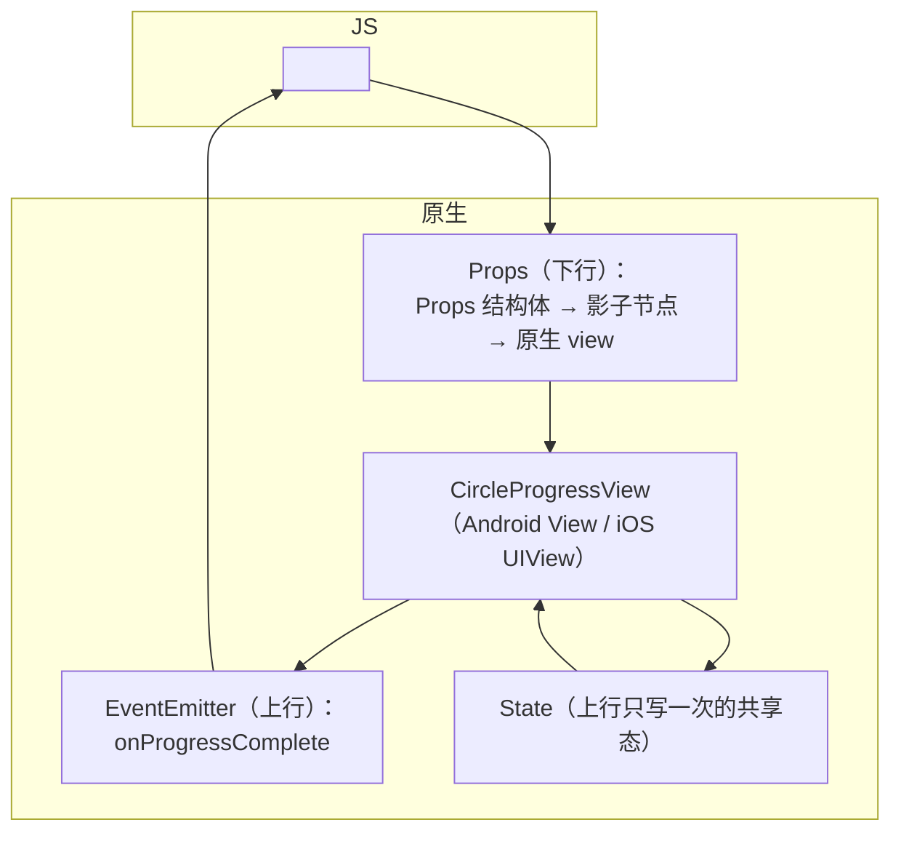

# Fabric 原生组件开发

> 02 篇做了"非 UI 能力"（TurboModule），本篇做"UI 能力"：自定义 **Fabric 原生组件**。样例是一个圆形进度环：props 控制 `size/progress/color`，动画走原生侧，完成时回传 `onProgressComplete` 事件——覆盖 props 下行、事件上行、状态（State）三通道。

## 1. 组件的通道模型

一个原生组件 = 三条通道（对照模块五/七）：



- **Props**：JS → 原生单向；经 Codegen 生成 `CircleProgressProps` 结构体与 ComponentDescriptor，diff 后只下发变化字段（模块五 03）；
- **Event**：原生 → JS 推送，适合"发生了什么"（完成、拖动值）；
- **State**：原生 → 提交到影子树的"回传状态"，典型如 TextInput 的原生文本——JS 读它但不直接改它，避免双写打架。

## 2. 第一步：JS spec（契约）

```ts
// specs/CircleProgress.ts
import codegenNativeComponent from 'react-native/Libraries/Utilities/codegenNativeComponent';

export interface CircleProgressProps {
  size?: number;        // dp，默认 40
  progress?: number;    // 0~1
  color?: string;       // '#2e7cf6'
  onProgressComplete?: (event: { finished: boolean }) => void;
}

export default codegenNativeComponent<CircleProgressProps>('CircleProgress');
```

`codegenNativeComponent`（type `components`，模块七 04）让 Codegen 生成：C++ 的 ComponentDescriptor/ShadowNode/Props 结构体与事件类型、平台侧的注册胶水。**使用组件时直接 import 这个默认导出**——它已经是合法的 React 组件。

## 3. Android 侧

新架构下 Android 组件 = 一个 `ViewManager` + C++ 描述符注册：

```kotlin
// CircleProgressManager.kt
class CircleProgressManager : SimpleViewManager<CircleProgressView>() {
  override fun getName() = "CircleProgress"

  @ReactProp(name = "progress", defaultDouble = 0.0)
  fun setProgress(v: CircleProgressView, p: Double) = v.setProgress(p.toFloat())

  @ReactProp(name = "color")
  fun setColor(v: CircleProgressView, c: String?) = v.setColor(parseColor(c))

  override fun createViewInstance(ctx: ThemedReactContext) = CircleProgressView(ctx)
}
```

```kotlin
// CircleProgressView.kt —— 真正的原生 View
class CircleProgressView(ctx: Context) : View(ctx) {
  fun setProgress(p: Float) { animateTo(p) }   // 动画在原生侧（ValueAnimator）
  override fun onDraw(c: Canvas) { drawArc(...) } // 标准自绘
  fun notifyComplete(finished: Boolean) {
    // 事件回传：用 Fabric 的事件发射器（由 Manager 桥接给 onProgressComplete）
    onEventEmitter { it.onProgressComplete(finished) }
  }
}
```

注册两处：ViewManager 进 package；ComponentDescriptor（Codegen 生成的 C++ 类）在 package 的 `getComponentDescriptorProviders` 暴露——**漏注册 C++ 描述符**是"组件存在但渲染不出"的头号原因。

## 4. iOS 侧

```objc
// CircleProgressComponentView.h —— 继承 RCTViewComponentView
@interface CircleProgressComponentView : RCTViewComponentView <RCTComponentViewProtocol>
@end

// CircleProgressComponentView.mm
@implementation CircleProgressComponentView {
  CircleProgressView *_view;   // 真正的 UIView（CAShapeLayer 画环）
}
+ (ComponentDescriptorProvider)componentDescriptorProvider {
  return concreteComponentDescriptorProvider<CircleProgressComponentDescriptor>(); // ← Codegen 生成
}
- (instancetype)initWithFrame:(CGRect)frame {
  if (self = [super initWithFrame:frame]) { _view = [[CircleProgressView alloc] init]; self.contentView = _view; }
  return self;
}
- (void)updateProps:(Props::Shared const &)props oldProps:(Props::Shared const &)oldProps {
  auto const &p = *std::static_pointer_cast<const CircleProgressProps>(props);
  [_view setProgress:p.progress];        // Props 下行：diff 后才调用
  [super updateProps:props oldProps:oldProps];
}
@end
```

注册：`RCTComponentViewFactory` 按 codegen 产物注册 component view class（通常由生成的 `RCTFabricComponentsPlugins` 自动挂上）。

## 5. 事件与 State 的实现要点

- **事件**：Android 在 View 层拿到 emitter 回调（Manager 桥接）；iOS 通过 `EventEmitter::onProgressComplete` 共享指针发出。事件体结构由 spec 的回调签名生成——**字段名写错在 JS 侧拿到 undefined，但类型契约本身受 Codegen 保护**；
- **State**：进度环不需要，但 TextInput 式场景的公式是：原生 `updateState` → State commit 进影子树 → JS `state.value` 读取。判断口径：**"这个值的事实源在原生"就用 State，"在 JS"就用 Props，别双写**；
- **动画归原生**：progress 变化引起的重绘/动画全部在原生 view 内完成——每帧不经 JS（模块六 02 的闭环思想在组件层的应用），JS 只发"目标值"。

## 6. 使用与验收

```jsx
import CircleProgress from '../specs/CircleProgress';

<CircleProgress size={80} progress={uploaded / total}
  onProgressComplete={(e) => toast(e.finished ? '完成' : '中断')} />
```

验收三查：props 变化是否只触发增量更新（DevTools 看下发次数）；高频改 progress 是否流畅（应全在原生，JS 帧不动）；事件是否正常回传。三查通过，说明 Props/Event 两条通道都工作在 Fabric 语义而非 interop 兜底（兜底模式下行为近似但通道是旧的）。

## 小结

- 原生组件三条通道：Props 下行（diff 增量）、Event 上行（推送）、State 回传（原生事实源）——通道选错是设计错误，不是实现细节；
- 双平台套路对称：ViewManager/`RCTViewComponentView` 实现 + **C++ ComponentDescriptor 注册**（最易漏）；
- 动画与绘制留在原生侧，JS 只发目标值——组件级的"高频闭环不过 JS"；
- 与 02 篇合起来，模块七的全部抽象（Codegen 契约、JSI 通道、Fabric 管线）都落到了可运行的代码上。
