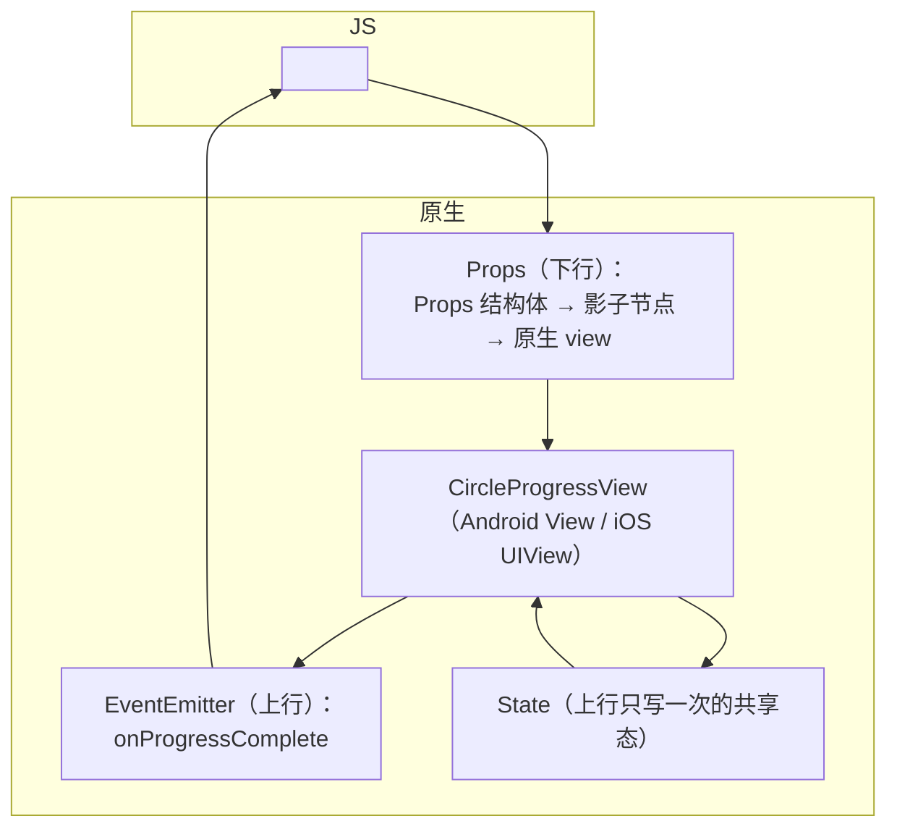
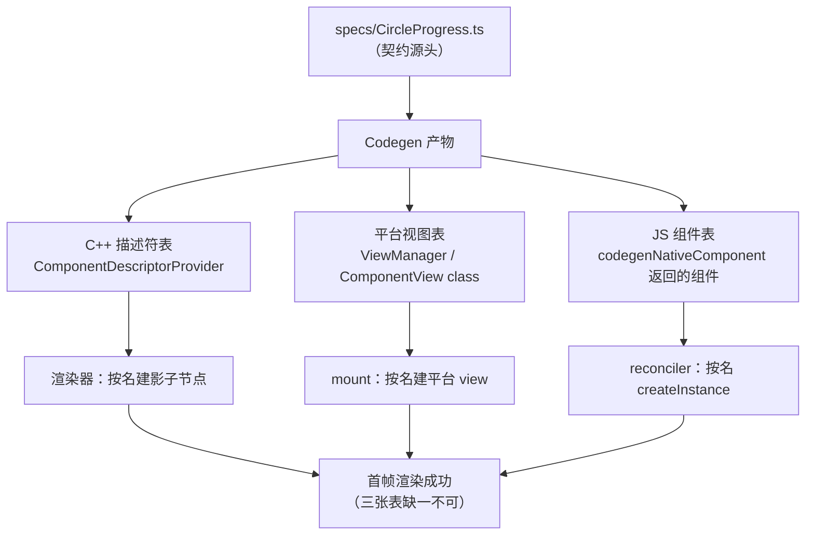
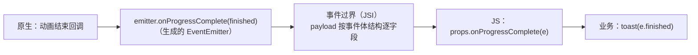

# Fabric 原生组件开发

> 02 篇做了"非 UI 能力"（TurboModule），本篇做"UI 能力"：自定义 **Fabric 原生组件**。样例是一个圆形进度环：props 控制 `size/progress/color`，动画走原生侧，完成时回传 `onProgressComplete` 事件——覆盖 props 下行、事件上行、状态（State）三通道。

## 0. 从模块到组件：差的不只是"画界面"

02 篇的 TurboModule 与本篇的原生组件常被混为一谈，先把分界线画清楚：

| | TurboModule（02 篇） | Fabric 组件（本篇） |
|--|---------------------|--------------------|
| 挂到哪里 | 全局单例，按名字取 | 挂在组件树里，随渲染生命周期 |
| 数据下行 | 方法参数（一次性） | Props（随渲染 diff 持续下发） |
| 数据上行 | Promise / 回调 | Event（推送）/ State（回传共享态） |
| 生命周期 | 懒加载后常驻 | 随挂载/卸载创建销毁 |
| 产物 | 双平台类 + delegate | 双平台视图类 + **C++ ComponentDescriptor** |

一句话：**模块是"能力"，组件是"树上的节点"**。节点就要参与渲染管线——diff、布局、mount 全套流程（模块五 03），所以组件的注册链天然比模块长一截（多出 C++ 描述符一层，这也是本篇头号坑的所在地）。

## 1. 组件的通道模型

一个原生组件 = 三条通道（对照模块五/七）：



- **Props**：JS → 原生单向；经 Codegen 生成 `CircleProgressProps` 结构体与 ComponentDescriptor，diff 后只下发变化字段（模块五 03）；
- **Event**：原生 → JS 推送，适合"发生了什么"（完成、拖动值）；
- **State**：原生 → 提交到影子树的"回传状态"，典型如 TextInput 的原生文本——JS 读它但不直接改它，避免双写打架。

### 1.1 三条通道的数据形态（过界前后）

通道选型只是第一步，每条通道上"数据长什么样"决定了实现时的手感：

| 通道 | JS 侧形态 | 过界后形态 | 到达原生 view 时 |
|------|----------|-----------|----------------|
| Props | JSX 属性 + style | C++ `Props` 结构体（定长字段） | setter 调用（`setProgress:` / `setProgress()`） |
| Event | 回调 prop（`onProgressComplete`） | C++ `EventEmitter` 结构体方法调用 | JS 侧监听函数被调用 |
| State | `state.value` 之类的只读读法 | 影子节点上的一次性提交 | 与 Props 同路回灌到 view |

注意 Props 通道的关键性质：**JS 侧的对象语义（嵌套、动态键）在过界时被"压平"成结构体**——Codegen 按 spec 为每个属性生成具名字段，diff 逐字段比较。这解释了为什么组件 spec 的类型边界与 02 篇同源（同一套可表达子集），也解释了为什么 props diff 是"预算化"的：结构体字段数在编译期已知（模块五 03 的 `ReactNativeAttributePayload` 对照）。

## 2. 第一步：JS spec（契约）

```ts
// specs/CircleProgress.ts
import codegenNativeComponent from 'react-native/Libraries/Utilities/codegenNativeComponent';

export interface CircleProgressProps {
  size?: number;        // dp，默认 40
  progress?: number;    // 0~1
  color?: string;       // '#2e7cf6'
  onProgressComplete?: (event: { finished: boolean }) => void;
}

export default codegenNativeComponent<CircleProgressProps>('CircleProgress');
```

`codegenNativeComponent`（type `components`，模块七 04）让 Codegen 生成：C++ 的 ComponentDescriptor/ShadowNode/Props 结构体与事件类型、平台侧的注册胶水。**使用组件时直接 import 这个默认导出**——它已经是合法的 React 组件。

spec 逐行的讲究：

- **`size?: number` 可选属性在组件 spec 里是合法的**（与模块 spec 的保守纪律不同）：组件 props 天然是"缺省用默认值"的模型，Codegen 会把可选数值字段生成为带默认值的结构体字段——默认值来自实现侧（如 `defaultDouble = 0.0`），spec 侧的注释只是文档；
- **`onProgressComplete` 命名不是风格**：`on` 前缀是 Codegen 识别"这是事件回调"的依据——回调签名会生成对应的 EventEmitter 方法。写成 `handleComplete` 这类名字，Codegen 当它是普通（不支持的函数属性）处理，codegen 阶段就失败；
- **事件体的结构 `{ finished: boolean }`**：回调参数的形状就是事件 payload 的形状——JS 侧 `e.finished` 的字段名在 spec 这一刻定死，实现侧拼错字段名不会有类型报错（02 篇同款静默），只能在运行时发现 `undefined`；
- **`color` 用 string 而不是 number**：颜色走 `#RRGGBB` 字符串是 RN 的惯例（`processColor` 在原生侧解析），spec 里写 number 也能表达，但生态里 string 更通用。

### 2.1 动手前先列文件清单

对照 02 篇的模块，组件要新动的文件更多，先列全再开工（每端各三件套 + 一份契约）：

| 文件 | 平台 | 作用 |
|------|------|------|
| `specs/CircleProgress.ts` | 共享 | 契约（本节） |
| `CircleProgressManager.kt` | Android | props 表 + 创建 view |
| `CircleProgressView.kt` | Android | 自绘与动画 |
| package 注册处（`getComponentDescriptorProviders`） | Android | C++ 描述符暴露（最易漏） |
| `CircleProgressComponentView.h/.mm` | iOS | 容器视图 + props 落地 |
| `CircleProgressView.h/.mm`（或 .swift+桥接） | iOS | 真正的绘制（CAShapeLayer） |
| `RCTComponentViewFactory` 注册（通常自动） | iOS | 按名建 view |

清单的用途是收尾自查：**每行都能指到一个真实文件，组件才算完成**——"渲染不出"类问题九成能归因到清单里某一行缺失。

## 3. Android 侧

新架构下 Android 组件 = 一个 `ViewManager` + C++ 描述符注册：

```kotlin
// CircleProgressManager.kt
class CircleProgressManager : SimpleViewManager<CircleProgressView>() {
  override fun getName() = "CircleProgress"

  @ReactProp(name = "progress", defaultDouble = 0.0)
  fun setProgress(v: CircleProgressView, p: Double) = v.setProgress(p.toFloat())

  @ReactProp(name = "color")
  fun setColor(v: CircleProgressView, c: String?) = v.setColor(parseColor(c))

  override fun createViewInstance(ctx: ThemedReactContext) = CircleProgressView(ctx)
}
```

```kotlin
// CircleProgressView.kt —— 真正的原生 View
class CircleProgressView(ctx: Context) : View(ctx) {
  fun setProgress(p: Float) { animateTo(p) }   // 动画在原生侧（ValueAnimator）
  override fun onDraw(c: Canvas) { drawArc(...) } // 标准自绘
  fun notifyComplete(finished: Boolean) {
    // 事件回传：用 Fabric 的事件发射器（由 Manager 桥接给 onProgressComplete）
    onEventEmitter { it.onProgressComplete(finished) }
  }
}
```

注册两处：ViewManager 进 package；ComponentDescriptor（Codegen 生成的 C++ 类）在 package 的 `getComponentDescriptorProviders` 暴露——**漏注册 C++ 描述符**是"组件存在但渲染不出"的头号原因。

### 3.0 注册链全景：一个组件名要被"三层"认识

"注册两处"展开看，是一个组件名在三个层次各有一张表，任何一张断链都渲染不出：



对照 mini-rn：我们只有**一张表**（`g_tree` + `Init` 的函数表），因为 JS、影子树、平台视图三层全在同一个 C++ 文件里；真 RN 把三层拆开（JS 运行时 / C++ 渲染核心 / 平台 UI），注册也就成了三条链。**理解"断链不报错"的关键是：每条链只在被用到时才查找**——JS import 成功只证明第三张表在，渲染不出说明前两张有一张断了。

### 3.1 ViewManager 讲解：注解驱动的 props 表

`@ReactProp` 是 Android 侧的 props 登记表，它的规则决定 diff 结果如何落到 view：

| 注解形态 | 对应 JS 类型 | 生成的 setter 签名 |
|---------|-------------|-------------------|
| `defaultDouble = 0.0` | number | `(v: View, p: Double)` |
| `defaultInt / defaultFloat` | number | `(v: View, p: Int/Float)` |
| `defaultBoolean` | boolean | `(v: View, p: Boolean)` |
| 无 default | string / ReadableMap / ReadableArray | 可空参数（属性被移除时传 null） |

三个使用要点：

1. **`name` 必须与 spec 字段一致**（`"progress"` 对 `progress`）——注解名是 diff 结果的查找键，拼错 = 该属性永远不下发（静默）；
2. **`defaultDouble = 0.0` 的语义**：JS 没传该 prop 时，setter 也会被调用一次（用默认值）——所以 setter 要能正确处理默认值路径，别把"没设置"当"设置为 0"误处理（对进度环无妨，对"角度=0 表示正北"这类语义就是坑）；
3. **`c: String?` 可空**：属性从 JSX 上移除时，RN 会用 null 调一次 setter 让你恢复默认——忘了处理 null 就是"移除属性不生效"。

`createViewInstance` 在组件首次挂载时调用——对照 mini-rn 的 `createView`（[06 篇](06-宿主工程与视图原语.md)）：**同一个"创建即入表"的模型，真 RN 的表由 ComponentDescriptor 与 ViewManager 共同维护**。

### 3.2 View 层讲解：动画为什么必须在原生

`setProgress(p) { animateTo(p) }` 这行是组件性能的全部关键：

- 如果动画在 JS 做（每帧 `setProgress` 一次），每一帧都要走一遍 `render → diff → props 下发 → 过界 → setter`——整条管线被高频压榨，JS 帧稍有波动动画就卡顿（模块六 02 的闭环思想）；
- 动画在原生做，JS 只在"目标值变化"时下发一次 prop，之后的每一帧都是 `ValueAnimator → invalidate → onDraw` 的纯原生闭环——**JS 完全闲着**；
- 这就是 spec 里 `progress` 是"目标值"而不是"当前值"的原因：契约层面已经把高频闭环留在了原生侧。

`onDraw` 是标准自绘（`drawArc` 画弧），与 RN 无关——**原生组件的"原生"部分就是普通平台开发**，RN 只负责把 props/事件接进去。

## 4. iOS 侧

```objc
// CircleProgressComponentView.h —— 继承 RCTViewComponentView
@interface CircleProgressComponentView : RCTViewComponentView <RCTComponentViewProtocol>
@end

// CircleProgressComponentView.mm
@implementation CircleProgressComponentView {
  CircleProgressView *_view;   // 真正的 UIView（CAShapeLayer 画环）
}
+ (ComponentDescriptorProvider)componentDescriptorProvider {
  return concreteComponentDescriptorProvider<CircleProgressComponentDescriptor>(); // ← Codegen 生成
}
- (instancetype)initWithFrame:(CGRect)frame {
  if (self = [super initWithFrame:frame]) { _view = [[CircleProgressView alloc] init]; self.contentView = _view; }
  return self;
}
- (void)updateProps:(Props::Shared const &)props oldProps:(Props::Shared const &)oldProps {
  auto const &p = *std::static_pointer_cast<const CircleProgressProps>(props);
  [_view setProgress:p.progress];        // Props 下行：diff 后才调用
  [super updateProps:props oldProps:oldProps];
}
@end
```

注册：`RCTComponentViewFactory` 按 codegen 产物注册 component view class（通常由生成的 `RCTFabricComponentsPlugins` 自动挂上）。

### 4.1 这段 ObjC++ 的逐行讲解

- **`componentDescriptorProvider` 类方法**：组件的"C++ 身份"入口——渲染器拿着这个 provider 去构造 ShadowNode 与 Props 结构体。返回的是 Codegen 生成的具体描述符，**手滑改成基类描述符 = 树上有节点但 props 全是默认值**；
- **`Props::Shared const &` 是 C++ 类型**：这就是 `.mm`（ObjC++）存在的原因——同一个文件里既写 ObjC 的 view 管理，又直接用 C++ 的 Props 结构体。`std::static_pointer_cast` 把基类指针向下转型为生成的具体 Props 类型，之后 `p.progress` 是**编译期检查**的字段访问（拼错字段名编译不过——比 Android 注解的字符串键更硬）；
- **`updateProps` 只在 diff 后被调**：与 Android 的 `@ReactProp` setter 逐属性调不同，iOS 是"整块 props 交给你，你自己取字段"——所以这里把 `progress` 取出后调 setter，未变化的字段根本不会触发这次调用；
- **`oldProps` 的用途**：本例没用它，但需要"知道变化量"的场景（如从旧颜色渐变到新颜色）就靠它——这是 diff 信息在组件侧的最后一面；
- **`self.contentView = _view`**：`RCTViewComponentView` 是个容器，真正的绘制交给内嵌的 UIView——RN 的 mount 只对容器做 frame/层级管理，内嵌视图的行为完全归你。

### 4.2 iOS 与 Android 的结构对照

| 角色 | Android | iOS |
|------|---------|-----|
| 注册名 | `getName()` | 组件名（codegen 定） |
| 视图创建 | `createViewInstance` | `initWithFrame` |
| props 落地 | `@ReactProp` setter（逐属性） | `updateProps`（整块给） |
| 事件出口 | Manager 桥接 emitter | `EventEmitter::` 共享指针 |
| C++ 挂钩 | package 的 `getComponentDescriptorProviders` | `componentDescriptorProvider` 类方法 |

注意 props 落地的粒度差异：Android 侧注解方法**只对变化的属性**调用；iOS 侧 `updateProps` 在**任一属性变化**时整体调用（是否逐字段细化取决于生成的描述符实现）——所以 iOS 实现里取字段是幂等的（重复 set 同值无副作用），这个纪律要自觉遵守。

## 5. 事件与 State 的实现要点

先给一张"碰到需求先查表"的选型速断（三通道的全部用法浓缩）：

| 需求描述 | 通道 | 一句话理由 |
|---------|------|-----------|
| JS 控制外观/行为（尺寸、颜色、开关） | Props | JS 是事实源，单向下行 |
| 原生通知"发生了什么"（完成、拖动） | Event | 推送语义，原生是发起方 |
| 原生持有真实值、JS 要读（输入文本、滚动位置） | State | 原生是事实源，回传只读 |
| 高频连续变化（动画、手势跟手） | 不通道化 | 闭环留原生，JS 只发目标值 |

- **事件**：Android 在 View 层拿到 emitter 回调（Manager 桥接）；iOS 通过 `EventEmitter::onProgressComplete` 共享指针发出。事件体结构由 spec 的回调签名生成——**字段名写错在 JS 侧拿到 undefined，但类型契约本身受 Codegen 保护**；
- **State**：进度环不需要，但 TextInput 式场景的公式是：原生 `updateState` → State commit 进影子树 → JS `state.value` 读取。判断口径：**"这个值的事实源在原生"就用 State，"在 JS"就用 Props，别双写**；
- **动画归原生**：progress 变化引起的重绘/动画全部在原生 view 内完成——每帧不经 JS（模块六 02 的闭环思想在组件层的应用），JS 只发"目标值"。

### 5.1 Event 通道展开：从 onDraw 到 JS 回调

一次"动画完成"事件的完整旅程：



三个工程细节：

1. **事件不排队**（新架构）：原生发出即同步到达 JS 调用点（模块七 02）——这与 mini-rn 09 篇手写的"队列 + 定拍"形成对照，也解释了为什么事件处理函数要轻（重逻辑用 setState 触发后续）；
2. **事件体的字段是查找键**：`e.finished` 若在原生拼成 `isFinished`，JS 拿到 undefined 且无报错——**事件字段名的编译期保护只到 EventEmitter 方法签名一层，payload 字段靠约定**。防御法：JS 侧对事件体做一次解构 + 默认值；
3. **高频事件要节流**：`onProgress`（每帧报进度）这类需求，要么只在关键节点发（开始/结束），要么原生侧聚合——事件通道快，但 JS 处理不是免费的。

### 5.2 State 通道展开：TextInput 的"单一事实源"

以 TextInput 的文本为例看 State 的完整用法（本组件用不上，但面试与实战高频）：

1. 用户在原生输入框敲字 → 原生持有真实文本；
2. 原生 `updateState(newState)` 提交——State 进入影子树，一次一提交；
3. JS 侧通过组件实例/受控接口读到新文本——**JS 是读者不是写者**；
4. JS 想"纠正"文本（如格式化）：下发 Props → 原生对比后决定是否采纳 → 必要时再提交 State。

双写打架的反面教材：如果不走 State、JS 与原生各存一份文本并互相覆盖，就会出现"输入一个字符跳回两个字符前"的经典 bug——**State 通道存在的意义就是给"原生事实源"一个单向回传管道**。判断口诀回到第 5 节：事实源在谁手上，谁拥有写入权。

## 6. 使用与验收

```jsx
import CircleProgress from '../specs/CircleProgress';

<CircleProgress size={80} progress={uploaded / total}
  onProgressComplete={(e) => toast(e.finished ? '完成' : '中断')} />
```

验收三查：props 变化是否只触发增量更新（DevTools 看下发次数）；高频改 progress 是否流畅（应全在原生，JS 帧不动）；事件是否正常回传。三查通过，说明 Props/Event 两条通道都工作在 Fabric 语义而非 interop 兜底（兜底模式下行为近似但通道是旧的）。

三查的操作方法（对应 [04 篇](04-调试工具链原理.md)的工具矩阵）：

- **下发次数**：React DevTools 的 Profiler 或组件 inspect——看 `commitUpdate` 层面的更新是否只含变化字段；更直接的是原生 setter 打日志，改一次 `progress` 应只看到 progress 的 setter 被调；
- **JS 帧不动**：Profiler 火焰图里动画期间不应出现持续渲染——如果每帧都有 commit，说明动画泄漏回了 JS（模块九 03 的排查思路）；
- **事件回传**：给 `onProgressComplete` 加 console.log——设备日志经 Metro WS 直接打在终端（04 篇第 2 节的日志通路）。

## 7. 常见坑与排查表

| 症状 | 根因 | 排查动作 |
|------|------|---------|
| 组件渲染不出（标签在但空白/报未知组件） | C++ ComponentDescriptor 没注册（头号坑） | 查 package 的 descriptor providers 两端是否都暴露 |
| props 变化无效果 | `@ReactProp` 的 name 拼错；iOS 字段没在 updateProps 里取 | 原生 setter/updateProps 打日志 |
| 属性移除不生效 | setter 没处理 null/默认值路径 | 对照 3.1 节第 2/3 条 |
| 事件 undefined | payload 字段名与 spec 不一致 | 5.1 节第 2 条；JS 解构加默认值 |
| 动画卡顿且 JS 高频渲染 | 动画写回了 JS（每帧 setProps） | 回到 3.2 节：动画归原生 |
| 行为"近似但怪"（默认值不对/事件时序怪） | 跑在 interop 兜底上而非 Fabric 语义 | 确认新架构开启、组件走 codegen 产物而非旧 ViewManager 兜底 |
| 双端表现不一致 | 平台 props 粒度差异（3.1 vs 4.2 的逐属性 vs 整块） | 检查 setter 幂等性 |

**漏注册 C++ 描述符**值得单独展开：它的迷惑性在于"JS 侧一切正常"——import 不报错、组件不抛错，只是渲染时找不到对应的影子节点实现。因为 JS 侧的组件合法性由 spec 保证，C++ 侧的注册是另一条独立链路（Codegen 生成 → package 暴露 → 渲染器按名查找），断在中间不会有显式报错。**排查姿势：从"渲染器按名查描述符"逆推**，两端各查一次注册表。

### 7.1 边界情况与鲁棒性

验收三查之外，四个值得主动测的边界（都是真实工程里"上线才炸"的类型）：

| 边界输入 | 期望行为 | 实现要点 |
|---------|---------|---------|
| `progress` 越界（>1 或 <0） | 钳制到合法区间 | 原生 setter 里 clamp，别信任 JS 传值 |
| `progress` 为 undefined/NaN | 用默认值，不崩 | `defaultDouble` 路径 + NaN 判断 |
| 快速连续改 progress | 动画平滑追目标，不叠加 | `animateTo` 先取消进行中的动画 |
| 组件快速挂载/卸载（列表滚动） | 事件不在卸载后到达 | 完成回调检查组件仍挂载 |

最后一行是事件通道特有的坑：**事件是异步语义**（哪怕 JSI 直调，"动画结束时"也晚于"卸载"），卸载后到达的事件若持有已回收的资源引用，就是崩溃或幽灵 toast。原生侧在发事件前检查有效性，是组件库的标配防御。

## 8. 与 mini-rn 的对照

本篇组件的三条通道，在 mini-rn 里都能找到手写的雏形：

| 本篇（真 RN） | mini-rn 对照 | 篇目 |
|--------------|-------------|------|
| Props 结构体 diff 下发 | `diffProps` + `setProps` 增量合并 | [07 篇](07-渲染器与更新管线.md) |
| ComponentDescriptor 创建影子节点 | `createView` 建 `MiniView` | [06 篇](06-宿主工程与视图原语.md) |
| mount 到平台 view | `PresentTree` 的 tag → NSView 表 | [08 篇](08-布局器与上屏后端.md) |
| EventEmitter 推送 | `EmitEvent` + 持久引用回调 | [09 篇](09-事件回路与收官自测.md) |
| （未做）State 通道 | 无——mini-rn 无原生输入场景 | — |

对照价值最大的一条：**mini-rn 的 `setProps` 增量合并（merge_patch）就是"props diff 后只下发变化字段"的手写版**——做完 07 篇再回本篇，`ReactNativeAttributePayload` 的"预算化 diff"不再是黑话。

## 9. 自测

1. 三条通道各自的方向、时机、典型场景？通道选错是什么级别的错误？（→ 第 1 节：设计错误）
2. `on` 前缀在组件 spec 里的作用是什么？去掉会发生什么？（→ 第 2 节）
3. Android 与 iOS 的 props 落地粒度有何不同？对 setter 实现提出了什么纪律？（→ 4.2 节：幂等）
4. "组件存在但渲染不出"的头号原因？为什么它不报错？（→ 第 7 节）
5. 什么情况下用 State 而不是 Props？双写打架的症状是什么？（→ 5.2 节）
6. 动画为什么必须在原生侧？这条原则的模块出处？（→ 3.2 节，模块六 02）
7. 场景题：做一个"原生滑杆，JS 显示当前值"的组件，值通道怎么选？如果还要支持 JS 程序化设置滑杆位置呢？（→ 提示：读走 State、写走 Props，两通道各司其职而非双写）

## 小结

- 原生组件三条通道：Props 下行（diff 增量）、Event 上行（推送）、State 回传（原生事实源）——通道选错是设计错误，不是实现细节；
- 双平台套路对称：ViewManager/`RCTViewComponentView` 实现 + **C++ ComponentDescriptor 注册**（最易漏）；注册是三条链（C++ 描述符表/平台视图表/JS 组件表），断链不报错是排查难点；
- 动画与绘制留在原生侧，JS 只发目标值——组件级的"高频闭环不过 JS"；
- 鲁棒性四边界（越界/NaN/连打/卸载后事件）是组件库上线前的必测项；
- 与 02 篇合起来，模块七的全部抽象（Codegen 契约、JSI 通道、Fabric 管线）都落到了可运行的代码上。

下一篇（[04 篇](04-调试工具链原理.md)）转向工具链：本篇验收用到的 Profiler、日志通路、原生断点，其原理都在那里展开。
