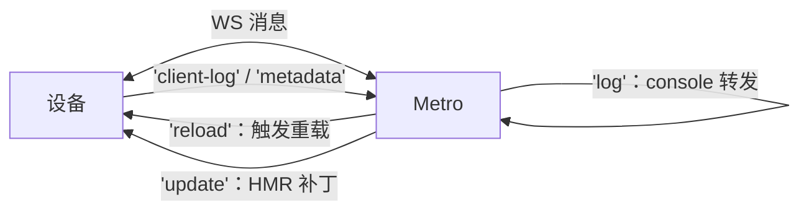

# 调试工具链原理

> 全站收官篇。调试工具不是"会用就行"的黑盒——**Metro 与设备怎么连、HMR 消息长什么样、DevTools 为什么能 attach、断点落在哪一层**，每个问题都有原理答案，而答案全部来自前九个模块。

## 0. 为什么"调试"值得单开一篇

调试能力 = **对链路的可观测性**。RN 的链路横跨四层（JS、绑定、原生、构建系统），每层各有一套工具；不理解链路的人只能"挨个试"，理解链路的人能直接从症状定位层。本篇的组织方式就是按层走：每节先讲"这层的工具为什么能工作"（原理），再讲"它能看到什么、看不到什么"（边界），最后全篇收进一张排障决策表。

与本模块 mini-rn 系列的关系：mini-rn 虽然跑在 Node 而非设备上，但它的三层（JS/绑定/C++）**恰好是 RN 四层的缩小版**，第 8 节会给一套 mini-rn 的调试实战——lldb 断进 `.node`、CDP 断 Node 的 JS，与真机调试是同一套思维。

## 1. 工具矩阵：分层看

| 工具 | 作用层 | 连接通道 |
|------|--------|---------|
| Metro + HMR | 构建与热替换 | 设备 ↔ Metro WebSocket（:8081） |
| React DevTools | 组件树/Profiler | App ↔ DevTools（:8097） |
| React Native DevTools（0.76+） | JS 断点（CDP） | Hermes ↔ 调试前端，直连 |
| Chrome DevTools / Hermes 调试 | JS 断点（旧路径） | CDP over WebSocket |
| Flipper | 原生/网络/DB 插件化 | 0.76 起移出默认栈 |
| Xcode / Android Studio | 原生与 C++ 层 | lldb / adb 系调试器 |

**选层原则：问题在哪层就用哪层的工具**——JS 帧卡顿看 Profiler（模块九 03），原生崩溃看符号化栈（模块九 04），渲染管线看 Perfetto（模块九 01）。

### 1.1 端口与通道速查

把矩阵里的"连接通道"拆成端口级的速查（排障第一步常是"端口通不通"）：

| 端口 | 谁监听 | 谁连谁 | 断了会怎样 |
|------|--------|--------|-----------|
| 8081（HTTP） | Metro | 设备拉 bundle | 白屏/加载失败 |
| 8081（WS） | Metro | 设备连 Metro | 日志/reload/HMR 全失效 |
| 8097 | React DevTools 前端 | **App 主动连** | DevTools 面板空 |
| CDP 通道 | 调试前端（RN DevTools） | 与 Hermes 协商建立 | 断点/源码面板不可用 |

方向值得注意：8081 与 8097 都是**设备侧主动发起连接**——所以"主机防火墙拦入站""设备与主机不在同一网段"这类网络问题，症状会表现为工具"连不上"而非"连不上它"。Android 真机的 `adb reverse tcp:8081 tcp:8081` 就是把设备的 8081 反向映射到主机，绕开网段问题（第 7 节）。

### 1.2 dev 与 release：两套形态，两套可见性

工具矩阵只对 dev 形态完整成立，release 是另一个世界：

| 能力 | dev | release |
|------|-----|---------|
| Metro WS（日志/HMR/reload） | 有 | 无（不连 Metro） |
| Dev 菜单 / Element inspector | 有 | 无 |
| CDP 断点 | 可用 | 不可用 |
| 原生符号化 | 调试器直接带符号 | 需归档符号还原 |
| console 输出 | 转发到终端 | 视构建配置，常被剥离 |

这张表解释了两条纪律：**性能结论只在 release 形态下做**（dev 的额外开销会污染数据，模块九的方法论）；**release 问题的工具是"符号化 + 崩溃上报"而非"现场调试"**（第 6.3 节）。排查"dev 好 release 坏"时，先想两套形态的差异项，再怀疑代码。

## 2. Metro 与设备：一条 WebSocket 的全部职责

dev 模式下设备与 Metro 之间除了 bundle 的 HTTP（模块二 03），还有一条 WebSocket，消息按 `type` 分发：



- **日志通路**：`console.log` 在设备上被打点转发到 Metro 终端——所以终端能看到 `js` 标签的日志；
- **reload**：摇一摇/R 菜单触发的消息，本质是让 App 重新走一遍"加载 bundle → runApplication"（模块二 01/02）；
- **HMR/Fast Refresh**：见下节。

### 2.1 消息类型速查

把图里出现过的 type 连同方向整理成表（这套消息就是"设备 ↔ 构建系统"协议的全部日常面）：

| type | 方向 | 载荷（定性） | 对应的日常现象 |
|------|------|-------------|---------------|
| `log` | 设备 → Metro | 级别 + 文本 | 终端打印 `js` 日志 |
| `client-log` | 设备 → Metro | 客户端侧日志 | 终端打印 `client` 类日志 |
| `metadata` | 设备 → Metro | 版本/环境等元信息 | Metro 终端启动时的握手输出 |
| `reload` | Metro → 设备 | 触发指令 | 终端按 r、Dev 菜单 Reload |
| `update` | Metro → 设备 | 增量模块代码 | Fast Refresh 的补丁载体 |

**怎么亲眼看到这些帧**：任何能代理 WebSocket 的工具（浏览器开发者工具的 WS 帧面板、Charles/wireshark 类抓包工具）挂在 8081 上即可。动手看一次的价值远超背表——你会发现"终端日志"本质是 WS 文本帧、"热更新"本质是一条带代码载荷的 JSON 消息，黑盒感立刻消失。

### 2.2 日志通路的一个推论

`console.log` 走 WS 而非 stdout，推出两个实用结论：

1. **Metro 没连上时，console.log 是静默的**——不是"没执行"，是"没人转发"。排查"日志突然没了"先查 WS（第 7 节现象 3）；
2. **原生侧日志不走这条路**—— NSLog / Log.d 走各平台自己的日志系统（Xcode 控制台 / logcat）。看到"JS 有日志原生没有"或反过来，先确认你看的是哪条通路，再怀疑代码。

## 3. Fast Refresh 原理：模块级替换 + 状态保留

Fast Refresh = Metro 编译期注入 + 运行时协作：

1. **transform 阶段**：Babel 给每个模块注入 `__react_refresh__` 包装——组件模块注册"刷新回调"（哪段代码导出了组件）；
2. **编辑保存**：Metro 增量编译出变更模块的新代码，经 WS `update` 消息下发（delta，模块八 01）；
3. **运行时替换**：HMR runtime 执行新模块工厂 `__d(newFactory)`（同 id 覆盖，模块八 01 的封装结构），通知 React Refresh：组件类型已更新；
4. **保留状态重渲染**：React Refresh 对**函数组件/Hook** 用新类型重新 render 当前 Fiber 子树——**state 保留**；非组件模块（工具函数）变更则向上冒泡到最近的组件边界整树重挂。

推论（都来自该机制）：改了**模块顶层有副作用**的代码（如 `console.log` 执行体、全局注册）只能整页 reload；类组件不享受 Hook 级保留；**导出结构变化**（增删导出）触发边界重挂——不是 bug，是语义安全的取舍。

### 3.1 三类编辑的下场对照

把推论整理成"编辑类型 → 结果"对照，编辑前扫一眼就知道会不会丢状态：

| 你改了什么 | Fast Refresh 的处理 | 状态 |
|-----------|--------------------|------|
| 函数组件函数体 / Hook 内逻辑 | 用新组件类型重渲染当前子树 | **保留** |
| 模块顶层的常量、纯工具函数 | 冒泡到最近的组件边界，边界内重挂 | 边界内丢失 |
| 模块顶层的副作用（注册、定时器、console 执行体） | 无法安全替换 → 要求整页 reload | 全丢 |
| 导出结构（新增/删除 export） | 边界重挂（模块契约变了） | 边界内丢失 |
| 类组件 | 不享受 Hook 级保留 | 丢失 |

两个高频误读，用机制直接解释：

- **"为什么改一行样式也丢状态"**——先查这行是不是写在模块顶层（比如 `StyleSheet.create` 之外又执行了什么）。丢不丢状态只跟**模块边界与副作用**有关，跟"改的代码多小"无关；
- **"为什么有时提示 can't be updated / suggest reload"**——运行时检测到上述不安全情形，主动降级。这是保护而不是失败。

### 3.2 一个对照实验：同样一行，三种下场

用同一份代码做三个变体，亲手验证对照表（建议在看完本节后做一次，五分钟）：

```js
// Counter.ts —— 变体 A：组件函数体
export function Counter() {
  const [n, setN] = useState(0);        // 改这行下面的按钮文案 → 状态保留
  return <Text onPress={() => setN(n + 1)}>count: {n}</Text>;
}

// utils.ts —— 变体 B：纯工具模块
export const clamp = (v, lo, hi) =>    // 改 clamp 实现 → 引用它的组件边界重挂
  Math.min(hi, Math.max(lo, v));

// register.ts —— 变体 C：顶层副作用
console.log('module loaded');          // 改这行 → 只能整页 reload
setupGlobalHandler();                  //   ↑ 副作用已发生，新工厂重跑会二次注册
```

三个变体改完保存，观察终端与 App 的反应：A 无感刷新、B 提示重挂边界、C 提示 reload。**做一遍，对照表就从"知识"变成"经验"**——之后遇到"状态丢了"，你能在三秒内归类是哪种变体。

### 3.3 从 bundle 结构看"同 id 覆盖"

第 3 步的 `__d(newFactory)` 为什么能成立，靠的是 bundle 的模块封装结构（模块八 01）：每个模块是一个带 id 的工厂函数注册。Fast Refresh 只需要**用同一 id 重新注册一个新工厂**，下次 require 该模块时拿到的就是新代码——**不动其他模块、不重跑入口**。这与全量 reload 的差别是量级的：reload 要重新执行整个 bundle（全部模块工厂 + 入口），Fast Refresh 只执行一个模块。理解这一点，"哪些改动必须 reload"的边界就不再是玄学：**凡是一个模块工厂重新执行无法安全表达的（顶层副作用已发生、导出契约已变），都必须 reload**。

## 4. React DevTools 为什么能 attach

App 启动时，React renderer（RN 定制的 react-reconciler，模块五 01）已内置 **DevTools hook**：检查到调试端在监听（:8097），就把 reconciler 内部事件（组件树变更、commit、渲染耗时）通过 WebSocket 推给 DevTools 前端渲染。

- Profiler 的火焰图数据源 = reconciler 的 commit 记录——这正是模块九 03 "why did render" 的数据来源；
- attach 不需要重新构建：**通道早就埋在运行时里，等一个监听者**；
- 同理，Element inspector（设备上审查元素）走的是"原生命中测试 → 反查 fiber"（`getInspectorDataForViewAtPoint`），把原生 view 与 React 组件对上号——三棵树知识的直接应用。

### 4.1 attach 的时序与边界


三个边界，决定了"DevTools 能回答什么问题"：

1. **它看的是 reconciler 的事件流，不是帧**——Profiler 告诉你"这次 render 花了多久、哪些组件参与"，不告诉你"掉帧发生在哪个系统调用"。掉帧归原生工具（Perfetto/Instruments，模块九 01）；
2. **它只认识 React 组件**——原生自定义组件（03 篇的 CircleProgress）在树里是一个节点，内部结构对它不可见；想看内部要看原生侧日志/断点；
3. **attach 是运行时行为**——线上 release 包没有这条通道（也不该有），所以 Profiler 数据只代表 dev 形态；release 性能问题要走符号化 + Perfetto 路线（模块九）。

## 5. 断点调试：CDP 直连 Hermes

- **旧路径（Remote JS Debugging）**：JS 跑进 Chrome 的 V8，用 Chrome DevTools 断点——问题：**引擎不是 Hermes**，行为/性能不可信（模块三：引擎差异真实存在），已被移除；
- **现行（React Native DevTools，0.76+ 默认）**：**CDP（Chrome DevTools Protocol）直连 Hermes**——Hermes 内置调试适配器，调试前端（基于 CDP 的独立 DevTools）直接对设备的 Hermes 实例下断点：**断的就是真机上的真引擎**，source map 还原到源码；
- 原理意义：CDP 是"调试协议"标准（inspect DOM/JS 的消息协议），Hermes 实现它 = 任何 CDP 客户端都能调试 RN 的 JS——**引擎调试能力接口化**，Flipper 退场的底层原因。


### 5.1 CDP 消息一览（断点一次的生命周期）

一次"下断点 → 命中 → 继续"在协议层的消息流（顺序即生命周期）：

| 阶段 | CDP 消息（domain.method 形态） | 谁发给谁 |
|------|-------------------------------|---------|
| 建立后 | `Debugger.scriptParsed`（携带 scriptId、URL） | Hermes → 前端 |
| 下断点 | `Debugger.setBreakpointByUrl`（URL/位置 → breakpointId） | 前端 → Hermes |
| 命中 | `Debugger.paused`（调用栈、作用域句柄） | Hermes → 前端 |
| 查看变量 | `Runtime.getProperties`（作用域/对象 → 值） | 前端 ⇄ Hermes |
| 继续 | `Debugger.resume` | 前端 → Hermes |

看懂这张表的收益：**DevTools 面板的每个能力都对应一类消息**——"变量悬停"是 getProperties、"调用栈面板"是 paused 的载荷、"黑盒脚本"是前端侧过滤 scriptParsed。CDP 把这些做成标准协议，所以同一个前端能调试 Chrome、Node、Hermes——mini-rn 第 8 节调 Node 时你会再次用到它。

### 5.2 Source map：断点为什么能落在源码行

bundle 是编译产物（模块拼接 + 压缩），断点想落在"你写的第 42 行"，靠的是 bundle 旁边的 map 文件：

- **生成**：bundle 与 map 配对产出（`--sourcemap-file`），map 记录产物位置 → 源文件/行/列的映射，外加源码内容；
- **使用（dev）**：`scriptParsed` 携带 bundle URL，前端拉取对应 map，把 Hermes 报上的产物位置反向映射成源码位置——**映射发生在前端，Hermes 只懂产物坐标**；
- **发布（release）**：map 不随包发布（体积与安全），但必须归档——否则线上 JS 报错只有行列号没有源码（第 6 节）。

"行号错位"类问题（第 7 节现象 2）的根因几乎都在这条链上：map 与 bundle 版本不配对（增量构建残留旧 map），或断在了做了优化的 release 包上。

## 6. 原生与混合联调

- **Xcode/Android Studio attach**：调试 Java/Kotlin/ObjC/Swift/C++——新架构下 ShadowTree、JSI 绑定层都是 C++，**混合栈断点（JS 断点 + C++ 断点同时挂）是排查跨层问题的终极手段**（模块七的代码位置就是断点位置）；
- **符号化**：release 崩溃必须符号表还原（模块九 04），调试期 lldb 已带符号；
- **Sourcemap 生成**：bundle 与 map 配对产出（`--sourcemap-file`），发布产物要把 map 归档，否则线上 JS 报错只有行列号没有源码。

### 6.1 lldb 上手：断进原生/C++ 层

lldb 是 macOS 上 Xcode 底层的调试器，命令行形态对"只想快速下一个断点"的场景比开 IDE 更轻：

```bash
# 形态一：从启动开始调试（能断初始化代码）
lldb -- <可执行文件> <参数>

# 常用三件套（lldb 会话内）
breakpoint set -f mini_native.cc -l 91     # 按文件:行号下断点
breakpoint set --name CreateView            # 按函数名（静态函数也能命中）
continue / step / frame variable            # 继续 / 单步 / 看当前帧变量
```

三个实战要点：

1. **断点要落在"过界之后"**——排查参数转换问题，断在 N-API/JSI 转换函数内部（06 篇的 `CreateView`），停下时 `frame variable` 直接看 C++ 侧的值形态；
2. **看线程面板**——断住后 `thread list` / `bt all` 能看到"谁调的我"，02 篇第 2.3 节的线程分析（调用线程 vs IO 线程）在这里得到验证；
3. **attach 已运行的进程**——`lldb -p <pid>` 适合"问题只在运行一段时间后出现"的场景，免去重启打断现场。

**混合栈断点的操作**：JS 侧挂 CDP 断点（第 5 节），原生侧挂 lldb/IDE 断点，两边同时开——JS 断点命中时原生断点挂着不影响；跨层调用（如 JS 调原生模块）发生时，先停在 JS 断点，release 后立刻停在原生断点，**一跳之隔的两层状态就都拿到了**。排查"参数过了界就变味"，这是唯一高效的路。

### 6.2 Android 侧对应物

| 任务 | macOS/iOS | Android |
|------|-----------|---------|
| 命令行调试器 | lldb | lldb（Android Studio 底层同款） |
| IDE 断点 | Xcode | Android Studio |
| 设备日志 | Console.app / Xcode 控制台 | `adb logcat` |
| 端口打通 | 同网段直连 | `adb reverse tcp:8081 tcp:8081` |
| 崩溃符号化 | dSYM 归档还原 | native debugging symbols 归档 |

原则不变：**工具随层走，平台只换名字**。

### 6.3 崩溃符号化工作流（release）

release 崩溃的栈是一堆地址，符号化把它们还原成函数名与行号，工作流四步：

1. **归档符号**：发布时把各产物的调试符号（iOS 的 dSYM、Android 的 native symbols）与 bundle 的 source map 一并与版本号对齐归档——**符号与版本不配对 = 无法还原**，这是发布流水线的纪律问题而不是技术问题；
2. **收集崩溃**：崩溃上报系统拿到的是"地址栈 + 版本号"；
3. **还原**：用归档的符号把地址映射回符号（函数名/行号）；JS 部分再用 source map 把 bundle 行号映射回源码；
4. **定位层**：还原后先看栈顶在哪个库——JS 框架代码、业务代码、第三方原生库、系统库，各自对应完全不同的处理路径。

容易忽略的一点：**JS 层的"符号化"就是 source map**（第 5.2 节）——两套映射（原生符号、JS map）共同覆盖全栈。归档缺了哪一半，那一半的线上错误就只剩地址/行列号。

## 7. 用原理排障：三个"灵异现象"的答案

1. **改代码没生效**：HMR 对副作用模块只能整页 reload（第 3 节）；确认 Metro 终端没报编译错误（transform 失败不会下发 update）；
2. **断点不停/行号错位**：source map 与 bundle 版本不配对（第 6 节），或断在了 release 优化的包上——dev 模式断点才可靠；
3. **DevTools 连不上**：端口被占/设备与主机不在同一网络（WS 建立失败，第 1 节）；`adb reverse tcp:8081 tcp:8081` 是 Android 真机的标准一步。

再补三个同样高频的：

4. **console.log 突然全没了**：App 与 Metro 的 WS 断了（网络切换、主机休眠）——日志是被转发的，没人转发就静默（第 2.2 节）。重连或 reload 恢复；
5. **DevTools 面板空的 / 树不刷新**：8097 被占用或前端起了多个实例，App 连到了"错误的监听者"——关掉多余前端重启；attach 是"通道等监听者"，监听者乱了通道也就乱了（第 4 节）；
6. **release 包一切正常，dev 包卡**：dev 形态有额外开销（日志转发、dev 菜单、未优化代码）——这不是"bug 在 dev"，而是两种形态本就不同；性能结论只在 release 形态下做（模块九的方法论）。

### 7.1 排障决策表：从症状到层

| 症状关键词 | 先查哪层 | 用什么工具 | 机制依据 |
|-----------|---------|-----------|---------|
| 改代码不生效 | 构建层 | Metro 终端 | update 不下发 / 副作用模块 |
| 日志没了 | 连接层 | WS 状态、adb reverse | 第 2 节日志通路 |
| 断点不停 | 映射层 | map 与 bundle 配对 | 第 5.2 节 |
| JS 崩溃 | JS 层 | CDP + 归档 map | 第 5 节 |
| 原生崩溃 | 原生层 | 符号化栈 | 第 6 节 |
| 渲染卡顿 | 管线层 | Profiler / Perfetto | 第 4.1 节边界 |

## 8. mini-rn 工程的调试实战（本模块专属）

mini-rn（06–09 篇）跑在 Node 上，没有 Metro/设备，但**三层结构与调试思维完全同构**——这套实战就是把本篇原理缩到巴掌大：

### 8.1 JS 层：node --inspect（CDP 的又一次出场）

```bash
node --inspect-brk app.js     # 启动并断在第一行，等调试前端接入
```

`--inspect` 暴露的就是 CDP——用 Chrome DevTools 的 "inspect Node" 或任何 CDP 客户端接入，断点/单步/变量查看与调试 Hermes 是**同一套协议、同一个体验**。第 5 节"Hermes 实现 CDP = 调试能力接口化"在这里有了第二个证据：Node 也实现了它。

典型用法：断在 `renderer.js` 的 `commitUpdate` 里，观察 reconciler 传来的 payload——07 篇差量语义的现场。

### 8.2 绑定/C++ 层：lldb 断进 .node

```bash
lldb -- node app.js
(lldb) breakpoint set -f mini_native.cc -l 91    # CreateView 里
(lldb) run
```

断住后 `frame variable` 看 `info`（CallbackInfo）、`info[0]` 解出的 `type` 字符串——**06 篇第 4 节"N-API 值取出"那张对照表的现场版**。再看 `bt`（调用栈）：从 JS 的 `createView` 到 C++ 的这一跳只有几帧，这条栈就是"跨语言边界"在调试器里的样子。

### 8.3 树/布局层：dumpTree 是 printf 调试的原生形态

08 篇的 `dumpTree` 输出每节点 x/y/w/h——本质上是我们手写的"可观测性出口"。对照真 RN：Element inspector（第 4 节）做的是同一件事的高级版。**给宿主树加一个打印出口**，是任何自研渲染系统都该有的第一件调试设施。

### 8.4 组合拳：一次"树不更新"的完整排查

假设 09 篇闭环 demo 跑起来文本不变，按层排查：

1. JS 层（--inspect）：断在 `commitUpdate`——没命中？问题在 reconciler/组件层（事件没 drain、state 没变）；
2. 命中了？看 payload——是 null？差量算错（07 篇 diffProps）；有值？继续往下；
3. C++ 层（lldb）：断在 `SetProps`——命中且 props 合并对？看 `RunLayout` 是否被调、坐标是否变化（08 篇）；
4. 都对还不显示？上屏后端问题（frame 设置/坐标翻转，08 篇第 5 节）。

四步三层，与本篇第 7.1 节的决策表同构——**工具的名字换了，分层的脑子是同一颗**。

### 8.5 mini-rn 调试的常见坑

| 症状 | 根因 | 解法 |
|------|------|------|
| `node --inspect` 断点不命中 | 代码走的 `.node` 原生路径，JS 断点当然不停 | 该处用 lldb 断 C++ 侧 |
| lldb 断点 pending 不 resolve | `.node` 尚未加载（断点下早了） | 先 run 到 require 之后，或下在函数名上 |
| 断住后变量显示不全 | 编译优化/缺调试信息 | 确认构建没开优化（06 篇默认配置即可） |
| `frame variable` 看不到 JS 值 | JS 值必须经转换函数才成 C++ 形态 | 断在转换之后（第 8.2 节的行号选择） |
| 改了 C++ 不生效 | 忘了 rebuild | `npm run build:native` 后重启 node |

第二条值得解释：lldb 的符号来自加载进进程的模块——`.node` 在 `require` 时才 dlopen，所以"启动前下的文件断点"要等模块加载后才生效（显示 pending）。这是**动态加载模块**调试的通用现象，Android 上调试 so 也是一样。

## 9. 自测

1. 设备与 Metro 之间的 WS 承担了哪四类消息？日志为什么终端能看见？
2. Fast Refresh 哪些情况保留状态、哪些必须整页 reload？判据是什么（模块边界/副作用）？
3. React DevTools 的数据从哪来？为什么 attach 不需要重新构建？它回答不了什么问题？
4. Remote JS Debugging 为什么被移除？现行方案的"可信"体现在哪个词上？
5. 断点行号错位的两个经典根因？
6. `napi_value`/JSI 值在断点视角下长什么样？去哪一层下断点才能看到"过界之后"的值？
7. mini-rn 的三层各用什么工具调？"树不更新"的四步排查顺序是什么？

## 小结

- 设备 ↔ Metro 一条 WebSocket 承担日志/reload/HMR——**Fast Refresh = 模块工厂同 id 替换 + React Refresh 保状态重渲染**，副作用模块例外；
- DevTools 的能力来自运行时预埋的 hook 与 reconciler 事件流，attach 只是"连上等在那里的通道"；
- 断点调试的现行正解是 **CDP 直连 Hermes**（RN DevTools），旧 remote debugging 因引擎不可信已退场；CDP 同时调 Node（mini-rn 实战），印证"调试能力接口化"；
- 原生层用 lldb/IDE，混合栈断点是跨层问题的终极手段；source map 的生成、使用、归档是断点与线上排错的生命线；
- 排障口诀：先分层（JS/原生/构建），再按层选工具——所有"灵异现象"都能在本篇机制里找到答案。
