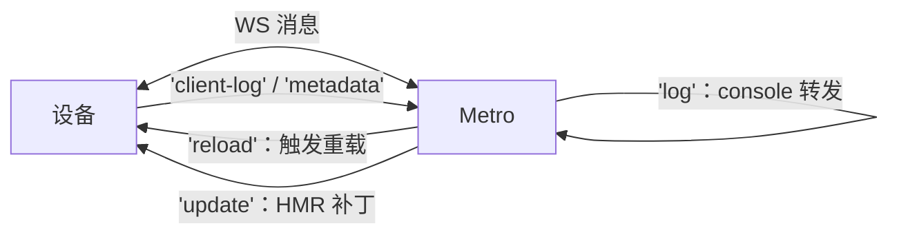
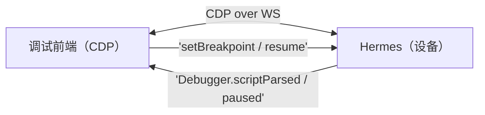

# 调试工具链原理

> 全站收官篇。调试工具不是"会用就行"的黑盒——**Metro 与设备怎么连、HMR 消息长什么样、DevTools 为什么能 attach、断点落在哪一层**，每个问题都有原理答案，而答案全部来自前九个模块。

## 1. 工具矩阵：分层看

| 工具 | 作用层 | 连接通道 |
|------|--------|---------|
| Metro + HMR | 构建与热替换 | 设备 ↔ Metro WebSocket（:8081） |
| React DevTools | 组件树/Profiler | App ↔ DevTools（:8097） |
| React Native DevTools（0.76+） | JS 断点（CDP） | Hermes ↔ 调试前端，直连 |
| Chrome DevTools / Hermes 调试 | JS 断点（旧路径） | CDP over WebSocket |
| Flipper | 原生/网络/DB 插件化 | 0.76 起移出默认栈 |
| Xcode / Android Studio | 原生与 C++ 层 | lldb / adb 系调试器 |

**选层原则：问题在哪层就用哪层的工具**——JS 帧卡顿看 Profiler（模块九 03），原生崩溃看符号化栈（模块九 04），渲染管线看 Perfetto（模块九 01）。

## 2. Metro 与设备：一条 WebSocket 的全部职责

dev 模式下设备与 Metro 之间除了 bundle 的 HTTP（模块二 03），还有一条 WebSocket，消息按 `type` 分发：

- **日志通路**：`console.log` 在设备上被打点转发到 Metro 终端——所以终端能看到 `js` 标签的日志；
- **reload**：摇一摇/R 菜单触发的消息，本质是让 App 重新走一遍"加载 bundle → runApplication"（模块二 01/02）；
- **HMR/Fast Refresh**：见下节。

## 3. Fast Refresh 原理：模块级替换 + 状态保留

Fast Refresh = Metro 编译期注入 + 运行时协作：

1. **transform 阶段**：Babel 给每个模块注入 `__react_refresh__` 包装——组件模块注册"刷新回调"（哪段代码导出了组件）；
2. **编辑保存**：Metro 增量编译出变更模块的新代码，经 WS `update` 消息下发（delta，模块八 01）；
3. **运行时替换**：HMR runtime 执行新模块工厂 `__d(newFactory)`（同 id 覆盖，模块八 01 的封装结构），通知 React Refresh：组件类型已更新；
4. **保留状态重渲染**：React Refresh 对**函数组件/Hook** 用新类型重新 render 当前 Fiber 子树——**state 保留**；非组件模块（工具函数）变更则向上冒泡到最近的组件边界整树重挂。

推论（都来自该机制）：改了**模块顶层有副作用**的代码（如 `console.log` 执行体、全局注册）只能整页 reload；类组件不享受 Hook 级保留；**导出结构变化**（增删导出）触发边界重挂——不是 bug，是语义安全的取舍。

## 4. React DevTools 为什么能 attach

App 启动时，React renderer（RN 定制的 react-reconciler，模块五 01）已内置 **DevTools hook**：检查到调试端在监听（:8097），就把 reconciler 内部事件（组件树变更、commit、渲染耗时）通过 WebSocket 推给 DevTools 前端渲染。

- Profiler 的火焰图数据源 = reconciler 的 commit 记录——这正是模块九 03 "why did render" 的数据来源；
- attach 不需要重新构建：**通道早就埋在运行时里，等一个监听者**；
- 同理，Element inspector（设备上审查元素）走的是"原生命中测试 → 反查 fiber"（`getInspectorDataForViewAtPoint`），把原生 view 与 React 组件对上号——三棵树知识的直接应用。

## 5. 断点调试：CDP 直连 Hermes

- **旧路径（Remote JS Debugging）**：JS 跑进 Chrome 的 V8，用 Chrome DevTools 断点——问题：**引擎不是 Hermes**，行为/性能不可信（模块三：引擎差异真实存在），已被移除；
- **现行（React Native DevTools，0.76+ 默认）**：**CDP（Chrome DevTools Protocol）直连 Hermes**——Hermes 内置调试适配器，调试前端（基于 CDP 的独立 DevTools）直接对设备的 Hermes 实例下断点：**断的就是真机上的真引擎**，source map 还原到源码；
- 原理意义：CDP 是"调试协议"标准（inspect DOM/JS 的消息协议），Hermes 实现它 = 任何 CDP 客户端都能调试 RN 的 JS——**引擎调试能力接口化**，Flipper 退场的底层原因。

## 6. 原生与混合联调

- **Xcode/Android Studio attach**：调试 Java/Kotlin/ObjC/Swift/C++——新架构下 ShadowTree、JSI 绑定层都是 C++，**混合栈断点（JS 断点 + C++ 断点同时挂）是排查跨层问题的终极手段**（模块七的代码位置就是断点位置）；
- **符号化**：release 崩溃必须符号表还原（模块九 04），调试期 lldb 已带符号；
- **Sourcemap 生成**：bundle 与 map 配对产出（`--sourcemap-file`），发布产物要把 map 归档，否则线上 JS 报错只有行列号没有源码。

## 7. 用原理排障：三个"灵异现象"的答案

1. **改代码没生效**：HMR 对副作用模块只能整页 reload（第 3 节）；确认 Metro 终端没报编译错误（transform 失败不会下发 update）；
2. **断点不停/行号错位**：source map 与 bundle 版本不配对（第 6 节），或断在了 release 优化的包上——dev 模式断点才可靠；
3. **DevTools 连不上**：端口被占/设备与主机不在同一网络（WS 建立失败，第 1 节）；`adb reverse tcp:8081 tcp:8081` 是 Android 真机的标准一步。

## 小结

- 设备 ↔ Metro 一条 WebSocket 承担日志/reload/HMR——**Fast Refresh = 模块工厂同 id 替换 + React Refresh 保状态重渲染**，副作用模块例外；
- DevTools 的能力来自运行时预埋的 hook 与 reconciler 事件流，attach 只是"连上等在那里的通道"；
- 断点调试的现行正解是 **CDP 直连 Hermes**（RN DevTools），旧 remote debugging 因引擎不可信已退场；
- 排障口诀：先分层（JS/原生/构建），再按层选工具——所有"灵异现象"都能在本篇机制里找到答案。
