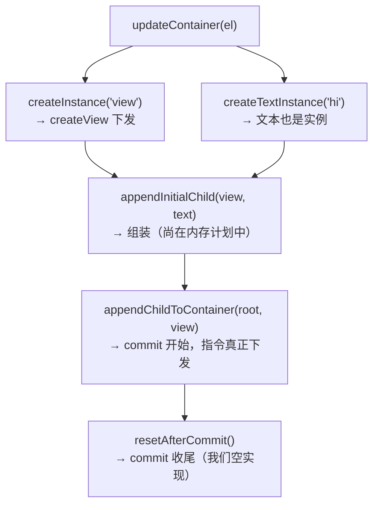

# mini-react-native 落地实现（M0–M5）

> 01 篇给了总设计与 M0–M5 里程碑，本篇把里程碑落到**可运行的最小代码**。宿主选择上做了一个务实替换：用 **Node.js + N-API 当作 JSI 的替身**（两者同为"引擎嵌入边界"，`napi_value ↔ jsi::Value` 语义同构），M0–M4 全部可跑，M5 给出接真平台的替换点。每个里程碑独立可验收。
>
> 本篇是走读视角（节选代码 + 决策理由）；**全量工程、验收输出与动手实验见 06–08 篇，事件上行闭环与收官自测见 09 篇**。

## 0. 为什么 N-API 可以"扮演"JSI

| JSI（真 RN） | N-API（本实现） | 共同语义 |
|--------------|-----------------|---------|
| `jsi::Runtime` | `napi_env` | 引擎上下文 |
| `jsi::Value` | `napi_value` | 跨边界值句柄 |
| `jsi::HostObject` | `napi_property_attributes` 导出的对象/函数 | 原生对象注入 JS |
| `jsi::Function::call` | `napi_call_function` | 同步直调 |

对照模块四 04 的五要素：我们同样在定义**通道（函数直调）、契约（类型签名）、线程（同进程同步）**——这正是"宿主进程暴露嵌入边界"的通用形态。

### 0.1 替换的代价与收益（想清楚再开跑）

任何"替身"都要先盘点失真点，本系列的替身也不例外：

| 维度 | 真 JSI | N-API 替身 | 影响 |
|------|--------|-----------|------|
| 值过界 | `jsi::Object` 引用、可遍历 | 同样可以传对象，但本系列刻意走 JSON 字符串 | 教学点保留（新旧架构对照） |
| 句柄生命周期 | `jsi::Value` 可存（自担 GC 风险） | `napi_value` 离栈即失效，存活要用 Persistent | 09 篇专门处理 |
| 注入形态 | HostObject 的 `get` 按需返回 | `exports` 对象表一次性注册 | 语义同构（对象表+函数指针） |
| 引擎 | Hermes/JSC | V8（Node） | 行为差异不影响树管线 |

收益则是工程量级的：不用拉 Hermes 源码、不用处理字节码加载、npm 生态的构建工具直接可用。**结论：教学目标是"通道语义 + 树管线"，替身的失真点全部可以圈出来当教材**——这正是 01 篇"务实替换"的完整含义。

### 0.2 为什么不干脆直接嵌 Hermes

被问得最多的问题，答案分三层：

1. **嵌 Hermes 的工程量在"引导"而非"绑定"**：拉源码、配构建、接 runtime 生命周期、实现模块加载器——每一项都与"理解 RN 渲染管线"无关；
2. **绑定层的语义 N-API 全部覆盖**：值过界、函数直调、对象注入、生命周期——我们要教的东西一样不少；
3. **想看引擎引导去模块二**：那是启动流程专题的领地，本系列不重复造轮子。

如果未来真想升级为"mini RN 宿主"，06–08 篇的 C++ 核心（视图树 + 布局器 + 上屏后端）可以原样搬走——**引擎无关性本身就是这次替换设计的副产品**。

## M0：宿主进程 + 全局注入

`binding.gyp` + 一个 C++ 文件，把 `MiniNative.log` 注入 global：

```cpp
// mini_native.cc（N-API）
#include <napi.h>
Napi::Value Log(const Napi::CallbackInfo& info) {
  printf("[MiniNative] %s\n", info[0].ToString().Utf8Value().c_str());
  return info.Env().Undefined();
}
Napi::Object Init(Napi::Env env, Napi::Object exports) {
  exports.Set("log", Napi::Function::New(env, Log));
  return exports;
}
NODE_API_MODULE(MiniNative, Init)
```

```js
// 验收：node -e "require('./build/Release/mini_native').log('hi')"
// 期望输出：[MiniNative] hi
```

对应真 RN：`ReactCommon` 里把 `TurboModuleBinding` 装进 global（模块七 03 的 `__turboModuleProxy`）。**M0 验证的是通道本身存在**。

### M0.1 这 10 行的逐段讲解

- **`Napi::Value Log(const Napi::CallbackInfo& info)`**：每个暴露给 JS 的函数都是这个签名——`CallbackInfo` 装着参数包与环境。对照 JSI 版：`jsi::Value Log(jsi::Runtime& rt, const jsi::Value& thisVal, const jsi::Value* args, size_t count)`——**同样是"上下文 + 参数包"，只是打包方式不同**；
- **`info[0].ToString().Utf8Value()`**：三步走——取第 0 参（`napi_value`）、强制转字符串（等价 JS 的 `String(x)` 强制转换）、拷出 UTF-8 的 `std::string`。**从这一步起，值就完全是 C++ 的了**，后续怎么用引擎都看不见；
- **`return info.Env().Undefined()`**：JS 的 `undefined` 也是要显式构造的——**跨边界没有"默认返回值"这回事**，忘写返回值是未定义行为而非返回 null；
- **`Init` 与 `NODE_API_MODULE`**：`.node` 文件被 `require` 时，dlopen 之后引擎调用这里的 `Init`——**注册发生在加载时刻、恰好一次**。`exports.Set("log", fn)` 就是"对象表 + 函数指针"的注入形态：JS 侧看到的 `MiniNative.log` 本质是一个指向 C++ 函数的句柄；
- **`printf` 而非 `std::cout`**：宿主是进程级程序，直接走 stdout 最短路径；这也解释了验收为什么能在终端直接看到输出。

### M0.2 验收命令逐词读

`node -e "require('./build/Release/mini_native').log('hi')"` 拆开是四步：node 启动 → `require` 触发 dlopen + `Init`（注入完成）→ 属性访问 `log` 拿到函数句柄 → 调用 `'hi'` 过界进 C++ 打印。**这条命令是后续所有里程碑的验收模板：一行命令、确定性输出**。

### M0.3 与真 RN 装配时序的对照

我们的注入发生在"require 时"；真 RN 的注入发生在"启动链路里"（模块二 01/02）——两者在"什么时候 global 上有原生对象"这个问题上可以逐段对齐：

| 阶段 | mini-rn（Node） | 真 RN |
|------|----------------|-------|
| 进程启动 | node 起，global 干净 | App 起，引擎（Hermes）初始化，global 干净 |
| 原生侧就绪 | dlopen `.node` | 装载 ReactCommon 的 C++ 绑定层 |
| 注入 | `Init` 填 exports → 模块对象 | BindingsInstaller 把 `__turboModuleProxy` 等装进 global |
| JS 开始跑 | 后续 require 拿到 MiniNative | bundle 执行，runApplication 上场 |

对齐之后再看 02 篇的 `__turboModuleProxy` 就毫无神秘感：**它就是我们的 `Init` 注册表的"懒加载 + 类型安全"版本**——同一个装配阶段，不同的工程化程度。

## M1：视图原语（C++ 侧视图树）

```cpp
struct MiniView {
  int tag; std::string type; std::string props;  // JSON 字符串
  std::vector<int> children; double x=0,y=0,w=0,h=0;
};
static std::unordered_map<int, MiniView> g_tree; static int g_next = 1;

Napi::Value CreateView(const Napi::CallbackInfo& i) {
  g_tree[++g_next-1] = {g_next-1, i[0].ToString(), i[1].ToString(), {}, 0,0,0,0};
  return Napi::Number::New(i.Env(), g_next-1);   // 返回 tag
}
// AppendChild(parentTag, childTag) / SetProps(tag, json) / RemoveChild(...) 同型，略
```

**偷懒点要自觉**：props 传 JSON 字符串是"序列化通道"（模块四 01 的旧架构做法）；真 JSI 应传 `jsi::Object` 引用遍历（模块七 01）。这个退化是刻意的——留作对比作业。

### M1.1 数据结构决策：为什么是这三样

`MiniView` 的字段表看着随意，其实每个都有对账对象：

| 字段 | 为什么需要 | 真 RN 对应 |
|------|-----------|-----------|
| `tag`（int） | 跨边界唯一身份，JS 侧只拿它 | viewId / ShadowNode 的 tag |
| `type`（string） | 后端按类型建平台控件（view/text） | componentName |
| `props`（JSON） | 样式与内容的载体 | Props 结构体（我们是字符串版） |
| `children`（vector<int>） | 树结构存"编号列表"而非指针 | ShadowNode 的 children（COW 版） |
| `x/y/w/h` | 布局器写入、上屏读取 | layoutMetrics |
| `g_tree`（unordered_map） | 编号 → 节点的注册表 | ShadowNode 注册表 |

两个值得停留的决策：

1. **children 存编号不存指针**：树结构靠两次查表（父的 children 列表 → 查 g_tree 得子节点）拼出来。代价是间接一层，收益是**节点永远不会被悬空引用**（编号要么在表里要么不在）——这正是模块四 01"只有编号没有对象"在数据结构层的落实；
2. **`unordered_map` 而非 `vector`**：vector 的下标即 tag 最快，但 removeChild 会造成"下标漂移"（编号必须稳定）；map 的 O(1) 查找 + 稳定键是正确的取舍。真 RN 同样是"稳定 tag + 注册表"的形态。

### M1.2 与 06 篇全量版的关系

本节代码是"走读版"（tag 分配写成了紧凑的自增表达式）；[06 篇](06-宿主工程与视图原语.md)给的是**整理后的全量版**：`int tag = g_next++;` 的清晰写法、props 直接存解析好的 json 对象、外加 `EnsureRoot`（内建 tag 0 根视图）与 `DumpTree`（树导出验收）。**功能语义完全一致，以 06 篇为抄写基准**——两边出现写法差异时，不是矛盾，是"讲稿"与"工程稿"的分工。

## M2：渲染器（react-reconciler hostConfig）

JS 侧 ~50 行接通 React（对照模块五 01）：

```js
const Reconciler = require('react-reconciler');
const MiniNative = require('./build/Release/mini_native.node');

const hostConfig = {
  createInstance(type, props) {
    const tag = MiniNative.createView(type, JSON.stringify(props));
    return { tag, type, props };
  },
  appendInitialChild(p, c) { MiniNative.appendChild(p.tag, c.tag); },
  finalizeInitialChildren() { return false; },
  createTextInstance() { throw new Error('text via <text> node'); },
  appendChildToContainer(c, child) { MiniNative.appendChild(c.tag, child.tag); },
  prepareUpdate() { return true; },
  commitUpdate(inst, _payload, type, oldP, newP) {
    MiniNative.setProps(inst.tag, JSON.stringify(diffProps(oldP, newP)));
    MiniNative.requestLayout();           // 思考题①见第 5 节
  },
  removeChild(p, c) { MiniNative.removeChild(p.tag, c.tag); },
  getRootHostContext() { return null; }, getChildHostContext() { return null; },
  shouldSetTextContent() { return false; },
  clearContainer() {}, insertBefore() {}, prepareForCommit() {},
  resetAfterCommit() {}, supportsMutation: true, now: Date.now,
};
const render = (el) => {          // container = tag 0 的根视图
  MiniNative.createView('root', '{}');  // 约定 tag 0 为根
  Reconciler(hostConfig).createContainer(/*root*/{tag:0}, 1, null, false, null, '', ()=>{}, ()=>{});
  // updateContainer(el)…（boilerplate 略）
};
```

验收：`render(<view><text>hello</text></view>)` 后 `MiniNative.dumpTree()` 打印出两节点树。

### M2.1 首帧时序：hostConfig 回调被谁、按什么顺序调

理解 hostConfig 的最快方式是看一次首帧的完整回调时序（`<view><text>hi</text></view>`）：



时序揭示的三件事：

1. **创建与挂载是两个阶段**：`createInstance` 只建实例（宿主树里多了孤立节点），`appendChildToContainer` 才把它挂上——**reconciler 先把整棵新树"计划"完，再一次性 commit**（模块五 01 的两阶段）；
2. **文本也是实例**：`createTextInstance` 在 reconciler 眼里与 `createInstance` 平级——`<text>hi</text>` 的 `'hi'` 是一个宿主节点，不是一个字符串属性；
3. **走读版埋着一个已知坑**：`createTextInstance` 直接 throw——真跑 `<view>hello</view>`（裸文本）会崩。**[07 篇](07-渲染器与更新管线.md)给的全量版把它修正为"建 text 实例"**，01 篇的占位写法以 07 为准。这是"走读稿省略"与"工程稿可用"的典型差异。

### M2.2 `prepareUpdate() { return true; }` 的深意

走读版恒返回 true（"总是更新"），07 篇换成真正的 `diffProps` 差量。这个占位值得停留一秒：返回 true 意味着**每次渲染每个实例都要下发全量 props**——属性一多就是更新风暴。它存在的意义是让 07 篇的差量版有对照物：**同一个 demo，改一行，宿主收到的指令量天差地别**。这是系列惯用的"先体验错、再修正"教学法。

## M3：状态与更新

M2 通了 M3 就是白送的——React 自己的机制：

```js
const App = () => {
  const [n, setN] = useState(0);
  useEffect(() => { const t = setInterval(() => setN(x => x + 1), 1000);
                     return () => clearInterval(t); }, []);
  return <view style={{padding:8}}><text>count: {n}</text></view>;
};
```

每秒一次 `commitUpdate → setProps → requestLayout`（真 RN 的对应物见模块五 03 的指令流）。**思考题②答案在此**：`instance` 只存 `{tag, type, props}` 纯数据——宿主对象不出 JSI 边界，编号是唯一身份（模块四 01"只有编号没有对象"）。

### M3.1 instance 身份的展开：为什么"纯数据"是唯一正解

`createInstance` 返回的 `{tag, type, props}` 是 reconciler 之后唯一持有的"宿主代表"。三种可选设计对照：

| 设计 | 做法 | 死法 |
|------|------|------|
| 存宿主对象引用 | `g_tree[tag]` 的指针/引用过界 | N-API 句柄离栈失效；JSI 则是 GC/线程问题——两边都活不过一次调用 |
| 存 closure 捕获的原生包装 | JS 侧包一层方法表 | 能跑，但每次操作仍要过界查表，白白多一层 |
| **存纯数据 `{tag,...}`**（本系列） | 编号 + 类型 + props 快照 | 无——查表成本由注册表吸收 |

"纯数据"还有个隐性收益：**props 快照让 diff 在 JS 侧独立完成**（`diffProps(oldP, newP)` 不需要问宿主要旧值）——旧值在 instance 里就有。真 RN 的对应物是 Props 结构体的 diff（模块五 03），思路同源：**diff 需要旧值，旧值放在"离 diff 最近"的那一侧**。

### M3.2 一秒内发生了什么：计数器的完整追踪

M3 验收时值得把一秒内的每一步写下来（这就是 09 篇闭环四步的下行半场）：

1. `setInterval` 到点，`setN(x => x + 1)` 触发更新调度；
2. reconciler 重新 render `App`——新元素树的 text 子节点带新字符串 `count: 3`；
3. diff 发现 text 实例的 children 变了 → 调 `prepareUpdate`（走读版恒 true）→ `commitUpdate`；
4. `commitUpdate` 里 `setProps` 下发差量过界、`requestLayout` 触发布局（M4 起）；
5. 宿主树更新完成，下一帧 dump 就能看到 `count: 3`。

五步里我们只写了第 4 步——**1~3 全是 React 送的**。这个比例（五分之一）就是"自定义渲染器"的性价比：接入一次合同，换来整个 React 编程模型。

## M4：极简布局器（C++）

一维 flex 的最小实现——**布局在宿主侧**（对照模块五 02：Yoga 在 C++）：

```cpp
void Layout(MiniView& v) {                    // 先递归子级，再排主轴
  for (auto c : v.children) Layout(g_tree[c]);
  double px = pad(v,"padding"), off = px;
  for (auto c : v.children) {
    auto& ch = g_tree[c];
    double m = pad(ch.props, "margin");
    ch.x = v.x + off + m; ch.y = v.y + px + m;
    off += ch.w + 2*m;                        // row：沿 x 排；column 同理沿 y
  }
  v.w = max(fixed(v.props,"width"), off + px); v.h = /*同理*/;
}
// requestLayout() => Layout(g_tree[0]); DumpTree();   打印每节点 x/y/w/h
```

验收：嵌套 `view(row)` 里三个定宽子 `view`，dump 出的 x 等差、外层 w = 内宽 + padding。**思考题③答案**：布局放宿主侧，JS 只发结构变化——一帧内多次 setProps 只触发一次 Layout（把 requestLayout 做成"脏标记 + 帧末 flush"即模块五 03 的两班倒雏形）。

### M4.1 走读版的简化与 08 篇的两遍法

本节的 `Layout` 是"一遍递归"的极简版（自下而上量尺寸 + 顺手排位置），它能工作是因为**父级原点恰好是 (0,0) 或已在外层确定**。一旦引入嵌套的坐标传递，"量"（后序）与"摆"（先序）就必须拆开——这正是 [08 篇](08-布局器与上屏后端.md)两遍布局法（Measure/Place）的由来：

- 走读版：一遍，讲"布局在宿主"这个**决策**；
- 工程版（08 篇）：两遍，讲"任意嵌套下正确"的**算法**，并配了手工可复算的数值样例（row/column 各一个）。

M4 的验收心态：先用走读版打出"x 等差"的直觉，再进 08 篇用工程版对账每个数字。

## M5：文本与上屏（真平台替换点）

- **文本度量**：字符数 × 单宽近似；接真平台时换成 CoreText（`CTLineGetTypographicBounds`）/ Android `Paint.measureText`——这是布局器里唯一"骗不了人"的平台依赖；
- **上屏**：把 `DumpTree` 换成遍历树创建真控件（macOS `NSView/NSTextField` 或 iOS `UIView/UILabel`，`Layout` 结果直接当 frame）；
- **双平台开关**：C++ 核心不动，平台层各一个 ~80 行的胶水文件——这正是真 RN"共享 C++、平台薄壳"的缩影（模块七）。

### M5.1 三个替换点的工程细节（接 08 篇）

每个替换点在 08 篇都有全量落点，这里先把"要换什么、别换什么"说清：

| 替换点 | 换什么 | 千万别动什么 |
|--------|--------|-------------|
| 文本度量 | Measure 的 text 分支改调平台 API | 度量的调用时机（必须留在后序遍历里） |
| 上屏 | DumpTree 的出口改 PresentTree | 树结构与布局字段的语义 |
| 平台开关 | 编译单元/后端文件级切换 | mini_native.cc 的核心逻辑 |

第三个坑最多人踩：**别在核心文件里写 `#ifdef __APPLE__` 分支**——平台差异应该被隔离在后端文件里，核心一旦长出平台分支，"共享 C++"就名存实亡。08 篇的 AppKit 胶水（`MiniNativeMac.mm`）就是"平台层薄壳"的示范：树查询、坐标翻转、控件创建全部圈在一个文件里。

## 6. 复盘：三百行换来的对应关系

| 里程碑 | 我写的 | RN 里的对应物（差距） |
|--------|--------|----------------------|
| M0 | N-API 注入 | TurboModuleBinding（Codegen 契约） |
| M1 | MiniView + JSON props | ShadowNode + Props 结构体（引用非序列化） |
| M2 | hostConfig | ReactFabric hostConfig（props 差量算法） |
| M3 | tag 身份 | viewId 指令流（批处理） |
| M4 | 一维 flex + 脏标记 | Yoga（完整规范/缓存/文本测量） |
| M5 | 平台胶水 | Fabric mount（优先级调度、同步布局） |

### 6.1 逐行读差距：每一格"差距"都是一个可做的扩展

复盘表右列的差距不是"输给 RN"的意思，而是**从这里出发还能练什么**的路线图：

- **M0 的 Codegen 契约**：我们的 `Init` 手写注册 → [02 篇](02-自定义TurboModule全流程.md)用 spec 生成注册，规模问题的工程解；
- **M1 的引用通道**：JSON 字符串 → `jsi::Object` 遍历，模块七 01 的原理不用重做也能"指认"：序列化点就是我们与 Fabric 的分界；
- **M2 的差量算法**：`prepareUpdate` 恒真 → [07 篇](07-渲染器与更新管线.md) diffProps → 真 RN 的属性结构体 diff，三级递进；
- **M3 的批处理**：每秒直发 → 07 篇实验的帧末合并 → 真 RN 的 commit 事务；
- **M4 的完整规范**：一维两遍 → Yoga 的 flex 比例/缓存失效（09 篇挑战 1 亲手撞墙）；
- **M5 的调度**：同步 mount → 真 RN 的按优先级 lane 调度（09 篇挑战 4 攒 ops 列表的入门版）。

## 7. 常见卡点速查（M0–M5 全程）

| 阶段 | 症状 | 原因与解法 |
|------|------|-----------|
| build | node-gyp 报 gyp/python 错 | Python 版本/工具链缺失（01 篇第 7 节清单） |
| build | 编译报 napi.h 找不到 | 没装 node-addon-api 或 include_dirs 没配（06 篇第 2 节） |
| require | dlopen 错误（架构不匹配类） | Node 与产物架构不一致，统一架构重编 |
| require | "Module did not self-register"类错误 | 注册宏与产物名不配套（06 篇第 8 节） |
| M1 | dump 树结构不对 | appendChild 参数序反（parent 在前）；根 tag 0 没建 |
| M2 | 裸文本直接崩 | createTextInstance 的占位 throw——用 07 篇全量版 |
| M2 | 树里只有 root | appendChildToContainer 没接（挂容器走它，07 篇第 5 节） |
| M3 | 更新风暴 | prepareUpdate 恒真 + 全量下发（07 篇差量版） |
| M4 | 坐标不对 | 走读版只保证根原点场景，换 08 篇两遍法；或 margin/padding 记错 |
| M5 | 上屏视图位置怪 | 坐标系翻转（AppKit 原点左下，08 篇第 5 节） |

排查的总原则（与 [04 篇](04-调试工具链原理.md)的分层思路一致）：**先确定层（构建/require/JS/C++），再下断点**——JS 侧 `node --inspect`，C++ 侧 lldb 断 `.node`，两头看值。

## 8. 自测

1. N-API 与 JSI 的四对同构物分别是什么？"序列化 vs 引用"这个刻意失真点对照哪两种架构？
2. `Init` 何时被调、调用几次？`exports.Set` 的注入形态与 HostObject 的 `get` 有何异同？
3. instance 为什么只存纯数据？diff 需要的旧 props 放在哪一侧、为什么？
4. 走读版 Layout 与 08 篇两遍法的边界条件差异是什么？
5. M5 的三个替换点各换什么、绝不换什么？
6. 复盘表 M3 行"tag 身份 → viewId 指令流（批处理）"——批处理的手工版在哪个篇目、怎么做的？

## 8.5 本篇在系列里的坐标（衔接总说明）

- **与 01 篇**：里程碑表与思考题的"题面"在 [01 篇](01-mini-react-native总览.md)，本篇是"求解过程"；
- **与 06 篇**：本篇 M0/M1 的代码是讲稿形态，可编译的全文与验收输出在 [06 篇](06-宿主工程与视图原语.md)；
- **与 07 篇**：本篇 M2 的 hostConfig 有两处占位（createTextInstance throw、prepareUpdate 恒真），[07 篇](07-渲染器与更新管线.md)逐处修正并给批处理实验；
- **与 08 篇**：本篇 M4 的"一遍递归"升级为两遍布局法 + 数值验收，M5 的替换点在 [08 篇](08-布局器与上屏后端.md)落到 AppKit 全量胶水；
- **与 09 篇**：本篇做完是"单向下行"，[09 篇](09-事件回路与收官自测.md)补上行事件成回路，并回收本篇埋的全部思考题；
- **与 02/03 篇**：M0 的 `Init` 注册表对照 [02 篇](02-自定义TurboModule全流程.md)的 Codegen 注册链；M1/M2 的三件套对照 [03 篇](03-Fabric原生组件开发.md)的三通道组件。

## 小结

- M0–M5 每步都有独立验收；N-API 与 JSI 同为"引擎嵌入边界"，替换不掉的只有"序列化 vs 引用"这一课（它就是新旧架构的分界）；
- 三个思考题的答案都落在已有模块：commitUpdate 攒批（模块五 03）、tag 身份（模块四 01）、布局归宿主（模块五 02）；
- 本篇是走读稿：占位与省略（createTextInstance throw、prepareUpdate 恒真）都以 06–08 篇的全量工程稿为准；
- 做完的标志不是"能跑"，而是再看 ReactFabric/Yoga 源码时，每个设计决策都能说出"我遇到过这个问题"。
