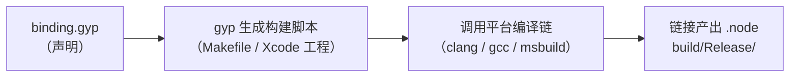

# 宿主工程与视图原语（M0–M1 全量实现）

> mini-react-native 子系列第一篇（总览见 01，走读见 05）：把 M0（宿主进程 + 全局注入）与 M1（视图原语）落成**完整可编译的工程**——每个文件全文给出，逐行可抄。宿主用 Node.js + N-API 扮演 JSI（05 篇讲过同构性）。

## 1. 工程结构

```text
mini-react-native/
├── package.json          # 依赖：react、react-reconciler（07 篇用）
├── binding.gyp           # node-gyp 构建描述
├── deps/
│   └── nlohmann/json.hpp # 单头 JSON 库（vendor，不装依赖）
├── mini_native.cc        # 本篇主角：宿主视图树 + 原语
├── renderer.js           # 07 篇：hostConfig
└── app.js                # 07/09 篇：业务组件
```

```json
// package.json（07 篇前只用到 build 脚本）
{
  "name": "mini-react-native",
  "scripts": { "build:native": "node-gyp rebuild", "start": "node app.js" },
  "dependencies": { "react": "18.3.1", "react-reconciler": "0.29.2" }
}
```

> 版本钉死是刻意的：react 与 react-reconciler 必须配套（reconciler 内部 API 跟随 React 大版本），系列代码以 React 18.3 + reconciler 0.29 为准。

### 1.1 每个文件的角色（为什么是这个清单）

| 文件 | 角色 | 被谁依赖 |
|------|------|---------|
| `binding.gyp` | 告诉 node-gyp 编什么、怎么编 | 构建系统 |
| `deps/nlohmann/json.hpp` | JSON 解析（props 载体） | mini_native.cc |
| `mini_native.cc` | 宿主全部：视图树 + 原语 + 注册 | renderer.js（07 篇） |
| `renderer.js` / `app.js` | 07/09 篇才入场 | 业务方 |

两个结构决策值得点名：

- **vendor 单头库而非 npm 装依赖**：`nlohmann/json` 是单头文件，直接进 `deps/` 让 C++ 侧零外部依赖——构建出问题的搜索空间越小越好（教学工程的第一美德）；真 RN 同样把第三方库 vendor 或子模块化进 `ReactCommon`；
- **一个 `.cc` 装下全部宿主**：M0/M1 阶段不做文件拆分——拆分是 08 篇的事（把树与布局抽成 `mini_core.h` 供 AppKit 后端复用）。**先长后拆**，避免"过度设计在能跑之前"。

## 2. binding.gyp

```json
{
  "targets": [
    {
      "target_name": "mini_native",
      "sources": ["mini_native.cc"],
      "include_dirs": ["<!(node -p \"require('node-addon-api').include\")", "deps"],
      "defines": ["NAPI_VERSION=8"],
      "cflags_cc": ["-std=c++17"],
      "conditions": [
        ["OS=='mac'", {
          "xcode_settings": { "CLANG_CXX_LANGUAGE_STANDARD": "c++17" }
        }]
      ]
    }
  ]
}
```

要点：`node-addon-api` 是 N-API 的 C++ 封装（对应关系：它之于 N-API，恰如 `jsi::Function` 等 helper 之于裸 JSI）；`include_dirs` 里的 `deps` 让 `#include <nlohmann/json.hpp>` 直接可用。`npm i node-addon-api node-gyp` 后 `npm run build:native` 产出 `build/Release/mini_native.node`。

### 2.1 node-gyp 链路：从一行命令到 .node

`npm run build:native`（即 `node-gyp rebuild`）背后是三段流水线，每段都可能出错，知道分段才知道排错从哪下手：



1. **gyp 读声明生成构建脚本**：把 `targets` 翻译成平台原生的构建文件——这阶段报错通常是 gyp 语法或 Python 环境（01 篇第 7 节）；
2. **编译**：按 `sources` 编 C++，按 `include_dirs` 找头文件，按 `defines`/`cflags_cc` 定编译标准——`napi.h 找不到`、`C++ 标准不够`都在这段；
3. **链接成动态库**：`.node` 本质是平台动态库（macOS 上是 dylib 形态），命名必须与 `NODE_API_MODULE` 的注册名配套（第 8 节的头号坑）。

### 2.2 逐字段读 binding.gyp

| 字段 | 作用 | 改动后果 |
|------|------|---------|
| `target_name: "mini_native"` | 产物名（mini_native.node） | 改了就要同步改 require 路径 |
| `sources` | 编译哪些文件 | 08 篇加布局器不用改（同文件追加） |
| `include_dirs` 的 `node-addon-api` 项 | `#include <napi.h>` 的来源 | 删了直接编译失败 |
| `include_dirs` 的 `"deps"` | nlohmann/json 的位置 | vendor 路径约定，别嵌套 |
| `defines: NAPI_VERSION=8` | 声明使用的 N-API 能力级别 | 级别决定可用 API 集，按需不冒进 |
| `cflags_cc / xcode_settings` | C++17 标准（跨编译器两套写法） | 布局器用了结构化绑定时必须保住 |

**为什么 C++17**：nlohmann/json 与我们后续代码按 C++17 惯用形态书写；`cflags_cc` 管类 Unix 编译器、`xcode_settings` 管 macOS 的 clang（Xcode 体系不吃 cflags_cc）——**同一个意图，两处声明**，这是 gyp 的平台适配税。

### 2.3 不用 node-gyp 行不行

行，且有工程先例：CMake 系构建（如 cmake-js）同样能产出 `.node`——N-API 的稳定 ABI 让"构建工具"与"运行时 Node 版本"解耦，这正是 N-API 相对老 NAN 绑定的核心优势。本系列选 node-gyp 是因为它是 Node 生态的默认路径、出错时搜索资料最多；**构建工具是可替换项，`Init` 注册与原语语义才是本篇的本体**。

## 3. mini_native.cc 全文（M0 + M1）

```cpp
#include <napi.h>
#include <nlohmann/json.hpp>
#include <cstdio>
#include <string>
#include <unordered_map>
#include <vector>

// ---------------- 宿主视图树（对照真 RN：C++ ShadowNode 的极简版）----------------
struct MiniView {
  int tag = 0;
  std::string type;                  // "view" | "text"（"root" 是 tag 0 的哨兵）
  nlohmann::json props;              // 完整 props（style 字段内含样式）
  std::vector<int> children;
  double x = 0, y = 0, w = 0, h = 0; // M4 布局器写入
  bool dirty = false;                // 07 篇批处理实验用
};

static std::unordered_map<int, MiniView> g_tree;   // tag → 节点（对照 ShadowNode 注册表）
static int g_next = 1;

// 宿主内建 tag 0 的根视图
static void EnsureRoot() { if (!g_tree.count(0)) g_tree[0] = MiniView{0, "root", {}, {}}; }

// ---------------- M0：通道本身 ----------------
static Napi::Value Log(const Napi::CallbackInfo& info) {
  printf("[MiniNative] %s\n", info[0].ToString().Utf8Value().c_str());
  return info.Env().Undefined();
}

// ---------------- M1：视图原语（对照模块五 03 的指令集）----------------
static Napi::Value CreateView(const Napi::CallbackInfo& info) {
  std::string type = info[0].ToString();
  nlohmann::json props = nlohmann::json::parse(
      info[1].ToString().Utf8Value(), nullptr, /*allow_exceptions=*/false);
  if (!props.is_object()) props = nlohmann::json::object();
  int tag = g_next++;
  g_tree[tag] = MiniView{tag, type, props};
  return Napi::Number::New(info.Env(), tag);   // 唯一身份是编号（模块四 01）
}

static Napi::Value AppendChild(const Napi::CallbackInfo& info) {
  int parent = info[0].As<Napi::Number>().Int32Value();
  int child  = info[1].As<Napi::Number>().Int32Value();
  g_tree.at(parent).children.push_back(child);
  g_tree.at(parent).dirty = true;
  return info.Env().Undefined();
}

static Napi::Value RemoveChild(const Napi::CallbackInfo& info) {
  int parent = info[0].As<Napi::Number>().Int32Value();
  int child  = info[1].As<Napi::Number>().Int32Value();
  auto& kids = g_tree.at(parent).children;
  kids.erase(std::remove(kids.begin(), kids.end(), child), kids.end());
  g_tree.erase(child);                            // 简化：连同子树一起删（无 COW 的代价）
  return info.Env().Undefined();
}

static Napi::Value SetProps(const Napi::CallbackInfo& info) {
  int tag = info[0].As<Napi::Number>().Int32Value();
  g_tree.at(tag).props.merge_patch(nlohmann::json::parse(
      info[1].ToString().Utf8Value(), nullptr, false));  // 增量合并 = 差量下发
  g_tree.at(tag).dirty = true;
  return info.Env().Undefined();
}

static Napi::Value RequestLayout(const Napi::CallbackInfo& info) {
  EnsureRoot();
  // M4 之前布局器缺位：只做树打印；08 篇把这里换成 Measure+Place
  printf("[MiniNative] requestLayout\n");
  return info.Env().Undefined();
}

// ---------------- 调试出口：树导出 ----------------
static void DumpRec(int tag, int depth, std::string& out) {
  MiniView& v = g_tree[tag];
  char line[160];
  snprintf(line, sizeof line, "%*s<%s tag=%d x=%.0f y=%.0f w=%.0f h=%.0f>\n",
           depth * 2, "", v.type.c_str(), tag, v.x, v.y, v.w, v.h);
  out += line;
  for (int c : v.children) DumpRec(c, depth + 1, out);
}
static Napi::Value DumpTree(const Napi::CallbackInfo& info) {
  EnsureRoot();
  std::string out;
  DumpRec(0, 0, out);
  printf("%s", out.c_str());
  return Napi::String::New(info.Env(), out);
}

// ---------------- 模块注册（对照 TurboModuleBinding 装配）----------------
static Napi::Object Init(Napi::Env env, Napi::Object exports) {
  EnsureRoot();
  exports.Set("log",           Napi::Function::New(env, Log));
  exports.Set("createView",    Napi::Function::New(env, CreateView));
  exports.Set("appendChild",   Napi::Function::New(env, AppendChild));
  exports.Set("removeChild",   Napi::Function::New(env, RemoveChild));
  exports.Set("setProps",      Napi::Function::New(env, SetProps));
  exports.Set("requestLayout", Napi::Function::New(env, RequestLayout));
  exports.Set("dumpTree",      Napi::Function::New(env, DumpTree));
  return exports;
}
NODE_API_MODULE(mini_native, Init)
```

### 3.1 逐跳看数据形态：从 JS 调用到节点入表

以 `createView('text', '{"value":"hello"}')` 为例，数据在函数内的形态变化链：

| 站点 | 数据形态 | 归属 |
|------|---------|------|
| JS 调用处 | `'text'`、`'{"value":"hello"}'`（JS 字符串） | 引擎堆 |
| `info[0]` / `info[1]` | `napi_value`（不透明句柄） | 引擎，仅本次调用内有效 |
| `.ToString().Utf8Value()` | `std::string`（两次拷贝：转字符串、拷出 UTF-8） | C++ 栈/堆 |
| `nlohmann::json::parse(...)` | 内存中的 json 对象（字段可查） | C++ 堆 |
| `g_tree[tag] = MiniView{...}` | 树节点（props 为 json 对象） | C++ 堆（宿主唯一事实源） |
| 返回 `Napi::Number::New` | `napi_value`（数字）→ JS number | 引擎 |

两个关键点：

- **每过一站都是拷贝，没有共享**：JS 字符串与 C++ `std::string` 是两份内存——这是"序列化通道"的本质成本，也是 05 篇反复标注的"刻意偷懒"（真 JSI 引用通道下，宿主直接遍历引擎内对象，无此拷贝）；
- **parse 用了 `allow_exceptions=false`**：坏 JSON 不抛异常而是返回 discarded 值，下一行 `is_object()` 兜底成空对象——**通道函数必须有"输入不可信"的自觉**：JS 侧传什么编译器管不着，健壮性靠自己。

### 3.2 错误路径：这份代码在什么输入下会怎么死

教学代码也该写清死法，这三条都是能亲手复现的：

| 输入 | 行为 | 机制 |
|------|------|------|
| `createView()`（缺参） | 不崩，建出 type 为 `"undefined"` 的节点 | `info[i]` 越界返回 undefined，`ToString()` 是强制转换（等价 `String(undefined)`） |
| `setProps(999, '{}')`（tag 不存在） | 进程直接终止 | `g_tree.at()` 抛 `std::out_of_range`，异常穿过 C 边界 → terminate |
| `appendChild(a, b)` 传字符串 | N-API 层抛 JS 可见的 TypeError | `As<Napi::Number>()` 类型不符时抛——这是"好死"（错误可见） |

对比第 1、2 行：**参数缺失被静默宽容，参数类型错误被抛出，注册表键错误直接崩**——三种截然不同的命运，说明"跨语言边界的错误处理"没有默认答案，每一处都要显式设计。真 RN 的对应做法是在 JSI 层包 try/catch 并把异常翻译回 JS 可见错误（模块七 01）；给 `at()` 换成 `find()` + 返回 `undefined` 是留给读者的加固作业。

### 3.3 N-API 类型转换速查（本篇用到的全部）

| 引擎侧类型 | `napi_value` 判型 | C++ 取值（node-addon-api） | 本篇用途 |
|-----------|------------------|---------------------------|---------|
| string | `IsString()` | `ToString().Utf8Value()` → `std::string` | type、props JSON |
| number | `IsNumber()` | `As<Napi::Number>().Int32Value()` | tag 参数 |
| （任意） | — | 强制转换 `ToString()` | Log 的宽容路径 |
| 构造返回 | — | `Napi::Number::New(env, tag)` / `Napi::String::New` / `Env().Undefined()` | 返回 tag / dump 文本 / 空 |
| 函数 | `IsFunction()` | （09 篇）`Napi::Persistent` | 事件回调 |

记法：**取值三问——是什么类型（判型）、怎么转（As/ToString）、拷到哪（Utf8Value/Int32Value）**。`As<T>()` 是"我知道我是谁"的断言式转换（错型即抛），`ToString()` 是"不管你是谁都变字符串"的强制转换——本篇在 Log/CreateView 用宽容版（参数来自外部），在 tag 参数用断言版（契约要求 number）。

### 3.4 注册表与生命周期：什么能存、存多久

全篇最值得抄走的认知，一句话版本：**`napi_value` 是"借用"，`std::string`/`int`/`nlohmann::json` 是"拥有"**。

- 函数返回后，本次调用产生的所有 `napi_value` 失效（句柄作用域回收）——所以 `MiniView` 里存的全部是 C++ 类型，**没有一个 `napi_value` 跨调用存活**；
- `g_tree` 的节点生命周期与进程相同，删除靠 `erase`——宿主是树的唯一 owner；
- 09 篇会碰到唯一例外：宿主要反过来"持有 JS 函数"——那时用 `Napi::Persistent` 把借用转成拥有（GC 对应物：模块三 03 的 Handle 体系）。

## 4. 逐点对照 JSI

| 我们写的（N-API） | 真 RN（JSI） | 说明 |
|-------------------|--------------|------|
| `const Napi::CallbackInfo&` | `jsi::Runtime&, const jsi::Value*, size_t` | 调用上下文/参数包 |
| `info[0].ToString()` | `args[0].asString(rt).utf8(rt)` | 值取出（都要求类型匹配，否则抛） |
| `Napi::Number::New(env, tag)` | `jsi::Value((double)tag)` | 返回值构造 |
| `exports.Set(name, fn)` | `runtime.global().setProperty(rt, name, fn)` | **注入方式同构：对象表 + 函数指针** |
| `nlohmann::json` 字符串 | `jsi::Object` 引用遍历 | **刻意偷懒点**：我们走序列化，真 JSI 走引用——新旧架构分界（模块四 04） |

一个值得体验的差异：N-API 的 `napi_value` 离开调用栈就失效（句柄生命周期由引擎管），JSI 的 `jsi::Value` 可以存起来（但要自己防 GC——真 RN 用模块三 03 的 Handle/LongLivedObject 体系）。**两边的"什么能存、存多久"都是跨语言边界的第一课。**

第 3.4 节从实现角度补完了这张表的"为什么"：句柄生命周期的差异不是 API 风格，而是**所有权模型的差异**——N-API 把回收完全收归引擎（省心、但也意味着不能存），JSI 给你存的自由（强大、但要用 Handle 体系还债）。选型时这是比"性能"更本质的考量。

## 5. M0/M1 验收

```bash
npm run build:native
node -e "
const N = require('./build/Release/mini_native.node');
N.log('hi');                                  // M0
const a = N.createView('view',  '{\"style\":{\"width\":50}}');
const b = N.createView('text',   '{\"value\":\"hello\"}');
N.appendChild(a, b); N.appendChild(0, a);     // 挂到根
N.dumpTree();
"
```

期望输出：

```text
[MiniNative] hi
<root tag=0 x=0 y=0 w=0 h=0>
  <view tag=1 x=0 y=0 w=50 h=0>
    <text tag=2 x=0 y=0 w=0 h=0>
```

通过标准：`hi` 打印（通道活）；树结构与挂载顺序一致（原语活）；`setProps` 增量合并可用 `dumpTree` 前后对比验证。

### 5.1 验收失败的分层排查

验收不过时，按"构建 → 加载 → 调用 → 语义"四层收窄（与 05 篇卡点表、04 篇分层思路同构）：

| 层 | 典型报错/现象 | 定位 |
|----|--------------|------|
| 构建 | gyp/编译/链接错误 | 第 2 节的链路分段 |
| 加载 | require 报 dlopen/注册类错误 | 第 8 节表 |
| 调用 | TypeError / 进程崩 | 第 3.2 节三种死法 |
| 语义 | 能跑但树不对 | 挂载顺序/参数序——手工推一遍期望树再对照 |

语义层的排查利器就是 `dumpTree` 本身：**先在纸上写出期望树，再跑命令对比**——这个"手算 → 跑码"的习惯到 08 篇的坐标验收会升级为完整方法论。

## 6. 已知欠账（刻意留下，后续篇目逐个还）

| 欠账 | 还债处 |
|------|--------|
| props 走 JSON 序列化 | 真 JSI 的引用通道 → 模块七 01（理解差异即可，不重做） |
| removeChild 连子树一起删 | 08 篇谈 COW 与子树所有权时回看 |
| requestLayout 只打印 | 08 篇换成真正的两遍布局 |
| 没有"帧"的概念 | 07 篇批处理实验引入 |

### 6.1 欠账的"利息"：每笔在本篇的具体表现

- **JSON 序列化**的利息在 3.1 节的拷贝链——每个 props 过界两次拷贝 + 一次解析；
- **连子树一起删**的利息在 `RemoveChild` 的注释里——被删节点的子孙仍占着 `g_tree` 的坑位（孤儿节点），树小无感、树大了就是泄漏；
- **requestLayout 只打印**的利息是每秒打一行日志（07 篇 M3 跑起来就能看见）；
- **没有帧**的利息要 07 篇实验才显形——一次 commit 两个实例更新就是两次 requestLayout。

写欠账表的意义：**不是道歉，是把"教学取舍"与"工程差距"显式对齐**——每笔债都有编号、有还期，读者随时能审计。

## 7. 调试这个工程：lldb 断进 .node

04 篇讲过分层调试的总纲，这里给本篇工程的三个落点（04 篇 8.2 节的展开）：

```bash
lldb -- node -e "require('./build/Release/mini_native.node').createView('view','{}')"
(lldb) breakpoint set --file mini_native.cc --line 91   # CreateView 的 parse 之后
(lldb) run
(lldb) frame variable type                              # 看 std::string 的形态
(lldb) bt                                               # 看跨边界调用栈
```

三个值得一断的位置：

1. **`CreateView` 的 parse 之后**：同时看到 `type`（已转 std::string）与 `props`（已是 json 对象）——3.1 节数据链的现场；
2. **`SetProps` 的 merge_patch 之前**：看差量 JSON 与节点现有 props——"增量合并"语义的直接观察；
3. **`RemoveChild` 的 erase**：观察孤儿节点的产生（erase 只删了 child 一个键）——欠账 2 的现场。

**断点为什么可能 pending**：`.node` 在 require 时才 dlopen，符号要等加载后才解析（04 篇 8.5 节）——看到 pending 别慌，run 起来就 resolve。

## 8. 常见坑与排查（构建期 / 运行期）

构建期：

| 症状 | 根因 | 解法 |
|------|------|------|
| `napi.h: No such file` | node-addon-api 未装/未在 include_dirs | 对照第 2 节 include 配置 |
| Python/gyp 报错 | 工具链缺失或版本不符 | 01 篇第 7 节环境清单 |
| 链接不出 .node | 产物名与 target_name 不符 | 检查 target_name |
| C++ 标准类编译错 | cflags/xcode_settings 没生效 | 确认两处都写了（2.2 节） |

运行期：

| 症状 | 根因 | 解法 |
|------|------|------|
| require 报"Module did not self-register"类错误 | `NODE_API_MODULE` 名与加载的二进制不配套 | 注册宏名、target_name、require 路径三处对齐 |
| dlopen 报架构不匹配类错误 | Node 与产物架构不一致 | 统一架构重编 |
| 调用即崩（无 JS 报错） | 多半踩了 3.2 节第二行（at 越界） | lldb 看栈，改 find+判空 |
| TypeError: number expected | `As<Napi::Number>()` 断言失败 | 检查参数序（tag 恒在第一个） |

"三处对齐"值得展开：注册宏（`NODE_API_MODULE(mini_native, Init)`）→ 产物名（`target_name`）→ require 路径（`build/Release/mini_native.node`）——**任何一个环节改名都要全链同步**，这是动态库加载的通用纪律（真 RN 的 so/dylib 同样如此）。

## 9. 与其他篇目的衔接

- **向 07 篇交棒**：本篇交付的原语（createView/appendChild/setProps/removeChild/requestLayout）正好是 [07 篇](07-渲染器与更新管线.md) hostConfig 要调的全部接口——07 篇不再新增原语，只新增"谁在什么时候调"；
- **向 08 篇交棒**：`MiniView` 的 x/y/w/h 字段在本篇空置，[08 篇](08-布局器与上屏后端.md)的 Measure/Place 写入；`RequestLayout` 的打印桩同时被替换；
- **向 09 篇交棒**：`dirty` 字段本篇已埋（批处理实验用），[09 篇](09-事件回路与收官自测.md)在 `Init` 注册表里追加 `onEvent`；
- **向 02 篇回望**：`Init` 的手写注册表对照 [02 篇](02-自定义TurboModule全流程.md)的 Codegen 注册链——做完两边，"为什么需要 Codegen"不再需要解释。

## 10. 自测

1. `napi_value` 为什么不能存进 `MiniView`？"借用 vs 拥有"怎么划分？
2. `As<Napi::Number>()` 与 `ToString()` 的语义差异？各自适合什么场景？
3. `createView` 缺参、`setProps` 传错 tag、`appendChild` 传字符串——三种输入各自的命运与机制？
4. 注册宏名、target_name、require 路径是什么关系？哪处改了会"Module did not self-register"？
5. removeChild 的"连子树一起删"具体指什么？留了哪笔债？
6. 用 lldb 断 `SetProps`，你预期能同时看到哪两份数据？

## 小结

- M0/M1 的完整工程 = 一个 `.cc` + 一个 `.gyp` + vendor 的 json.hpp：视图树、四个原语、树导出，全部 < 130 行 C++；
- N-API 与 JSI 的注入形态同构（对象表 + 函数指针），**序列化 vs 引用**是唯一刻意保留的"旧架构味道"；
- 数据过界是一条拷贝链（napi_value → std::string → json → 节点），错误路径三种死法各不相同——边界函数对输入不可信要有自觉；
- 验收以输出为准：通道打印 + 树结构正确即通过；
- 四笔"欠账"都有对应还债篇目——这就是子系列的路线图。
