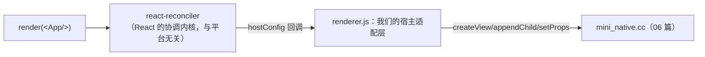
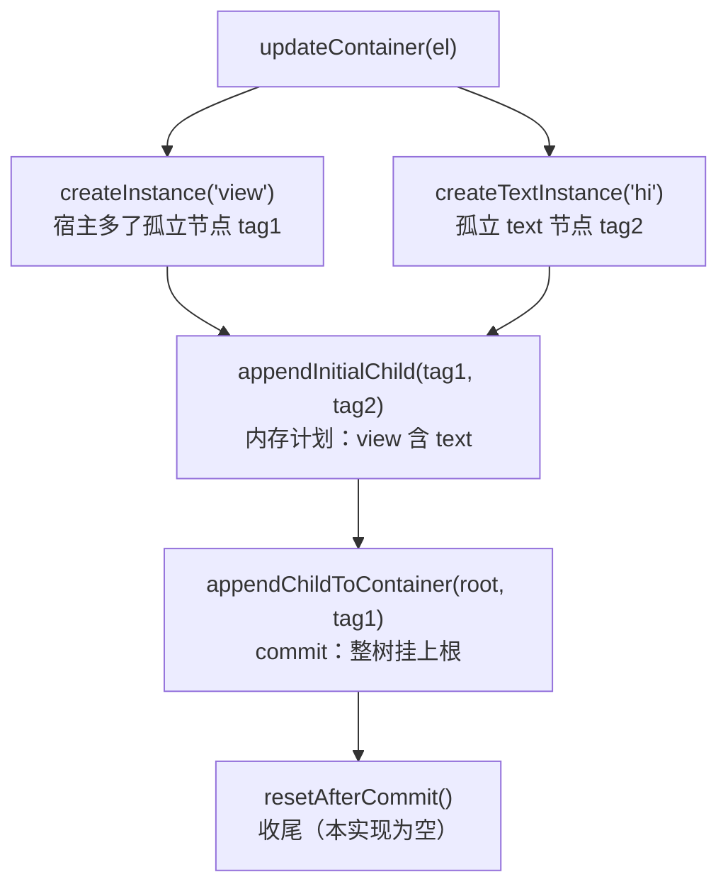

# 渲染器与更新管线（M2–M3 全量实现）

> 子系列第二篇：把 react-reconciler 接到 06 篇的宿主上。本篇给**完整可用的 hostConfig**（含总览里占位写法的一个修正）、`diffProps` 的差量语义，以及一个亲手可做的**批处理实验**——它会让模块五 03"两级批处理"从结论变成体验。

## 1. 接线全景：业务组件到宿主原语



reconciler 只认 hostConfig 这份"合同"，对宿主一无所知——这正是 React 能同时驱动 DOM/RN/Test Renderer 的机制（模块五 01）。

### 1.1 首帧时序：合同被按什么顺序履行

`render(<view style={...}>hi</view>)` 一次首帧，hostConfig 的回调时序（用 06 篇的 dump 树可以逐条验证）：



三个时序事实，后面每个环节都依赖它们：

1. **创建先行、挂载殿后**：`createInstance/createTextInstance` 阶段宿主树里是"孤立节点"，直到 `appendInitialChild`（组计划）与 `appendChildToContainer`（真挂载）才成树——**协调期与提交期的分离在回调时序上肉眼可见**；
2. **文本走专属通道**：`'hi'` 不经过 `createInstance`，走 `createTextInstance`——为什么总览的抛错写法跑不通，见 2.2 节的修正说明；
3. **回调全部发生在 commit 阶段**：render 阶段（可以被打断、重来的那部分）不触碰宿主——这就是 React 并发特性的安全边界（模块五 01），我们一行没写就继承了它。

### 1.2 更新时序：与首帧共用合同的不同子集

setState 引发的更新走的是合同的另一组条款：

| 阶段 | 调谁 | 我们做什么 |
|------|------|-----------|
| render（可中断） | 无宿主回调 | 纯 React 内部 |
| diff | `prepareUpdate(inst, type, oldP, newP)` | 算差量，返回 payload 或 null |
| commit | `commitUpdate(inst, payload)` / `commitTextUpdate` | payload 过界下发 + requestLayout |
| 卸载 | `removeChild(parent, child)` | 宿主摘节点 |

注意 `prepareUpdate` 是**问答式**的：reconciler 问"要更新吗、更新什么"，我们的返回值就是答案——**返回 null 是合法且重要的答案**（宿主零指令，2.1 节展开）。

## 2. renderer.js 全文（M2 核心）

```js
// renderer.js
const Reconciler = require('react-reconciler');
const MiniNative = require('./build/Release/mini_native.node');

// props 差量：引用比较 + 键并集（返回 null 表示无需更新，reconciler 会跳过 commitUpdate）
function diffProps(oldP, newP) {
  const out = {};
  for (const k of new Set([...Object.keys(oldP), ...Object.keys(newP)]))
    if (oldP[k] !== newP[k]) out[k] = newP[k];
  return Object.keys(out).length ? out : null;
}

const hostConfig = {
  // ---------- 实例创建（对照：Fabric 的 createShadowNode）----------
  createInstance(type, props) {
    const tag = MiniNative.createView(type, JSON.stringify(props));
    return { tag, type, props };          // instance 是纯数据，宿主对象不过界（模块四 01）
  },
  // 修正点：原生文本节点不是错误，而是"带 value 的 text 实例"
  // （总览 01 篇的 createTextInstance 抛错写法是占位——真跑不通，以此为准）
  createTextInstance(text) {
    const tag = MiniNative.createView('text', JSON.stringify({ value: text }));
    return { tag, type: 'text', props: { value: text } };
  },
  appendInitialChild(parent, child) { MiniNative.appendChild(parent.tag, child.tag); },

  // ---------- 挂载（对照：mount 阶段）----------
  appendChild(parent, child) { MiniNative.appendChild(parent.tag, child.tag); },
  appendChildToContainer(container, child) { MiniNative.appendChild(container.tag, child.tag); },
  insertBefore(parent, child, before) { /* 练习：按 before 的 tag 定位插入 */ },
  removeChild(parent, child) { MiniNative.removeChild(parent.tag, child.tag); },
  removeChildFromContainer(container, child) { MiniNative.removeChild(container.tag, child.tag); },

  // ---------- 更新（对照：commit 阶段的指令流）----------
  prepareUpdate(instance, type, oldProps, newProps) { return diffProps(oldProps, newProps); },
  commitUpdate(instance, payload) {
    if (payload) MiniNative.setProps(instance.tag, JSON.stringify(payload));
    instance.props = { ...instance.props, ...payload };
    MiniNative.requestLayout();
  },
  commitTextUpdate(instance, _old, newText) {
    MiniNative.setProps(instance.tag, JSON.stringify({ value: newText }));
    MiniNative.requestLayout();
  },

  // ---------- 合同的其余条款（最小满足）----------
  shouldSetTextContent: (type) => false,
  finalizeInitialChildren: () => false,
  prepareForCommit: () => null, resetAfterCommit: () => {},
  getRootHostContext: () => null, getChildHostContext: () => null,
  clearContainer: () => {}, getPublicInstance: (i) => i,
  preparePortalMount: () => {},
  supportsMutation: true, supportsPersistence: false, supportsHydration: false,
  now: () => Date.now(),
  scheduleTimeout: setTimeout, cancelTimeout: clearTimeout, noTimeout: -1,
};

// ---------- React 入口 ----------
const reconciler = Reconciler(hostConfig);
let container = null;
function render(element) {
  if (!container) {
    // tag 0 的根视图在宿主已内建（06 篇 EnsureRoot）
    container = reconciler.createContainer(
      { tag: 0, type: 'root', props: {} },   // containerInfo：会传给 appendChildToContainer
      1,                                      // 0=LegacyRoot 1=ConcurrentRoot
      null, false, null, '', () => {}, null  // hydration/报错等回调的最小集
    );
  }
  reconciler.updateContainer(element, container, null, null);
}
module.exports = { render };
```

> 版本提醒：`createContainer` 的参数个数随 react-reconciler 版本变化（0.29 为 8 参）。以 TypeScript 报错为准补齐——**报错本身就是 hostConfig 合同的文档**。

### 2.1 diffProps 逐行：六行代码里的三个语义决定

```js
for (const k of new Set([...Object.keys(oldP), ...Object.keys(newP)]))
  if (oldP[k] !== newP[k]) out[k] = newP[k];
return Object.keys(out).length ? out : null;
```

- **键并集（Set 去重）**：新增键、删除键、改值键一网打尽——只遍历 newP 会漏"删除"；
- **`!==` 引用比较**：对原始值（string/number/bool）是值比较，对对象/数组是引用比较——这是全部微妙性的来源（下面展开）；
- **返回 null 而非空对象**：reconciler 对 null 的处理是**跳过 commitUpdate**——宿主一条指令都收不到。差量语义的"省钱"就省在这一步。

**坑 1：嵌套对象恒变**。`<view style={{ padding: 10 }}>` 每次渲染 `style` 都是新对象字面量，`oldP.style !== newP.style` 恒真——于是每次渲染 view 都有"style 变了"的差量。本系列里这个差量被 `merge_patch` 增量合并吸收（同值合并无副作用），但在心里要标注：**真 RN 用编译期 Props 结构体按字段比较来消除这个恒变**（模块五 03），这是我们的 diff 与 Fabric diff 的核心差距。

**坑 2：删除语义会丢**。键在 old 有、new 无时，`newP[k]` 是 undefined，`out[k] = undefined`——而 `JSON.stringify` 会**丢掉值为 undefined 的键**，宿主的 merge_patch 收不到这个键，旧值保留。即"从 JSX 上删掉一个 prop"在这条管线上不会生效。修法有二：差量里显式放 `null`（merge_patch 语义里 null 是删除）；或用 `JSON.stringify` 的 replacer 把 undefined 转 null。这是留给读者的加固作业——**先知道语义有洞，再谈修补**。

### 2.2 文本节点的修正说明（对照 01/05 篇）

总览与走读篇的 `createTextInstance() { throw }` 是"教具"——它想强调"原生世界没有裸文本"，但真跑 `<view>hi</view>` 会直接崩。本篇的修正是：

- **文本是宿主节点**（type 为 `'text'`、value 装内容），不是 view 的属性——对应真 RN 里文本也是影子节点（TextView/文本组件）；
- **`shouldSetTextContent: () => false`** 配套地告诉 reconciler"别把 children 合并成字符串塞给我"——每个文本子节点都会独立调 `createTextInstance`。09 篇自测第 7 题考的就是这对搭档。

### 2.3 合同条款速查：其余条款各自挡了什么

| 条款 | 我们的值 | 它挡住的问题 |
|------|---------|-------------|
| `supportsMutation: true` | 声明"宿主可变" | false 则 reconciler 走持久化模式（每次新树） |
| `finalizeInitialChildren: () => false` | 不在挂载时绑定 | true 会触发额外回调（DOM 的 autofocus 类场景） |
| `prepareForCommit/resetAfterCommit` | 空/null | commit 前后的钩子（真 RN 在此触发批量挂载） |
| `getRootHostContext/getChildHostContext` | null | 树上下文（DOM 的 form 之类继承链） |
| `clearContainer` | 空 | 重挂根时清容器 |
| `getPublicInstance: (i) => i` | 恒等 | 外部（如 DevTools）取实例的口子 |
| `now/scheduleTimeout/noTimeout` | 平台设施 | reconciler 的超时/计时依赖 |

这些"最小满足"条款的共同点：**reconciler 按需调用，缺了才报错，多写无用**——合同是 React 定的，我们只履行被援引的条款（第 5 节的排查正是利用这一点：看堆栈第一帧缺谁补谁）。

### 2.4 createContainer 参数与版本纪律

`createContainer` 的参数表随 reconciler 版本演进（0.29 为 8 参），值得记住的是**每个参数的"角色"而非个数**：

| 位次 | 本篇实参 | 角色 |
|------|---------|------|
| 1 | `{ tag: 0, ... }` | containerInfo——原样传给容器级回调 |
| 2 | `1` | root 标签：0=Legacy、1=Concurrent |
| 3~8 | null/false/回调等 | hydration、严格模式、并发覆盖、id 前缀、可恢复错误等 |

参数漂移是 reconciler 最常见的升级破坏点，应对纪律就一句：**用 TS（或对着 d.ts）让编译器当文档**——报错信息直接指出缺哪个参数，比背版本表可靠。这也解释了 06 篇把 react/reconciler 版本钉死的原因：**合同细节与版本强绑定**。

## 3. M3：计数器（React 满血验证）

```js
// app.js
const React = require('react');
const { render } = require('./renderer');
const N = require('./build/Release/mini_native.node');

const App = () => {
  const [n, setN] = React.useState(0);
  React.useEffect(() => {
    const t = setInterval(() => setN((x) => x + 1), 1000);
    return () => clearInterval(t);
  }, []);
  return React.createElement(
    'view', { style: { padding: 10 } },
    React.createElement('text', null, `count: ${n}`)
  );
};
render(React.createElement(App));
setTimeout(() => N.dumpTree(), 3500);   // 3 秒后看树
```

期望输出（每秒一次 `commitTextUpdate → setProps → requestLayout`）：

```text
<root tag=0 ...>
  <view tag=1 ...>
    <text tag=2 ...>        ← props.value 已是 "count: 3"
```

**M3 的洞察**：我们没写任何 diff 代码——reconciler 全权决定"哪个实例要更新、更新什么"，我们的 commitUpdate 只是"信使"。`setState → prepareUpdate（算差量）→ commitUpdate（下指令）` 的分工，就是 React 与宿主适配层的边界。

### 3.1 每秒那一下的完整追踪（含一个"意外"的参与者）

按 2.1 的坑 1 推演，这一秒内其实有**两个**实例被更新：

1. text 实例：children 变了（新字符串）→ `commitTextUpdate` 下发 `{value: 'count: 3'}`；
2. view 实例：`style` 与 `children` 每渲染都是新对象 → `prepareUpdate` 判定"变了" → `commitUpdate` 下发 `{style: {...}, children: ...}`——被宿主 merge_patch 无害吸收。

也就是说宿主每秒实际收到**两次** setProps（view 一次、text 一次）——这不妨碍"每秒一刷"的验收，但它解释了第 4 节实验里模式 A 为什么打印两次。**看穿"无害但存在的冗余指令"是差量语义理解的最后一关**：怎么消掉它？把 style 提为模块级常量（引用稳定 → `===` 命中 → payload 为 null → view 零指令），动手改一改，dump 前后对比，比读十遍文档都清楚。

## 4. 批处理实验：亲手制造"帧"

把 06 篇的 `requestLayout` 升级成两种模式做对照（08 篇会替换为真布局，实验结论不变）：

```js
// 模式 A：同步执行（每次 commitUpdate 立刻做事）
let flushMode = 'sync';
// renderer.js 的 commitUpdate 里：
//   sync 模式：MiniNative.requestLayout()（立即）
//   batch 模式：pendingLayout = true;（只做脏标记）

// 模式 B：帧末统一执行
setInterval(() => {
  if (pendingLayout) { pendingLayout = false; MiniNative.requestLayout(); }
}, 16);                                  // ≈ 一帧的节拍器
```

实验：把 App 的 interval 回调改成**一次 tick 内连续 `setN` 两次**（或改文本再改样式）：

- 模式 A：`requestLayout` 打印出现 **2 次**——中间态被宿主看见；
- 模式 B：打印 **1 次**——两次更新在一帧内合并，宿主只见终态。

这正是模块五 03 的结论来源：**reconciler 天然按批 commit（React 18 自动合并），但"宿主何时消费"由适配层决定**——真 RN 的答案是把布局/挂载放到独立阶段按帧执行（Paper 的帧批 / Fabric 的 commit 事务）。模式 B 的 `pendingLayout` 就是"影子线程积攒、UI 线程消费"的最小雏形。

### 4.1 实验仪器化：三行日志让结论可见

裸看打印次数不够严谨，给实验装上仪表（加在 renderer.js）：

```js
let stat = { setProps: 0, layout: 0 };
// commitUpdate/commitTextUpdate 里：stat.setProps++;
// requestLayout 真正执行处：stat.layout++;
setInterval(() => { console.log('[stat]', JSON.stringify(stat)); stat = { setProps: 0, layout: 0 }; }, 1000);
```

预期读数（按第 3.1 节的两个实例计）：

| 模式 | setProps/秒 | layout/秒 | 解读 |
|------|------------|-----------|------|
| A sync | 2 | 2 | 每条指令各触发一次布局 |
| B batch | 2 | **1** | 指令数不变，**布局消费**合并了 |

注意关键细节：**batch 模式减少的是 layout，不是 setProps**——批处理合并的是"宿主的重活"（布局/上屏），指令下发本身仍是逐条同步的。真 RN 更进一步把指令也攒进 commit 事务（09 篇挑战 4），那是下一层优化。

### 4.2 模式 A 打印两次的来源澄清

容易误读为"React 没合并两次 setN"——不是。React 18 把同 tick 内的两个 setState 合并成**一次 commit**；打印仍有两次，是因为这一次 commit 里**两个实例**（view + text，见 3.1 节）各自调了 requestLayout。把 tick 内两次 setN 改成一次，sync 模式仍是两次打印——除非同时把 style 提为常量消掉 view 的差量。**"React 的批"与"实例级差量"是两个正交的合并层**，实验里能亲手分离它们，是这个实验最值钱的部分。

### 4.3 从开关到真 RN：三级递进

本篇实验与真 RN 的两级批处理（模块五 03）可以排成一条递进线：

| 级别 | 做法 | 本系列落点 |
|------|------|-----------|
| 0 | 每条指令立即消费（sync） | 实验的模式 A（反例） |
| 1 | 指令照发、重活攒帧末（脏标记） | 实验的模式 B |
| 2 | 指令也攒：commit 事务原子应用 | 09 篇扩展挑战 4（ops 列表） |
| 真 RN | 事务 + 独立线程 + 优先级调度 | Fabric 的 commit/mount 两阶段 |

每一级解决上一级的残留问题：0→1 消"宿主见中间态"，1→2 消"指令流本身的碎片化"，2→真 RN 补"并发与优先级"。**mini-rn 做到 1、练习到 2，就能理解真 RN 为什么必须是那个形态**——这就是"复刻"的终点判定。

## 5. 常见接线故障排查

| 症状 | 原因 |
|------|------|
| `TypeError: node.removeChild is not a function` | hostConfig 缺条款——reconciler 按需调用，缺哪个补哪个（看堆栈第一帧） |
| 树里只有 root，没有子节点 | `appendChildToContainer` 没接（container 的挂载走它，不是 `appendChild`） |
| 文本不更新 | `commitTextUpdate` 忘了写，或 `createTextInstance` 返回的 instance 没带 tag |
| 更新风暴 | `prepareUpdate` 恒返回真值 + `commitUpdate` 全量下发——回到差量语义（`null` 跳过） |

再补四条高频的：

| 症状 | 原因 |
|------|------|
| 裸文本直接崩（"text via ..."） | 抄了 01/05 篇的占位写法——用本篇 2.2 的修正版 |
| 删 prop 不生效 | 2.1 坑 2：undefined 键被 JSON.stringify 丢弃 |
| reconciler 报 createContainer 参数错 | 版本不配套——对照 2.4 与 06 篇钉死的版本 |
| startTransition/Suspense 类 API 报缺配置 | 合同的调度类条款没给够（scheduleTimeout 等）——按报错补 |

### 5.1 用 Proxy 观测全部回调（排查神器）

不确定"reconciler 到底调了什么"时，给 hostConfig 套一层日志代理，一行不改业务代码：

```js
const loggedConfig = new Proxy(hostConfig, {
  get(target, prop) {
    const v = target[prop];
    if (typeof v === 'function') {
      return (...args) => { console.log('[hostConfig]', prop, args.map(safePreview)); return v(...args); };
    }
    return v;
  },
});
const reconciler = Reconciler(loggedConfig);
```

跑一次首帧 + 一次更新，日志里就是 1.1/1.2 节的时序实证——**把"文档说的时序"变成"我的机器上的时序"**。这也是 04 篇"给系统加可观测性出口"思想在 JS 侧的落地（宿主侧的对应物是 06 篇的 dumpTree）。

## 6. 与系列其他篇目的衔接

- **承接 06 篇**：本篇没有新增宿主原语——06 篇的五个原语 + dumpTree 恰好覆盖合同的全部需要；
- **修正 01/05 篇**：createTextInstance 占位在本篇转正（2.2 节）；
- **交给 08 篇**：requestLayout 在本篇还是"打印/计数"，[08 篇](08-布局器与上屏后端.md)换成两遍布局；本篇的 batch 模式（pendingLayout 脏标记）在 08 篇以"练习"身份转正；
- **交给 09 篇**：本篇打通的下行链在 [09 篇](09-事件回路与收官自测.md)接上上行事件，闭环成回路；本篇的 dirty 字段（06 篇埋）正式用上；
- **对照 03 篇**：我们的 `prepareUpdate` 差量对应 [03 篇](03-Fabric原生组件开发.md) Props 结构体 diff 的手写版。

## 7. 自测

1. 首帧时序里，`appendInitialChild` 与 `appendChildToContainer` 的分工是什么？为什么缺后者会"树里只有 root"？
2. `prepareUpdate` 返回 null 与返回空对象，对 reconciler 意味着什么差别？
3. 嵌套 style 对象为什么恒变？两种消除手段（本系列的吸收 vs 真 RN 的结构体）各是什么？
4. 删除 prop 为什么不生效？merge_patch 里什么值表示删除？
5. 模式 A 打印两次的真正来源？它与"React 的批"如何正交？
6. `createTextInstance` 与 `shouldSetTextContent` 为什么必须配套理解？
7. 想让宿主每秒只收一次 setProps（而不是 view+text 两次），业务侧最小改动是什么？（→ 3.1 节：style 提为常量）

## 小结

- hostConfig 是 reconciler 的"平台合同"：实例创建/挂载/更新三类条款 + 一批最小满足的杂项，全文 ~80 行 JS；时序上创建先行、挂载殿后，全部宿主回调集中在 commit 阶段；
- 文本节点的正确形态是 `createTextInstance` 建 text 实例（总览占位写法的修正）；差量语义由 `prepareUpdate` 返回 `null` 表达；嵌套对象恒变与删除语义丢失是差量实现的两处已知暗礁；
- 批处理实验把"一帧"从概念变成开关：sync 两刷、batch 一刷，真 RN 的两阶段设计由此自明；"React 的批"与"实例级差量"是两个正交的合并层，实验可亲手分离；
- M2/M3 通过后，React 的 useState/useEffect/并发调度全部可用——我们只写了"信使"，没写"大脑"；Proxy 观测与统计日志是本篇送的两件排查工具。
