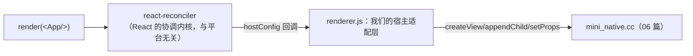

# 渲染器与更新管线（M2–M3 全量实现）

> 子系列第二篇：把 react-reconciler 接到 06 篇的宿主上。本篇给**完整可用的 hostConfig**（含总览里占位写法的一个修正）、`diffProps` 的差量语义，以及一个亲手可做的**批处理实验**——它会让模块五 03"两级批处理"从结论变成体验。

## 1. 接线全景：业务组件到宿主原语



reconciler 只认 hostConfig 这份"合同"，对宿主一无所知——这正是 React 能同时驱动 DOM/RN/Test Renderer 的机制（模块五 01）。

## 2. renderer.js 全文（M2 核心）

```js
// renderer.js
const Reconciler = require('react-reconciler');
const MiniNative = require('./build/Release/mini_native.node');

// props 差量：引用比较 + 键并集（返回 null 表示无需更新，reconciler 会跳过 commitUpdate）
function diffProps(oldP, newP) {
  const out = {};
  for (const k of new Set([...Object.keys(oldP), ...Object.keys(newP)]))
    if (oldP[k] !== newP[k]) out[k] = newP[k];
  return Object.keys(out).length ? out : null;
}

const hostConfig = {
  // ---------- 实例创建（对照：Fabric 的 createShadowNode）----------
  createInstance(type, props) {
    const tag = MiniNative.createView(type, JSON.stringify(props));
    return { tag, type, props };          // instance 是纯数据，宿主对象不过界（模块四 01）
  },
  // 修正点：原生文本节点不是错误，而是"带 value 的 text 实例"
  // （总览 01 篇的 createTextInstance 抛错写法是占位——真跑不通，以此为准）
  createTextInstance(text) {
    const tag = MiniNative.createView('text', JSON.stringify({ value: text }));
    return { tag, type: 'text', props: { value: text } };
  },
  appendInitialChild(parent, child) { MiniNative.appendChild(parent.tag, child.tag); },

  // ---------- 挂载（对照：mount 阶段）----------
  appendChild(parent, child) { MiniNative.appendChild(parent.tag, child.tag); },
  appendChildToContainer(container, child) { MiniNative.appendChild(container.tag, child.tag); },
  insertBefore(parent, child, before) { /* 练习：按 before 的 tag 定位插入 */ },
  removeChild(parent, child) { MiniNative.removeChild(parent.tag, child.tag); },
  removeChildFromContainer(container, child) { MiniNative.removeChild(container.tag, child.tag); },

  // ---------- 更新（对照：commit 阶段的指令流）----------
  prepareUpdate(instance, type, oldProps, newProps) { return diffProps(oldProps, newProps); },
  commitUpdate(instance, payload) {
    if (payload) MiniNative.setProps(instance.tag, JSON.stringify(payload));
    instance.props = { ...instance.props, ...payload };
    MiniNative.requestLayout();
  },
  commitTextUpdate(instance, _old, newText) {
    MiniNative.setProps(instance.tag, JSON.stringify({ value: newText }));
    MiniNative.requestLayout();
  },

  // ---------- 合同的其余条款（最小满足）----------
  shouldSetTextContent: (type) => false,
  finalizeInitialChildren: () => false,
  prepareForCommit: () => null, resetAfterCommit: () => {},
  getRootHostContext: () => null, getChildHostContext: () => null,
  clearContainer: () => {}, getPublicInstance: (i) => i,
  preparePortalMount: () => {},
  supportsMutation: true, supportsPersistence: false, supportsHydration: false,
  now: () => Date.now(),
  scheduleTimeout: setTimeout, cancelTimeout: clearTimeout, noTimeout: -1,
};

// ---------- React 入口 ----------
const reconciler = Reconciler(hostConfig);
let container = null;
function render(element) {
  if (!container) {
    // tag 0 的根视图在宿主已内建（06 篇 EnsureRoot）
    container = reconciler.createContainer(
      { tag: 0, type: 'root', props: {} },   // containerInfo：会传给 appendChildToContainer
      1,                                      // 0=LegacyRoot 1=ConcurrentRoot
      null, false, null, '', () => {}, null  // hydration/报错等回调的最小集
    );
  }
  reconciler.updateContainer(element, container, null, null);
}
module.exports = { render };
```

> 版本提醒：`createContainer` 的参数个数随 react-reconciler 版本变化（0.29 为 8 参）。以 TypeScript 报错为准补齐——**报错本身就是 hostConfig 合同的文档**。

## 3. M3：计数器（React 满血验证）

```js
// app.js
const React = require('react');
const { render } = require('./renderer');
const N = require('./build/Release/mini_native.node');

const App = () => {
  const [n, setN] = React.useState(0);
  React.useEffect(() => {
    const t = setInterval(() => setN((x) => x + 1), 1000);
    return () => clearInterval(t);
  }, []);
  return React.createElement(
    'view', { style: { padding: 10 } },
    React.createElement('text', null, `count: ${n}`)
  );
};
render(React.createElement(App));
setTimeout(() => N.dumpTree(), 3500);   // 3 秒后看树
```

期望输出（每秒一次 `commitTextUpdate → setProps → requestLayout`）：

```text
<root tag=0 ...>
  <view tag=1 ...>
    <text tag=2 ...>        ← props.value 已是 "count: 3"
```

**M3 的洞察**：我们没写任何 diff 代码——reconciler 全权决定"哪个实例要更新、更新什么"，我们的 commitUpdate 只是"信使"。`setState → prepareUpdate（算差量）→ commitUpdate（下指令）` 的分工，就是 React 与宿主适配层的边界。

## 4. 批处理实验：亲手制造"帧"

把 06 篇的 `requestLayout` 升级成两种模式做对照（08 篇会替换为真布局，实验结论不变）：

```js
// 模式 A：同步执行（每次 commitUpdate 立刻做事）
let flushMode = 'sync';
// renderer.js 的 commitUpdate 里：
//   sync 模式：MiniNative.requestLayout()（立即）
//   batch 模式：pendingLayout = true;（只做脏标记）

// 模式 B：帧末统一执行
setInterval(() => {
  if (pendingLayout) { pendingLayout = false; MiniNative.requestLayout(); }
}, 16);                                  // ≈ 一帧的节拍器
```

实验：把 App 的 interval 回调改成**一次 tick 内连续 `setN` 两次**（或改文本再改样式）：

- 模式 A：`requestLayout` 打印出现 **2 次**——中间态被宿主看见；
- 模式 B：打印 **1 次**——两次更新在一帧内合并，宿主只见终态。

这正是模块五 03 的结论来源：**reconciler 天然按批 commit（React 18 自动合并），但"宿主何时消费"由适配层决定**——真 RN 的答案是把布局/挂载放到独立阶段按帧执行（Paper 的帧批 / Fabric 的 commit 事务）。模式 B 的 `pendingLayout` 就是"影子线程积攒、UI 线程消费"的最小雏形。

## 5. 常见接线故障排查

| 症状 | 原因 |
|------|------|
| `TypeError: node.removeChild is not a function` | hostConfig 缺条款——reconciler 按需调用，缺哪个补哪个（看堆栈第一帧） |
| 树里只有 root，没有子节点 | `appendChildToContainer` 没接（container 的挂载走它，不是 `appendChild`） |
| 文本不更新 | `commitTextUpdate` 忘了写，或 `createTextInstance` 返回的 instance 没带 tag |
| 更新风暴 | `prepareUpdate` 恒返回真值 + `commitUpdate` 全量下发——回到差量语义（`null` 跳过） |

## 小结

- hostConfig 是 reconciler 的"平台合同"：实例创建/挂载/更新三类条款 + 一批最小满足的杂项，全文 ~80 行 JS；
- 文本节点的正确形态是 `createTextInstance` 建 text 实例（总览占位写法的修正）；差量语义由 `prepareUpdate` 返回 `null` 表达；
- 批处理实验把"一帧"从概念变成开关：sync 两刷、batch 一刷，真 RN 的两阶段设计由此自明；
- M2/M3 通过后，React 的 useState/useEffect/并发调度全部可用——我们只写了"信使"，没写"大脑"。
