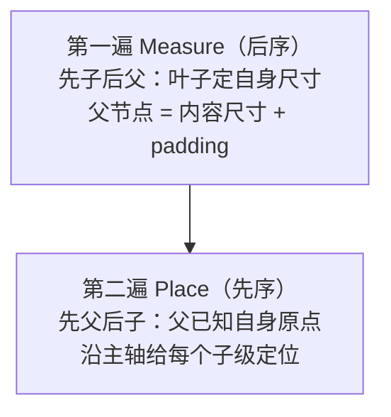

# 布局器与上屏后端（M4–M5 全量实现）

> 子系列第三篇：给宿主装上"Yoga 的极简替身"（两遍布局法），并给出两个上屏后端——dump 树（默认）与 macOS AppKit（真像素）。布局器代码全文给出，配一个**手工可验算的数值样例**。

## 1. 为什么布局在宿主侧（决策复盘）

模块五 02 的结论在 mini-rn 的落点：布局放在 C++ 宿主侧，JS 只发结构/样式变化。三个理由可在此直接体验：

1. **量正比于树**：布局遍历不该占 JS 线程（模块三 02"Shadow 线程是绘图员"）；
2. **与上屏同侧**：布局结果（x/y/w/h）直接是后端要用的 frame，不过界；
3. **批处理友好**：宿主攒脏标记、一次布局全树一致——07 篇实验的 mode B 延伸。

### 1.1 三条理由的"违反检查"：如果布局在 JS 会怎样

决策的分量要用反面来称。假如把 Layout 搬到 JS 侧：

| 违反的理由 | 具体恶果 |
|-----------|---------|
| 量正比于树 | 每帧全树遍历挤占 JS——业务逻辑、事件处理、动画全部排队等布局（模块三 02 的线程职责被破坏） |
| 与上屏同侧 | 算完的坐标要整棵树过界传回宿主（一次 JSON 序列化 + 遍历），过界成本随节点数线性放大 |
| 批处理友好 | JS 侧的"脏标记 + 帧末"要自己再造一遍（07 篇 mode B 的机制平移到 JS，且更容易被业务代码打断） |

三条都不是"快一点"的量变，而是**线程职责与数据流向的质变**——这就是决策要前置到架构期的原因。

### 1.2 与 Yoga 的关系定位

我们不做 Yoga 的复制品，只复刻它的**骨架**（两遍遍历）。差距清单先摆出来（第 7 节对照表展开）：flex 比例分配、换行、缓存失效、文本实测——每一条都是"从能跑到正确"的一道坎，09 篇的扩展挑战 1（flex:1）会让人亲手体会为什么这些坎需要专门的设计。

## 2. 两遍布局法

任何无弹性（non-flex-grow）的一维排布都可以拆成两遍：



- **后序量**：不知道子级尺寸就算不出父级 content 尺寸；
- **先序摆**：不知道父级原点就没法定子级坐标——两遍缺一不可，这正是 Yoga `calculateLayout` 的骨架（Yoga 在此之上加 flex 比例、换行、缓存失效、文本实测）。

### 2.1 信息依赖方向：两遍法为什么恰好是两遍

遍历顺序不是风格选择，由**信息依赖的方向**唯一决定：

- **尺寸依赖自下而上**：父的 content 尺寸是子尺寸的聚合（主轴求和、交叉轴取最大）——必须先算子，故 Measure 后序；
- **坐标依赖自上而下**：子的绝对坐标 = 父的原点 + 排布偏移——必须先定父，故 Place 先序。

一维无弹性场景里，两个依赖方向恰好各需一次全树遍历，所以"恰好两遍"。引入 flex-grow 后，尺寸变成了**约束求解**（子的大小依赖父的可用空间，父又依赖子的需求）——两遍不再够，这正是 Yoga 与我们的分水岭（09 篇挑战 1 的撞墙点）。

### 2.2 一个最小反例：单遍为什么不行

试着把两遍合成一遍（边量边摆）：处理到某个子级时，它的 x 需要"前面兄弟的总宽"与"父的起点"——前者要兄弟的尺寸（可得），后者要父已定位（如果父还没量完就没定位）。唯一的修补是"先递归量完整棵子树再回头摆"，写着写着就还原成了两遍。**建议亲手试一次这个合并**——失败之后对两遍法的理解会从"背下来"变成"推出来"。

## 3. 布局器全文（接进 06 篇的 mini_native.cc）

```cpp
// ---------------- 样式读取小工具 ----------------
static const nlohmann::json& styleOf(const MiniView& v) {
  static const nlohmann::json empty = nlohmann::json::object();
  auto it = v.props.find("style");
  return (it != v.props.end() && it->is_object()) ? *it : empty;
}
static double num(const nlohmann::json& st, const char* k, double dft = 0) {
  auto it = st.find(k);
  return (it != st.end() && it->is_number()) ? it->get<double>() : dft;
}
#define TEXT_W 7.0   // M5 前的文本近似：等宽字符（真平台接法见第 5 节）
#define TEXT_H 18.0

// ---------------- 第一遍：Measure（后序）----------------
static void Measure(int tag) {
  MiniView& v = g_tree.at(tag);
  const nlohmann::json& st = styleOf(v);
  double pad = num(st, "padding");
  bool row = st.value("flexDirection", "column") == "row";

  if (v.type == "text") {                       // 叶子：文本近似尺寸
    std::string s = v.props.value("value", std::string());
    v.w = num(st, "width",  s.size() * TEXT_W + 2 * pad);
    v.h = num(st, "height", TEXT_H + 2 * pad);
    return;
  }
  double main = 0, cross = 0;                   // view：内容尺寸聚合
  for (int c : v.children) {
    Measure(c);
    MiniView& ch = g_tree.at(c);
    double m = num(styleOf(ch), "margin");
    main  += (row ? ch.w : ch.h) + 2 * m;
    cross  = std::max(cross, (row ? ch.h : ch.w) + 2 * m);
  }
  v.w = num(st, "width",  (row ? main : cross) + 2 * pad);
  v.h = num(st, "height", (row ? cross : main) + 2 * pad);
}

// ---------------- 第二遍：Place（先序）----------------
static void Place(int tag) {
  MiniView& v = g_tree.at(tag);
  const nlohmann::json& st = styleOf(v);
  double pad = num(st, "padding");
  bool row = st.value("flexDirection", "column") == "row";
  double main = pad, cross = pad;               // 内容区从 padding 起
  for (int c : v.children) {
    MiniView& ch = g_tree.at(c);
    double m = num(styleOf(ch), "margin");
    if (row) { ch.x = v.x + main + m;  ch.y = v.y + cross + m; main += ch.w + 2 * m; }
    else     { ch.y = v.y + main + m;  ch.x = v.x + cross + m; main += ch.h + 2 * m; }
    Place(c);
  }
}

// ---------------- requestLayout 的真身（替换 06 篇的打印桩）----------------
static void RunLayout() { EnsureRoot(); Measure(0); Place(0); }
static Napi::Value RequestLayout(const Napi::CallbackInfo& info) {
  RunLayout();                                   // 08 篇仍同步执行；
  return info.Env().Undefined();                 // 练习：改成 07 篇的脏标记 + 帧末执行
}
```

删掉 06 篇的旧 `RequestLayout` 桩函数，`DumpTree` 不变——它现在能打出真实坐标了。

### 3.1 Measure 逐段讲解

- **text 叶子分支**：文本是唯一"自定尺寸"的叶子——宽按 `字符数 × TEXT_W` 近似（忽略字间距、变宽字形），高按单行行高。**这是布局器里唯一骗不了人的近似**（第 5.3 节接真测量）；`num(st, "width", ...)` 的三参用法让显式 width 覆盖近似值——"写了 width 就听你的"；
- **main/cross 聚合**：主轴求和（子级尺寸 + 双侧 margin），交叉轴取最大。注意 **margin 计入两轴**：主轴方向 margin 占位（间隔），交叉轴方向 margin 撑大 content（外沿留白）——一处公式管两个语义，容易漏看；
- **`num(st, "width", ...)` 的兜底链**：没有 style → 没有 width → 用内容尺寸 + padding。三层"显式值优先于推导值"的语义，与 CSS 的"指定尺寸优先于内容尺寸"同构；
- **后序的体现**：循环里先 `Measure(c)` 再读 `ch.w/ch.h`——读到的必然是已算好的值。如果把递归挪到读尺寸之后，读到的是上一帧的旧值（首帧就是 0），这是本函数唯一容易写错的顺序。

### 3.2 Place 逐段讲解

- **`main` 从 pad 起**：内容区从 padding 内沿开始排——第一行的 `x = v.x + main + m` 把"父原点 + 内边距 + 子外边距"三段偏移一次算清；
- **主轴递进 `main += ch.w + 2*m`**：下一个兄弟从"本子级宽 + 双侧 margin"之后起——注意 **margin 是双侧计的**（左右各 m），与 Measure 的口径严格一致（口径不一致是布局 bug 的头号来源）；
- **交叉轴不居中**：cross 固定从 pad 起，子级靠交叉轴起点对齐（相当于 alignItems: flex-start 的缺省）——支持 center 要加"父 content 交叉尺寸/2 - 子尺寸/2"，本系列不做，列入已知简化；
- **先序的体现**：先定 `ch.x/ch.y` 再 `Place(c)`——子级带着确定的父原点递归。与 Measure 恰好相反的顺序，写错方向的 Symptoms 是"坐标全 0"或"用到上一帧原点"。

### 3.3 已知简化清单（本布局器不支持的样式语义）

| 简化 | 现行为 | 真 Yoga |
|------|--------|---------|
| margin/padding 只支持单值 number | 双侧等距 | 四边独立 + 复合写法 |
| 无 justifyContent | 主轴顶格排 | 起止/居中/空间分布 |
| 无 alignItems | 交叉轴顶格排（3.2 节） | 起止/居中/拉伸 |
| 无 flex-grow/shrink | 固定尺寸模型 | 约束求解 |
| 文本等宽近似 | `n × TEXT_W` | 平台实测回灌 |
| 无换行/无嵌套主轴翻转之外的复合 | 单一主轴 | flex-wrap、绝对定位等 |

清单的作用与 06 篇欠账表相同：**每条"不支持"都是有意为之**，做扩展前先确认它不在你的需求里。

## 4. 数值验收（手工可算）

```js
render(React.createElement('view', { style: { flexDirection: 'row', padding: 10 } },
  React.createElement('view', { style: { width: 50, height: 20, margin: 5 } }),
  React.createElement('view', { style: { width: 30, height: 20 } }),
  React.createElement('text',  null, 'hi'),
));
N.dumpTree();
```

手算过程：子级 main 尺寸 = (50+2×5) + 30 + (2×7) = 104；根 w = 104 + 2×10 = **124**，cross = max(20+10, 20, 18) = 30，根 h = 30 + 2×10 = **50**。期望输出：

```text
<root tag=0 x=0 y=0 w=124 h=50>
  <view tag=1 x=0 y=0 w=124 h=50>
    <view tag=2 x=15 y=15 w=50 h=20>    ← padding 10 + margin 5
    <view tag=3 x=70 y=10 w=30 h=20>    ← 15 + (50+2×5) = 70
    <text tag=4 x=100 y=10 w=14 h=18>   ← 70 + 30 = 100，"hi" = 2×7
```

**验收方式：先手算、再跑码、两相对照**——布局器 bug 无所遁形。改 `flexDirection` 为 column 再算一遍（x/y 语义互换），对"主轴/交叉轴"的理解就落地了。

### 4.1 column 版完整手算（照着算一遍）

把样例的 `flexDirection: 'row'` 改成 `column`，其余不动，手算如下：

- 子级高度聚合 main = (20+2×5) + 20 + 18 = 68；交叉（宽度）cross = max(50+10, 30, 14) = 60；
- 容器 w = 60 + 2×10 = **80**，h = 68 + 2×10 = **88**；根随容器（无 padding）；
- Place：内容区从 (10,10) 起，column 沿 y 递进——tag2 (15,15)，main → 10+20+10 = 40；tag3 (10,40)，main → 60；tag4 (10,60)。

期望输出：

```text
<root tag=0 x=0 y=0 w=80 h=88>
  <view tag=1 x=0 y=0 w=80 h=88>
    <view tag=2 x=15 y=15 w=50 h=20>
    <view tag=3 x=10 y=40 w=30 h=20>
    <text tag=4 x=10 y=60 w=14 h=18>
```

注意两处"主轴/交叉轴互换"的落点：尺寸上，**宽从"主轴和"变成"交叉最大"**；坐标上，**x 固定在 padding（+margin）、y 递进**。两版样例都算对，两遍法的坐标系就真正长在手上了。

### 4.2 手算→跑码方法论

数值验收的价值不在"通过"，在**对账**：

1. 写下期望树（先算叶子、再聚合、再定位——就是照着两遍法的顺序算）；
2. 跑码打印实际树；
3. 逐位 diff——第一个不一致的节点就是 bug 的最小定位（它的 Measure 对不对？还是它的 Place 对不对？）。

这套"人肉差分"比断点调试快得多，因为布局是**纯函数**（输入树与样式，输出坐标，无副作用）——纯函数都可以这样验。这也解释了为什么布局器天生适合单测（真 RN 的 Yoga 就带庞大的布局单测集）。

### 4.3 把手算固化成断言（从验收到回归）

`dumpTree` 返回的是字符串（06 篇的实现细节），这让"手算结果"可以直接固化成断言：

```js
const assert = require('assert');
// …渲染样例后：
assert(N.dumpTree().includes('<view tag=2 x=15 y=15 w=50 h=20>'));
assert(N.dumpTree().includes('<text tag=4 x=100 y=10 w=14 h=18>'));
```

价值不在一次验收，而在**回归**：此后任何布局器改动（接文本实测、加 alignItems）跑一遍断言，两遍法的"地基数字"没破就说明改动是增量的。真 RN 的 Yoga 单测正是这个思路的满配版——**每个布局特性都有一组"手算好的期望树"**。mini-rn 用两行 assert 就拿到了同款安全感。

## 5. 上屏后端 B：macOS AppKit（M5）

dump 树是"后端 A"（渲染到终端）。后端 B 把同一棵 `MiniView` 树呈现为真像素——**C++ 核心不动，只换出口**：

```objc
// MiniNativeMac.mm —— 编进一个 macOS App 工程（Xcode: App + 命令行注入 JS）
#import <Cocoa/Cocoa.h>
#import "mini_core.h"        // 06/08 篇的树与 RunLayout 抽到共享头
#include <unordered_map>

static std::unordered_map<int, NSView*> g_views;   // tag → NSView（对照 Fabric 的 mount 表）
static NSView* g_stage = nil;

static NSView* Materialize(int tag) {              // 懒建：首次出现的节点才 create
  MiniView& v = g_tree.at(tag);
  NSView* view = g_views[tag];
  if (!view) {
    view = (v.type == "text") ? [NSTextField labelWithString:@""] : [NSView new];
    if (v.type != "text") { view.wantsLayer = YES; view.layer.backgroundColor =
                              [NSColor controlAccentColor].CGColor; }
    g_views[tag] = view; [g_stage addSubview:view];
  }
  return view;
}

void PresentTree() {                                // 替代 DumpTree 的"上屏"入口
  RunLayout();
  CGFloat H = g_stage.bounds.size.height;
  std::function<void(int)> walk = [&](int tag) {
    MiniView& v = g_tree.at(tag);
    NSView* view = Materialize(tag);
    view.frame = NSMakeRect(v.x, H - v.y - v.h, v.w, v.h);  // ①坐标系翻转
    if (v.type == "text")
      ((NSTextField*)view).stringValue = @(v.props.value("value", "").c_str());
    for (int c : v.children) walk(c);
  };
  walk(0);
}
```

三个真实细节，都是真 RN mount 阶段的缩影：

1. **坐标系翻转**：AppKit 原点在左下、布局器输出左上原点——`H - y - h` 这行就是"平台坐标系适配层"的全部；
2. **懒建 + 复用**：节点只在首次出现时 create，之后只改 frame——对照 Fabric mount 的"创建一次、更新走 set"；删除节点的回收留作练习（从 g_views 移除 + `[view removeFromSuperview]`）；
3. **文本是特例**：NSTextField 的字号决定真实尺寸——真平台应把文本实测接回 Measure（iOS 用 `CTLineGetTypographicBounds`，见第 6 节），我们的 TEXT_W 近似到此为止。

### 5.1 工程形态：这个 .mm 怎么跑起来

示意工程的组装步骤（全在平台侧，C++ 核心零改动）：

1. 建一个 macOS App target（Xcode：App 模板）；
2. 把 06/08 篇的树与布局器抽成 `mini_core.h/.cpp`（纯 C++，无 N-API 依赖）加进 target——这就是 05 篇 M5 说的"抽共享头"；
3. `MiniNativeMac.mm` 作为桥接层：创建窗口与 `g_stage`，在合适的时机（如定时器或按钮）执行 JS 并调 `PresentTree`；
4. 首选"命令行注入 JS"的形态（代码注释所示）：App 起来后从命令行/环境拿 JS 路径执行，保持与 Node 版同一份业务代码。

关键纪律：**`mini_core` 不 import 任何 Cocoa 头**——一旦核心 import 平台头，"共享 C++、平台薄壳"就破了（05 篇 M5.1 的"千万别动"清单）。

### 5.2 三个细节的展开

- **坐标翻转为什么只有一行**：我们的布局输出是"左上原点 + 向下 y"（Web/RN 惯例），AppKit 未翻转视图是"左下原点 + 向上 y"。两个坐标系 x 同向、y 反向，转换就是"镜像 y"：`topLeftY = H - bottomUpY - height`。真 RN 在 iOS mount 同样做这套适配（模块五 03）——平台适配层薄，但它**必须有**，且只在边界处出现一次；
- **懒建 + 复用的收益**：`PresentTree` 每次全树遍历，但只有新 tag 才创建控件——频繁刷新时（07 篇的计数器）控件创建/销毁的开销被摊掉，只有 set frame 的廉价更新。这正是 Fabric mount "创建一次、更新走 set"的用意；反过来，**忘了做删除回收**（代码注释的练习）就是内存泄漏 + 幽灵视图——对照 06 篇 removeChild 的欠账，两处一起补才算完整闭环；
- **递归 walk 的顺序**：先序遍历保证父 frame 先于子 frame 设置——虽然本例不依赖顺序（frame 是绝对坐标），但一旦引入"相对布局/自动约束"就必须先父后子，与 Place 同序。

### 5.3 文本实测：把平台度量接回 Measure（M5 的"骗不了人"部分）

TEXT_W 近似的局限在中文/全角/变宽字体下会放大（一个汉字的宽度明显大于 7pt 等宽假设）。真解法是**把"量文本"做成可注入的回调**：

| 方案 | 做法 | 形态 |
|------|------|------|
| 注入测量函数 | `mini_core` 暴露 `SetMeasureText(double (*fn)(const std::string&))`，后端注入平台实现 | 函数指针（C++ 经典手法） |
| 平台实现（AppKit） | 用 NSAttributedString 的排版度量测宽（同 05 篇 M5 的 CoreText 思路） | `boundingRectWithSize:` 一类 API |
| 平台实现（iOS） | `CTLineGetTypographicBounds`（05 篇 M5 已点名） | CoreText |
| 平台实现（Android） | `Paint.measureText`（05 篇 M5 已点名） | android.graphics |

这个"测量回调"的形态不是发明——**Yoga 的 measure function 就是同构物**：宿主把"这块内容多大"的问题回调给持有平台度量能力的一方（文本、任意自绘内容）。理解了这一节，看 Yoga 的 `setMeasureFunction` 会倍感亲切。

接入时序也有讲究：Measure 是后序遍历，**测量回调会在布局期间被同步调用**——回调实现必须快（缓存字形宽度）且无副作用（不能再触发布局），这两条是所有布局系统的通用纪律。

## 6. 与真 RN 的对照（本篇视角）

| 我们写的 | 真 RN | 差距要点 |
|----------|-------|---------|
| Measure/Place 两遍 | Yoga `calculateLayout` | flex 比例、换行、缓存失效、文本实测 |
| 同步 RunLayout | Shadow 线程布局 + commit 原子化 | 线程化与可中断（模块五 03、七 02） |
| PresentTree 递归 set frame | Fabric mount 按优先级调度 | lane 优先级、批量 mount |
| tag → NSView 表 | ShadowNode → platform view | COW 克隆、事件回绑 |

逐行补注（差距的"意思"）：

- **两遍 → Yoga**：我们覆盖"固定尺寸 + 一维排布"；Yoga 补的是弹性分配与缓存——缓存失效指"样式没变就复用上次结果"，树大时收益显著；
- **同步 → 线程化**：我们的 RunLayout 在 JS 调用线程同步执行（RequestLayout 注释的练习可改成脏标记 + 帧末，07 篇 mode B）；真 RN 把布局放独立阶段并做 commit 原子化——布局期间 UI 依旧可响应；
- **递归 set frame → 优先级调度**：我们每次全树遍历；Fabric 按 lane 优先级决定"这帧 mount 哪些子树"——高优更新（用户输入反馈）可插队；
- **映射表 → COW/回绑**：我们的 g_views 只管创建更新；真 RN 的 mount 表还要处理影子节点克隆树与事件目标回绑（09 篇的事件按 tag 回溯是它的雏形）。

## 7. 常见坑（本篇专属）

| 症状 | 根因 | 解法 |
|------|------|------|
| 坐标全 0 | Place 写在了 Measure 前 / 递归顺序错 | 对照 3.1/3.2 的顺序说明 |
| 视图上下颠倒 | 忘了坐标系翻转 | 5.2 节第一点 |
| 间距比预期大一圈 | margin 双侧计、与 Measure 口径不一致 | 两处 `+ 2*m` 对账 |
| column 下宽度不对 | 主轴/交叉轴在聚合公式里的角色没换 | 4.1 手算对账 |
| 中文文本宽度不对 | TEXT_W 等宽近似 | 第 5.3 节实测回灌 |
| 控件越积越多 | 删除回收没做（练习） | 5.2 节第二点 |
| 首帧有坐标、更新帧没有 | requestLayout 没被更新路径触发 | 07 篇 commitUpdate/commitTextUpdate 里的调用 |
| AppKit 版首帧全挤在角落 | PresentTree 在窗口尺寸就绪前跑（H=0） | 确保在窗口 layout 之后再调用 |

排查这类问题的通用顺序：**先 dump 后端对不对（纯 C++ 问题），再查 AppKit 后端**——两个后端共享核心，dump 对而 AppKit 错，问题必然在胶水层（翻转/frame/时序三者之一）；dump 就不对，回第 3/4 节修布局器。这个"二分"能省掉一半排查时间。

## 8. 自测

1. 两遍法为什么恰好两遍？信息依赖的方向分别是什么？
2. margin 在 Measure 与 Place 里各出现一次，语义分别是什么？口径不一致会怎样？
3. column 样例里 tag3 的 x 为什么是 10 而不是 40？（→ 4.1：主轴 y 递进，x 固定在 padding）
4. 坐标系翻转公式为什么是 `H - y - h` 而不是 `H - y`？
5. 文本测量为什么必须做成回调注入？Yoga 里的同构物叫什么？
6. PresentTree 的懒建复用对照真 RN mount 的哪条原则？
7. "dump 对而 AppKit 错"说明什么？候选原因有哪三类？
8. 同步 RunLayout 与真 RN 的差异不止"线程"一项——说出至少两条对照表里的差距要点。

## 小结

- 布局器 = 后序 Measure + 先序 Place 两遍，~40 行 C++ 覆盖 row/column、padding、margin、固定尺寸与文本近似；两遍的顺序由信息依赖方向唯一决定，不是风格选择；
- 验收用"手算 → 跑码"对照法，样例数字全部可复算（row/column 各一组）；断言化之后，验收盘升级为回归盘；
- 上屏后端可插拔：dump 与 AppKit 共享同一 C++ 核心，换出口不换大脑——"共享 C++、平台薄壳"正是真 RN 的形态；
- AppKit 胶水里的坐标系翻转、懒建复用、文本特例，分别对应真 mount 的坐标适配、创建/更新分离、文本测量回灌；文本实测做成回调注入后，形态与 Yoga 的 measure function 同构；
- 下一篇（[09 篇](09-事件回路与收官自测.md)）补上事件上行，闭环成型。
