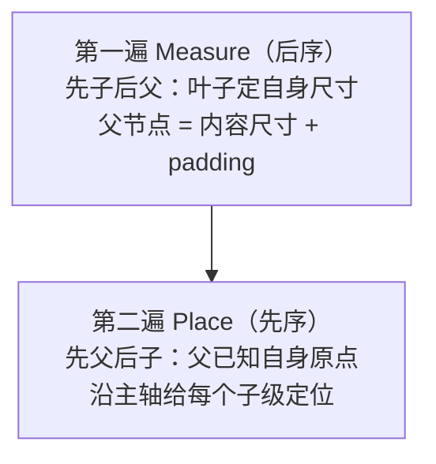

# 布局器与上屏后端（M4–M5 全量实现）

> 子系列第三篇：给宿主装上"Yoga 的极简替身"（两遍布局法），并给出两个上屏后端——dump 树（默认）与 macOS AppKit（真像素）。布局器代码全文给出，配一个**手工可验算的数值样例**。

## 1. 为什么布局在宿主侧（决策复盘）

模块五 02 的结论在 mini-rn 的落点：布局放在 C++ 宿主侧，JS 只发结构/样式变化。三个理由可在此直接体验：

1. **量正比于树**：布局遍历不该占 JS 线程（模块三 02"Shadow 线程是绘图员"）；
2. **与上屏同侧**：布局结果（x/y/w/h）直接是后端要用的 frame，不过界；
3. **批处理友好**：宿主攒脏标记、一次布局全树一致——07 篇实验的 mode B 延伸。

## 2. 两遍布局法

任何无弹性（non-flex-grow）的一维排布都可以拆成两遍：



- **后序量**：不知道子级尺寸就算不出父级 content 尺寸；
- **先序摆**：不知道父级原点就没法定子级坐标——两遍缺一不可，这正是 Yoga `calculateLayout` 的骨架（Yoga 在此之上加 flex 比例、换行、缓存失效、文本实测）。

## 3. 布局器全文（接进 06 篇的 mini_native.cc）

```cpp
// ---------------- 样式读取小工具 ----------------
static const nlohmann::json& styleOf(const MiniView& v) {
  static const nlohmann::json empty = nlohmann::json::object();
  auto it = v.props.find("style");
  return (it != v.props.end() && it->is_object()) ? *it : empty;
}
static double num(const nlohmann::json& st, const char* k, double dft = 0) {
  auto it = st.find(k);
  return (it != st.end() && it->is_number()) ? it->get<double>() : dft;
}
#define TEXT_W 7.0   // M5 前的文本近似：等宽字符（真平台接法见第 5 节）
#define TEXT_H 18.0

// ---------------- 第一遍：Measure（后序）----------------
static void Measure(int tag) {
  MiniView& v = g_tree.at(tag);
  const nlohmann::json& st = styleOf(v);
  double pad = num(st, "padding");
  bool row = st.value("flexDirection", "column") == "row";

  if (v.type == "text") {                       // 叶子：文本近似尺寸
    std::string s = v.props.value("value", std::string());
    v.w = num(st, "width",  s.size() * TEXT_W + 2 * pad);
    v.h = num(st, "height", TEXT_H + 2 * pad);
    return;
  }
  double main = 0, cross = 0;                   // view：内容尺寸聚合
  for (int c : v.children) {
    Measure(c);
    MiniView& ch = g_tree.at(c);
    double m = num(styleOf(ch), "margin");
    main  += (row ? ch.w : ch.h) + 2 * m;
    cross  = std::max(cross, (row ? ch.h : ch.w) + 2 * m);
  }
  v.w = num(st, "width",  (row ? main : cross) + 2 * pad);
  v.h = num(st, "height", (row ? cross : main) + 2 * pad);
}

// ---------------- 第二遍：Place（先序）----------------
static void Place(int tag) {
  MiniView& v = g_tree.at(tag);
  const nlohmann::json& st = styleOf(v);
  double pad = num(st, "padding");
  bool row = st.value("flexDirection", "column") == "row";
  double main = pad, cross = pad;               // 内容区从 padding 起
  for (int c : v.children) {
    MiniView& ch = g_tree.at(c);
    double m = num(styleOf(ch), "margin");
    if (row) { ch.x = v.x + main + m;  ch.y = v.y + cross + m; main += ch.w + 2 * m; }
    else     { ch.y = v.y + main + m;  ch.x = v.x + cross + m; main += ch.h + 2 * m; }
    Place(c);
  }
}

// ---------------- requestLayout 的真身（替换 06 篇的打印桩）----------------
static void RunLayout() { EnsureRoot(); Measure(0); Place(0); }
static Napi::Value RequestLayout(const Napi::CallbackInfo& info) {
  RunLayout();                                   // 08 篇仍同步执行；
  return info.Env().Undefined();                 // 练习：改成 07 篇的脏标记 + 帧末执行
}
```

删掉 06 篇的旧 `RequestLayout` 桩函数，`DumpTree` 不变——它现在能打出真实坐标了。

## 4. 数值验收（手工可算）

```js
render(React.createElement('view', { style: { flexDirection: 'row', padding: 10 } },
  React.createElement('view', { style: { width: 50, height: 20, margin: 5 } }),
  React.createElement('view', { style: { width: 30, height: 20 } }),
  React.createElement('text',  null, 'hi'),
));
N.dumpTree();
```

手算过程：子级 main 尺寸 = (50+2×5) + 30 + (2×7) = 104；根 w = 104 + 2×10 = **124**，cross = max(20+10, 20, 18) = 30，根 h = 30 + 2×10 = **50**。期望输出：

```text
<root tag=0 x=0 y=0 w=124 h=50>
  <view tag=1 x=0 y=0 w=124 h=50>
    <view tag=2 x=15 y=15 w=50 h=20>    ← padding 10 + margin 5
    <view tag=3 x=70 y=10 w=30 h=20>    ← 15 + (50+2×5) = 70
    <text tag=4 x=100 y=10 w=14 h=18>   ← 70 + 30 = 100，"hi" = 2×7
```

**验收方式：先手算、再跑码、两相对照**——布局器 bug 无所遁形。改 `flexDirection` 为 column 再算一遍（x/y 语义互换），对"主轴/交叉轴"的理解就落地了。

## 5. 上屏后端 B：macOS AppKit（M5）

dump 树是"后端 A"（渲染到终端）。后端 B 把同一棵 `MiniView` 树呈现为真像素——**C++ 核心不动，只换出口**：

```objc
// MiniNativeMac.mm —— 编进一个 macOS App 工程（Xcode: App + 命令行注入 JS）
#import <Cocoa/Cocoa.h>
#import "mini_core.h"        // 06/08 篇的树与 RunLayout 抽到共享头
#include <unordered_map>

static std::unordered_map<int, NSView*> g_views;   // tag → NSView（对照 Fabric 的 mount 表）
static NSView* g_stage = nil;

static NSView* Materialize(int tag) {              // 懒建：首次出现的节点才 create
  MiniView& v = g_tree.at(tag);
  NSView* view = g_views[tag];
  if (!view) {
    view = (v.type == "text") ? [NSTextField labelWithString:@""] : [NSView new];
    if (v.type != "text") { view.wantsLayer = YES; view.layer.backgroundColor =
                              [NSColor controlAccentColor].CGColor; }
    g_views[tag] = view; [g_stage addSubview:view];
  }
  return view;
}

void PresentTree() {                                // 替代 DumpTree 的"上屏"入口
  RunLayout();
  CGFloat H = g_stage.bounds.size.height;
  std::function<void(int)> walk = [&](int tag) {
    MiniView& v = g_tree.at(tag);
    NSView* view = Materialize(tag);
    view.frame = NSMakeRect(v.x, H - v.y - v.h, v.w, v.h);  // ①坐标系翻转
    if (v.type == "text")
      ((NSTextField*)view).stringValue = @(v.props.value("value", "").c_str());
    for (int c : v.children) walk(c);
  };
  walk(0);
}
```

三个真实细节，都是真 RN mount 阶段的缩影：

1. **坐标系翻转**：AppKit 原点在左下、布局器输出左上原点——`H - y - h` 这行就是"平台坐标系适配层"的全部；
2. **懒建 + 复用**：节点只在首次出现时 create，之后只改 frame——对照 Fabric mount 的"创建一次、更新走 set"；删除节点的回收留作练习（从 g_views 移除 + `[view removeFromSuperview]`）；
3. **文本是特例**：NSTextField 的字号决定真实尺寸——真平台应把文本实测接回 Measure（iOS 用 `CTLineGetTypographicBounds`，见第 6 节），我们的 TEXT_W 近似到此为止。

## 6. 与真 RN 的对照（本篇视角）

| 我们写的 | 真 RN | 差距要点 |
|----------|-------|---------|
| Measure/Place 两遍 | Yoga `calculateLayout` | flex 比例、换行、缓存失效、文本实测 |
| 同步 RunLayout | Shadow 线程布局 + commit 原子化 | 线程化与可中断（模块五 03、七 02） |
| PresentTree 递归 set frame | Fabric mount 按优先级调度 | lane 优先级、批量 mount |
| tag → NSView 表 | ShadowNode → platform view | COW 克隆、事件回绑 |

## 小结

- 布局器 = 后序 Measure + 先序 Place 两遍，~40 行 C++ 覆盖 row/column、padding、margin、固定尺寸与文本近似；
- 验收用"手算 → 跑码"对照法，样例数字全部可复算；
- 上屏后端可插拔：dump 与 AppKit 共享同一 C++ 核心，换出口不换大脑——"共享 C++、平台薄壳"正是真 RN 的形态；
- AppKit 胶水里的坐标系翻转、懒建复用、文本特例，分别对应真 mount 的坐标适配、创建/更新分离、文本测量回灌。
