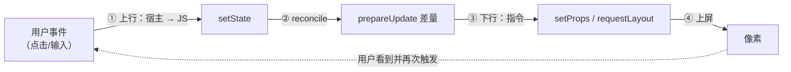

# 事件回路与收官自测

> 子系列收官：补上 RN 的最后一根支柱——**事件上行**。做完本篇，mini-rn 就拥有完整闭环：原生事件 → JS 状态 → 指令下行 → 原生上屏，与真 RN 的主链路一一对应。文末是全系列自测清单与扩展挑战。

## 1. 缺了什么：从单向到回路

07/08 篇打通的是**下行链**（JS → 宿主）。但 RN 的本质是双向的（模块二 01 的 runApplication 之后，一切交互都从上行事件开始）：



上行通道要解决三个问题：**宿主怎么持有 JS 函数、线程怎么交接、事件怎么排队**——每一个都有真 RN 的对应物。

三个问题的难度排序值得先讲清：**持有函数**是生死问题（做错就崩，GC 不是玩笑）；**排队**是时序问题（做错是"诡异"而非崩溃）；**线程交接**是两者的放大器（单线程下可以视而不见，真宿主上必须正面回答）。本篇按这个顺序逐个落地。

### 1.1 与 03 篇事件通道的对照（先认亲）

03 篇 Fabric 组件的 Event 通道与本篇手写的上行通道是同一事物的两个精度：

| | 03 篇（真 RN 组件） | 本篇（mini-rn） |
|--|--------------------|----------------|
| 事件体 | Codegen 按 spec 回调签名生成结构体 | 手写 `(type, tag)` 两个参数 |
| 发射 | 生成的 EventEmitter 方法 | 手写 `EmitEvent` |
| 持有 JS 侧 | 引擎/框架托管 | 手写 `Napi::Persistent` |
| 交付 | 直调（新架构，无队列） | 队列 + 定拍（教学保守版） |
| 命中 | 组件内（view 自身） | tag 直达（无冒泡） |

看完本篇再回 03 篇，"EventEmitter 的共享指针"就是 2.1 节 Persistent 的工程版；"事件直调不排队"就是 3.4 节方案二的规模化形态。

## 2. 宿主持有 JS 回调：三个对应物

```cpp
// mini_native.cc 新增（M5+）
static Napi::FunctionReference g_onEvent;         // ① 持久引用：跨调用存活的 JS 函数

static Napi::Value OnEvent(const Napi::CallbackInfo& info) {
  g_onEvent = Napi::Persistent(info[0].As<Napi::Function>());
  return info.Env().Undefined();
}
static void EmitEvent(const char* type, int tag) { // 宿主内部任意时刻可发事件
  if (!g_onEvent.IsEmpty()) {
    Napi::Env env = g_onEvent.Env();
    g_onEvent.Call({ Napi::String::New(env, type),
                     Napi::Number::New(env, tag) });
  }
}
```

| 我们 | 真 RN | 说明 |
|------|-------|------|
| `Napi::FunctionReference`（Persistent） | JSI 的 `jsi::Function` + Handle 体系 | 跨调用存 JS 值，防 GC 回收（模块三 03） |
| `EmitEvent` 直接 Call | 事件经 EventEmitter/JSI 分发 | 真新架构里事件直调不排队（模块七 02） |
| 见第 3 节 | 旧架构事件过 Bridge 批量 | 我们做的是"排队版"，恰好能体会差异 |

### 2.1 FunctionReference 逐行：为什么每一行都不能省

- **`Napi::Persistent(...)`**：把"本次调用的句柄"升级为"跨调用存活的所有权"。如果没有这一步——直接 `static Napi::Function g_fn = info[0].As<Napi::Function>()`——函数返回时句柄作用域回收，`g_fn` 变成悬空引用，下次 `Call` 就是崩溃或未定义行为。**这正是 06 篇"借用 vs 拥有"的还债现场**：前八篇我们只把 C++ 值拷出边界（拥有），本篇第一次反向操作——把 JS 值留下（Persistent 转拥有）；
- **`As<Napi::Function>()` 的断言语义**：调用方传了非函数，这里直接抛 TypeError——事件回调的契约在入口处强制（比静默存个字符串然后崩在 Call 里好得多）；
- **`IsEmpty()` 判空**：`g_onEvent` 是静态变量，宿主启动后、JS 注册回调前的时间窗里它是空的——**宿主侧代码必须假设"回调可能还没就绪"**，这个防御在任何注册时序下都成立；
- **`Call({ ... })` 的参数构造**：每个参数都要显式 `Napi::String::New / Napi::Number::New`——下行通道的教训反向适用：**JS 侧拿到什么形态，完全由这一行决定**；
- **赋值即覆盖**：JS 侧第二次调 `onEvent(fn2)` 会直接顶掉 fn1——单订阅者模型。想做多订阅者要包一层数组（真 RN 的事件系统有完整的订阅/清理语义，我们刻意不做）。

### 2.2 一个对照实验：去掉 Persistent 会怎样

把 `Napi::Persistent(...)` 改成直接存局部句柄（错误示范），现象是：注册当次调用可能正常，**之后任何一次 EmitEvent 要么崩、要么调进一个已被回收的对象**——且崩法取决于引擎的 GC 时机，表现为"偶现"。这就是 GC 体系（模块三 03）给跨语言开发者的见面礼：**生命周期错误不立即报错，只在你最没有防备的时候出现**。真 RN 的 Handle/LongLivedObject 体系（同模块）就是给 JSI 侧的同类问题修的同一道墙。

### 2.3 注册的时序问题：useEffect 里注册的三个推论

demo 把 `N.onEvent(...)` 放在 `useEffect` 里，这个位置藏着三个值得推敲的时序事实：

1. **注册晚于首帧**：首帧渲染时回调还没注册——若宿主在启动早期就 EmitEvent，事件会被 `IsEmpty()` 挡掉（2.1 节判空的价值现场）。宿主侧"就绪前的事件丢弃"是最简单也最常用的策略，真 RN 的做法是事件系统初始化先于业务渲染（模块二 01 的启动顺序）；
2. **重挂载会再注册**：组件卸载重挂，`onEvent` 被再次调用，静态 `g_onEvent` 被覆盖——单订阅者模型下恰好正确（旧回调被新回调顶替）。但如果清理函数里写 `N.onEvent(null)` 之类的"注销"，要小心另一个组件可能已注册了新的——**注销语义在单订阅者模型里是含糊的**，这是"多订阅者要包一层数组"的又一论据；
3. **注册必须先于触发**：demo 里 `EmitSim` 是 3 秒后才第一次触发，宽裕地覆盖了注册完成——把 interval 改成 0ms 立即触发，就能亲手复现推论 1 的"丢弃"。

时序问题的总口诀：**注册方、触发方、消费方三者各自独立演化，任何一方都不能假设另外两方的进度**——这正是 06 篇"通道函数对输入不可信要有自觉"在上行方向的翻版。

## 3. 线程现实与事件队列（Node 版与 AppKit 版）

**Node 宿主（单线程）**：宿主与 JS 同线程，`EmitEvent` 直接调用即可——但为了体验"帧"的语义，做成队列 + 定拍 drain（09 的推荐形态）：

> 单线程为什么还要排队？三条理由：**体验帧语义**（事件消费与更新消费对齐帧边界，07 篇 mode B 的上行版）；**为真宿主铺路**（AppKit 版的队列结构原样复用，只换生产者）；**保序与合并可控**（队列是"何时消费"的显式答案，直调的答案藏在调用栈里）。教学代码要为"下一个形态"留好接口，这是 06 篇"欠账表"思想的又一次应用。

```js
// app.js：事件队列 = "宿主线程 → JS 线程"的最小过桥
const queue = [];
N.onEvent((type, tag) => queue.push({ type, tag }));   // 生产：宿主侧
setInterval(() => {                                     // 消费：JS 侧按拍取走（≈帧循环）
  for (const e of queue.splice(0)) {
    if (e.type === 'press') setCount((c) => c + 1);    // setState → ② ③ ④ 自动发生
  }
}, 16);
```

**AppKit 宿主（真双线程）**：UI 事件在主线程 `mouseDown` 里产生，而 JS 在 node 侧执行——`EmitEvent` 不能直接跨线程调 N-API。真做法：主线程只把事件**入队**，由 JS 侧的 drain 取走。对照表：

| | 我们的队列 | 真 RN（旧架构） | 真 RN（新架构） |
|--|-----------|----------------|----------------|
| 事件来源线程 | 主线程/宿主 | UI 线程 | UI 线程 |
| 交接方式 | 队列 + 定拍 drain | Bridge 批量消息 | JSI 直调（无队列） |
| JS 消费时机 | drain 节拍 | 批末 | 立即 |

**这就是模块三 04"同步与异步的边界"的宿主侧镜像**：上行事件永远不能阻塞产生它的线程（UI），队列是保守解，JSI 直调是激进解——我们已经站在了保守侧，看懂激进侧只需要把"队列 + 定拍"换成一个条件变量唤醒。

### 3.1 队列细节：三处写法都有讲究

- **`splice(0)` 而非遍历后清空**：原子地"取走全部"——drain 过程中新到的事件进下一批，不会丢也不会重；如果先 `for` 再 `queue = []`，遍历期间生产者 push 的事件会被清空误伤；
- **16ms 定拍**：与 07 篇批处理实验的节拍器同一个数——它不是魔法，是"消费频率不低于人眼帧感"的经验值；定拍的意义是**把事件消费与更新消费对齐到同一个帧边界**（一帧内事件与状态变更合并处理）；
- **顺序保持**：队列先进先出，两次 press 不会乱序——事件顺序是交互语义的一部分（连点计数、双击判定都依赖它），任何"顺手加个并发消费"的优化都要先想清楚这一点。

### 3.2 AppKit 侧的事件源（示意）

双线程版的宿主侧只做一件事——**在 UI 线程把事件变成队列条目**：

```objc
// MiniNativeMac.mm（示意）：主线程 mouseDown → 入队，绝不跨线程调 JS
- (void)mouseDown:(NSEvent *)e {
  int tag = [self hitTestTag:e];            // 命中测试：坐标 → tag（08 篇的树可查）
  EventQueuePush("press", tag);             // 线程安全的入队（如加锁队列）
}
```

两个要点：

1. **命中测试**：坐标 → 哪个节点被点中，用 08 篇布局结果做矩形包含判断即可——这正是真 RN 元素审查（04 篇"原生命中测试 → 反查"）的同款思路；
2. **N-API 的线程规则**：`napi_env` 与一切 `napi_value` 操作只能在 JS 线程进行——**其他线程想调 JS，官方工具是 threadsafe function**（把调用打包投递回 JS 线程）。我们的"入队 + JS 定拍取走"是绕开它的教学解，语义等价于"最朴素的手写 threadsafe"。

### 3.3 队列的极限：积压与背压

定拍 drain 隐含一个假设：**消费速度 ≥ 生产速度**。违反时（事件风暴、JS 每帧都很忙）队列开始积压，症状是"点击响应越来越滞后"。三个处置选项（真 RN 各有对应物）：

| 选项 | 做法 | 代价 | 真 RN 对应 |
|------|------|------|-----------|
| 丢旧 | 同类事件只留最新（press 塌缩成一个标记） | 丢中间语义 | 某些连续事件的合并 |
| 限长 | 队列超限丢最旧/拒绝 | 需要丢弃策略 | —— |
| 提频 | drain 提高频率或事件驱动唤醒 | 空转/复杂度 | JSI 直调（即时唤醒） |

对"press 计数"这种**计数语义**的事件，丢旧是错的（3 次点击变 1 次）；对"位置/进度"这种**状态语义**的事件，丢旧是对的（中间值无人关心）。**先问事件的语义，再选背压策略**——这与 03 篇通道选型的思路一脉相承。

### 3.4 从队列到直调：换掉定拍的两种升级

正文说"看懂激进侧只需要把队列 + 定拍换成一个条件变量唤醒"，落到代码就是两处改动（Node 版示意）：

```js
// 方案一：条件变量式——事件到达立即唤醒消费（Microtask 级）
N.onEvent((type, tag) => { queue.push({ type, tag }); Promise.resolve().then(drain); });
// drain 前先清掉定时器版定拍；批语义仍在：同一微任务批次内合并

// 方案二：真直调——回调里直接 setState（新架构形态）
N.onEvent((type) => { if (type === 'press') setCount((c) => c + 1); });
```

- 方案一保留了队列但去掉了"等拍"——事件延迟从"最多一帧"降到"微任务级"；**批处理语义不丢**（React 自己会在微任务边界合并多次 setState，07 篇的批仍在）；
- 方案二连队列都不要了——回调即消费，这就是真新架构"事件直调不排队"（模块七 02）的形态；代价是**回调发生在宿主调用的栈上**，回调里再做重活会直接拖住宿主（Node 版同线程无所谓，真宿主里这就是"事件处理必须轻"的原因）；
- 对照表（第 3 节）第三列的"立即"，说的就是方案二的形态——做完这个替换，你就同时拥有过保守解与激进解。

## 4. 完整闭环 demo（Node 版）

```js
const App = () => {
  const [n, setN] = React.useState(0);
  React.useEffect(() => {
    N.onEvent((type) => { if (type === 'press') queue.push({ type }); });
    setInterval(drain, 16);                 // 帧循环
    setInterval(() => EmitSim(), 3000);     // 模拟"每 3 秒被点一下"
  }, []);
  return React.createElement('view', { style: { padding: 10 } },
    React.createElement('text', null, `pressed: ${n}`));
};
const EmitSim = () => simulatePress();      // 宿主测试钩子：真正触发 EmitEvent('press')
```

验收：每 3 秒终端输出一轮 `setProps → requestLayout → dump`，文本从 `pressed: 0` 递增——**①上行 ②diff ③下行 ④上屏** 四步全在日志里可见。至此 mini-rn 与真 RN 的主链路完全同构，只差规模。

### 4.1 每 3 秒发生什么：四步的逐帧追踪

把验收的那"一轮"展开到步级（对照第 1 节的编号）：

1. **①上行**：`EmitSim` → 宿主 `EmitEvent('press', tag)` → `g_onEvent.Call` → JS 的 onEvent 回调 → `queue.push`（宿主线程完成了它的全部工作：发出与入队）；
2. **等待帧边界**：事件在队列里躺到下一个 16ms 定拍——这一"躺"就是队列版的全部异步性；
3. **消费**：drain 取走 press → `setCount(c => c+1)`——从这一刻起进入 07 篇的世界；
4. **②diff**：reconciler render → `prepareUpdate` 算差量（text 的 value 变了）；
5. **③下行**：`commitTextUpdate` → `setProps(tag, '{"value":"pressed: 3"}')` → `requestLayout`；
6. **④上屏**：`RunLayout`（08 篇）→ dump 后端打印新树（或 AppKit 后端 set frame）。

注意 1~2 之间与 3~6 之间的**两种"等待"**：前者是队列的帧级延迟（可感知上限约一帧），后者是 React 调度（通常同帧完成）。分清这两种延迟，"点了一下隔半天才响应"这类问题的归因（队列积压？渲染太慢？）就有了坐标系。

### 4.2 验收日志的手算期望（08 篇方法论的最后一用）

闭环 demo 的树是 root > view(padding 10) > text。`pressed: 3` 共 10 个字符，照 08 篇公式手算：text w = 10×7 = 70、h = 18；view w = 70 + 2×10 = 90、h = 18 + 2×10 = 38；root 随 view；text 定位在 (10, 10)。期望日志（每 3 秒一轮）：

```text
[MiniNative] requestLayout
<root tag=0 x=0 y=0 w=90 h=38>
  <view tag=1 x=0 y=0 w=90 h=38>
    <text tag=2 x=10 y=10 w=70 h=18>   ← value 已是 "pressed: 3"
```

这组数字的价值：**它同时验证了上行（值变了说明事件到了）、diff（只有 text 变了）、布局（坐标是 08 篇公式算出来的）**——一张 dump 树验收整条回路。至此"手算 → 跑码"方法论在系列里第三次出场（08 篇 row/column、本篇闭环），它应该已经成为你的肌肉记忆。

### 4.3 回路断在哪儿：四种断法与各自的观测点

demo 跑不通时，四段各有一个"最快观测点"，从上游往下游查：

| 断点 | 症状 | 最快观测点 |
|------|------|-----------|
| 上行没发生 | EmitSim 后毫无动静 | 宿主侧 EmitEvent 入口加 printf / lldb 断 2.1 的函数 |
| 注册没生效 | EmitEvent 打印了但 JS 回调没进 | 回调里 console.log（或 04 篇 node --inspect 断回调第一行） |
| 消费没发生 | 回调进了、队列涨 | drain 的 interval 里打印 queue.length |
| 下行没生效 | setCount 调了、树不变 | 07 篇 5.1 的 Proxy 观测 prepareUpdate/commitUpdate |
| 上屏没生效 | 树变了、画面/输出没变 | 08 篇：dump 对而 AppKit 错 → 胶水层；dump 就不对 → 布局器 |

四段刚好对应 04 篇的分层调试：**宿主层 printf/lldb、JS 层断点、中间层打长度**。做完这一节的排查练习，04 篇的决策表就从"知识"变成"用过的方法"。

## 5. 收官自测（答不上就回对应模块）

1. `instance` 里为什么存 `{tag, type, props}` 而不是宿主对象？（→ 模块四 01：跨边界只有编号没有对象）
2. `prepareUpdate` 返回 `null` 意味着什么？谁受益？（→ 模块五 03：跳过 commitUpdate，宿主零指令）
3. 一帧内两次 setState，宿主为什么可以只见终态？（→ 07 篇实验 + 模块五 03：React 批 commit + 适配层脏标记）
4. 布局为什么放 C++ 而不是 JS？（→ 模块五 02/03：量正比树、与上屏同侧、不占 JS 线程）
5. 事件回调从宿主调 JS，为什么必须持久引用？（→ 模块三 03：GC 与 Handle 体系）
6. 我们哪个设计与旧架构 Bridge 同构？换成 JSI 直调要改哪里？（→ props JSON 序列化 / 事件队列：前者传引用、后者条件变量直调）
7. `createTextInstance` 与 `shouldSetTextContent` 的关系？（→ 07 篇：raw text children 永远走 createTextInstance）

再补三题（覆盖 06/08 篇的实现细节）：

8. `SetProps` 的 merge_patch 语义与 07 篇差量下发是怎么配合的？删除语义的洞在哪？（→ 06/07 篇：undefined 键被 JSON.stringify 丢弃）
9. 两遍布局法的顺序由什么决定？Place 里 cross 为什么固定从 padding 起？（→ 08 篇：信息依赖方向 / 无 alignItems 的已知简化）
10. AppKit 版为什么主线程只入队不直接 EmitEvent？官方的跨线程工具叫什么？（→ 本篇 3.2：napi 线程规则 / threadsafe function）
11. 从"队列 + 定拍"升级到"直调"要改哪两处？两种方案各丢掉了什么、保住了什么？（→ 3.4 节）
12. "计数事件丢旧"与"进度事件丢旧"为什么判断相反？（→ 3.3 节：计数语义 vs 状态语义）

## 6. 扩展挑战（按收益排序）

1. **flex:1**：Measure 加"剩余主轴分配"第二遍——会撞上"父尺寸依赖子尺寸"的循环，体会 Yoga 的约束求解为什么不是简单两遍；
2. **事件冒泡**：tag → 父链回溯，对照模块六 01 的事件表与 Responder 协商；
3. **COW 子树**：removeChild 只标记，PresentTree 时 diff 复用——对照 ShadowNode clone-on-write；
4. **commit 事务**：把 setProps/appendChild 攒成 ops 列表、帧末原子应用——对照 Fabric 的 commit 两阶段；
5. **interleaved 渲染**：ConcurrentRoot 下用 `startTransition` 包 setState，观察 drain 前后的更新顺序——模块九 03 的并发语义亲手复现。

每题附一个起步提示（卡住时再看）：

- **挑战 1 提示**：先只做"单层 flex:1"（父固定宽、一个子 flex:1）——Measure 后补一趟"剩余空间分配"；然后造一个反例树（父无定宽 + 子 flex:1），亲眼看循环依赖在哪；
- **挑战 2 提示**：EmitEvent 的第二个参数 tag 已经有了，缺的是父链查询（g_tree[tag] 的 children 反查或加 parent 字段）；冒泡语义先做"沿途都通知"，再读模块六 01 决定谁有权拦截；
- **挑战 3 提示**：removeChild 改为打 tombstone 标记，PresentTree 遍历时跳过并回收 g_views 条目——别忘了 06 篇欠账表里这笔债的原始形态；
- **挑战 4 提示**：ops 列表就是一个 `std::vector<Op>`（Op = {setProps|appendChild|removeChild, ...}），apply 时批量执行；对照 07 篇 4.3 的递进表，这是从级别 1 到级别 2；
- **挑战 5 提示**：把 setCount 包进 `React.startTransition`，用 07 篇的统计日志观察"紧急更新插队"的形态——注意 ConcurrentRoot 已经在 07 篇 createContainer 的第二参就选好了。

### 6.5 从挑战到真源码：带着什么去看

做完挑战（或哪怕只是想通它们），读真 RN 源码的正确姿势是**带着 mini-rn 的问题清单去**，而不是从第一行开始读：

| 想看懂的东西 | 入口（系列里出现过的名字） | 你带着的问题 |
|--------------|--------------------------|-------------|
| 真 hostConfig | ReactFabric 的 hostConfig（01 篇对照表） | 它的 prepareUpdate 怎么做到不恒变？commit 攒批在哪层？ |
| 布局引擎 | Yoga 的 `calculateLayout`（08 篇） | 两遍骨架之上，flex 比例与缓存失效加在哪？ |
| 模块系统 | `__turboModuleProxy` 与 BindingsInstaller（02/06 篇） | 我们手写的注册表，它怎么生成、怎么懒加载？ |
| 渲染管线 | Fabric 的 commit/mount 两阶段（07 篇递进表） | 级别 2 的"事务"长什么样？优先级调度在哪层？ |
| 事件系统 | 事件直调链路（模块七 02、本篇直调版） | 条件变量唤醒的等价物是什么？哪些事件仍走队列？ |

读书法：**每个入口只读 50 行，回答一个带着的问题就走**——比通读一万行更能建立结构感。模块五/六/七的各篇就是这些"带着的问题"的答案版，可以对照。

## 7. 子系列全图（回到总览）

| 篇目 | 里程碑 | 交付物 |
|------|--------|--------|
| 01 总览 | — | 目标/架构/里程碑/思考题 |
| 05 落地实现 | M0–M5 | 逐里程碑走读与决策 |
| 06 宿主工程 | M0–M1 | 全量 C++ 工程 + 验收输出 |
| 07 渲染器 | M2–M3 | 全量 hostConfig + 批处理实验 |
| 08 布局上屏 | M4–M5 | 两遍布局法 + AppKit 后端 + 数值验收 |
| 09 事件回路 | M5+ | 上行闭环 + 自测 + 挑战 |

### 7.1 全模块收官地图（含对照组篇目）

mini-rn 子系列收官，整个模块（含 02/03/04 对照组）的完成态：

| 能力 | 手写版（篇目） | 工程版/真身（篇目） |
|------|---------------|-------------------|
| 原生方法暴露 | 06 篇 `Init` 注册表 | [02 篇](02-自定义TurboModule全流程.md) Codegen 全流程 |
| 原生组件三通道 | 06/07 篇 createView+setProps+requestLayout 三件套 | [03 篇](03-Fabric原生组件开发.md) Props/Event/State |
| 渲染管线 | 07 篇 hostConfig + 批处理实验 | 模块五/七（Fabric 管线） |
| 布局与上屏 | 08 篇两遍布局 + 双后端 | 模块五 02（Yoga） |
| 事件回路 | 本篇队列 + 持久引用 | 模块六（事件系统）、模块七 02 |
| 调试 | 04 篇 8 节 mini-rn 实战 | [04 篇](04-调试工具链原理.md) 全套工具链原理 |

回到 [01 篇](01-mini-react-native总览.md)的对照表再自测一遍——当初五行的"差距主要在哪"，现在每一条都应该能展开成一段话，这就是复刻的完成态。

### 7.2 三条主线回头看

整个 mini-rn 系列，除去 02/03/04 对照篇，主线其实是三条"一次讲透一条"的线：

| 主线 | 篇目 | 一句话总结 | 最大的迁移价值 |
|------|------|-----------|---------------|
| 通道线 | 06 → 09（上半） | 值怎么过界、谁能存多久 | 任何跨语言嵌入（N-API/JSI/FFI）的通用纪律 |
| 渲染线 | 07 | 合同（hostConfig）如何把 React 接到任意宿主 | 看懂 Fabric、也看懂一切"自定义渲染器" |
| 几何线 | 08 | 从样式到像素的两遍法与可插拔后端 | 布局系统的骨架与验收方法论 |

事件回路（本篇）把三条线缝在一起：上行靠通道线（Persistent）、状态变更走渲染线（diff/批）、最终呈现归几何线（布局/上屏）。**三条线在真 RN 里对应三组子系统，在 mini-rn 里对应三个 ~40-130 行的文件**——规模不同，结构同构，这就是本系列敢叫"复刻"的底气。

## 8. 常见坑（本篇专属）

| 症状 | 根因 | 解法 |
|------|------|------|
| 偶现崩溃在 EmitEvent | 没用 Persistent（或注册前就 Call） | 2.1/2.2 节；判空不能省 |
| 事件偶尔"丢"（启动初期） | 注册晚于触发 | 2.3 节推论 1；接受丢弃或延后触发 |
| 计数偶尔少加 | drain 期间清空误伤新事件 | 3.1 节：splice(0) 原子取走 |
| 回调里做事很卡 | 回调在宿主调用栈上执行重活（直调版） | 3.4 节：回调只 setState |
| AppKit 版事件导致崩溃 | 主线程直接跨线程调 N-API | 3.2 节：只入队 |
| 卸载后事件仍打到旧闭包 | 注册在 useEffect 且无注销语义 | 2.3 节推论 2；单订阅者模型下考虑回调判活 |

## 9. 收官清单（全部打勾再合上本系列）

- [ ] M0–M5 四个 demo 都能一键跑出验收输出（06/07/08/09 篇各一）；
- [ ] 12 道自测题全部能不看书作答；
- [ ] 三个思考题（01 篇）都能指出验证场与答案出处；
- [ ] 06 篇四笔欠账能说出各自的还债状态（还了/怎么还/为什么可以不还）；
- [ ] 讲得清"序列化 vs 引用"与"队列 vs 直调"两组新旧架构分界；
- [ ] 说出三条主线（通道/渲染/几何）各自的篇目与一句话总结；
- [ ] 至少做完一道扩展挑战。

## 小结

- 上行通道三件事：持久引用持回调（GC 对应物）、不阻塞来源线程、队列/直调两档交接——分别对应 Handle 体系、事件线程语义、新旧架构分界；
- 闭环 demo 的四步日志 = 真 RN 主链路的缩影，规模之外无本质差异；dump 树的一次输出能同时验收上行、diff、布局三段；
- 排查回路断点从上游往下游：宿主 printf → 回调断点 → 队列长度 → Proxy 观测，四段各有最快观测点；
- 七道自测题全部能答，说明模块三~七的原理已经"长在手上"；五道挑战题是从 mini-rn 通向真 RN 源码的台阶——带着问题清单去读码，而不是从第一行读起。

## 结语：回到 01 篇的那句话

系列开篇说"检验原理的最好方式是复刻"。此刻可以给这句话一个可操作的判据：**找一份真 RN 的设计文档或源码片段，尝试预测它的下一步**——读完 hostConfig 的 diff 策略，你能否预测它的批处理位置？读完事件直调，你能否预测哪些场景仍必须排队？预测对了，说明原理内化；预测错了，错在哪一节，就回哪一节补——这正是 01 篇"问题预埋引导回正文模块"在收官时的镜像用法。

mini-rn 到此合拢。它不会出现在任何生产环境里，但往后你写下的每一行业务代码、排查的每一个 RN 问题，背后都多了一副"我也造过这套东西"的眼光。

带着这副眼光，可以进入本模块的对照组篇目（02/03/04）或回正文模块（三~七）做第二轮精读——那时每一张图、每一段源码摘录，都会读出第一轮没读出的东西。
