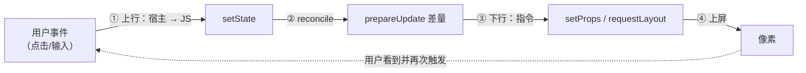

# 事件回路与收官自测

> 子系列收官：补上 RN 的最后一根支柱——**事件上行**。做完本篇，mini-rn 就拥有完整闭环：原生事件 → JS 状态 → 指令下行 → 原生上屏，与真 RN 的主链路一一对应。文末是全系列自测清单与扩展挑战。

## 1. 缺了什么：从单向到回路

07/08 篇打通的是**下行链**（JS → 宿主）。但 RN 的本质是双向的（模块二 01 的 runApplication 之后，一切交互都从上行事件开始）：



上行通道要解决三个问题：**宿主怎么持有 JS 函数、线程怎么交接、事件怎么排队**——每一个都有真 RN 的对应物。

## 2. 宿主持有 JS 回调：三个对应物

```cpp
// mini_native.cc 新增（M5+）
static Napi::FunctionReference g_onEvent;         // ① 持久引用：跨调用存活的 JS 函数

static Napi::Value OnEvent(const Napi::CallbackInfo& info) {
  g_onEvent = Napi::Persistent(info[0].As<Napi::Function>());
  return info.Env().Undefined();
}
static void EmitEvent(const char* type, int tag) { // 宿主内部任意时刻可发事件
  if (!g_onEvent.IsEmpty()) {
    Napi::Env env = g_onEvent.Env();
    g_onEvent.Call({ Napi::String::New(env, type),
                     Napi::Number::New(env, tag) });
  }
}
```

| 我们 | 真 RN | 说明 |
|------|-------|------|
| `Napi::FunctionReference`（Persistent） | JSI 的 `jsi::Function` + Handle 体系 | 跨调用存 JS 值，防 GC 回收（模块三 03） |
| `EmitEvent` 直接 Call | 事件经 EventEmitter/JSI 分发 | 真新架构里事件直调不排队（模块七 02） |
| 见第 3 节 | 旧架构事件过 Bridge 批量 | 我们做的是"排队版"，恰好能体会差异 |

## 3. 线程现实与事件队列（Node 版与 AppKit 版）

**Node 宿主（单线程）**：宿主与 JS 同线程，`EmitEvent` 直接调用即可——但为了体验"帧"的语义，做成队列 + 定拍 drain（09 的推荐形态）：

```js
// app.js：事件队列 = "宿主线程 → JS 线程"的最小过桥
const queue = [];
N.onEvent((type, tag) => queue.push({ type, tag }));   // 生产：宿主侧
setInterval(() => {                                     // 消费：JS 侧按拍取走（≈帧循环）
  for (const e of queue.splice(0)) {
    if (e.type === 'press') setCount((c) => c + 1);    // setState → ② ③ ④ 自动发生
  }
}, 16);
```

**AppKit 宿主（真双线程）**：UI 事件在主线程 `mouseDown` 里产生，而 JS 在 node 侧执行——`EmitEvent` 不能直接跨线程调 N-API。真做法：主线程只把事件**入队**，由 JS 侧的 drain 取走。对照表：

| | 我们的队列 | 真 RN（旧架构） | 真 RN（新架构） |
|--|-----------|----------------|----------------|
| 事件来源线程 | 主线程/宿主 | UI 线程 | UI 线程 |
| 交接方式 | 队列 + 定拍 drain | Bridge 批量消息 | JSI 直调（无队列） |
| JS 消费时机 | drain 节拍 | 批末 | 立即 |

**这就是模块三 04"同步与异步的边界"的宿主侧镜像**：上行事件永远不能阻塞产生它的线程（UI），队列是保守解，JSI 直调是激进解——我们已经站在了保守侧，看懂激进侧只需要把"队列 + 定拍"换成一个条件变量唤醒。

## 4. 完整闭环 demo（Node 版）

```js
const App = () => {
  const [n, setN] = React.useState(0);
  React.useEffect(() => {
    N.onEvent((type) => { if (type === 'press') queue.push({ type }); });
    setInterval(drain, 16);                 // 帧循环
    setInterval(() => EmitSim(), 3000);     // 模拟"每 3 秒被点一下"
  }, []);
  return React.createElement('view', { style: { padding: 10 } },
    React.createElement('text', null, `pressed: ${n}`));
};
const EmitSim = () => simulatePress();      // 宿主测试钩子：真正触发 EmitEvent('press')
```

验收：每 3 秒终端输出一轮 `setProps → requestLayout → dump`，文本从 `pressed: 0` 递增——**①上行 ②diff ③下行 ④上屏** 四步全在日志里可见。至此 mini-rn 与真 RN 的主链路完全同构，只差规模。

## 5. 收官自测（答不上就回对应模块）

1. `instance` 里为什么存 `{tag, type, props}` 而不是宿主对象？（→ 模块四 01：跨边界只有编号没有对象）
2. `prepareUpdate` 返回 `null` 意味着什么？谁受益？（→ 模块五 03：跳过 commitUpdate，宿主零指令）
3. 一帧内两次 setState，宿主为什么可以只见终态？（→ 07 篇实验 + 模块五 03：React 批 commit + 适配层脏标记）
4. 布局为什么放 C++ 而不是 JS？（→ 模块五 02/03：量正比树、与上屏同侧、不占 JS 线程）
5. 事件回调从宿主调 JS，为什么必须持久引用？（→ 模块三 03：GC 与 Handle 体系）
6. 我们哪个设计与旧架构 Bridge 同构？换成 JSI 直调要改哪里？（→ props JSON 序列化 / 事件队列：前者传引用、后者条件变量直调）
7. `createTextInstance` 与 `shouldSetTextContent` 的关系？（→ 07 篇：raw text children 永远走 createTextInstance）

## 6. 扩展挑战（按收益排序）

1. **flex:1**：Measure 加"剩余主轴分配"第二遍——会撞上"父尺寸依赖子尺寸"的循环，体会 Yoga 的约束求解为什么不是简单两遍；
2. **事件冒泡**：tag → 父链回溯，对照模块六 01 的事件表与 Responder 协商；
3. **COW 子树**：removeChild 只标记，PresentTree 时 diff 复用——对照 ShadowNode clone-on-write；
4. **commit 事务**：把 setProps/appendChild 攒成 ops 列表、帧末原子应用——对照 Fabric 的 commit 两阶段；
5. **interleaved 渲染**：ConcurrentRoot 下用 `startTransition` 包 setState，观察 drain 前后的更新顺序——模块九 03 的并发语义亲手复现。

## 7. 子系列全图（回到总览）

| 篇目 | 里程碑 | 交付物 |
|------|--------|--------|
| 01 总览 | — | 目标/架构/里程碑/思考题 |
| 05 落地实现 | M0–M5 | 逐里程碑走读与决策 |
| 06 宿主工程 | M0–M1 | 全量 C++ 工程 + 验收输出 |
| 07 渲染器 | M2–M3 | 全量 hostConfig + 批处理实验 |
| 08 布局上屏 | M4–M5 | 两遍布局法 + AppKit 后端 + 数值验收 |
| 09 事件回路 | M5+ | 上行闭环 + 自测 + 挑战 |

## 小结

- 上行通道三件事：持久引用持回调（GC 对应物）、不阻塞来源线程、队列/直调两档交接——分别对应 Handle 体系、事件线程语义、新旧架构分界；
- 闭环 demo 的四步日志 = 真 RN 主链路的缩影，规模之外无本质差异；
- 七道自测题全部能答，说明模块三~七的原理已经"长在手上"；五道挑战题是从 mini-rn 通向真 RN 源码的台阶。
