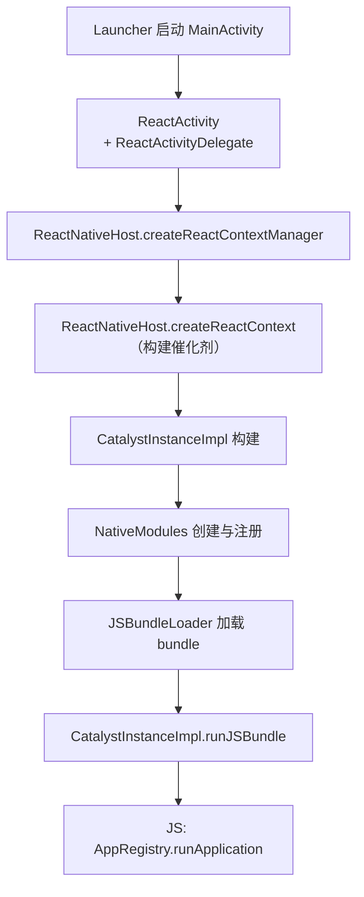
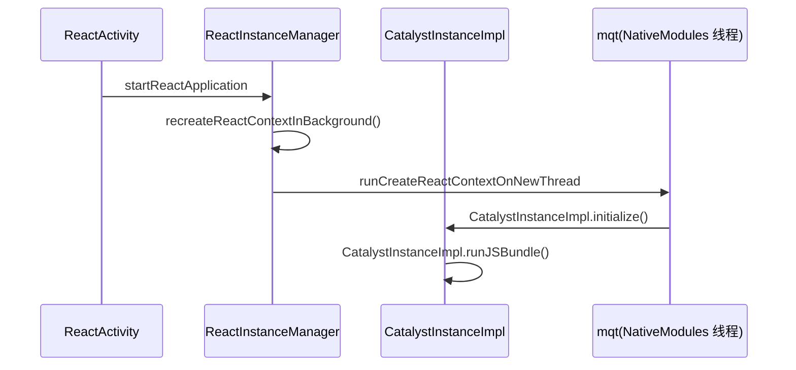

# Android 启动链路

> 从用户点击图标到 `runApplication` 执行，Android 侧要穿过 Activity → ReactContext → CatalystInstance 三级火箭。本篇以 0.7x 旧架构为主线（新架构差异处单独标注），源码位置以 `ReactAndroid/` 为根。

## 1. 全链路总览



总览图的"读者指南"：这一串不是同一个线程一口气跑完的——每一段的执行线程与耗时属性都不同，展开前先给一张"阶段 × 线程 × 职责"表：

| 阶段 | 主要执行线程 | 职责 | 与 RN 的关系 |
|------|------------|------|-------------|
| 进程创建 → Activity | 主线程（+zygote fork） | 壳的启动 | 无关，但常占大头 |
| ReactActivity/Delegate | 主线程 | 建根视图、发起 RN 启动 | RN 的门面 |
| ReactContext 构建 | 专用后台线程（mqt） | 注册表、催化剂组装 | RN 的内脏 |
| Bundle 加载执行 | 同上 → JS 线程 | 读文件 + 跑 JS | JS 世界的点火 |
| 首帧挂载 | UI 线程 | 视图树上屏 | RN 与原生的握手 |

把这张表记在心里，后面每一节都会标注"此刻在哪个线程"——线程归属是理解启动问题时序的第一把钥匙。

## 2. 第一级：Activity 与 Delegate

入口 `MainActivity` 继承 `ReactActivity`，自己几乎是空的——真正的工作在 `ReactActivityDelegate`：

- 源码：`ReactAndroid/src/main/java/com/facebook/react/ReactActivityDelegate.java`
- 职责：持有 `ReactRootView`，向 `ReactInstanceManager` 请求 ReactContext。

```java
// 简化的时序
protected void loadApp(String appKey) {
  ReactRootView mReactRootView = createRootView();
  mReactRootView.startReactApplication(
      getReactNativeHost().getReactInstanceManager(), appKey, launchOptions);
}
```

`ReactInstanceManager` 是全局单例管理者：当前 ReactContext、DevSupportManager（摇一摇菜单、HMR）、生命周期事件的分发中心。

### 2.1 为什么要有 Delegate 这一层

`ReactActivity` 几乎是空壳、活都甩给 Delegate，这不是过度设计：

- **Activity 是框架锁定的**：`ReactActivity` 继承自 `Activity`，它的行为（生命周期回调如何转译给 RN）不适合让业务改；Delegate 是普通类，业务可以替换（提供自定义 delegate 工厂），在不fork框架的前提下换掉门面行为；
- **多入口复用**：`ReactFragment`、`ReactSurfaceView` 等其他宿主形态可以共享同一套 Delegate 逻辑；
- **新架构顺势沿用**：Bridgeless 时代的 `ReactActivityDelegate` 内部换成了对接 `ReactHost` 的实现——门面不变，内脏可换，正是这层解耦的价值兑现。

```java
// ReactActivity 的空壳模式（骨架示意）
public abstract class ReactActivity extends Activity {
  private final ReactActivityDelegate mDelegate =
      createDelegate();   // 子类可覆写换掉门面行为

  @Override
  protected void onCreate(Bundle savedInstanceState) {
    super.onCreate(savedInstanceState);
    mDelegate.onCreate(savedInstanceState);   // 一切转发给 delegate
  }
  @Override
  protected void onPause()  { mDelegate.onPause(); }
  @Override
  protected void onResume() { mDelegate.onResume(); }
  // ...
}
```

### 2.2 ReactNativeHost：配置的集中地

`ReactActivityDelegate` 拿到的 `ReactInstanceManager` 来自 `ReactNativeHost`（Application 级单例）。Host 是 App 声明"我要怎么跑 RN"的地方：

| 配置项 | 作用 | 常见定制 |
|--------|------|---------|
| `getUseDeveloperSupport` | dev/release 模式（决定 bundle 来源） | 按构建类型切换 |
| `getJSMainModuleName` / `getBundleAssetName` | bundle 入口 | 热更新时改读取路径（模块八 02） |
| `getPackages` | ReactPackage 列表（原生模块的来源） | 注册自研模块 |
| JS 执行器工厂 | JSC/Hermes 选择 | 默认 Hermes（模块三 01） |

理解 Host 的位置：它不干活，只**描述**；真正按描述组装环境的是 `ReactInstanceManager`。

## 3. 第二级：ReactContext 的构建

`ReactNativeHost.createReactContext()` 走到 `ReactInstanceManager.createReactContext()`：

1. `JavaScriptModuleRegistry` / `NativeModuleRegistry` 建立（模块注册，模块四展开）。
2. `CatalystInstanceImpl.builder()` 组装催化剂：
   - JS 执行器 `JSExecutor`（JSC / Hermes，模块三展开）；
   - `NativeModuleCallExceptionHandler`；
   - `JSBundleLoader`（决定从哪读 bundle）。



关键点：**ReactContext 的构建发生在专用后台线程（mqt）**，避免卡住主线程；但创建完成后会切回主线程 emit `onReactContextInitialized`。

### 3.1 模块注册：PROCESS_PACKAGES 的内部

`createReactContext` 里最"重"的一步是遍历所有 `ReactPackage`：

```java
// ReactPackage 的两个入口（骨架示意）
public interface ReactPackage {
  List<NativeModule> createNativeModules(ReactApplicationContext context);
  List<ViewManager> createViewManagers(ReactApplicationContext context);
}
```

逐模块做三件事：

1. **实例化**：每个 Package 的 `createNativeModules` 被调用，所有模块对象被创建——不管业务用不用；
2. **方法表收集**：反射扫描 `@ReactMethod` 注解，收集方法名/参数类型，生成 moduleID/methodID 编号表（模块四 01 的编号世界的源头）；
3. **常量快照**：模块的 `getConstants()` 被调用，常量打包等待注入 JS。

三件事的成本都随模块数量线性增长——这就是打点表里 PROCESS_PACKAGES 常成优化对象的原因，也是 TurboModules 把"注册"整个砍掉（懒加载）所针对的靶子（模块七 03）。

### 3.2 线程切换点：一张时刻表

构建过程的线程跳转容易看晕，按时刻对齐：

| 时刻 | 在哪个线程 | 在做什么 |
|------|-----------|---------|
| t0 | 主线程 | Activity onCreate → delegate.loadApp |
| t1 | 主线程 | startReactApplication → 请求 context |
| t2 | 主线程 | 创建 mqt 后台线程，投递创建任务 |
| t3 | mqt | 扫 Package、注册表、组装 Catalyst |
| t4 | mqt | loadScript（读 bundle） |
| t5 | JS 线程 | 执行 bundle（runJSBundle） |
| t6 | 主线程 | emit onReactContextInitialized |
| t7 | UI 线程 | 首批视图操作挂载 |

记住两个"回主线程"的节点（t6、t7）：**启动收尾的回调与首帧都在主/UI 线程**——所以"主线程忙"会直接吃掉启动末段，哪怕 RN 的内脏都在后台线程跑。

### 3.3 CatalystInstance 的组装清单

`CatalystInstanceImpl.builder()` 的入参清单值得过一遍——它是旧架构运行环境的"全部家当"，也是理解 bridgeless 砍掉了什么的对照物：

| 部件 | 作用 | bridgeless 时代 |
|------|------|----------------|
| JS 执行器（JSExecutor） | 承载 JSC/Hermes | 保留（JSI Runtime 直连） |
| NativeModuleRegistry | 模块编号表（模块四 01） | 取消 → delegate + 懒加载 |
| JavaScriptModuleRegistry | JS 模块代理表（原生回调 JS 用） | 取消 → JSI 直调 |
| JSQueue/NativeQueue | 双向消息队列 | 取消（通道本体消失） |
| NativeModuleCallExceptionHandler | 原生异常的统一出口 | 保留（形态更新） |
| JSBundleLoader | bundle 来源策略 | 保留（模块二 03 主角） |

清单里一半的部件在新架构中被"取消"而不是"替换"——复习模块七 05 的说法：新架构不是把桥修得更快，而是把桥拆掉。启动耗时因此少了一整块"队列与注册表的构建成本"。

## 4. 第三级：加载并执行 Bundle

`CatalystInstanceImpl.runJSBundle()`（源码：`.../CatalystInstanceImpl.java`）：

1. `mJSBundleLoader.loadScript(CatalystInstanceImpl.this)` —— 三种典型来源：
   - dev：`JSBundleLoader.createDevBundleLoader`（HTTP 从 Metro 拉取）；
   - prod：`createFileLoader` / `createAssetLoader`（APK 内置 assets）；
   - 热更新：指向下载目录的文件 loader（模块八展开）。
2. JS 执行入口后，`AppRegistry.runApplication` 被调（见下篇）。
3. 执行完成回调 `onJSBundleLoadedFromServer` / `mJSModuleHasLoaded = true`。

### 4.1 Loader 的三种形态对照

Loader 是个"策略对象"：同一个 `loadScript` 接口，背后是完全不同的 IO 路径：

| Loader | 读取路径 | 何时使用 | 启动特征 |
|--------|---------|---------|---------|
| Dev loader | HTTP GET Metro（localhost:8081） | 开发模式 | 有网络段；bundle 未压缩 |
| Asset/File loader | APK assets / 本地文件 | 发布构建 | 纯本地 IO；Hermes 读字节码 |
| 自定义 file loader | 沙盒下载目录 | 热更新 | 本地 IO + 版本选择逻辑（模块八 02） |

（dev loader 的 URL 参数、Metro 连通性排查在 03 篇有完整展开，这里只需记住"loader 是可替换的策略"。）

热更新的替换点之所以"就在这条链上"，正是因为 loader 抽象了"从哪读"——把策略换掉，其余链路（解析、执行、runApplication）全部复用（模块二 03 展开）。

### 4.2 执行 bundle 时 JS 世界在做什么

`executeScript` 不是"跑个脚本"这么简单，bundle 的执行会依次完成：

1. **模块定义**：整包的 `__d(...)` 注册（define）——此时只是登记，不执行模块体（除非顶层被 require）；
2. **入口 require**：`__r(entrypoint)` 触发入口模块链的执行——App 组件、样式、依赖一路初始化；
3. **`AppRegistry.registerComponent`**：把组件工厂挂到注册表；
4. 等待原生侧的 `runApplication` 调用（原生在 JS attach 后发起，见下篇 iOS 侧对应节）。

所以"执行 bundle"的耗时 ≈ 模块登记 + **入口链上所有模块体的执行**——后者由依赖图决定，是 inline requires 等 JS 层优化的作用面（模块二 03/04）。

## 5. 渲染挂载的接合部

JS 侧 `runApplication` 触发的第一批视图操作，最终回到 `ReactRootView`：

- `UIManagerModule` 把整棵树的 createView/setChildren 批量执行（模块五）；
- `ReactRootView.startViewApplication` → `UIManager.addRootView`，把根节点与真正的 Android View 树连接。

至此，JS 世界与原生世界完成握手。

展开"接合部"的关键动作序列（旧架构视角）：

| 步 | 动作 | 所在线程 |
|----|------|---------|
| 1 | JS 首帧 reconcile 完成，视图指令批量入队 | JS 线程 |
| 2 | 批量窗口 flush，指令过桥（JSON） | JS → Native |
| 3 | UIManagerModule 逐条执行 createView/setChildren | UI 线程 |
| 4 | `addRootView` 把根 View 挂进 ReactRootView | UI 线程 |
| 5 | measure/layout/draw → 首帧上屏 | UI 线程 |

注意第 2 步的"批量窗口"：这是旧架构首帧必经的队列环节，也是 Fabric 用 MountingTransaction 直投所取代的环节（模块七 02 第 6 节对照表）。

`ReactRootView` 在这条链里扮演"坑位"角色，还有两个容易被忽略的行为：

- **在内容到达之前它就是空容器**——白屏的主体就是这个空容器亮相的时间；骨架屏/占位视图就是在坑位层面做的感知优化（04 篇）；
- **重复 attach 的守卫**：JS 执行完成前若有再次 attach 请求（快速切页/重建），startReactApplication 的调用会被排队去重——排查"偶发不渲染"问题时留意这个时序窗口。

## 6. 打点：各阶段耗时去哪了

Android 内置 `ReactMarker`（`.../util/ReactMarker.java`）标记关键节点，可用 `systrace` / Perfetto 直接观察：

| Marker | 含义 | 常见优化对象 |
|--------|------|-------------|
| CREATE_REACT_CONTEXT_START/END | ReactContext 构建总时长 | 模块注册量 |
| PROCESS_PACKAGES_START/END | NativeModule 扫描注册 | TurboModules 懒加载的动机 |
| RUN_JS_BUNDLE_START/END | Bundle 加载+执行 | Hermes 字节码、拆包 |
| CREATE_CATALYST_INSTANCE_START/END | 催化剂组装 | — |

### 6.1 把打点接出来：ReactMarkerListener

```java
// 进程早期（Application.onCreate 里）注册一次（骨架示意）
public class TTIMarkerListener implements ReactMarkerListener {
  @Override
  public void logMarker(String name) {
    Log.d("TTI", name);   // 进一步：记时间戳、上报
  }
}
ReactMarker.setMarkerListener(new TTIMarkerListener());
```

三个使用要点：

- **注册要早**：错过 CREATE_REACT_CONTEXT_START 就丢了第一段；
- **只打点不做重活**：回调在关键路径上，IO 会污染被测对象；
- **成对消费**：START/END 配对求差才有意义，落库时按段名归档（04 篇的度量工程展开）。

### 6.2 Perfetto/systrace 里看什么

打点之外，trace 视角能看到打点看不到的东西：

- **线程时间线**：主线程、mqt、JS 线程的忙闲分布——"哪段在等谁"一眼可见（比如 JS 执行期间主线程空转 = 可并行化的窗口）；
- **段与段的空隙**：两个打点之间的空隙若是"等待"而非"计算"，优化方向完全不同（并行化 vs 砍成本）；
- **RN 相关 trace 段**：与 ReactMarker 的节点对应关系，交叉验证归因（模块九 05 的操作手册有完整流程）。

### 6.3 新架构差异（展开）

> 新架构差异：`ReactHost` / `ReactHostImpl` 取代 ReactInstanceManager，Bridgeless 模式下 CatalystInstance 让位于 `ReactHostImpl + BindingsInstaller`，但 Activity → Host → 加载 bundle → runApplication 的骨架不变。

把"骨架不变、内脏全换"再拆细：

| 旧架构环节 | 新架构（bridgeless）对应 | 变化性质 |
|-----------|------------------------|---------|
| ReactInstanceManager | ReactHost / ReactHostImpl | 更名+重设计：支持多实例、预热 |
| CatalystInstance | JSI Runtime 直连（无催化剂中间层） | 结构取消：消息队列不存在了 |
| 全量模块注册 | delegate 就位即可（懒加载） | 成量取消（模块七 03） |
| BatchedBridge 装载 | BindingsInstaller 注入 HostObject | 形态替换（模块七 01 install 时机） |
| runApplication 骨架 | 不变 | — |

对启动优化的含义：新架构自动销掉"模块注册"一段（PROCESS_PACKAGES 趋零），其余段（bundle 读取/执行、首帧）的优化逻辑照旧——这也是 04 篇五段模型在新架构下依然成立的原因。

## 7. dev 与 release 的启动差异

同一条链路，两种构建的"体重"差别巨大（04 篇度量纪律的根基）：

| 维度 | dev | release |
|------|-----|---------|
| bundle 来源 | Metro HTTP（未压缩、含 source map） | 本地 assets（压缩 + Hermes 字节码） |
| 附加设施 | DevSupportManager、红盒、HMR 连接 | 无 |
| JS 执行 | 未优化代码 | Hermes 字节码（模块三 03） |
| 首帧后 | inspector/热更新握手 | 直接进入运行态 |

两个推论：**dev 的启动数字不可用于优化决策**（放大数倍）；排查"release 才有的启动问题"（如 Hermes 字节码与版本错配）不能靠 dev 复现——要直接跑 release 构建（模块二 03 坑位表）。

## 8. reload 与二次启动

冷启动之外的两种常见"再启动"，路径不同：

- **dev reload**（摇一摇/命令 R）：销毁当前 Catalyst/Context → 重建 → 重新拉 bundle——走一遍简化冷启动，是验证启动问题的快速循环；
- **热重启/后台回收恢复**：进程若还在，ReactContext 复用（不走构建链）；进程被杀则完整冷启动。

排查启动问题时先问"哪种启动"——**dev reload 快不等于冷启动快**（reload 跳过了进程创建与部分初始化），最终验收必须以真冷启动为准（杀进程后启动）。

## 9. 常见卡点与排查

| 现象 | 高概率环节 | 排查动作 |
|------|-----------|---------|
| 点击图标后长时间白屏，无任何 RN 日志 | 进程/Activity 段（RN 之外） | 先看纯原生壳的启动耗时（04 篇误区节） |
| PROCESS_PACKAGES 段长 | 模块注册量 | 数 Package/模块数；新架构下此段消失 |
| RUN_JS_BUNDLE 段长 | bundle 读取或执行 | 拆开看：读文件时间 vs JS 执行时间（trace 分段） |
| JS 执行完但首帧慢 | 首屏组件树/挂载 | 模块五 03/模块九 02 的处方 |
| dev 真机起不来（拿不到 bundle） | Metro 连通性 | adb reverse / 同网段检查（模块二 03 展开） |
| 偶发启动崩溃（注册相关） | 模块初始化顺序 | 看崩溃栈是否落在 createNativeModules 链上 |

排查卡点时的两个习惯：

1. **先看日志分期**：`ReactNativeJS` 前后的日志顺序能粗定位卡在构建期还是执行期——比盲猜快得多；
2. **对照新架构差异**：如果 App 已在 bridgeless 下，上表"注册相关"两行的处方直接换新架构结论（3.3 的取消清单），不要按旧架构的直觉开药。

排查的顺序纪律与 04 篇一致：**先打点分段、再对段下药**——上表的"高概率环节"列就是分段的产物。

## 小结

- 三级火箭：ReactActivity（壳）→ ReactInstanceManager（上下文管理）→ CatalystInstance（执行环境）。
- Bundle 加载在专用后台线程，模块注册是隐藏的启动大头。
- 用 ReactMarker 的打点把启动时间切成可归因的段落，再谈优化。
- 线程时刻表是时序问题的第一 diagnostic：t3–t5 在后台/JS 线程，t6–t7 回主/UI 线程——主线程忙会吃掉启动末段。
- 新架构换内脏不换骨架：注册段消失、催化剂取消，"Activity → Host → bundle → runApplication"主线不变。
- dev 与 release、reload 与冷启动是不同的测量对象——验收永远以 release 真冷启动为准。

## 自测

先合上正文画一遍"阶段 × 线程"时刻表，再答题。

1. 三级火箭各解决什么问题？如果让你向新人只讲三个"必背时刻"，你选哪三个（提示：对应 t2/t5/t7）？
2. 模块注册为什么必须发生在启动期？这个"必须"在新架构下如何被解除？
3. `JSBundleLoader` 的三种形态各对应什么场景？热更新为什么能"只换一个策略"就接入？
4. `onReactContextInitialized` 为什么切回主线程 emit？首帧挂载为什么在 UI 线程？
5. ReactMarker 四组打点各自圈住哪一段？PROCESS_PACKAGES 长的处方是什么？
6. "dev reload 很快但线上冷启动慢"——列出至少三个可能解释。
7. Bridgeless 下哪些启动环节消失了？哪些优化手段因此失效（不再需要做）？
