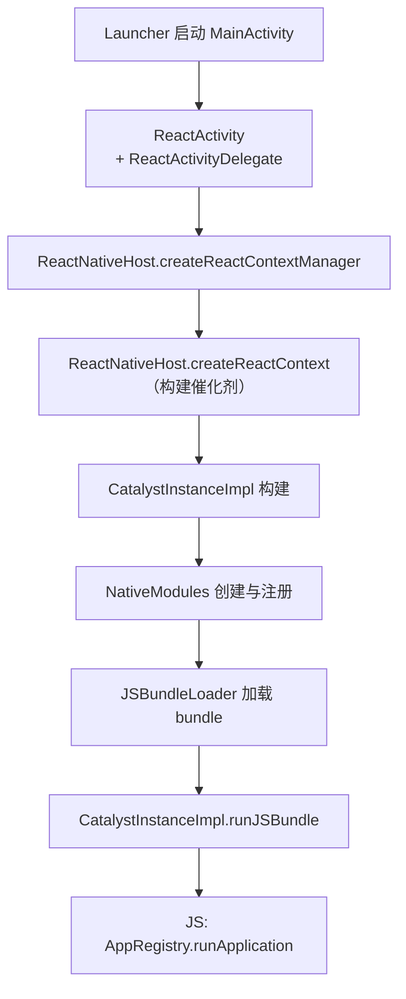
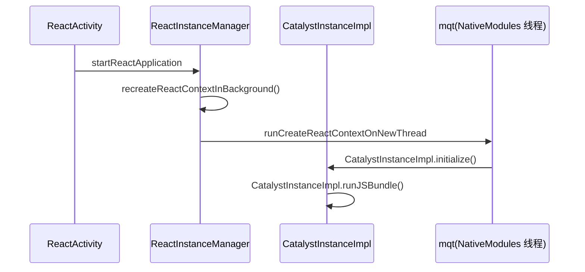

# Android 启动链路

> 从用户点击图标到 `runApplication` 执行，Android 侧要穿过 Activity → ReactContext → CatalystInstance 三级火箭。本篇以 0.7x 旧架构为主线（新架构差异处单独标注），源码位置以 `ReactAndroid/` 为根。

## 1. 全链路总览



## 2. 第一级：Activity 与 Delegate

入口 `MainActivity` 继承 `ReactActivity`，自己几乎是空的——真正的工作在 `ReactActivityDelegate`：

- 源码：`ReactAndroid/src/main/java/com/facebook/react/ReactActivityDelegate.java`
- 职责：持有 `ReactRootView`，向 `ReactInstanceManager` 请求 ReactContext。

```java
// 简化的时序
protected void loadApp(String appKey) {
  ReactRootView mReactRootView = createRootView();
  mReactRootView.startReactApplication(
      getReactNativeHost().getReactInstanceManager(), appKey, launchOptions);
}
```

`ReactInstanceManager` 是全局单例管理者：当前 ReactContext、DevSupportManager（摇一摇菜单、HMR）、生命周期事件的分发中心。

## 3. 第二级：ReactContext 的构建

`ReactNativeHost.createReactContext()` 走到 `ReactInstanceManager.createReactContext()`：

1. `JavaScriptModuleRegistry` / `NativeModuleRegistry` 建立（模块注册，模块四展开）。
2. `CatalystInstanceImpl.builder()` 组装催化剂：
   - JS 执行器 `JSExecutor`（JSC / Hermes，模块三展开）；
   - `NativeModuleCallExceptionHandler`；
   - `JSBundleLoader`（决定从哪读 bundle）。



关键点：**ReactContext 的构建发生在专用后台线程（mqt）**，避免卡住主线程；但创建完成后会切回主线程 emit `onReactContextInitialized`。

## 4. 第三级：加载并执行 Bundle

`CatalystInstanceImpl.runJSBundle()`（源码：`.../CatalystInstanceImpl.java`）：

1. `mJSBundleLoader.loadScript(CatalystInstanceImpl.this)` —— 三种典型来源：
   - dev：`JSBundleLoader.createDevBundleLoader`（HTTP 从 Metro 拉取）；
   - prod：`createFileLoader` / `createAssetLoader`（APK 内置 assets）；
   - 热更新：指向下载目录的文件 loader（模块八展开）。
2. JS 执行入口后，`AppRegistry.runApplication` 被调（见下篇）。
3. 执行完成回调 `onJSBundleLoadedFromServer` / `mJSModuleHasLoaded = true`。

## 5. 渲染挂载的接合部

JS 侧 `runApplication` 触发的第一批视图操作，最终回到 `ReactRootView`：

- `UIManagerModule` 把整棵树的 createView/setChildren 批量执行（模块五）；
- `ReactRootView.startViewApplication` → `UIManager.addRootView`，把根节点与真正的 Android View 树连接。

至此，JS 世界与原生世界完成握手。

## 6. 打点：各阶段耗时去哪了

Android 内置 `ReactMarker`（`.../util/ReactMarker.java`）标记关键节点，可用 `systrace` / Perfetto 直接观察：

| Marker | 含义 | 常见优化对象 |
|--------|------|-------------|
| CREATE_REACT_CONTEXT_START/END | ReactContext 构建总时长 | 模块注册量 |
| PROCESS_PACKAGES_START/END | NativeModule 扫描注册 | TurboModules 懒加载的动机 |
| RUN_JS_BUNDLE_START/END | Bundle 加载+执行 | Hermes 字节码、拆包 |
| CREATE_CATALYST_INSTANCE_START/END | 催化剂组装 | — |

> 新架构差异：`ReactHost` / `ReactHostImpl` 取代 ReactInstanceManager，Bridgeless 模式下 CatalystInstance 让位于 `ReactHostImpl +BindingsInstaller`，但 Activity → Host → 加载 bundle → runApplication 的骨架不变。

## 小结

- 三级火箭：ReactActivity（壳）→ ReactInstanceManager（上下文管理）→ CatalystInstance（执行环境）。
- Bundle 加载在专用后台线程，模块注册是隐藏的启动大头。
- 用 ReactMarker 的打点把启动时间切成可归因的段落，再谈优化。
