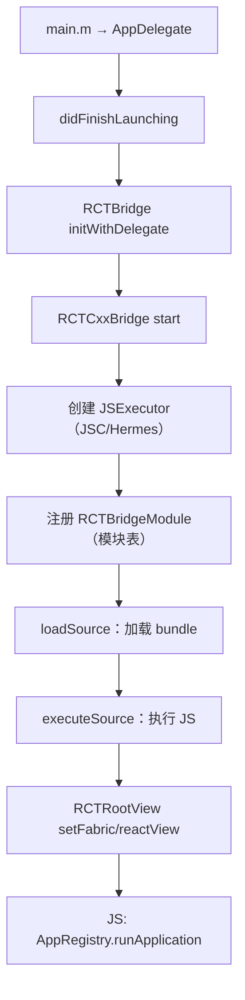
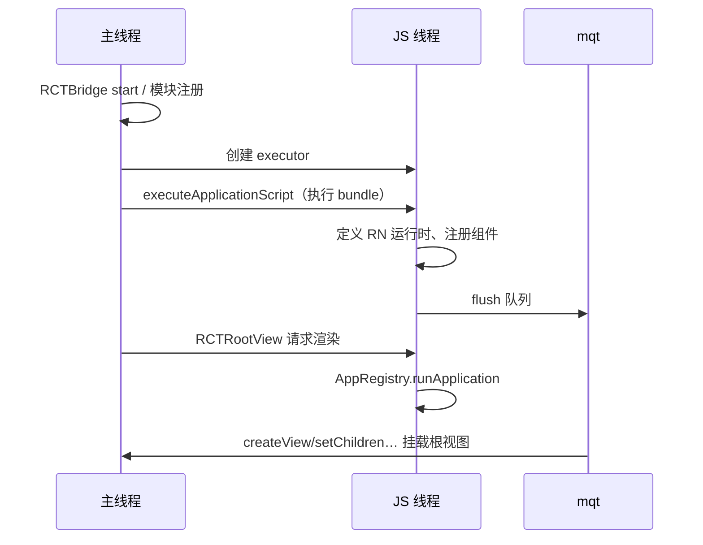

# iOS 启动链路与 runApplication

> iOS 侧的同一出戏：AppDelegate → RCTBridge → RCTRootView。重点看 bridge 的启动阶段划分（setup/start/loadSource/executeSource/dispatch）与 JS 侧 `AppRegistry.runApplication` 的收尾。源码以 `React/` 为根。

## 1. 全链路总览



与 Android 篇同款"读者指南"——阶段 × 线程 × 职责表：

| 阶段 | 主要执行线程 | 职责 | 备注 |
|------|------------|------|------|
| main → didFinishLaunching | 主线程 | App 壳启动 | 与 RN 无关但常占大头 |
| RCTBridge 发起 | 主线程 | 总指挥就位 | start 的重活在 JS 线程 |
| 模块注册 | 主线程（部分可后台） | 扫描 RCTBridgeModule 类 | iOS 的隐形大头 |
| loadSource | 独立队列 | 读 bundle | dev 走网络、prod 走文件 |
| executeSource | JS 线程 | 执行整包 | JS 世界点火 |
| runApplication | JS 线程 | 首帧 reconcile | 回 UI 线程挂载 |

与 Android 的显著差异：iOS 的模块注册**主要在主线程做**（类扫描发生在 start 早期）——这也是 iOS 侧"模块拆分/懒注册"优化更早被重视的原因（第 5 节打点表）。

本篇与 Android 篇是姊妹篇：主线对照读（3.2 节的表），平台细节各自读；两篇共同的"发令枪"细节（runApplication 的 JS 侧展开）在本篇第 4 节。

## 2. AppDelegate：一切的开端

```objc
// AppDelegate.mm（RN 模板，简化）
- (BOOL)application:(UIApplication *)application didFinishLaunchingWithOptions:... {
  RCTBridge *bridge = [[RCTBridge alloc] initWithDelegate:self launchOptions:launchOptions];
  RCTRootView *rootView = [[RCTRootView alloc] initWithBridge:bridge
                                                   moduleName:@"MyApp"
                                            initialProperties:nil];
  self.window.rootViewController.view = rootView;
}
```

三个角色：

- `RCTBridge`：总指挥（真正干活的是 `RCTCxxBridge`）；
- `RCTRootView`：原生世界的"坑位"，等 JS 渲染出内容填进来；
- `moduleName`：与 JS 侧 `AppRegistry.registerComponent('MyApp', ...)` 的字符串对齐——对不上就是白屏。

### 2.1 RCTBridge 与 RCTCxxBridge 的关系

名字里都带 bridge，分工要分清：

| | RCTBridge | RCTCxxBridge |
|--|-----------|--------------|
| 角色 | 门面/调度壳 | 实际执行者（C++ 侧接线） |
| 生命周期 | App 级持有 | 随 start/stop 创建销毁 |
| 职责 | 分发阶段、暴露 OC API | 六阶段长流程的宿主 |

这是典型的"门面—工人"结构：业务与模板代码面向 `RCTBridge` 编程，版本升级时工人可以整体替换（历史上从纯 OC 实现换到 Cxx 系）而门面不动——与 Android 篇"ReactActivity 空壳 + Delegate"是同一种防御性设计。

### 2.2 bridge 何时真正启动

`initWithDelegate` 之后 start 的执行不在主线程同步做完全程——重活被切到专用 JS 线程分段推进，主线程发起后即返回。这意味着：

- didFinishLaunching 不会被 bridge 的构建阻塞——主线程继续走 window/VC 的搭建；
- `RCTRootView` 初始化时 bridge 可能还没就绪——它内部会**等待/监听** bridge 就绪后再请求渲染（加载视图先顶上）；
- "启动完成"是一个**多线程汇合点**：bundle 执行完 + rootView 挂好 + runApplication 触发，三者齐备才有首帧。

### 2.3 模块自动注册：宏 + 类收集

iOS 没有 Android 那种"遍历 Package"的显式注册，靠的是 ObjC 运行时的类收集：

```objc
// 模块声明宏的背后（骨架示意）
#define RCT_EXPORT_MODULE(name)                    \
  RCT_EXTERN void RCTRegisterModule(Class);        \
  __attribute__((constructor))                     \
  static void RCTRegisterModule_##name(Class cls) { \
    RCTRegisterModule([MyModule class]);           \
  }
```

机制三步：

1. 每个模块文件里的 `RCT_EXPORT_MODULE` 宏展开出一个 **constructor 函数**（dyld 加载类时自动执行）；
2. 把自己的 Class 登记进全局模块类表；
3. `RCTCxxBridge` 启动时遍历这张表逐个实例化——**"注册"被拆到了编译/加载期（登记）与启动期（实例化）**。

所以 iOS 的"模块注册成本"由两段构成：类扫描（查表）+ 逐模块实例化（走 init 与常量导出）——打点表里 RCTPLTagModuleSetup 圈住的就是这两段。

## 3. RCTCxxBridge.start 的六个阶段

源码：`React/Base/RCTCxxBridge.mm`。start 方法是个长流程，可切成六段：

1. **setup**：创建 JS 线程 `_jsThread`、`RCTPerformanceLogger` 开始打点；
2. **模块注册**：`registerModulesForAllClasses` —— 扫描所有标了 `RCTBridgeModule` 的 OC 类，构建模块表（这就是 iOS 启动的隐形大头）；
3. **JSExecutor**：创建 `RCTHermesInstance` / JSC 实例，注入 `JSExecutorFactory`；
4. **loadSource**：`loadSource` 在独立队列读 bundle（dev 从 Metro HTTP，prod 从 `main.jsbundle` 文件）；
5. **executeSource**：`executeApplicationScript` 在 JS 线程执行整个 bundle；
6. **dispatch**：flush 消息队列，JS 世界开始运转。



### 3.1 六阶段的逐步展开

每阶段多看两眼"里面在干什么、坏了什么样"：

| 阶段 | 内部动作 | 失败时的典型现象 |
|------|---------|----------------|
| setup | 建 JS 线程、性能打点复位 | 极少见（系统资源类） |
| 模块注册 | 类表遍历、实例化、常量导出 | 某模块 init 崩 → 启动即崩 |
| executor | 创建引擎实例、注入执行器工厂 | 引擎/字节码版本错配 → 执行期炸 |
| loadSource | 网络（dev）或文件读（prod） | URL 错/文件缺 → 白屏 + 控制台明确报错 |
| executeSource | 整包执行（模块定义→入口 require） | JS 语法/顶层抛错 → `RCTFatal` 断言 |
| dispatch | flush 初始消息队列 | 极少见（前序成功的自然延续） |

（六阶段在不同版本里细节有增减——比如 executor 创建与模块注册的先后、部分模块的延迟实例化——但作为心智模型足够稳：**先备环境、再备模块、再取脚本、最后点火**。）

注意 loadSource 与 executeSource 的**分工**：前者只负责把字节搬到内存（IO 段），后者才是 JS 世界的点火（执行段）——04 篇 TTI 分段模型里"②读取解析"与"③JS 执行"的分界线就在这。

### 3.2 与 Android 链路的对照

同一出戏两种方言，对照表帮助两栖排查：

| 环节 | Android | iOS |
|------|---------|-----|
| 壳入口 | MainActivity + Delegate | AppDelegate + window/VC |
| 上下文管理 | ReactInstanceManager | RCTBridge（门面）/ RCTCxxBridge（工人） |
| 模块注册 | Package 遍历 + 反射注解 | 宏登记类表 + 启动遍历 |
| bundle 加载 | JSBundleLoader 策略族 | RCTJavaScriptLoader（URL 决定来源） |
| 执行 | runJSBundle | executeApplicationScript |
| 发令枪 | AppRegistry.runApplication | 同（JS 侧统一） |
| 新架构宿主 | ReactHost / ReactHostImpl | RCTHost（骨架一致） |

**发令枪是同一个**——`AppRegistry.runApplication` 是跨平台统一的 JS 侧入口，这就是"平台链路各一条、JS 收口只有一处"的结构性原因。

### 3.3 模块注册段的优化谱系

RCTPLTagModuleSetup 圈住的成本，历史上有一串渐进的优化手段（按介入位置排列）：

| 手段 | 介入位置 | 思路 |
|------|---------|------|
| 模块拆分/下沉 | 类表本身 | 少注册：把非启动必需的模块从主 bridge 拆出去 |
| 懒注册（延迟收集类表） | registerModulesForAllClasses | 先注册急需子集，其余延后补 |
| TurboModules | 模型替换 | 彻底取消启动期实例化（模块七 03 的三替换） |

谱系的终点印证了一个判断：**当"注册"的存在理由（给消息队列建编号表）消失时，围绕它的优化也就整体作废**——新架构下的启动优化注意力应该移向 bundle 与首帧（04 篇）。

## 4. runApplication：JS 侧的收尾

bundle 执行到最后，`index.js` 只有寥寥数行：

```js
import { AppRegistry } from 'react-native';
import App from './App';

AppRegistry.registerComponent(appName, () => App);
```

`AppRegistry.runApplication`（源码：`Libraries/ReactNative/AppRegistry.js`）做的事：

1. 取出注册的组件工厂，用 `AppRegistry.getApplication` 包成 React 元素（外层包 `RootErrorBoundary`、`AppContainer`——后者在 dev 模式注入 inspector 入口）；
2. 调 `RenderReact.render`（旧架构走 `ReactNative.render`，本质是 `ReactFabric.render` / legacy renderer）；
3. 首帧 reconcile 完成 → 视图指令批量过桥 → `RCTRootView` 里的 contentView 被真实 UIView 树填充。

**白屏排查思路**就藏在这条链上：moduleName 不匹配 / bundle 执行抛错（`RCTFatal`）/ 首屏 JS 异步阻塞——分别对应注册、执行、渲染三段。

### 4.1 runApplication 的参数与包装层次

`runApplication` 被原生调用时带一组参数（appKey、初始参数、rootTag 等），JS 侧的消费层次：

| 层 | 做什么 | 出问题的现象 |
|----|--------|-------------|
| appKey → 组件工厂查表 | 字符串对齐 moduleName | 查无此 key → 白屏 + 警告日志 |
| RootErrorBoundary | 捕获渲染错误展示错误界面 | 红屏（dev）/ 白屏（release 静默） |
| AppContainer | dev 注入 inspector/元素检查 | 仅影响 dev 工具 |
| RenderReact.render | 进入 reconcile | 首帧异常在此暴露 |

rootTag 的意义：原生侧以此标识这棵根视图树——多根（多次 runApplication，如混合开发的多个 RN 容器）就是靠它区分的（模块十二 01）。

### 4.2 首帧之后的回流

`runApplication` 只是"发令枪"，首帧落地还要一程回流：

| 步 | 动作 | 线程 |
|----|------|------|
| 1 | reconcile 完成，视图指令批量入队 | JS 线程 |
| 2 | 指令过桥 flush | JS → Native |
| 3 | createView/setChildren 逐条执行 | 主线程（UI） |
| 4 | contentView 被真实 UIView 树填充 | 主线程 |
| 5 | layout/draw，首帧上屏 | 主线程 |

第 3–4 步就是"`RCTRootView` 里的 contentView 被填充"的机械过程——旧架构的批量窗口在第 2 步，Fabric 的 MountingTransaction 直投取代的也是它（模块七 02，与 Android 篇第 5 节完全同构）。

### 4.3 多根与卸载：runApplication 不是一次性指令

AppRegistry 的 API 族里还有与 runApplication 成对的动作，混合开发场景天天在用：

| API | 时机 | 语义 |
|-----|------|------|
| `runApplication` | 容器首次展示 | 按 rootTag 建一棵新根树 |
| `unmountApplicationComponentAtRootTag` | 容器销毁 | 按根卸载、释放视图 |
| （Fabric 下）根的挂载由 Surface 驱动 | 同一语义的平台化封装 | 模块十二 01 的容器生命周期 |

（`getRunnable`/`getApplication` 等内部辅助不展开，记住"注册—运行—卸载"三动词即可。）

两个工程推论：

- **rootTag 是根的唯一句柄**：多容器并存时，事件、指令、生命周期消息都靠它路由——容器复用/销毁的 bug 多数能在 rootTag 的时序上找到原因；
- **runApplication 可以多次**：它不是全局单次发令，而是"每根一次"——理解这一点后，"混合开发里 RN 页面反复进出"的行为就不再神秘（模块十二 02）。

## 5. iOS 侧的打点

`RCTPerformanceLogger`（`React/Base/RCTPerformanceLogger.h`）记录各阶段，Xcode 控制台 `RCTProfile` / Instruments 可读：

| 阶段 | Logger 项 | 对应优化 |
|------|-----------|---------|
| 模块注册 | RCTPLTagModuleSetup | 模块拆分、懒注册 |
| 加载 bundle | RCTPLTagScriptLoad | 内联（嵌入可执行文件）、预加载 |
| 执行 bundle | RCTPLTagScriptExecute | Hermes 字节码 |
| 渲染首帧 | RCTPLTTI | 首屏组件瘦身 |

### 5.1 把打点读出来

```objc
// 启动完成后导出（骨架示意；也可桥给 JS 侧统一上报）
for (NSUInteger tag = 0; tag < RCTPLSize; tag++) {
  int64_t value = [RCTPerformanceLogger valueForTag:tag];
  NSLog(@"perf tag=%ld value=%lld", (unsigned long)tag, (long long)value);
}
```

三个使用纪律（与 Android 篇同款）：

- **成对消费**：start/end 求差，按段落归档；
- **release 采数**：dev 的数字被 Metro 请求与 dev 设施放大，没有可比性；
- **入库对比**：分段数据随版本留存，任何回归都能定位到段（04 篇度量工程）。

### 5.3 Instruments / Perfetto 里的 iOS 观察点

打点之外，trace 工具能看到打点之间的"空隙"（04 篇归因的另一半）：

| 观察对象 | 在 trace 里的样子 | 说明的问题 |
|---------|------------------|-----------|
| 主线程忙段 | 密集的系统/业务帧 | 首帧挂载被主线程排队 |
| JS 线程忙段 | executeApplicationScript 起的连续段 | JS 执行是长板 |
| 模块注册段的调用栈 | 大量 init/常量导出帧 | 注册是长板（5.2 节谱系介入） |
| 线程间空隙 | JS 等待、IO 等待 | 可并行化窗口（04 篇并行化手段） |

打点回答"哪段长"，trace 回答"为什么长"——两者配合才是完整归因，单独依赖任何一个都会漏判。

### 5.2 新架构差异（展开）

> 新架构差异：`RCTBridge` 被 `RCTHost`（`ReactCommon/rninstances/RCTHost.h`）取代，Bridgeless 下没有 RCTCxxBridge 的六阶段，但"模块表 → 执行 bundle → runApplication"骨架一致。

与 Android 篇 6.3 同款的"内脏替换清单"：

| 旧架构环节 | 新架构（bridgeless）对应 | 变化性质 |
|-----------|------------------------|---------|
| RCTBridge / RCTCxxBridge | RCTHost | 门面换血 |
| 启动期全量模块实例化 | delegate 就位即可（懒加载） | 成量取消（模块七 03） |
| BatchedBridge 装载 | JSI 绑定注入 | 形态替换 |
| runApplication 骨架 | 不变 | — |

模板代码层面的变化：AppDelegate 不再手工组装 RCTBridge/RCTRootView，改由宿主工厂一类的封装完成（各版本模板有差异）——**moduleName 对齐这条纪律不变**：宿主创建根视图用的名字仍要和 `AppRegistry.registerComponent` 的字符串一致，白屏第一查项代代相传。

## 6. dev 与 release：iOS 侧的差异清单

与 Android 篇第 7 节同款对照（04 篇度量纪律的 iOS 半边）：

| 维度 | dev | release |
|------|-----|---------|
| bundle 来源 | Metro HTTP（localhost:8081，真机需同网段） | App 包内 main.jsbundle |
| JS 代码 | 未压缩、可调试 | 压缩 + Hermes 字节码 |
| 附加设施 | 红盒、inspector、HMR 连接 | 无 |
| 首帧后 | dev 菜单/热更新握手 | 直接运行态 |

iOS 特有的两个注意点：

- **模拟器与真机的 Metro 连通性不同**：模拟器共享宿主网络天然可达；真机要么同 Wi-Fi，要么走端口转发——"dev 起不来"先查连通再查代码；
- **release 包的 JS 错误更安静**：dev 的红盒在 release 变成静默或崩溃——排查 release 白屏必须看设备日志/崩溃上报，不能指望界面提示。

## 7. 白屏/启动慢排查清单

把 4 节的三段归因展开成可执行清单：

| 顺序 | 检查项 | 手段 | 对应段落 |
|------|--------|------|---------|
| 1 | 纯原生壳耗时 | Instruments 看主线程（不涉及 RN 的部分） | ① 原生初始化 |
| 2 | bundle 是否就绪 | RCTPLTagScriptLoad；dev 看Metro连通 | ② 读取解析 |
| 3 | bundle 是否执行成功 | 控制台 `RCTFatal`/红屏；顶层 try 包裹 | ③ JS 执行 |
| 4 | moduleName 对齐 | 两端字符串 diff | 注册段 |
| 5 | 首帧是否被异步阻塞 | 打日志看首屏组件是否等到数据才渲染 | ④ 首屏渲染 |
| 6 | 模块注册段 | RCTPLTagModuleSetup | 隐形大头 |

清单的用法是**从上往下逐项排除**——与 04 篇"没有打点的启动优化都是猜"同源：每一项都有对应的观测手段，不靠肉眼。

补一个 iOS 侧的高频坑：**Podfile/缓存状态**。升级 RN 或切新架构开关后，模块注册/执行期的诡异崩溃常来自 Pods 与 node_modules 的不同步——标准动作是清 DerivedData、必要时重装 Pods（模块七 06 篇 4.1 构建期表格的同款处方，跨模块通用）。

## 小结

- iOS 启动 = RCTBridge.start 六阶段：setup → 模块注册 → executor → loadSource → executeSource → dispatch。
- `AppRegistry.runApplication` 是 JS 世界的发令枪，moduleName 是两侧的接头暗号。
- 白屏/启动慢的归因顺序：模块注册 → bundle 加载 → JS 执行 → 首帧渲染，逐段看打点。
- 门面—工人结构（RCTBridge/RCTCxxBridge）与模块自动注册（宏 + 类表）是 iOS 侧两大结构特征，分别解释了"可替换性"与"隐形注册成本"。
- loadSource 与 executeSource 的分界就是 TTI 模型②与③的分界——IO 与执行分开优化、分开验收。
- 与 Android 的对照表是两栖排查的地图：平台链路各一条，JS 收口只有 runApplication 一处。
- 模块注册优化谱系（拆分→懒注册→TurboModels）的终点是"注册整体作废"——优化注意力随架构演进移向 bundle 与首帧。
- 多根场景下 rootTag 是根的唯一句柄，runApplication 是"每根一次"而非全局单次。

## 自测

答题前先合上正文，凭记忆画出 iOS 启动的"阶段 × 线程"表，再逐题核对。

1. 六阶段各自在哪个线程执行？哪两段之间是"IO 与执行"的分界？
2. RCTBridge 与 RCTCxxBridge 的分工是什么？这种门面—工人结构与 Android 的哪个设计同构？
3. 模块"自动注册"实际拆成两步，分别发生在何时？这解释了 RCTPLTagModuleSetup 圈住的哪些成本？
4. `runApplication` 的参数里 rootTag 有什么用？混合开发的多个 RN 容器靠什么区分？
5. 白屏三段归因（注册/执行/渲染）各自的观测手段是什么？
6. loadSource 读到的是"字节"还是"模块"？两阶段的产物各是什么？
6. 新架构下哪些启动环节消失了？哪条排查纪律（白屏第一查项）保持不变？
7. "打点回答哪段长、trace 回答为什么长"——用一个白屏案例走一遍两者配合的归因过程。
