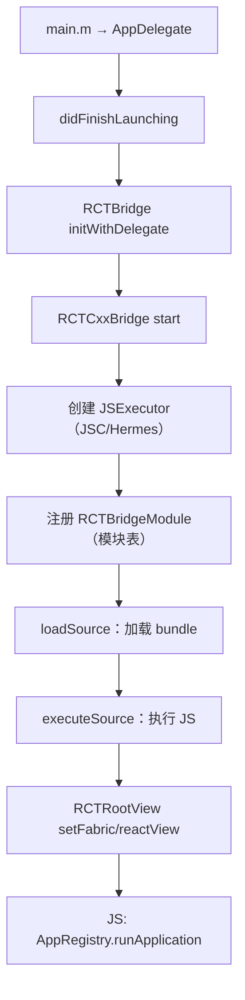
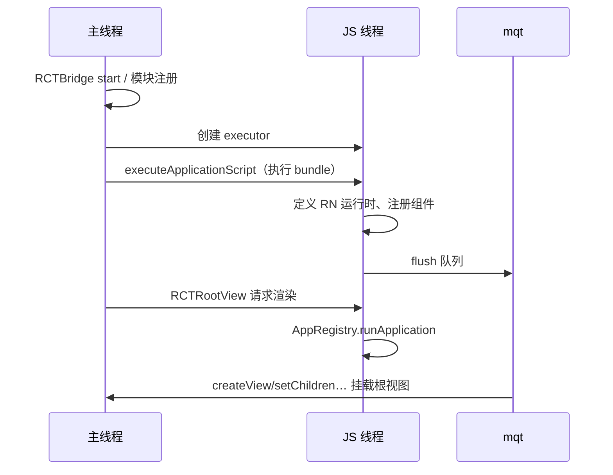

# iOS 启动链路与 runApplication

> iOS 侧的同一出戏：AppDelegate → RCTBridge → RCTRootView。重点看 bridge 的启动阶段划分（setup/start/loadSource/executeSource/dispatch）与 JS 侧 `AppRegistry.runApplication` 的收尾。源码以 `React/` 为根。

## 1. 全链路总览



## 2. AppDelegate：一切的开端

```objc
// AppDelegate.mm（RN 模板，简化）
- (BOOL)application:(UIApplication *)application didFinishLaunchingWithOptions:... {
  RCTBridge *bridge = [[RCTBridge alloc] initWithDelegate:self launchOptions:launchOptions];
  RCTRootView *rootView = [[RCTRootView alloc] initWithBridge:bridge
                                                   moduleName:@"MyApp"
                                            initialProperties:nil];
  self.window.rootViewController.view = rootView;
}
```

三个角色：

- `RCTBridge`：总指挥（真正干活的是 `RCTCxxBridge`）；
- `RCTRootView`：原生世界的"坑位"，等 JS 渲染出内容填进来；
- `moduleName`：与 JS 侧 `AppRegistry.registerComponent('MyApp', ...)` 的字符串对齐——对不上就是白屏。

## 3. RCTCxxBridge.start 的六个阶段

源码：`React/Base/RCTCxxBridge.mm`。start 方法是个长流程，可切成六段：

1. **setup**：创建 JS 线程 `_jsThread`、`RCTPerformanceLogger` 开始打点；
2. **模块注册**：`registerModulesForAllClasses` —— 扫描所有标了 `RCTBridgeModule` 的 OC 类，构建模块表（这就是 iOS 启动的隐形大头）；
3. **JSExecutor**：创建 `RCTHermesInstance` / JSC 实例，注入 `JSExecutorFactory`；
4. **loadSource**：`loadSource` 在独立队列读 bundle（dev 从 Metro HTTP，prod 从 `main.jsbundle` 文件）；
5. **executeSource**：`executeApplicationScript` 在 JS 线程执行整个 bundle；
6. **dispatch**：flush 消息队列，JS 世界开始运转。



## 4. runApplication：JS 侧的收尾

bundle 执行到最后，`index.js` 只有寥寥数行：

```js
import { AppRegistry } from 'react-native';
import App from './App';

AppRegistry.registerComponent(appName, () => App);
```

`AppRegistry.runApplication`（源码：`Libraries/ReactNative/AppRegistry.js`）做的事：

1. 取出注册的组件工厂，用 `AppRegistry.getApplication` 包成 React 元素（外层包 `RootErrorBoundary`、`AppContainer`——后者在 dev 模式注入 inspector 入口）；
2. 调 `RenderReact.render`（旧架构走 `ReactNative.render`，本质是 `ReactFabric.render` / legacy renderer）；
3. 首帧 reconcile 完成 → 视图指令批量过桥 → `RCTRootView` 里的 contentView 被真实 UIView 树填充。

**白屏排查思路**就藏在这条链上：moduleName 不匹配 / bundle 执行抛错（`RCTFatal`）/ 首屏 JS 异步阻塞——分别对应注册、执行、渲染三段。

## 5. iOS 侧的打点

`RCTPerformanceLogger`（`React/Base/RCTPerformanceLogger.h`）记录各阶段，Xcode 控制台 `RCTProfile` / Instruments 可读：

| 阶段 | Logger 项 | 对应优化 |
|------|-----------|---------|
| 模块注册 | RCTPLTagModuleSetup | 模块拆分、懒注册 |
| 加载 bundle | RCTPLTagScriptLoad | 内联（嵌入可执行文件）、预加载 |
| 执行 bundle | RCTPLTagScriptExecute | Hermes 字节码 |
| 渲染首帧 | RCTPLTTI | 首屏组件瘦身 |

> 新架构差异：`RCTBridge` 被 `RCTHost`（`ReactCommon/rninstances/RCTHost.h`）取代，Bridgeless 下没有 RCTCxxBridge 的六阶段，但"模块表 → 执行 bundle → runApplication"骨架一致。

## 小结

- iOS 启动 = RCTBridge.start 六阶段：setup → 模块注册 → executor → loadSource → executeSource → dispatch。
- `AppRegistry.runApplication` 是 JS 世界的发令枪，moduleName 是两侧的接头暗号。
- 白屏/启动慢的归因顺序：模块注册 → bundle 加载 → JS 执行 → 首帧渲染，逐段看打点。
