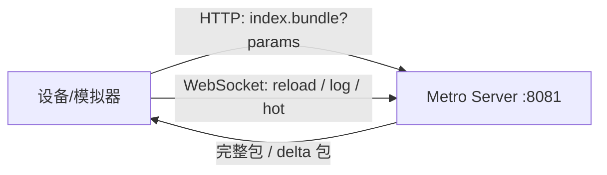
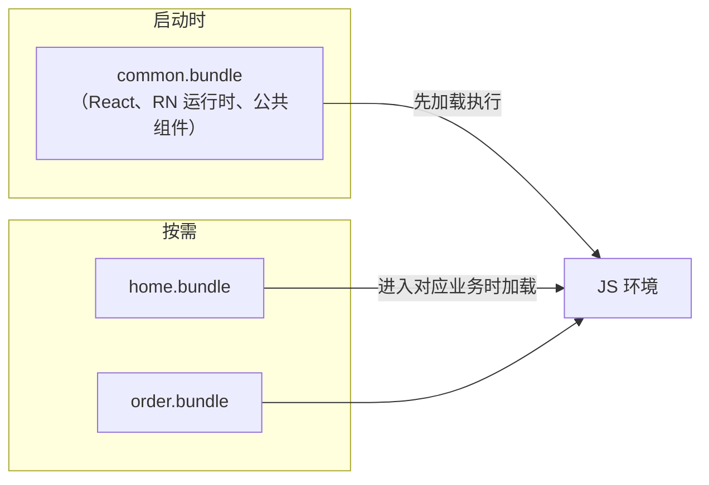
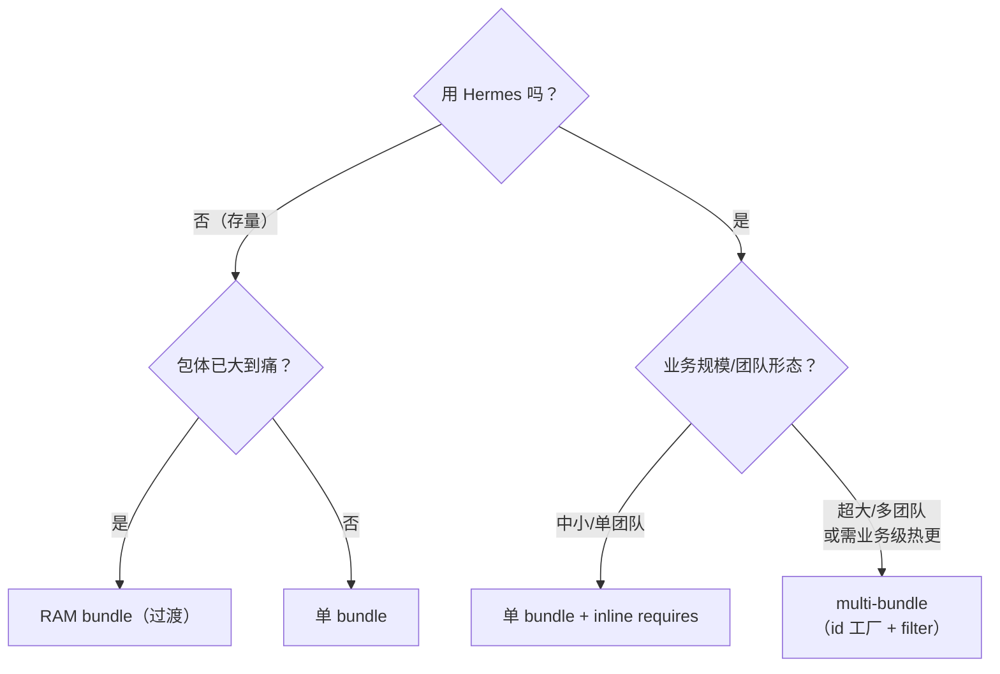

# Bundle 加载策略

> 模块二前两篇讲到"加载 Bundle、执行 JS"，本篇把**"加载"二字拆开**：dev 模式从哪来、prod 模式从哪读、大 App 怎么分包。加载策略直接决定启动耗时（04 篇）与热更新形态（模块八）。

## 1. dev 模式：向 Metro Server 要一个"活"的包

`npm start` 后，设备并不使用磁盘上的任何 bundle，而是**向 Metro 发 HTTP 请求**：

```
GET http://localhost:8081/index.bundle?platform=android&dev=true&minify=false&modulesOnly=false&runModule=true
```

要点：

1. **URL 即参数**：platform 决定平台后缀文件的解析（`.android.js`），dev 关闭压缩换取可调试，模块八会看到 Metro 三阶段如何消费这些参数；
2. **增量（delta）请求**：Metro 支持 delta bundle 格式——重新 reload 时只请求发生变化的模块，HMR 时更是只推单个模块的补丁；
3. 设备与 Metro 之间另有一条 **WebSocket**（日志、reload、HMR 消息），这是模块十调试链路的通道。



### 1.1 URL 参数速查

请求串里每个参数都在改变 Metro 的产出形态：

| 参数 | 作用 | 典型值 |
|------|------|--------|
| platform | 平台后缀文件解析（`.android.js`/`.ios.js`） | android / ios |
| dev | 关闭压缩、保留调试信息、注入 dev 工具 | true / false |
| minify | 是否压缩产物 | 通常随 dev 取反 |
| modulesOnly | 只出模块定义不出入口（组合拆分用） | false |
| runModule | 是否自动 require 入口 | true |
| bundleEntry / index | 入口文件 | index |

把这张表与 04 篇的"度量纪律"连起来：**dev=true 的请求产出的任何数字都不可用于性能决策**——它未压缩、带调试设施，与 release 是两个物种。

### 1.2 全量、delta 与 HMR：三种"要包"姿势

| 姿势 | 请求/推送内容 | 触发时机 |
|------|-------------|---------|
| 全量 | 完整 bundle | 首次加载 / 缓存失效 |
| delta | 只有变化的模块 | reload（带上基线版本信息） |
| HMR 补丁 | 单个模块的替换代码 | 文件保存（经 WebSocket 通道推送） |

delta 的价值在迭代节奏：改一个模块，reload 只需传输与执行变化部分——开发循环的提速不是"优化"，是 Metro 的默认能力（模块八 01 展开 Metro 侧的消费过程）。

### 1.3 真机连不上 Metro：排查顺序

dev 模式最常见的"启动失败"其实是网络问题，按序排查：

1. **手机与电脑是否同网段**：公司 Wi-Fi 常有客户端隔离，换热点验证；
2. **Android 用端口反射**：`adb reverse tcp:8081 tcp:8081`——让设备的 localhost:8081 指到电脑；
3. **iOS 模拟器**天然共享宿主网络，一般可达；真机同 1；
4. **Metro 是否真的在跑**：电脑浏览器先访问一次该 URL 自证；
5. **设备上的 dev server 设置**：摇一摇菜单里确认指向的地址端口正确。

排查顺序的原则：**先证连通，再查代码**——90% 的"bundle 加载失败"停在前两步。

### 1.4 WebSocket 通道上跑着什么

HTTP 之外那条 WebSocket 不是附属品，dev 体验的半条命都在上面（定性列举，细节随版本演进）：

| 消息方向 | 内容 | 服务于 |
|---------|------|--------|
| 设备 → Metro | console 日志、报错堆栈 | 终端里看到的 JS 日志 |
| Metro → 设备 | reload 指令（命令 R / 摇一摇触发） | 快速重载 |
| Metro → 设备 | HMR 补丁（单模块替换） | 保存即热更 |
| 双向 | 调试协议消息（断点/求值） | 模块十 04 的调试链路 |

理解这条通道的分工：**HTTP 负责"要一份产物"，WebSocket 负责"持续的会话"**——所以 Metro 挂了以后不只是"拿不到包"，日志、reload、HMR 全部静默，这也是判断"Metro 是否还活着"的观测面。

## 2. prod 模式：从 App 包内读一个"死"的文件

发布构建时 bundle 被打进 App 资产，启动时从**文件系统**读取：

| 平台 | 位置 | 读取代码（旧架构示例） |
|------|------|----------------------|
| Android | `assets/index.android.bundle` | `CatalystInstanceImpl.loadScriptFromAssets(...)` |
| iOS | App 主 bundle 内 `main.jsbundle` | `[RCTJavaScriptLoader loadBundleAtURL:]`（file URL） |
| Hermes | 同上，但文件是 **hbc 字节码** 而非源码 | 引擎直接映射字节码，跳过解析（模块三） |

源码定位：Android `ReactInstanceManager`/新版 `ReactHost` 的 `getJSMainModulePath` 链；iOS `RCTBundleURLProvider`。

**热更新的替换点就在这条链上**：把"读 assets"换成"读沙盒里下载的新文件"（CodePush 的 `getJSBundleFile()`、expo-updates 的数据库选包），详见模块八 02。

### 2.1 loader 代码走读：读一个文件要经过什么

以 Android 侧资产读取为骨架，看"读文件"这四个字背后的动作序列：

```java
// ReactInstanceManager / CatalystInstanceImpl 链（骨架示意）
JSBundleLoader assetLoader = JSBundleLoader.createAssetLoader(
    context, "assets/index.android.bundle", false);
// loadScript 时的内部动作（示意）：
// 1. AssetManager.open() 拿到输入流（可能经压缩存储）
// 2. 读入内存缓冲（或经 mmap 映射）
// 3. 交给 JS 执行器：JSC 读源码文本；Hermes 直接映射 hbc 字节码
```

三个成本点依次是：**打开与解压（IO）、拷贝（内存带宽）、解析/映射（CPU）**。Hermes 的优势落在第三点——字节码免解析直接映射（模块三 03 深拆）；而压缩存储（assets 的对齐方式）影响第一点——这就是"文件更小 → IO 更短"的朴素逻辑（04 篇手段表）。

### 2.2 iOS 侧走读：RCTJavaScriptLoader

iOS 的对应角色是 `RCTJavaScriptLoader`，输入是一个 URL——**URL 的 scheme 决定一切**：

| URL 形态 | 来源 | 读取路径 |
|---------|------|---------|
| `http://localhost:8081/...` | dev | Metro HTTP（同 1 节） |
| `file://...main.jsbundle` | prod | App 包内文件 |
| `file://.../Documents/...` | 热更新 | 沙盒下载文件（模块八 02） |

loader 内部同样是"取字节 → 交给执行器"的两段式，与 Android 骨架同构——平台差异集中在"从哪拿 URL"（`RCTBundleURLProvider` 负责按构建形态给出正确 URL）。**scheme 即策略**的设计让热更新接入在 iOS 侧也只需要"换一个 URL"，与 Android 的 loader 替换如出一辙。

### 2.3 从文件到引擎：读与执行的分工

`loadScript` 与其后的执行是两个世界（模块二 02 的 loadSource/executeSource 分界）：

| 阶段 | 产物 | 成本属性 |
|------|------|---------|
| 读取 | 内存里的字节（源码或 hbc） | IO 带宽 |
| 解析/映射 | 引擎可执行的内部表示 | CPU（hbc 近似为零） |
| 执行 | 模块登记 + 入口链跑起来 | CPU（依赖图决定） |

分包策略（第 3/4 节）的本质都是**在这三段里少付钱**：少读（按需）、少解析（懒执行）、少执行（入口链瘦身）。

## 3. 分包加载：multi-bundle

单 bundle 把所有业务打进一个文件，两个矛盾随之出现：

- **体积 ∝ 全部业务**：启动必须整包读取执行，哪怕首页只用到 5%；
- **更新粒度 = 全量**：改一行文案也要重发整个包。

multi-bundle 的做法是**公共包 + 业务包**：



工程要点：

1. **模块 id 必须跨包稳定**：多包共享同一个 JS 环境，`__d/__r` 的模块编号若各自从 0 编号会冲突——需要自定义 `createModuleIdFactory`（按"包名 + 相对路径"编号），见模块八 03；
2. **公共包先行**：业务包依赖的 React/RN 运行时必须已就位，否则 `__r` 找不到目标；
3. **加载即多一次"执行 bundle"**：本质是复用模块二 01/02 里的 `loadScript` 环节，只是触发时机推迟到路由切换。

### 3.1 模块 id 工厂：分包的第一块基石

Metro 的 `createModuleIdFactory` 决定每个模块的编号。单包时"从 0 递增"没问题；多包共享一个 JS 环境时必须全局稳定：

```js
// metro.config.js（骨架示意：按路径生成稳定 id）
module.exports = {
  serializer: {
    createModuleIdFactory() {
      return (path) => {
        // 以"包名 + 相对路径"为准的稳定编号（示意：哈希/映射表均可）
        return stableIdFor(path);   // 同一路径在任何包里得到同一 id
      };
    },
  },
};
```

要点不在具体算法，在**三条性质**：确定性（同路径同 id）、全局唯一（跨包不撞）、持久稳定（重打包不改旧 id——否则热更新的业务包与已装的公共包对不上号）。模块八 03 有完整配置走读。

### 3.2 怎么切出公共包：processModuleFilter

有了稳定 id，还要决定"哪些模块进哪个包"。Metro 的 `processModuleFilter` 是切分闸门：

```js
// metro.config.js（骨架示意）
serializer: {
  processModuleFilter(module) {
    // 打业务包时：公共模块返回 false（不进这个包）
    return !isCommonModule(module.path);
  },
}
```

典型切分产物：`common.bundle`（React/RN 运行时 + 公共业务组件）+ N 个业务 bundle（各自 filter 掉公共部分）。**切分清单要显式维护**——"什么算公共"是业务决策（团队边界、变更频率），不是工具能猜的。

### 3.3 业务包的加载：与冷启动同构

进入业务包时发生的动作，与模块二 01/02 的 bundle 环节完全同构：

| 步 | 动作 | 与冷启动的对应 |
|----|------|---------------|
| 1 | 路由命中，发起加载 | 点击图标（触发点不同） |
| 2 | 读文件/下载到内存 | loadScript 读取 |
| 3 | 引擎执行模块定义 | executeSource |
| 4 | `__r(业务入口)` | 入口 require |
| 5 | 组件渲染挂载 | runApplication 后的首帧 |

同构的含义：**冷启动优化的一切手段（字节码、懒执行）对业务包同样适用**；反过来，业务包加载慢的归因也与冷启动同一套方法论（04 篇分段）。

### 3.4 分包的工程账：什么时候值得做

multi-bundle 不是免费午餐，做决定前把两边的账都摆出来：

| 收益侧 | 成本侧 |
|--------|--------|
| 启动读取量 = 公共包 + 首页包（不是全量） | 自定义 id 工厂 + filter 的长期维护 |
| 业务包级热更（灰度/回滚粒度细） | 公共包接口变更 = 全量业务包联动回归 |
| 多团队并行发版（边界清晰） | "什么算公共"的边界治理（会随时间腐化） |
| 首页外的业务代码完全不占启动 | 路由层多一层"包加载中"的状态管理 |

经验性的判断线（定性）：

- 单团队、业务规模中小：**先 inline requires + hbc**，分包大概率是负优化；
- 多团队、强热更诉求、包体明显超重：分包的收益开始覆盖成本；
- 介于两者之间：先做"首页依赖集合审计"（04 篇③段）——如果首页本来就只依赖小集合，单 bundle 已经接近分包的启动收益。

## 4. RAM Bundle：单文件内的"分包"

## 4. RAM Bundle：单文件内的"分包"

不想拆多个文件时，还有**随机访问模块（RAM）格式**：序列化时把每个模块的**字节偏移量**写进文件头，加载时只解析文件头，**模块体按需 `require` 时才读取**。

- 与 multi-bundle 的区别：RAM 是"一个文件内的懒执行"，multi-bundle 是"多个文件的懒分发"；
- 与 Hermes 的关系：Hermes 字节码本身就是按函数表组织的，且配合 **inline requires**（延迟 require）能达到类似效果，因此 RAM 方案在新架构时代逐渐退场；
- 共同思想：**把"解析成本"从启动路径挪到首次访问路径**。

### 4.1 RAM 文件的形态

RAM bundle 的物理结构（形态描述，具体格式随版本）：

| 区块 | 内容 | 何时消费 |
|------|------|---------|
| 文件头 | 模块数量 + 每个模块的偏移量表 | 启动时解析（很小） |
| 模块体 N | 各模块的序列化代码 | 首次 `__r(id)` 时按偏移读取 |

配套还有"unbundle"式的散文件形态（一模块一文件 + 索引），思想相同：**索引常驻、正文按需**。这个"头索引 + 惰性正文"的模式在系统设计里到处可见（动态库的懒绑定、网页的懒加载脚本），RAM 只是它在 bundle 世界的实例。

RAM 与多包的混搭也是合法形态（索引文件按业务再拆），但每多一层自定义格式，工具链与排查成本就多一截——引入前先确认 3.4 节的工程账算得过来。

### 4.2 为什么 Hermes 时代 RAM 退场

三条理由叠加：

1. **收益被覆盖**：hbc 免解析 + mmap 随机访问，已经把"启动时的解析成本"打到很低——RAM 要解决的主体问题被釜底抽薪；
2. **配套更简单**：inline requires 是纯 JS/构建层开关（04 篇手段表），不需要自定义文件格式与加载协议；
3. **生态收敛**：新工具链与热更新设施围绕 hbc 建设，RAM 的维护成本失去分摊。

存量 App 里的 RAM 资产不必急着拆——按模块八 04 的成本收益节奏自然迁移即可。

## 5. 三种策略对照

| 策略 | 文件形态 | 启动读取量 | 更新粒度 | 适用 |
|------|---------|-----------|---------|------|
| 单 bundle + inline require | 一个 hbc | 全文件 + 懒执行模块体 | 全量 | 中小 App 默认 |
| RAM bundle | 一个索引文件 | 头部 + 按需模块体 | 全量 | 不用 Hermes 的存量 App |
| multi-bundle | 公共包 + N 业务包 | 公共包 + 首页包 | 业务包级 | 超大 App / 多团队 |

### 5.1 选型决策图



决策的关键不是"哪个更快"，而是**痛点在哪个维度**：启动读取量（前两者的战场）、更新粒度与团队边界（multi-bundle 的主场）。没有痛点的分包是负优化——多一层工程复杂度换不来对应收益（模块八 03/04 的工程账）。

再补一条"可以从单 bundle 开始"的安心剂：三种策略不是互斥的演进阶段——单 bundle + inline requires 的 App 后天要分包，迁移路径是平滑的（id 工厂可以后期引入，业务包可以逐个拆出）。**先简单后复杂**在这个领域没有沉没成本惩罚。

## 6. 与热更新的关系：替换点回顾

加载策略的尽头连着热更新——本篇的三种策略在热更新语境下各有含义：

| 策略 | 热更新替换点 | 说明 |
|------|-------------|------|
| 单 bundle | 把 loader 指向沙盒下载的新文件 | CodePush/expo-updates 的经典形态（模块八 02） |
| multi-bundle | 业务包级替换，公共包低频更新 | 更新粒度是分包的核心红利 |
| RAM/hbc | 整文件替换 | 格式不影响替换逻辑，只影响读取效率 |

热更新侧的完整性问题（签名、回滚、版本对齐——尤其 hbc 字节码版本必须与引擎版本匹配）在模块八 02/05 展开；本篇只需记住：**加载策略决定热更新的"替换单元"**。

版本对齐值得单独立一条军规：**hbc 字节码与 Hermes 引擎是版本耦合的**——用新工具链编译的字节码跑在旧引擎上（或反之）会直接执行失败。含义有二：

- 升级 RN（连带 Hermes 版本变化）后，历史热更新包全部失效风险要评估——OTA 系统需要"按引擎版本分发"的能力（模块八 05）；
- 排查"升级后启动即崩"时，"字节码版本错配"是高优先假设（第 7 节坑位表已收录）。

## 7. 常见坑清单

坑位表的阅读方式：**"现象"列对应你观察到的症状，"根因"列对应本篇某节的机制**——把症状映射回机制，处理动作自然浮现。这张表也适合当团队 FAQ 维护：每撞一个新坑补一行，半年后它就是你们的"加载策略排查手册"。

| 坑 | 现象 | 根因 | 处理 |
|----|------|------|------|
| dev 真机白屏"拿不到 bundle" | 报连接 Metro 失败 | 网络不通/端口不对 | 1.3 节排查顺序 |
| 自定义路径 release 读不到 | 壳正常但 JS 不执行 | 文件未打包/路径错 | 核对构建产物与 loader 路径 |
| 多包后模块互相覆盖/错乱 | 调到了错误的模块实现 | 模块 id 冲突 | 3.1 稳定 id 工厂 |
| 业务包加载报"找不到依赖" | `__r` 目标不存在 | 公共包未就绪/切分漏模块 | 3.2 filter 清单核对 |
| 升级后启动即崩（引擎相关） | 字节码无法执行 | hbc 版本与 Hermes 引擎不匹配 | 对齐生成与运行版本 |
| "分包后启动没变快" | 数据与预期不符 | 首页仍依赖大业务包 | 审计首页依赖集合（04 篇③段） |
| Metro "挂了"但不知情 | 日志/reload/HMR 全静默 | WebSocket 通道断开 | 1.4 节观测面；重启 Metro 验证 |

最后一行是分包最经典的失望：**分包只优化"非首页业务"的加载**——首页依赖集合没瘦身，启动读取量就没有质变（04 篇"必需集合最小化"是配套动作，不是可选项）。

坑位表的共同规律：加载策略类问题的根因几乎都在"配置与约定"（路径、id、版本），而不是运行时逻辑——所以排查从核对配置开始效率最高。

## 小结

- dev 从 Metro HTTP 拉活包（delta/HMR），prod 从资产读死文件——**热更新 = 把 prod 的读取点换到沙盒**；
- 分包的工程核心是**跨包模块 id 稳定**（自定义 module id 工厂）与**公共包先行**；
- 业务包的加载与冷启动的 bundle 环节同构：冷启动的一切手段（字节码、懒执行）与归因方法对业务包同样适用；
- RAM、inline requires、Hermes 字节码共享同一思想：**启动路径上只付"必需模块"的成本**——这也是 04 篇启动优化的理论基础。
- 读文件的三段成本（IO/拷贝/解析）分别对应三类手段：压缩与内联、mmap、hbc 字节码——归因时先分清在哪段付钱；
- 分包的选型依据是痛点维度（启动量 vs 更新粒度），不是绝对速度；没有痛点的分包是负优化；
- 从单 bundle 到 multi-bundle 的迁移路径平滑：id 工厂可后期引入、业务包可逐个拆——先简单后复杂无沉没成本。
- hbc 字节码与引擎版本耦合：升级 RN 时，OTA 按"引擎版本分发"与"字节码错配"排查是两条常备军规。

## 自测

先合上正文，把"三种策略对照表"和"选型决策图"凭记忆画一遍，再答题。

1. dev 请求 URL 里的每个参数各改变 Metro 产出的什么？为什么 dev=true 的数字不可用于优化决策？
2. delta 与 HMR 补丁的区别是什么？各自走哪条通道？
3. "读文件"的三段成本是什么？Hermes 在哪一段建立优势？
4. 为什么多包必须自定义 `createModuleIdFactory`？"稳定 id"要满足哪三条性质？
5. RAM 与 multi-bundle 的本质区别用一句话概括；RAM 退场的三条理由是什么？
6. "分包后启动没变快"——用"必需集合"概念解释原因，并给出配套动作。
7. 热更新在三种加载策略下的"替换单元"分别是什么？
8. iOS 侧"URL 的 scheme 决定一切"——三种 scheme 各对应什么来源？这与 Android 的 loader 替换为什么说是同构设计？
9. 分包的"收益侧/成本侧"账单各有四条——你的 App 当前更偏向哪一侧？判断依据是什么？
