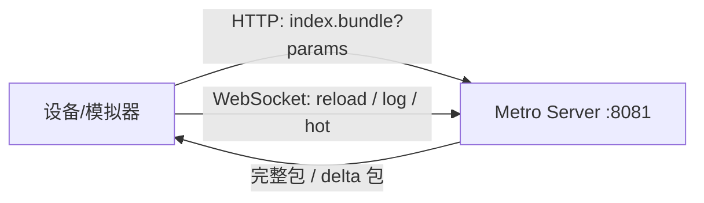
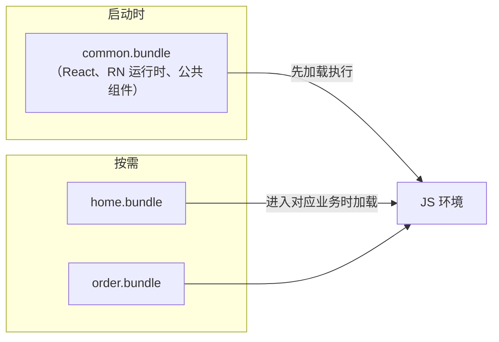

# Bundle 加载策略

> 模块二前两篇讲到"加载 Bundle、执行 JS"，本篇把**"加载"二字拆开**：dev 模式从哪来、prod 模式从哪读、大 App 怎么分包。加载策略直接决定启动耗时（04 篇）与热更新形态（模块八）。

## 1. dev 模式：向 Metro Server 要一个"活"的包

`npm start` 后，设备并不使用磁盘上的任何 bundle，而是**向 Metro 发 HTTP 请求**：

```
GET http://localhost:8081/index.bundle?platform=android&dev=true&minify=false&modulesOnly=false&runModule=true
```

要点：

1. **URL 即参数**：platform 决定平台后缀文件的解析（`.android.js`），dev 关闭压缩换取可调试，模块八会看到 Metro 三阶段如何消费这些参数；
2. **增量（delta）请求**：Metro 支持 delta bundle 格式——重新 reload 时只请求发生变化的模块，HMR 时更是只推单个模块的补丁；
3. 设备与 Metro 之间另有一条 **WebSocket**（日志、reload、HMR 消息），这是模块十调试链路的通道。



## 2. prod 模式：从 App 包内读一个"死"的文件

发布构建时 bundle 被打进 App 资产，启动时从**文件系统**读取：

| 平台 | 位置 | 读取代码（旧架构示例） |
|------|------|----------------------|
| Android | `assets/index.android.bundle` | `CatalystInstanceImpl.loadScriptFromAssets(...)` |
| iOS | App 主 bundle 内 `main.jsbundle` | `[RCTJavaScriptLoader loadBundleAtURL:]`（file URL） |
| Hermes | 同上，但文件是 **hbc 字节码** 而非源码 | 引擎直接映射字节码，跳过解析（模块三） |

源码定位：Android `ReactInstanceManager`/新版 `ReactHost` 的 `getJSMainModulePath` 链；iOS `RCTBundleURLProvider`。

**热更新的替换点就在这条链上**：把"读 assets"换成"读沙盒里下载的新文件"（CodePush 的 `getJSBundleFile()`、expo-updates 的数据库选包），详见模块八 02。

## 3. 分包加载：multi-bundle

单 bundle 把所有业务打进一个文件，两个矛盾随之出现：

- **体积 ∝ 全部业务**：启动必须整包读取执行，哪怕首页只用到 5%；
- **更新粒度 = 全量**：改一行文案也要重发整个包。

multi-bundle 的做法是**公共包 + 业务包**：



工程要点：

1. **模块 id 必须跨包稳定**：多包共享同一个 JS 环境，`__d/__r` 的模块编号若各自从 0 编号会冲突——需要自定义 `createModuleIdFactory`（按"包名 + 相对路径"编号），见模块八 03；
2. **公共包先行**：业务包依赖的 React/RN 运行时必须已就位，否则 `__r` 找不到目标；
3. **加载即多一次"执行 bundle"**：本质是复用模块二 01/02 里的 `loadScript` 环节，只是触发时机推迟到路由切换。

## 4. RAM Bundle：单文件内的"分包"

不想拆多个文件时，还有**随机访问模块（RAM）格式**：序列化时把每个模块的**字节偏移量**写进文件头，加载时只解析文件头，**模块体按需 `require` 时才读取**。

- 与 multi-bundle 的区别：RAM 是"一个文件内的懒执行"，multi-bundle 是"多个文件的懒分发"；
- 与 Hermes 的关系：Hermes 字节码本身就是按函数表组织的，且配合 **inline requires**（延迟 require）能达到类似效果，因此 RAM 方案在新架构时代逐渐退场；
- 共同思想：**把"解析成本"从启动路径挪到首次访问路径**。

## 5. 三种策略对照

| 策略 | 文件形态 | 启动读取量 | 更新粒度 | 适用 |
|------|---------|-----------|---------|------|
| 单 bundle + inline require | 一个 hbc | 全文件 + 懒执行模块体 | 全量 | 中小 App 默认 |
| RAM bundle | 一个索引文件 | 头部 + 按需模块体 | 全量 | 不用 Hermes 的存量 App |
| multi-bundle | 公共包 + N 业务包 | 公共包 + 首页包 | 业务包级 | 超大 App / 多团队 |

## 小结

- dev 从 Metro HTTP 拉活包（delta/HMR），prod 从资产读死文件——**热更新 = 把 prod 的读取点换到沙盒**；
- 分包的工程核心是**跨包模块 id 稳定**（自定义 module id 工厂）与**公共包先行**；
- RAM、inline requires、Hermes 字节码共享同一思想：**启动路径上只付"必需模块"的成本**——这也是 04 篇启动优化的理论基础。
