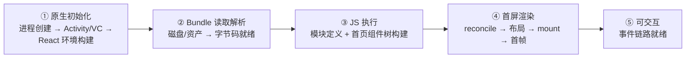
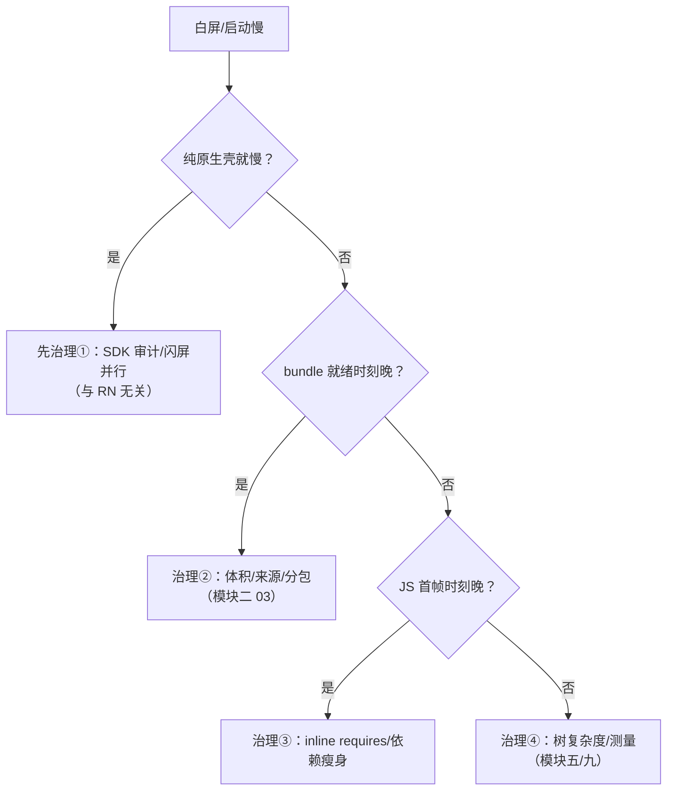
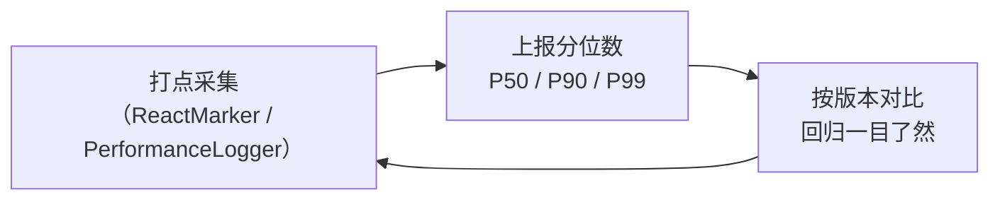

# 启动优化原理

> 启动优化不是技巧合集，是**对 TTI（Time To Interactive）的分段归因 + 逐段削减**。本篇给出分段模型、每段的原理化手段与度量方法——数字会过时，模型不会。

## 1. TTI 分段模型



关键认知：**五段是串行依赖，任何一段为零下限都是 0**。优化前先测量占比（第 4 节），最长的两段值得投入，其余先放下。

### 1.1 先把指标定义清楚

三个常被混用的词，先分家：

| 指标 | 定义 | 用户体感 |
|------|------|---------|
| 首帧（FP/FCP 类） | 第一帧内容上屏 | "看到东西了" |
| 可交互（TTI） | 首屏渲染完成 + 事件链路就绪 | "能点了" |
| 感知启动 | 用户主观觉得"快" | 骨架屏/启动图影响的那个 |

三者可以差很远：首帧亮了但 JS 还在跑长任务，点了没反应（TTI 远大于首帧）；首帧是骨架屏，"看着快"但真实加载没变（感知与真实分离）。**优化什么先说清指标，否则验收没有意义。**

### 1.2 五段与打点锚点的映射

五段模型要能落地到观测数据上——每一段都有平台侧的锚点可读（模块二 01/02 的打点表）：

| 段 | Android 锚点（ReactMarker） | iOS 锚点（RCTPerformanceLogger） |
|----|---------------------------|-------------------------------|
| ① 原生初始化 | 进程/Activity 时间戳（系统侧） | didFinishLaunching 前后（系统侧） |
| ① 后半（React 环境） | CREATE_REACT_CONTEXT / PROCESS_PACKAGES | RCTPLTagModuleSetup |
| ② 读取解析 | RUN_JS_BUNDLE 前半（loadScript） | RCTPLTagScriptLoad |
| ③ JS 执行 | RUN_JS_BUNDLE 后半 | RCTPLTagScriptExecute |
| ④ 首屏渲染 | CONTENT_APPEARED 类标记 | RCTPLTTI |
| ⑤ 可交互 | 自定义埋点（首个可交互事件） | 自定义埋点 |

映射表的意义：**分段模型不是示意图，是打点字段的分组方案**——段与段的比例就是从这些锚点求差得来的。

### 1.3 为什么是"串行依赖"

五段里多数段确实前后依赖（②依赖①的环境，③依赖②的字节），但有两处**可以并行化**的缝隙：

- ①的原生壳启动与部分初始化（SDK 等）可以并行/延后——不依赖 React 环境；
- ②的 bundle 读取可以与①的模块注册并行（新架构下注册趋零，这条缝隙价值下降但读取仍可预热）。

优化手段里的"并行化"（第 5 节）全部落在这两处缝隙上；其余手段都是"削减段本身"。

## 2. 逐段手段：每条都对应一篇原理

### ① 原生初始化

| 手段 | 原理 |
|------|------|
| Application 瘦身（少初始化 SDK） | 这段与 RN 无关，却常占大头；Deferred SDK init 是第一刀 |
| 预热 React 环境（Android `ReactHost` 预创建 / iOS 后台预 init bridge） | 把模块二 01/02 的"建上下文"挪到闪屏页背后 |
| 独立闪屏进程/Activity | 用系统级窗口先亮屏，争取并行时间 |

这段的第一刀永远是**砍**而不是"优化"：Application.onCreate 里的 SDK 逐个审计——哪些能延后到首帧后、哪些能懒初始化、哪些根本没在用。这一刀与 RN 无关，却是多数 App 最大的单笔收益。

### ② Bundle 读取解析

| 手段 | 原理 |
|------|------|
| Hermes 字节码 | 跳过 parse + 无 JIT 预热，模块三 03 深拆 |
| 内联 bundle（打包进原生资源而非二次下载） | 消除"下载"这个网络段 |
| RAM / multi-bundle / inline requires | 启动只付必需模块的解析成本，模块二 03 |
| 压缩与映射 | 文件更小 → IO 更短；hbc 支持 mmap 减少拷贝 |

### ③ JS 执行

| 手段 | 原理 |
|------|------|
| inline requires（`transform.inlineRequires: true`） | `require` 挪到使用处，首屏不执行用不到的模块顶层代码 |
| 首页依赖瘦身（moment/lodash 全量、顶层 import 图标库） | 模块二 03 的"必需集合"最小化 |
| 延迟非关键初始化（埋点、AB、推送） | 从启动路径移到 `InteractionManager.runAfterInteractions` 后（模块三 04） |

inline requires 的开启方式（构建层配置，示意）：

```js
// metro.config.js（节选：以项目实际模板为准）
module.exports = {
  transformer: {
    getTransformOptions: async () => ({
      transform: {
        experimentalRequiresSupport: true,
        inlineRequires: true,          // require 调用下沉到使用处
      },
    }),
  },
};
```

延迟初始化的标准姿势：

```js
// 非关键 SDK：等交互完成后再拉起
const { InteractionManager } = require('react-native');
InteractionManager.runAfterInteractions(() => {
  require('./sdk/analytics').init();   // 顶层 require 也一并延迟
});
```

### ④ 首屏渲染

| 手段 | 原理 |
|------|------|
| 首页组件树扁平化、拆掉重布局 | Yoga 计算量 ∝ 树复杂度（模块五 02） |
| 列表 `getItemLayout` / 首屏固定高度 | 免去"先渲染再测量"的二段布局（模块九 02） |
| 骨架屏占位 | 不减少真实 TTI，但改善**感知** TTI——感知与真实是两个指标 |

### 每段的"第一刀"

四段手段表信息量大，实操时按"第一刀"顺序出手：

| 段 | 第一刀 | 为什么是它 |
|----|--------|-----------|
| ① | Application.onCreate 的 SDK 审计 | 与 RN 无关却常占大头；砍掉的是纯浪费 |
| ② | 确认 Hermes 生效 | 一次配置的收益，覆盖整段解析成本 |
| ③ | 开 inline requires + 首页 import 审计 | 构建层开关 + 少量代码调整，性价比最高 |
| ④ | 首屏定高（列表/图片/轮播） | 消灭二段布局，通常是渲染段最大单点 |

"确认 Hermes 生效"值得强调：它是**配置而非优化**——但被构建配置/热更新链路悄悄退回 JSC 的情况并不少见，验证方式是看产物里是否有 hbc 文件、引擎加载日志指向 Hermes（模块三 03）。两端的开关位置：

```properties
# android/gradle.properties
hermesEnabled=true
```

```ruby
# ios/Podfile
use_react_native!(
  :path => config[:reactNativePath],
  :hermes_enabled => true
)
```

### 手段的模块溯源表

每条手段背后的原理篇目（复习地图）：

| 手段 | 原理出处 |
|------|---------|
| SDK 延后/闪屏并行 | 本篇 §1.3 串行缝隙 |
| Hermes 字节码/mmap | [模块三 03 · Hermes 深潜](../rn-JS引擎与线程模型/03-Hermes深潜：字节码与GC.md) |
| 分包/inline requires/RAM | [模块二 03 · Bundle 加载策略](03-Bundle加载策略.md) |
| runAfterInteractions | [模块三 04 · 同步与异步的边界](../rn-JS引擎与线程模型/04-同步与异步的边界.md) |
| 树扁平化/定高 | [模块五 02 · Yoga 布局引擎](../rn-渲染原理/02-Yoga布局引擎.md)、[模块九 02 · 列表虚拟化原理](../rn-性能优化原理/02-列表虚拟化原理.md) |
| 骨架屏 | 本篇 §5.1 感知优化 |
| 打点/预算 | 本篇 §4/§6 |

## 3. 一个常见误区：把"白屏"全归给 RN

白屏 = ①–④ 的总和，其中 ① 常被忽略。归因顺序应当是：

1. 用系统工具先看**纯原生启动**（不加载 JS 的壳）耗时——这是 RN 之外的地板；
2. 再看 bundle 就绪时刻、JS 首帧时刻的 gap（第 4 节打点）；
3. gap 落在哪段，用哪段的手段——**没有打点的启动优化都是猜**。

### 3.1 归因流程图



流程图的三岔结构对应三个量：**壳耗时、就绪 gap、首帧 gap**——每个量都有第 1.2 节的锚点可测，整个归因过程不需要任何猜测。

## 4. 度量：不打点就没有优化

### Android：ReactMarker

`ReactMarkerConstants` 定义了全程锚点（`CONTENT_LOADING_START` → `RUN_APPLICATION_START` → `CONTENT_APPEARED`…），实现 `ReactMarkerListener` 注册即可拿到每段耗时。

```java
// Application.onCreate 早期注册（骨架示意）
ReactMarker.setMarkerListener(new ReactMarkerListener() {
  @Override
  public void logMarker(String name, int instanceKey) {
    StartupTrace.record(name, SystemClock.elapsedRealtime());
  }
});
```

### iOS：RCTPerformanceLogger

`RCTPerformanceLogger` 维护各阶段时间戳（`RCTPLBundleDownload`、`RCTPLScriptExecution`、`RCTPLTTI`…），通过 `RCTPerfStats` 或桥接方法导出。

### 工程化建议



- **只在 release 模式下采数**：dev 的 Metro 请求、未压缩代码、dev 工具注入都会把数字放大数倍；
- 关心 **P90 而非均值**：低端机的长尾才是用户流失处；
- 把五段耗时随版本入库，任何"启动变慢了"都能定位到段。

### 4.1 采集的三条纪律展开

| 纪律 | 为什么 | 违反的典型后果 |
|------|--------|---------------|
| release 采数 | dev 与 release 是两个物种（模块二 01/02 差异表） | 按 dev 数字优化，上线无效 |
| 看分位数 | 均值被高端机拉平，掩盖长尾 | "平均值没问题"但低端机流失 |
| 版本入库对比 | 启动回归是渐进的，肉眼发现时已积累数个版本 | 回归定位不到引入版本，排查成本翻倍 |

第三条展开成动作：每个版本发布后自动拉取该版本的分段分位数，与上一版本 diff——**任何一段的显著劣化都触发复查**，把"启动变慢"从用户投诉变成 CI 预警（第 6 节）。

### 4.2 上报字段的最小集

把打点变成数据资产，需要的字段不多：

| 字段 | 说明 |
|------|------|
| 版本 / 构建号 | 对比基准 |
| 设备档位（内存/SoC 代际） | 分位数分层的维度 |
| 冷/热启动 | 两种启动是两个指标（模块二 01） |
| 五段耗时 | 归因的主体 |
| 是否首装（首次 vs 升级） | 首装常有额外初始化 |

字段设计的原则：**能归因、能分层、能对比**——多于这三个用途的字段都是存储浪费。

## 5. 感知优化与并行化：两个补充手段族

分段削减之外，还有两族手段值得单列——它们不改变真实分段，或者改变的是分段间的连接方式。

### 5.1 感知优化：管理"等待的体感"

| 手段 | 机制 | 边界 |
|------|------|------|
| 系统启动画面/Splash 保持 | 平台级启动图与首帧无缝衔接（Android 12 起系统强制默认启动画面，自定义要沿新 API 做） | 只是遮盖，不减少任何一段 |
| 骨架屏 | 用低成本占位组件先上屏 | 首帧成本转嫁给骨架本身，别把骨架做重 |
| 首屏静态化/占位图 | 首帧渲染极简结构，内容异步填充 | 注意内容跳变（布局稳定性） |

感知优化的记账纪律（第 1.1 节的延伸）：**感知指标与真实指标分开报表**——骨架屏让"看着快"提升，TTI 分毫未动；把感知收益冒充真实收益，会在复盘时误导后续投入方向。

### 5.2 并行化：利用串行链的缝隙

| 手段 | 落在哪条缝隙 | 做法 |
|------|-------------|------|
| 闪屏期预热 React 环境 | ①内部的并行 | 壳先亮屏，环境构建藏在其后（模块二 01 的预热手段） |
| bundle 预读取 | ①与②的并行 | 壳启动的同时开始读 bundle 字节 |
| 首页数据预取 | ③与网络的并行 | 原生侧在 JS 启动前先发首页请求，JS 就绪后直接消费 |

并行化的统一思想：**串行链上任何"不真正依赖前序"的工作都该挪进缝隙**。识别缝隙的判据很简单——问"这件事真的需要等前一步完成才能开始吗？"多数情况下答案是否。

### 5.3 落地排序的推演：同样一堆手段，先做谁

手段清单不长，但落地顺序错了会白做。推演一个典型 App（Hermes 未开、无分包、首页 20 个初始化）的手段排序：

| 顺位 | 手段 | 为什么排这里 | 排错的后果 |
|------|------|-------------|-----------|
| 1 | 采集设施（第 4 节） | 没有分位数就没有"改了多少"的裁决权 | 后面所有手段做完都无法证明收益，复盘靠感觉 |
| 2 | 砍启动路径外初始化 | 零技术风险、常砍掉最大一段；不动架构 | 先做精细优化会把"垃圾初始化"的时间也优化出花来 |
| 3 | Hermes | 编译期一次性收益，覆盖 ②③ | 排太晚：inline requires 的收益在解释器上被稀释 |
| 4 | inline requires | 依赖 Hermes（字节码惰性加载语义） | 在 JSC 上收益小且难度量 |
| 5 | 首页数据预取 | 依赖③段已缩短（否则 JS 就绪前请求已返回，白预取） | 过早做：预取窗口与缩短后的③段错位 |
| 6 | 骨架屏 | 最后做：它是"剩余时间的遮盖"，先做会把慢遮住、失去优化动力 | 先做：感知"变快"后真实优化被砍排期 |

排序的统一判据：**先做"不改变其他手段收益"的，后做"改变其他手段收益"的**。采集设施是裁决器，垃圾初始化是背景噪声——都要先清场，精细手段才能量得准。

最后一个推论：这张表解释了为什么"启动优化专项"经常虎头蛇尾——团队从骨架屏入手（最容易出 demo），感知收益让专项提前宣告成功，而真实 TTI 几乎没动。把本表贴在专项 kickoff 文档第一页，比任何口号都管用。

## 6. 防回归：性能预算与 CI

优化做完不是终点，守住才是：

| 机制 | 做法 | 触发动作 |
|------|------|---------|
| 性能预算 | 给五段（或总 TTI 的 P90）定阈值 | 超预算的版本不允许出分支 |
| 版本对比任务 | CI 拉新版本的启动分位数与上一版 diff | 显著劣化触发复查（定位引入 PR） |
| 关键路径守卫 | 冒烟用例校验"首屏可交互"时延上限 | 回归挡在发布前 |

三个机制共用第 4 节的采集设施——**度量管道建好了，防回归只是加一个判断**。这也是"先度量后优化"顺序的另一半理由：没有管道的优化，做完就又飘走了。

### 6.1 预算怎么定：示例与反模式

预算不是拍一个总数字，而是按五段分账。示例（口径：TTI P90，版本入库基线）：

| 分段 | 预算 | 定依据 |
|------|------|--------|
| ① 原生初始化 | ≤ 400ms | 壳Application的内容，与 RN 无关的基线 |
| ② 读取解析 | ≤ 150ms | Hermes 字节码 mmap 后基本稳定 |
| ③ JS 执行 | ≤ 600ms | inline requires 落地后的合理档位 |
| ④ 首屏渲染 | ≤ 300ms | 首屏组件数 × 单组件挂载成本 |
| ⑤ 可交互 | ≤ 200ms | 首帧后到按钮可点的余量 |

三条反模式（对照 5.3 的排序教训）：

| 反模式 | 症状 | 纠正 |
|--------|------|------|
| 只锁总 TTI | 某段劣化被另一段"改善"掩盖，定位靠猜 | 按段分账，总账只是底线 |
| 预算按当前值加 10% | 把历史欠债固化成合法基线 | 预算来自手段落位后的推演值（5.3 的表） |
| 超预算就回滚版本 | 团队学会绕开 CI 而不是修问题 | 超预算触发定位复查（归因到段→PR），回滚是最后手段 |
| 预算只测旗舰机 | 中低端机超预算数倍，问题在灰度后才暴露 | 预算按"设备分位"各设一档，至少锁定中位与低位机型 |

## 小结

- TTI 五段模型（原生初始化 / 读取解析 / JS 执行 / 首屏渲染 / 可交互）是归因的坐标系，每段手段都能落回本站对应模块；
- 最有效的三件事通常依次是：**砍启动路径外的初始化、用 Hermes + inline requires 缩 ②③、打点防回归**；
- 感知优化（骨架屏）与真实优化（分段削减）分开记账，度量永远先于手段。
- 归因流程三岔（壳耗时/就绪 gap/首帧 gap）全部有锚点可测——白屏排查不需要猜测；
- 并行化只落在两处真缝隙（①内部、①②之间），识别判据是"真的依赖前序吗"；
- 性能预算 + 版本对比把启动质量变成 CI 约束，优化成果才守得住。

## 自测

1. 首帧、TTI、感知启动三个指标分别定义什么？骨架屏改善哪个、不改善哪个？
2. 五段模型各自对应哪些打点锚点（Android/iOS 各说两个）？"分段模型是打点字段的分组方案"怎么理解？
3. 归因流程图的三个量是什么？分别排除哪一段的问题？
4. inline requires 与延迟初始化各作用于哪一段？两者的配置/写法是什么？
5. 为什么"release 采数、看 P90、版本入库"三条纪律缺一不可？各自违反的后果是什么？
6. 并行化手段只可能落在哪两处缝隙？判据是什么？
7. "分包后启动没变快"（模块二 03 的坑）用本篇哪个概念解释？配套动作是什么？
8. 性能预算机制依赖哪条前置设施？这如何反过来论证"先度量后优化"的顺序？
9. 5.3 的排序表里，Hermes 排在砍初始化之后、inline requires 之前——把 3 和 4 对调会怎样？给出推演链。
10. "骨架屏最后做"的推演依据是什么？如果产品要求第一周就上骨架屏，你如何设置补偿措施保住真实优化的排期？
11. 版本对比任务发现 TTI P90 劣化 12%，如何用五段模型的分段数据把嫌疑范围缩小到一段？（提示：每段的锚点是独立打点的）
12. 把你项目的启动手段按 5.3 的判据重新排序：哪一项你现在做的位置和推演建议不一致？代价是什么？
13. 6.1 的分账表里，①段预算为什么可以定得比②~⑤宽松？它劣化时该找谁负责（提示：这一段与 RN 无关）？
14. "超预算触发定位复查而非直接回滚"——复查找什么？用什么数据把嫌疑缩小到一个 PR？
15. 6.1 的"预算只测旗舰机"反模式为什么特别容易漏？它与"release 采数"纪律的哪个盲区同源？
16. 若产品要求"首屏 500ms 内可看"，你如何用五段模型拆解这个需求、并判断它该归入哪个分段的目标？
17. "先度量后优化"在预算机制之外还有一个隐含收益：分位数数据本身就是团队向上争取排期的证据——用 5.3 排序表里的某一格举例说明怎么用。
18. 把 5.3 排序表、6.1 分账表、6 反模式表合成一张"启动专项 kickoff 检查单"：三张表各贡献哪几栏？
