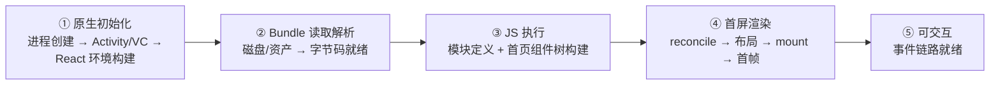
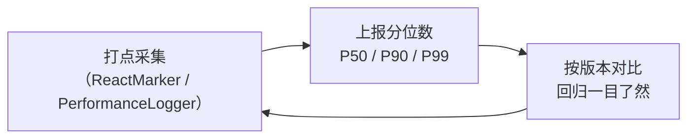

# 启动优化原理

> 启动优化不是技巧合集，是**对 TTI（Time To Interactive）的分段归因 + 逐段削减**。本篇给出分段模型、每段的原理化手段与度量方法——数字会过时，模型不会。

## 1. TTI 分段模型

关键认知：**五段是串行依赖，任何一段为零下限都是 0**。优化前先测量占比（第 4 节），最长的两段值得投入，其余先放下。

## 2. 逐段手段：每条都对应一篇原理

### ① 原生初始化

| 手段 | 原理 |
|------|------|
| Application 瘦身（少初始化 SDK） | 这段与 RN 无关，却常占大头；Deferred SDK init 是第一刀 |
| 预热 React 环境（Android `ReactHost` 预创建 / iOS 后台预 init bridge） | 把模块二 01/02 的"建上下文"挪到闪屏页背后 |
| 独立闪屏进程/Activity | 用系统级窗口先亮屏，争取并行时间 |

### ② Bundle 读取解析

| 手段 | 原理 |
|------|------|
| Hermes 字节码 | 跳过 parse + 无 JIT 预热，模块三 03 深拆 |
| 内联 bundle（打包进原生资源而非二次下载） | 消除"下载"这个网络段 |
| RAM / multi-bundle / inline requires | 启动只付必需模块的解析成本，模块二 03 |
| 压缩与映射 | 文件更小 → IO 更短；hbc 支持 mmap 减少拷贝 |

### ③ JS 执行

| 手段 | 原理 |
|------|------|
| inline requires（`transform.inlineRequires: true`） | `require` 挪到使用处，首屏不执行用不到的模块顶层代码 |
| 首页依赖瘦身（moment/lodash 全量、顶层 import 图标库） | 模块二 03 的"必需集合"最小化 |
| 延迟非关键初始化（埋点、AB、推送） | 从启动路径移到 `InteractionManager.runAfterInteractions` 后（模块三 04） |

### ④ 首屏渲染

| 手段 | 原理 |
|------|------|
| 首页组件树扁平化、拆掉重布局 | Yoga 计算量 ∝ 树复杂度（模块五 02） |
| 列表 `getItemLayout` / 首屏固定高度 | 免去"先渲染再测量"的二段布局（模块九 02） |
| 骨架屏占位 | 不减少真实 TTI，但改善**感知** TTI——感知与真实是两个指标 |

## 3. 一个常见误区：把"白屏"全归给 RN

白屏 = ①–④ 的总和，其中 ① 常被忽略。归因顺序应当是：

1. 用系统工具先看**纯原生启动**（不加载 JS 的壳）耗时——这是 RN 之外的地板；
2. 再看 bundle 就绪时刻、JS 首帧时刻的 gap（第 4 节打点）；
3. gap 落在哪段，用哪段的手段——**没有打点的启动优化都是猜**。

## 4. 度量：不打点就没有优化

### Android：ReactMarker

`ReactMarkerConstants` 定义了全程锚点（`CONTENT_LOADING_START` → `RUN_APPLICATION_START` → `CONTENT_APPEARED`…），实现 `ReactMarkerListener` 注册即可拿到每段耗时。

### iOS：RCTPerformanceLogger

`RCTPerformanceLogger` 维护各阶段时间戳（`RCTPLBundleDownload`、`RCTPLScriptExecution`、`RCTPLTTI`…），通过 `RCTPerfStats` 或桥接方法导出。

### 工程化建议

- **只在 release 模式下采数**：dev 的 Metro 请求、未压缩代码、dev 工具注入都会把数字放大数倍；
- 关心 **P90 而非均值**：低端机的长尾才是用户流失处；
- 把五段耗时随版本入库，任何"启动变慢了"都能定位到段。

## 小结

- TTI 五段模型（原生初始化 / 读取解析 / JS 执行 / 首屏渲染 / 可交互）是归因的坐标系，每段手段都能落回本站对应模块；
- 最有效的三件事通常依次是：**砍启动路径外的初始化、用 Hermes + inline requires 缩 ②③、打点防回归**；
- 感知优化（骨架屏）与真实优化（分段削减）分开记账，度量永远先于手段。
