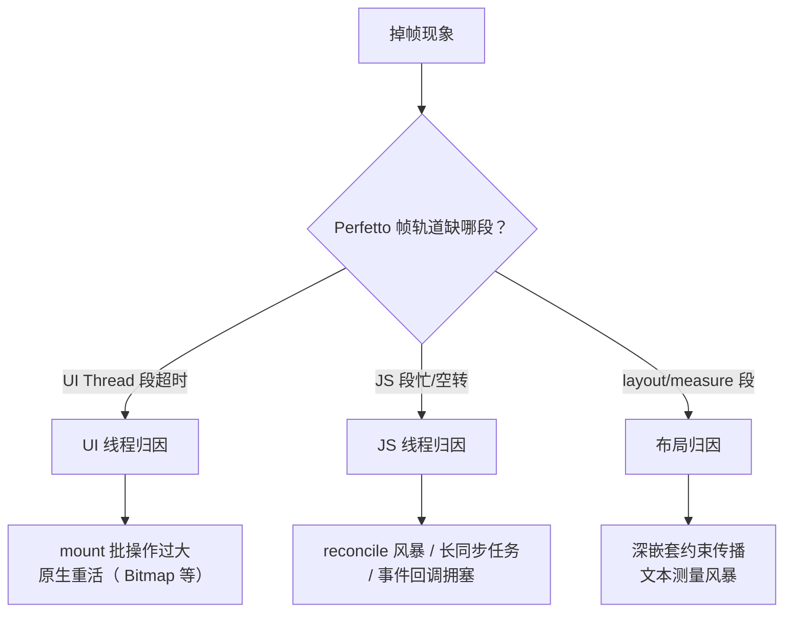
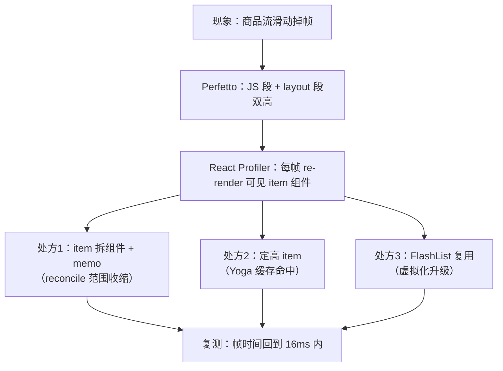

# 性能定位方法论

> 性能优化不是技巧清单，是归因流程。本篇给一个可复用的三步法：**先定位现象 → 再归因线程 → 最后对症下药**，并配齐每一步的工具矩阵。

## 1. 第一步：把"卡"翻译成可度量的现象

| 体感 | 度量指标 | 工具 |
|------|---------|------|
| 掉帧/滑动不跟手 | FPS、帧耗时分布 | Perfetto（Android）/ Instruments（iOS）/ RN 内置 FPS monitor |
| 点了没反应 | 交互延迟（TTI of tap） | Perfetto 事件段 + React Profiler commit 时间 |
| 启动慢 | TTI（模块二打点） | ReactMarker / RCTPerformanceLogger |
| 越用越卡 | 内存曲线 | Android Studio Profiler / Xcode Memory Graph |

**纪律**：先度量再优化。没有数字的优化是玄学，有数字的优化是工程。

## 2. 第二步：归因到线程（核心步骤）

帧预算 16.7ms（60fps）。掉帧时问一句：**这段时间哪条线程在忙？**（模块三的四线程模型在这里兑现价值）

三类归因的典型处方（先记住方向，细节在后续篇目）：

- **UI 线程**：mount 批太大 → 拆帧提交；原生绘制重 → 图片解码尺寸、过度重绘；
- **JS 线程**：reconcile 风暴 → 拆状态、memo、下移状态；长任务 → 切片（InteractionManager/startTransition）或下沉原生；
- **布局**：嵌套过深 → 扁平化；列表 item 布局抖动 → 定高/复用（模块九第 2 篇）。

## 3. 工具矩阵：每把枪打什么靶

| 工具 | 归因对象 | 关键用法 |
|------|---------|---------|
| **Perfetto / systrace**（Android） | 线程级帧分析 | 抓 5–10s 滑动场景，看 `ReactNativeJS`、`mqt_native_modules`、`RenderThread` 各段 |
| **Instruments**（iOS） | 同上 + 渲染 | Time Profiler + Core Animation FPS |
| **React DevTools Profiler** | 组件级渲染次数与耗时 | "Highlight updates" 看 re-render 范围；commit 时间轴对照用户操作 |
| **Hermes Sampling Profiler** | JS 函数级 CPU | dev 菜单 → Sampling Profiler → `.cpuprofile` 拖进 Chrome DevTools |
| **Flipper / 原生内存工具** | 内存与泄漏 | Memory 图谱、Heap 快照（JS 侧 `chrome://inspect`） |
| **内建 Perf Monitor** | 快速体感校验 | dev 挪出常驻（本机开销会污染数据） |

> 排查顺序建议：Perfetto 定线程 → React Profiler 定组件 → Hermes Profiler 定函数。三级放大，不要跳步。

## 4. 一个完整案例：长列表滑动掉帧

注意流程闭环：**每个处方都要有复测数字**。如果处方 1 后 JS 段仍高，回 React Profiler 找漏网的 re-render（常见漏因：context 值未 memo）。

## 5. RN 特有的性能暗坑速查

1. **匿名内联对象/函数 props**：每次 render 新引用 → 子树 diff 全量跑（尽管消息层有第二道保险，reconcile 成本仍在）；
2. **onScroll 高频 setState**：每帧过桥 + reconcile；先 `scrollEventThrottle`（iOS），再考虑 `onScrollEndDrag/onMomentumScrollEnd` 降频；
3. **大图未降采样**：解码内存与主线程 Bitmap 上传是 UI 线程大户；
4. **dev 与 prod 差异**：dev 的告警、未压缩代码会让问题失真——**结论必须用 release 验证**；
5. **新架构的预期差**：Fabric 提升高频小更新，对"重 JS 计算列表"帮助有限——归因没做好时，换架构不是银弹。

## 6. 方法论收束

1. **现象 → 数字**：FPS / TTI / 内存，先有基线；
2. **数字 → 线程**：Perfetto 三色归因（UI/JS/Layout）；
3. **线程 → 代码**：Profiler 两级放大（组件 → 函数）；
4. **处方 → 复测**：每个改动都有前后对照。

这套流程对任何 RN 性能问题成立——本模块后续篇目（列表虚拟化、渲染与状态、内存）都是它的具体展开。

## 小结

- 性能优化 = 归因流程：度量 → 线程 → 组件 → 函数 → 复测，五步闭环。
- 工具矩阵各司其职：Perfetto 管线程、React Profiler 管组件、Hermes Profiler 管函数。
- 警惕 RN 特有暗坑：内联 props、onScroll 风暴、大图解码、dev/prod 失真。
