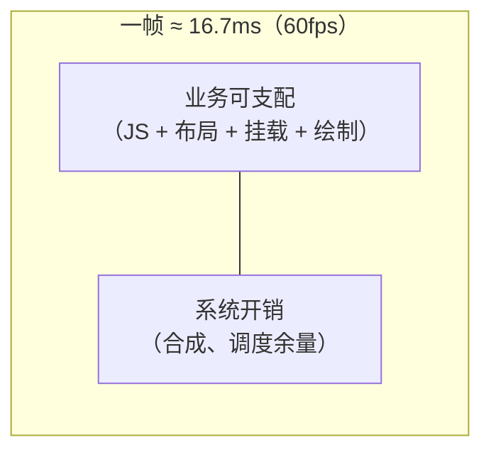
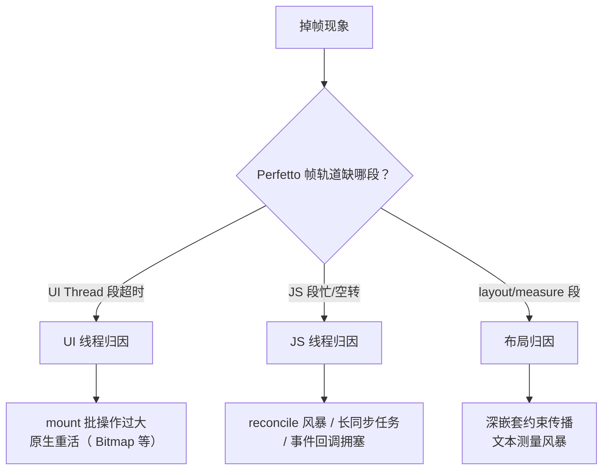
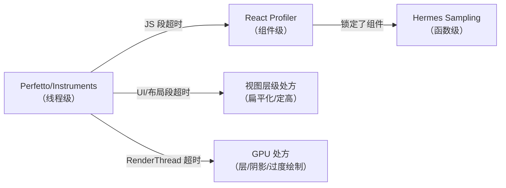
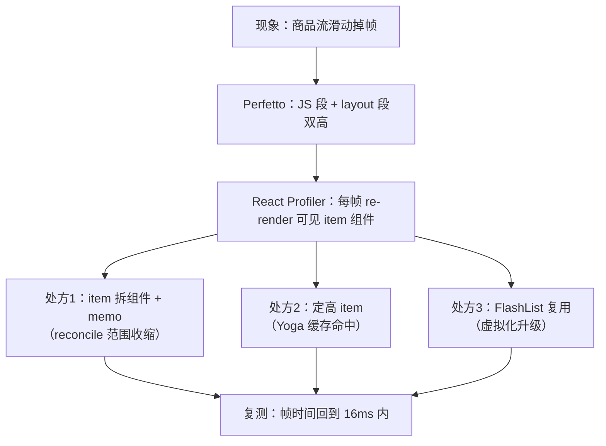
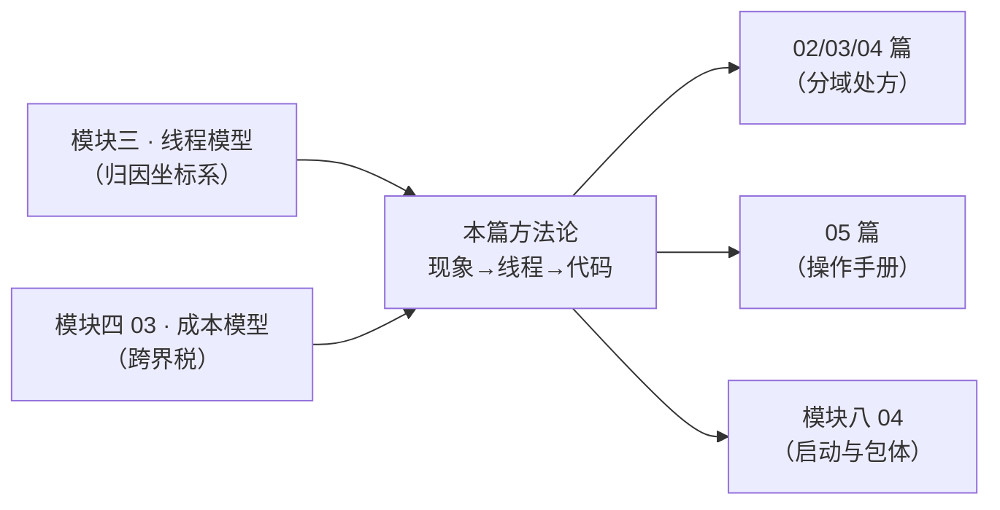

# 性能定位方法论

> 性能优化不是技巧清单，是归因流程。本篇给一个可复用的三步法：**先定位现象 → 再归因线程 → 最后对症下药**，并配齐每一步的工具矩阵。

本篇是模块九的入口，也是整个站的性能总纲：线程归因的底层模型来自[模块三 · 四线程模型](../rn-JS引擎与线程模型/02-四线程模型.md)，操作层面的采集与读法在[05 篇 · 性能剖析操作手册](05-性能剖析操作手册.md)逐条展开——本篇先立骨架与纪律。

## 1. 第一步：把"卡"翻译成可度量的现象

| 体感 | 度量指标 | 工具 |
|------|---------|------|
| 掉帧/滑动不跟手 | FPS、帧耗时分布 | Perfetto（Android）/ Instruments（iOS）/ RN 内置 FPS monitor |
| 点了没反应 | 交互延迟（TTI of tap） | Perfetto 事件段 + React Profiler commit 时间 |
| 启动慢 | TTI（模块二打点） | ReactMarker / RCTPerformanceLogger |
| 越用越卡 | 内存曲线 | Android Studio Profiler / Xcode Memory Graph |

**纪律**：先度量再优化。没有数字的优化是玄学，有数字的优化是工程。

### 1.1 指标先定义清楚，再谈采集

上表四个指标每个都有"看起来会量、实际量错"的坑，先钉死定义：

| 指标 | 正确定义 | 常见误用 |
|------|---------|---------|
| FPS / 帧耗时 | **逐帧耗时分布**（多少帧超 16.7ms、超多少、连续还是散点）才是归因原料 | 只看平均 FPS——若干帧卡很久 + 其余飞快，平均值可能"及格"，体感却是明显顿挫 |
| 交互延迟 | 从 touch 事件进入系统，到对应视觉变化上屏的端到端时长 | 只量 JS handler 执行时长——前后还有事件下行与 commit 上行两段（模块三 02 数过这条链的跳数） |
| 启动 TTI | 进程创建 → 首屏内容**可交互**（不只是"看到画面"） | 用"首帧出现"冒充 TTI——首帧可能是启动图/骨架屏，可交互才是用户被服务的时刻（模块二 04 的五段拆解） |
| 内存曲线 | **长时间会话**的进程内存走势（进出页面、滚动、播放） | 只看冷启动后静止值——泄漏与位图堆积恰恰要靠"操作序列"暴露（[04 篇](04-内存与稳定性.md)的长会话压测） |

一句总纲：**度量的是分布与走势，不是单点快照**。掉帧看分布（哪些帧超了），内存看走势（锯齿还是爬升），启动看分段（哪一段占大头）。

### 1.2 帧预算的算术

60fps 的预算来自显示器的物理节拍：每秒 60 个 vsync，均摊每帧约 16.7ms。这笔预算不是全部归你——一帧里还要跑系统合成、输入分发、别的工作：



两个推论：

1. **预算随刷新率收紧**：高刷新率屏幕（90/120Hz）的帧预算按比例缩小——在中端机 60fps 之下刚好够用的代码，放到高刷屏上就超支。采集时确认设备的实际刷新率，别把"高刷屏上的 60fps 跑不满"误判为代码劣化；
2. **偶尔超一帧 vs 连续超多帧是两种病**：前者常见于 GC、批量挂载这类"脉冲"（可以削峰），后者是结构性超支（要做减法）。分布形态决定处方形态——这也是为什么 1.1 强调逐帧分布。

### 1.3 基线：优化前先给现状画像

"复测要有对照"的前提是优化前就有基线。基线采集协议四条：

1. **设备档位固定**：至少分旗舰与低端两档——很多问题（GC 压力、位图解码）只在低端机显形（04 篇的 OOM 复现配方）；
2. **场景脚本化**：同一份操作序列（进哪个页、滑几下、停多久），保证前后可比——这也是 05 篇采集纪律的前半条；
3. **多轮取模式**：单次数据有调度噪声，看"复现的模式"而不是"最好的一次"；
4. **记录环境**：系统版本、电量/省电模式、温度状态（过热降频会让同一设备前后两轮不可比——05 篇的坑清单里专门列了温控）。

基线的产出物是一张小表：指标（分布/分段）× 场景 × 设备档位。之后每个处方对着这张表复测，优化才可累积。没有基线的优化是**不可证伪**的——"感觉快了"和"真的快了"从此再也分不开。

## 2. 第二步：归因到线程（核心步骤）

帧预算 16.7ms（60fps）。掉帧时问一句：**这段时间哪条线程在忙？**（模块三的四线程模型在这里兑现价值）



三类归因的典型处方（先记住方向，细节在后续篇目）：

- **UI 线程**：mount 批太大 → 拆帧提交；原生绘制重 → 图片解码尺寸、过度重绘；
- **JS 线程**：reconcile 风暴 → 拆状态、memo、下移状态；长任务 → 切片（InteractionManager/startTransition）或下沉原生；
- **布局**：嵌套过深 → 扁平化；列表 item 布局抖动 → 定高/复用（模块九第 2 篇）。

### 2.1 三类归因的证据与第一反应

把上面的处方表反过来看——归因时你手里只有 trace，先认证据再开处方：

| 归因 | trace 上的典型证据 | 第一反应处方 | 容易误判成 |
|------|------------------|-------------|-----------|
| UI 线程 | 主线程 doFrame 段超时，内部是 measure/layout/draw 或成串的 View 操作 | 查视图层级深度与新增视图数量（05 篇的切片读法） | "JS 慢"——因为 JS 段同时也在忙，其实是 JS 制造了 mount 风暴 |
| JS 线程 | JS 泳道连续高密度活跃，内部是 reconcile/业务函数 | 进 React Profiler 与 Hermes profile 两级放大（05 篇 2/3 节） | "原生卡"——用户体感是滑动掉帧，但根因在 JS |
| 布局 | layout/measure 切片反复出现、耗时随嵌套放大 | 扁平化层级、列表定高（[02 篇](02-列表虚拟化原理.md) getItemLayout） | "渲染慢"——Yoga 计算不发生在 UI 线程，别在主线程段里找 |
| GPU/绘制 | RenderThread 段超时 | 查过度绘制、阴影、离屏层（原生侧手段） | 前三类——归因时别漏了第四条泳道 |

注意最后加的第四行：**RenderThread 也是一色**。Android 上 RenderThread 泳道超时指向 GPU 压力（层、阴影、过度绘制），处方落在原生渲染侧，与前三类的 JS/视图手段完全不同。

归因还有一条经常被忽略的排除法：**先确认不是环境噪声**。CPU 降频（trace 里看 freq 轨道）、后台同步任务、模拟器本身的宿主负载，都会造成"全线皆忙"的假象——05 篇 0 节的采集纪律（release 构建、多轮复现）就是为排掉这些噪声设的。

### 2.2 "点了没反应"的专门归因

交互延迟是一条**闭环**，不是单点（模块四 03 的闭环模型）：


链条上任何一环忙都会表现为"没反应"，归因顺序：

1. **JS 线程是否被占**：长任务（大计算、同步 JSON、深递归）排队了触摸事件——trace 上 JS 段在事件到达时刻仍在跑上一件事；
2. **事件下行是否拥塞**：旧架构下高频事件（onScroll 无节流）把队列塞满，新点击排在后面；
3. **commit 是否被推迟**：setState 已执行但批量刷队还没到时机——这属于"底数"而非故障（模块三 02：一次交互端到端天然有 1–2 帧底数）；
4. **是"慢"还是"没收到"**：手势被原生层拦截/仲裁掉了（模块六 01/02），那就不是性能问题而是事件归属问题。

区分 3 和 1 很重要：前者是架构时序的正常成本，后者才是要修的病。把正常底数当病修，就会得出"RN 天生卡"的错误结论——新架构把部分等待点消掉（模块七 05 的对照表），但没有人把物理延迟消成零。

### 2.3 多线程同超时：找因果起点

真实 trace 常见 JS 段、布局段、UI 段**同时**超时——这不是三合并发，是一条因果链的三段投影：JS 决定新建/更新视图 → 布局跟随计算 → UI 线程执行挂载。判别方法是**跨线程弧线**（Perfetto slice 上的箭头）与时间先后：谁先忙、谁的忙引发了谁的忙。

一般规律：**起点在事件源，终点在渲染**。滚动场景的起点常是 onScroll → setState 风暴（JS），列表首屏的起点常是大批 mount（JS 出指令、UI 线程执行）。先治起点，末端的超时常常不治自愈；只治末端（比如给 UI 线段"优化"）等于给症状退烧。

举个归因表述的模板（把结论写成可反驳的形式）：

```text
现象：快速滑动 3s 内出现连续掉帧（低端机）
证据：JS 泳道在滚动期间高密度活跃，弧线指向 Shadow 段与主线程挂载段
推理：滚动事件 handler 内 setState → 可见行全量 re-render → 大批复用行重建
处方候选：事件降频（模块六 03）/ 行组件 memo（03 篇）/ 虚拟化升级（02 篇）
```

每一步都能被下一轮采集推翻——这正是归因流程区别于"拍脑袋优化"的地方。

## 3. 工具矩阵：每把枪打什么靶

| 工具 | 归因对象 | 关键用法 |
|------|---------|---------|
| **Perfetto / systrace**（Android） | 线程级帧分析 | 抓 5–10s 滑动场景，看 `ReactNativeJS`、`mqt_native_modules`、`RenderThread` 各段 |
| **Instruments**（iOS） | 同上 + 渲染 | Time Profiler + Core Animation FPS |
| **React DevTools Profiler** | 组件级渲染次数与耗时 | "Highlight updates" 看 re-render 范围；commit 时间轴对照用户操作 |
| **Hermes Sampling Profiler** | JS 函数级 CPU | dev 菜单 → Sampling Profiler → `.cpuprofile` 拖进 Chrome DevTools |
| **Flipper / 原生内存工具** | 内存与泄漏 | Memory 图谱、Heap 快照（JS 侧 `chrome://inspect`） |
| **内建 Perf Monitor** | 快速体感校验 | dev 挪出常驻（本机开销会污染数据） |

> 排查顺序建议：Perfetto 定线程 → React Profiler 定组件 → Hermes Profiler 定函数。三级放大，不要跳步。

### 3.1 三级放大为什么不能跳步

把三级工具串成一条收敛漏斗：



- **不跳步的经济性**：每往下一级，搜索空间缩一个数量级。直接打开 Hermes profile 面对全 App 的函数，是大海捞针；带着"商品流滑动时 JS 段超时"的上下文去看，目标立即显形；
- **跳步的方向性错误更贵**：只有组件级证据（"这个组件 re-render 了 20 次"）而没有线程级证据，容易把"正常渲染"当病灶修掉——re-render 多不一定卡（05 篇 3 节：Profiler 定性不定量）；
- 反过来也成立：只有线程级结论（"JS 忙"）而不下钻，处方就只能停留在"拆任务、上 memo"的口号层。

### 3.2 工具使用的常见错误

1. **在 dev 构建上采数**：告警、未压缩代码、调试链路都会污染数据（本篇第 5 节暗坑 4）——结论必须 release 验证；
2. **单轮 trace 定案**：调度噪声与后台进程会造成偶发毛刺，至少 3 轮看模式（05 篇 0 节纪律 4）；
3. **只看平均值不看分布**：见 1.1 的指标定义表；
4. **iOS/Android 只测一端**：两端的线程形态、渲染后端、图片解码路径都不同，归因结论不跨端通用；
5. **把工具当医生**：工具只出证据，归因是人的判断——每个"处方"都应该能指着 trace/火焰图上的具体段说清楚"为什么是它"。

### 3.3 各工具的一天：什么时候打开什么

把矩阵翻译成时间线上的动作：

- **接手问题第一小时**：内建 Perf Monitor 快速确认"哪类场景卡"（它的数字不精确，但零成本）→ 立刻换 release 构建复现；
- **第一次正式采集**：Perfetto/Instruments 抓目标场景 5–10s（脚本化操作），完成三色归因；
- **归因到 JS 之后**：React DevTools Profiler 录制同一场景，读 commit 时序与渲染原因（03 篇第 4 节的读法）；
- **锁定组件之后**：Hermes Sampling Profiler 采函数级证据，读 self/total（05 篇 2.3 的分工）；
- **处方生效之后**：回到第一小时的同一条链再走一遍——**复测用的是与基线完全相同的采集协议**，否则对照无意义。

### 3.4 双端采集的差异速查

同一套三步法在两端的具体形态不同，混着记会互相污染结论：

| 维度 | Android | iOS |
|------|---------|-----|
| 线程级工具 | Perfetto（命令行/Studio，05 篇 1.1） | Instruments（Time Profiler / Hangs，05 篇 1.3） |
| JS 泳道形态 | `mqt_js` 等命名，随架构形态而异 | 主线程之外的 JS 队列，命名口径同样以 trace 为准 |
| 图片解码路径 | Bitmap 上传与采样（resizeMethod） | UIImage 解码与缓存策略 |
| 掉帧的外显 | Chorecoder/doFrame 段超时 | Core Animation 帧 skipped / Hangs 报告 |
| 共同项 | Hermes 采样 profile、React Profiler——两端同源（05 篇 2/3 节） | 同左 |

结论：**线程归因的思想跨端一致，证据形态两端不同**——在一端练熟后去另一端，要重新认一遍泳道与工具入口，但"先定线程再下钻"的纪律原样适用。

## 4. 一个完整案例：长列表滑动掉帧



注意流程闭环：**每个处方都要有复测数字**。如果处方 1 后 JS 段仍高，回 React Profiler 找漏网的 re-render（常见漏因：context 值未 memo）。

这个案例的三个处方分别打在不同环节，值得展开一句：

- **处方 1（memo）**压缩的是 reconcile 的范围——JS 线程的工作量（[03 篇](03-渲染与状态优化.md)的引用相等性是它的前置知识）；
- **处方 2（定高）**让窗口计算变纯数学、Yoga 缓存可命中——布局段的成本（02 篇 getItemLayout 一节）；
- **处方 3（FlashList）**换掉的是"出窗卸载、入窗重建"的模型——挂载管线的成本（02 篇的关键真相）。

同一现象、三个处方、三个不同层面——**这就是归因的意义**：知道瓶颈在哪一层，才知道哪个处方会起效、哪个只是安慰剂。

### 4.1 把案例沉淀成处方台账

一次性排查的价值有限，把过程沉淀成团队资产——每个性能问题建一行台账：

| 字段 | 内容示例（示意格式，数字永远来自你自己的测量） |
|------|---------------------------------------------|
| 现象 | 商品流快速滑动掉帧（低端机明显） |
| 基线 | release 构建、脚本化滑动场景、3 轮采集中位数 |
| 归因 | Perfetto：JS 段 + layout 段双高；Profiler：可见 item 全量 re-render |
| 处方 | ① item 拆组件 + memo ② 定高 ③ 换 FlashList |
| 复测 | 每个处方单独复测一轮，记录帧耗时分布变化 |
| 结论 | 保留有效处方，回滚无效改动，标注反例原因 |

台账的两个用途：**防止回退**（下次同类问题先查台账，别从零再来）与**校准直觉**（积累多了你会知道哪类归因对应哪类处方，命中率就是经验本身）。

### 4.2 反例：一次没有闭环的排查长什么样

对照一个常见失败模式："列表卡 → 网上说是 FlatList 的问题 → 换了 FlashList → 好像好了一点 → 结案"。三个漏洞：

1. **没有基线**："好像好了一点"无法区分真实改善与心理安慰（或那两天设备本来就凉快、后台本来就干净）；
2. **没有归因**：不知道原瓶颈在 JS 段还是布局段——如果瓶颈是行内大图解码（UI 线程），换列表库无效，问题只是被遗忘；
3. **处方捆绑**：同时改了三处，哪一处有效说不清，下次同类问题还是要靠猜。

这就是 05 篇把"只改一处、回 1 再采一轮"写进 checklist 的原因：**性能工作的产出是可复现的模式与处方对照，不是一次性的灵光**。

## 5. RN 特有的性能暗坑速查

1. **匿名内联对象/函数 props**：每次 render 新引用 → 子树 diff 全量跑（尽管消息层有第二道保险，reconcile 成本仍在）；
2. **onScroll 高频 setState**：每帧过桥 + reconcile；先 `scrollEventThrottle`（iOS），再考虑 `onScrollEndDrag/onMomentumScrollEnd` 降频；
3. **大图未降采样**：解码内存与主线程 Bitmap 上传是 UI 线程大户；
4. **dev 与 prod 差异**：dev 的告警、未压缩代码会让问题失真——**结论必须用 release 验证**；
5. **新架构的预期差**：Fabric 提升高频小更新，对"重 JS 计算列表"帮助有限——归因没做好时，换架构不是银弹。

往下再补五个同样高频的：

6. **动画用 JS 驱动**：`Animated` 不开 `useNativeDriver` 时每帧 setValue 过桥，同时压榨 JS 线程、通道与 UI 线程（模块六 04 的通道降级路线，能原生的别回 JS）；
7. **阴影与 elevation**：iOS 的 shadow 系列样式与 Android 的 elevation 都可能触发离屏渲染/阴影重绘，列表 item 上叠加最伤——列表行内慎用；
8. **旧式远程调试的失真**：把 JS 跑到桌面 Chrome 的远程调试模式，执行环境完全不同于真机引擎（Hermes），性能结论整体作废——新版本的 React Native DevTools 在应用内调试，才与真实引擎一致（模块十 04）；
9. **未清理的 dev 痕迹**：`console.log` 在 release 仍有格式化成本，测试用开关/构建期剥离（模块八 03 的 transformer 定制点可以顺手做这件事）；
10. **无障碍与文本测量的隐性成本**：动态字号（`allowFontScaling`）与长文本会让文本测量分支放大，列表定高策略要把它算进去。

### 5.1 暗坑背后的共同规律

把十条暗坑放在一起看，规律只有三条：

- **跨边界次数是硬通货**（1、2、6、8）：每次过桥/跨线程都有税，高频场景的优化几乎都是"减少跨界次数"——下沉原生、事件降频、引用稳定；
- **体积是第二硬通货**（3、7、9、10）：解码内存、绘制面积、日志字符串——"大"本身就是成本，与代码写得好不好无关；
- **测量环境失真是一切结论的坟墓**（4、8）：再漂亮的归因，落在 dev/远程调试的数据上都是空中楼阁。

后面四个篇目的展开（列表、渲染、内存、手册）本质上都在这三条规律的具体场景里做工程。

### 5.2 常见误区对照表

| 误区 | 纠正 | 出处 |
|------|------|------|
| "re-render 一次就是卡一次" | re-render 是 React 的正常机制，多余的才是成本；且 props 无差异时消息层有第二道保险（模块五 01） | [03 篇](03-渲染与状态优化.md) |
| "把所有组件都 memo 了就快" | memo 有比较成本与维护成本，先挪状态再 memo 热点；memo 也挡不住 context 订阅 | [03 篇](03-渲染与状态优化.md) |
| "换新架构能解决一切卡顿" | 新架构的收益集中在通道与同步性，重计算/大位图/深层级的问题原样保留 | [模块七 05](../rn-新架构/05-新旧架构对比与迁移.md) |
| "内存没问题，进程没崩" | 泄漏是慢性病：曲线持续爬升 → GC 变频 → 最后 OOM，等崩的时候已经晚了 | [04 篇](04-内存与稳定性.md) |
| "优化完成，结案" | 没有回归门禁的优化会被下一个 PR 悄悄退回去 | 6.1 节 |

## 6. 方法论收束

1. **现象 → 数字**：FPS / TTI / 内存，先有基线；
2. **数字 → 线程**：Perfetto 三色归因（UI/JS/Layout）；
3. **线程 → 代码**：Profiler 两级放大（组件 → 函数）；
4. **处方 → 复测**：每个改动都有前后对照。

这套流程对任何 RN 性能问题成立——本模块后续篇目（列表虚拟化、渲染与状态、内存）都是它的具体展开。

### 6.1 把流程固化成回归门禁

方法论的最后一步是让它**自动运行**，而不是等用户投诉再启动：

- **关键页定预算**：给核心页定"单次交互的 commit 数上限、冷启动 TTI 分段预算、关键场景掉帧率上限"（03 篇第 4 节的性能预算法）——预算是团队约定，不是物理定律，定了就要有门禁看护；
- **脚本化采集进 CI**：固定设备/模拟器 + 固定操作脚本 + release 构建，定期采集关键指标与基线比对（05 篇的两条收敛路径就是采集脚本的模板）；
- **超限的处理**：门禁红了不是自动回滚（性能回归的因果要人判断），而是**阻断合入 + 指认到具体 PR**——性能问题在合并前拦截的成本，远低于线上排查；
- **指标可视化**：把 TTI 分段、帧分布、内存峰值做成随版本走的趋势线——趋势比单点更能暴露"温水煮青蛙"式的劣化（每个 PR 只慢一点点，谁都没有错，最后加起来很慢）。

门禁的起点可以很低：一条 TTI 打点 + 一个启动场景的定时采集，就比"没有"强一个维度。

### 6.2 处方速查：症状 → 本模块篇目

最后给一张"症状到篇目"的路由表，方便回头翻：

| 症状关键词 | 主要篇目 | 核心机制 |
|-----------|---------|---------|
| 列表滑动掉帧 / 空白 / 越滚越卡 | [02 篇 · 列表虚拟化原理](02-列表虚拟化原理.md) | 窗口化计算、不回收的代价、复用模型 |
| 输入卡顿 / 大面积 re-render / context 风暴 | [03 篇 · 渲染与状态优化](03-渲染与状态优化.md) | 引用相等性、状态放置三法则、并发 API |
| 越用越卡 / OOM / 崩溃看不懂栈 | [04 篇 · 内存与稳定性](04-内存与稳定性.md) | 四账户、跨边界持有链、符号化 |
| 不知道怎么采数 / 读不懂 trace | [05 篇 · 性能剖析操作手册](05-性能剖析操作手册.md) | Perfetto/Hermes/Profiler 的操作与读法 |
| 启动慢 | 模块二 04 + 模块八 04 | TTI 五段拆解；bundle 与依赖治理 |
| 动画不跟手 | 模块六 04 | Animated 驱动位置与通道降级 |
| 桥上流量可疑 | 模块四 03 | 成本五段拆解与闭环洪泛模型 |

### 6.3 本方法论与其他模块的接口

三步法不是孤立的，它消费上游模块的模型、输出给下游模块的处方：



- 没有[四线程模型](../rn-JS引擎与线程模型/02-四线程模型.md)，"归因到线程"就没有坐标系；
- 没有[Bridge 成本模型](../rn-Bridge通信原理/03-Bridge瓶颈量化.md)，"跨边界次数"就只是一个口号；
- 本篇的处方清单故意只给方向不给细节——细节属于各分域篇目，方法论的职责是**保证你走对了门**。

## 小结

- 性能优化 = 归因流程：度量 → 线程 → 组件 → 函数 → 复测，五步闭环。
- 工具矩阵各司其职：Perfetto 管线程、React Profiler 管组件、Hermes Profiler 管函数。
- 警惕 RN 特有暗坑：内联 props、onScroll 风暴、大图解码、dev/prod 失真。
- 度量看分布与走势不看单点；多线程同超时先找因果起点；三级放大不跳步。
- 基线 + 处方台账 + 回归门禁，让一次性的排查沉淀成团队的可复用资产。

## 自测

1. "滑动掉帧"和"点了没反应"在归因路径上有什么本质区别？各自的证据分别出现在哪条线程泳道？
2. 为什么平均 FPS 良好仍可能体感明显卡顿？应该用什么指标形态替代平均值？
3. Perfetto 上 JS 段、layout 段、UI 段同时超时，如何判断该先治哪一个？依据是什么？
4. 三级放大（trace → Profiler → 采样 profile）为什么不能跳步？各跳一步分别会犯什么方向的错误？
5. 列举三个你在自己项目里见过的"跨边界次数"型暗坑，并说出各自的"减少跨界"处方。
6. 为什么性能门禁红了应该"阻断 + 指认 PR"而不是"自动回滚"？这和热更新的自动回滚（04 篇）逻辑上差在哪？
7. 一位同事说"我把组件全包了 memo 但列表还是卡"——按本篇流程，你接下来三个动作分别是什么？
