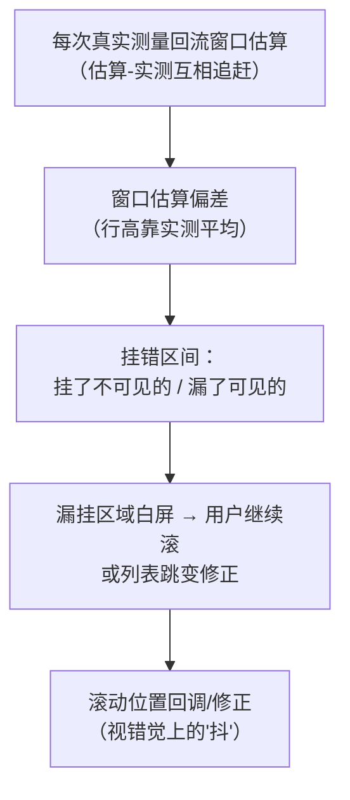
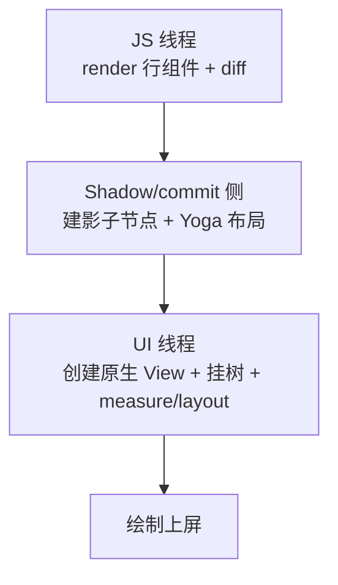
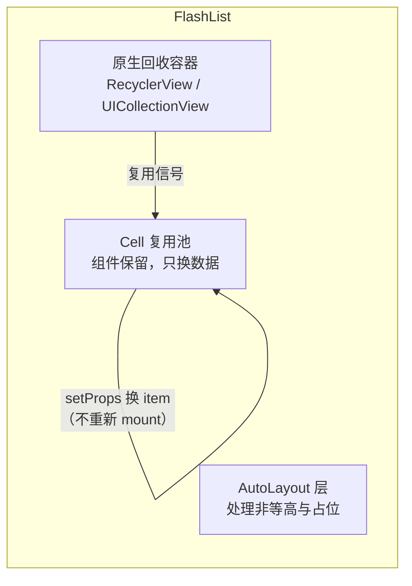
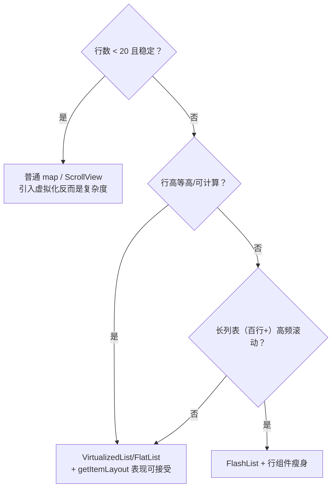
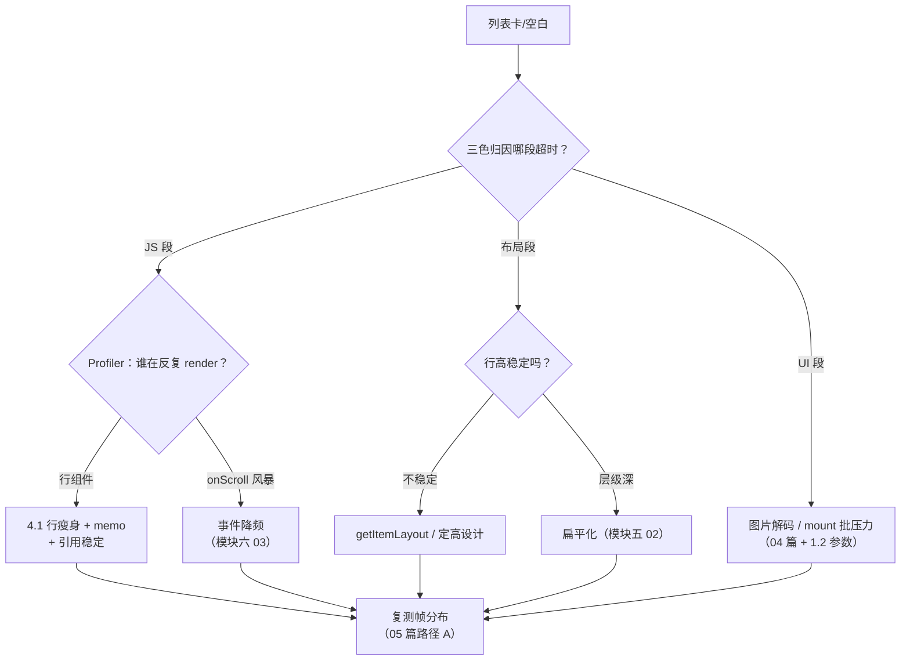

# 列表虚拟化原理

> 长列表是 RN 性能问题的重灾区，而 VirtualizedList 是理解一切列表库的钥匙：**窗口化渲染**它做对了，**组件回收**它没做——FlatList 的卡与 FlashList 的快，全部能从这两个事实推导出来。源码主路径：`Libraries/Lists/VirtualizedList.js`。

前置提醒：本篇讲"渲染侧"的虚拟化；滚动事件的产生与节流（onScroll 怎么来、多久一次）在[模块六 03 · 滚动与列表事件](../rn-事件系统原理/03-滚动与列表事件.md)，两者是一根链条的上下游。

## 1. 窗口化：只渲染"看得见 + 一点余量"

VirtualizedList 的核心是一个滑动窗口计算（每次滚动事件后重算）：


参与计算的参数：`initialNumToRender`（首屏行数）、`windowSize`（以"屏"为单位的窗口倍数，默认 21/10≈2.1 屏）、`maxToRenderPerBatch`（每批最多补挂几行）、`updateCellsBatchingPeriod`（补挂批间隔）。四个参数共同决定**内存占用 ↔ 空白风险 ↔ 挂载压力**的三角。

**getItemLayout 为什么重要**：窗口计算需要"第 i 行在哪"，没有 `getItemLayout` 时只能**先渲染再测量**（Yoga 布局后才知道高度）——滚动到深处时窗口是"摸着石头"扩的，表现为滚动中出空白、跳变；给了 `getItemLayout`（等高或可计算高度），窗口计算变成纯数学，O(1) 定位。

### 1.1 窗口计算到底在算什么

把官方实现（`Libraries/Lists/VirtualizeUtils.js` 的窗口估计算法）的思想简化成可读的伪码——真实实现带滑动平均与利用率修正，以源码为准：

```js
// 简化示意：滚动事件到达时的窗口重算
function recomputeWindow(offset, velocity, rendered) {
  // ① 由当前 offset 估算第一/最后可见行（依赖已知的行高分布）
  const first = estimateIndexAt(offset);
  const last  = estimateIndexAt(offset + visibleLength);

  // ② 顺着滚动速度方向"过扫描"：滚得越快，窗口往运动方向伸得越远
  const dir = Math.sign(velocity);
  const newFirst = dir >= 0 ? first : first - overscanBefore;
  const newLast  = dir >= 0 ? last + overscanAfter : last;

  // ③ 利用率门槛：窗口内"已渲染行"的占比高于阈值就不动，
  //    避免"每滚一行就全窗口重算/重挂"
  if (renderedUtilization(newFirst, newLast, rendered) > threshold) return SAME;

  // ④ diff 出要补挂的区间，交给批量器（maxToRenderPerBatch × 周期）慢慢挂
  return {first: newFirst, last: newLast};
}
```

四个可读出的机制细节：

1. **速度参与窗口形状**：快速滚动时窗口向运动方向预伸——这就是"慢慢滚没事、狂滑出空白"的机理之一：预伸的行数有限，滚得比补挂快，窗口就被击穿；
2. **利用率门槛是性能保险**：窗口计算本身跑在 JS 线程，每次滚动事件都全量重算会自我拥塞——门槛让大多数滚动事件空手返回；
3. **估算依赖历史测量**：行高估计来自已渲染行的实测值——没有 `getItemLayout` 的混合高度列表，估算误差会传导成窗口偏移（表现为"该挂的没挂、挂了的不可见"）；
4. **补挂是异步分批的**：diff 出的缺口不是一次挂完，而是每批 `maxToRenderPerBatch` 行、隔 `updateCellsBatchingPeriod` 挂一批——把 mount 压力摊到多帧，代价是缺口弥合有延迟。

### 1.2 四参数的联动调优

| 参数 | 管什么 | 调大 | 调小 |
|------|--------|------|------|
| `initialNumToRender` | 首屏一次挂几行 | 首屏更满，但首帧更重（启动变慢） | 首帧轻，但首屏可能不满（配合渐显） |
| `windowSize` | 渲染窗口总倍数 | 来回滚更顺（少重挂），内存与在树组件更多 | 内存省，来回滚抖动多 |
| `maxToRenderPerBatch` | 每批补挂行数 | 缺口弥合快，但单帧 mount 压力大（掉帧） | 单帧轻，但快速滚动更易空白 |
| `updateCellsBatchingPeriod` | 补挂批间隔 | 批间隔长，总补挂速率低 | 补挂更跟手，但 JS/布局线程更忙 |

调优的顺序建议：**先让行组件便宜（第 4 节）、再给 getItemLayout（等高场景）、最后才动这四个旋钮**。参数调优是在"行组件本身很重"的病根上做缓解，旋钮拧得再准也治不了"每行渲染 30ms"的行。

### 1.3 没有 getItemLayout 时的代价链

等高或高度可计算的列表，`getItemLayout` 是性价比最高的一个 prop。不给它时的完整代价链：



典型症状对照：滚动中反复出现"先空白后补上"（缺口弥合延迟）、`scrollToIndex` 抱怨定位不准（没有布局信息可算）、来回滚动时滚动位置轻微跳动（实测修正回写）。三个症状共享同一个根因：**窗口计算退化成"边渲染边试错"**。

### 1.4 窗口机制的三个配套接口

窗口化不只影响渲染，还改变了一批"看起来很普通"的列表 API 的行为，使用前要知道它们都在跟窗口机制打交道：

| 接口 | 与窗口的关系 | 使用注意 |
|------|-------------|---------|
| `scrollToIndex` | 需要"第 i 行在哪"才能滚——没有 `getItemLayout` 时要靠估算 | 定位远处行时列表可能先挂载沿途内容，官方提供了"沿途逐步滚"的兜底参数；深列表定位慢是窗口机制的自然结果，不是 bug |
| `onEndReached` | 触发点以"距列表内容末尾多远"判断，而"内容末尾"依赖已挂载部分的测量 | 行高不均匀时触发时机飘；翻页加载配合 `onMomentumScrollEnd`（模块六 03 的阶段事件）可以做得更符合用户意图 |
| `onViewableItemsChanged` + `viewabilityConfig` | 可见性判定基于窗口内已挂载行的位置回调 | 常用于曝光埋点；判定有节流与阈值语义（"多大比例可见才算"），高频滚动下回调本身也要保持轻——别在回调里做重活或 setState |

这批接口的共同点：**它们读的都是"虚拟化世界里的位置"，不是真实 DOM 那种全局确定的位置**——把 Web 直觉搬过来，就会在"为什么定位不准/触发不稳"上浪费时间。

## 2. 关键真相：VirtualizedList 不"回收"

窗口滑出 = **卸载**（unmount）该行的 React 子树；滑回 = **重新挂载**并完整执行一遍 render + 布局 + 挂载（模块五 03 的整条管线）。它没有"把行组件留着、只换数据"的机制。

FlatList = VirtualizedList + 常用 props 封装（`data`/`renderItem`）+ 事件透传，**继承同样的不回收模型**。由此推导出 FlatList 的全部经典症状：

| 症状 | 机理 |
|------|------|
| 快速滚动出空白 | 窗口补挂速度 < 滚动速度（每批 maxToRenderPerBatch 行，还要走整条渲染管线） |
| 长列表越滚越卡 | 反复 mount/unmount 的抖动 + renderItem 重的组件每次全量重建 |
| 嵌套列表告警/崩溃 | VirtualizedList 嵌 VirtualizedList，内外两个窗口机制互相打架（官方直接 warn） |
| 掉帧归因 | 新行挂载 = JS 线程 reconcile + 影子布局 + UI 挂载三线程齐动（模块三 02、模块九 01） |

### 2.1 一次"滑入一行"的三线程账单

把"重新挂载一行"拆开看，每一行滑入窗口时三线程都要干活：



- **JS 段**：行组件函数执行 + reconciler diff——行内组件越重（多层嵌套、行内格式化、行内创建闭包），这段越长；
- **布局段**：新节点进树触发 Yoga 计算——不定高时还要等测量回流（[模块五 02 · Yoga 布局引擎](../rn-渲染原理/02-Yoga布局引擎.md)）；
- **UI 段**：真实创建原生 View 并挂到视图树——行内若有图片，解码与上传也在这条链附近（04 篇的位图账户）。

注意这笔账单是**每行每次滑入都付一次**：上下反复滚动的用户，会对同一批行反复付费。这就是"越滚越卡"的机械原因——不是列表变大了，是**单位时间内的挂载次数**居高不下。

### 2.2 空白的完整机理

快速滚动出空白 = 三个延迟的叠加：

1. **事件延迟**：onScroll 到达 JS 有节流与传输延迟（模块六 03）；
2. **计算延迟**：窗口重算排在 JS 线程当前任务之后——JS 线程忙时（比如正在 reconcile 上一批行），窗口重算被推迟；
3. **挂载延迟**：diff 出的缺口分批补挂（1.1 的第 4 点），每批之间还隔着 `updateCellsBatchingPeriod`。

三层延迟乘上滚动速度就是空白区域的长度。所以"治空白"的处方分布在三个层面：降事件频率（模块六 03 的节流）、减 JS 占用（03 篇的状态与 memo）、加快挂载（本篇第 3 节的复用模型）——单点优化只能压缩一层。

### 2.3 嵌套列表为什么打架，怎么绕

VirtualizedList 嵌 VirtualizedList 的冲突点：外层把内层整体当作"一行"，但内层自己也在做窗口计算——两个窗口对"谁响应滚动、谁挂载/卸载"各有主张，事件与状态互相干扰，官方直接给出告警。绕开的常见路线：

| 需求形态 | 替代做法 |
|---------|---------|
| 行内横向小列表（标签、封面组） | 行数少且有限时用普通 `ScrollView horizontal` / `map`——短列表不配虚拟化 |
| 分组的纵向列表 | `SectionList`（内部仍是 VirtualizedList，但把分组语义做对了） |
| 页面级横滑（每页一个列表） | 分页容器 + 每页独立列表，页间不嵌套窗口 |
| 真·二维虚拟化（日历、表格） | 专用库或自绘方案——RN 内置组件不覆盖这个形态 |

原则就一句：**一个滚动方向一个虚拟化容器**，多方向需求用"容器套普通视图"降维。

### 2.4 新架构改变了这笔账吗

Fabric（模块七 02）改的是"挂载管线怎么走"，不是"要不要挂载"：

| 环节 | 旧架构 | Fabric 下的变化 | 对列表的意义 |
|------|--------|----------------|-------------|
| 指令通道 | Bridge JSON 批量 | JSI 直达 C++（省序列化） | 新行挂载的指令更快下达 |
| 布局 | Shadow 线程异步 | commit 内同步、可按优先级 | 滚动时新行的布局可插队 |
| 挂载批次 | 固定帧批 | 按优先级调度 | 交互相关挂载优先 |

结论：**单行挂载的账单变便宜了，但"滑出卸载、滑入全量重建"的模型没变**——反复滚动仍会反复付（变便宜了的）账单。所以本篇的选型与瘦身清单在新架构下全部原样成立，这也是 01 篇暗坑 5"新架构预期差"在列表场景的具体含义。

## 3. FlashList：把回收还给原生

FlashList 的设计洞察：**回收是原生平台早已解决的问题**——Android `RecyclerView` / iOS `UICollectionView` 就是干这个的。



- **换数据不换组件**：行滑出屏幕时组件不卸载，滑入时复用已挂载实例、更新 props——省掉整条 mount 管线；
- **占位高度**：先用估算高度占位，实际布局后修正（AutoLayoutView），减少无 getItemLayout 时的跳变；
- **itemType 分池**：多种行型各自成池，避免"文本行复用成图片行"的错配——这也是它的使用约定。

代价与边界：复用意味着**行组件不能假设 mount 生命周期与数据一一对应**（副作用要跟着 item 变化清理）；特殊布局（瀑布流高级形态、复杂 sticky）仍要看它的支持清单。

### 3.1 复用纪律：行组件的正确写法

"组件不重挂、只换 props"改变了行组件的写作纪律——副作用不能再挂在 mount/unmount 上，要跟着**数据变化**走：

```tsx
// 反模式：复用模型下，这段 effect 只在"组件第一次被复用到"时跑，
// 后续换数据（同一个组件实例换了 item）不会重新执行 → 播放器串台、定时器用旧数据
function VideoRow({ item }: { item: Video }) {
  useEffect(() => {
    startPreview(item.id);           // ✗ 只跑一次
    return () => stopPreview(item.id); // ✗ 卸载才清理，复用不触发
  }, []);                             // ✗ 空依赖 = 假设 mount 与数据一一对应
}

// 正确：依赖 item，数据换就重跑；FlashList 复用换数据时 effect 自然重执行
function VideoRow({ item }: { item: Video }) {
  useEffect(() => {
    startPreview(item.id);
    return () => stopPreview(item.id);
  }, [item.id]);
}
```

配套的三个必守约定：

1. **`estimatedItemSize` 给准**：占位高度与真实高度差得越远，滚动中的位置修正越多（跳变的来源）——按真实行高的典型值给；
2. **`itemType` 分型**：多形态列表（文本/图片/视频混排）必须标型，否则复用池跨型错配，轻则闪烁重则布局错乱；
3. **行内状态最小化**：复用换数据时行内 state 不会自动重置——行内尽量无状态，状态上移或以 item 为键重置。

### 3.2 FlatList vs FlashList：逐维度对照

| 维度 | FlatList（VirtualizedList） | FlashList |
|------|------------------------------|-----------|
| 滑出行为 | 卸载子树 | 组件保留，进复用池 |
| 滑入行为 | 全量重新挂载（render + 布局 + mount） | 复用实例 + 换 props |
| 行高约定 | `getItemLayout` 可选（不给则先渲染再测量） | `estimatedItemSize` 近乎必给（占位与修正的基础） |
| 多行型 | renderItem 内自行分支 | 额外的 `itemType` 约定（分池） |
| 行组件纪律 | 常规 React 生命周期 | 复用纪律：副作用跟数据走（3.1） |
| 迁移成本 | —— | props 大体同名，但"看起来一样"的行组件可能藏着 mount 假设 |

迁移 checklist：先把 FlatList 里的行组件按 3.1 的纪律过一遍（这一步不迁移也要做，它是普适的好习惯），再换组件、给 `estimatedItemSize`、混排列表补 `itemType`，最后用[05 篇](05-性能剖析操作手册.md)的滑动场景采集对照前后——**换库也是处方，处方要有复测**。

### 3.3 选它的边界

复用模型不是处处更优：极短列表（一屏内）复用没有意义；行组件极轻时两种模型的差距收窄（重建本来就便宜）；高度极度不规则的瀑布流形态要看当时版本的官方支持清单。**任何"X 一定比 Y 快"的说法都要用你自己的场景压一遍**——本篇给的是机理，不是排名。

### 3.4 虚拟化家族的其余成员

内置与生态里还有几个"长在 VirtualizedList 上"的组件，选型时一起放进视野：

| 组件 | 与 VirtualizedList 的关系 | 适用 |
|------|---------------------------|------|
| `FlatList` | 最常用的 props 封装（本篇主角之一） | 单一 data + renderItem 的平铺列表 |
| `SectionList` | 分组语义的封装（sections + 每组可选 header/footer） | 设置页、通讯录这类分组结构 |
| 直接用 `VirtualizedList` | 自己实现 `getItem`/`getItemCount` 等最低层接口 | 数据不在一个数组里（惰性分页拼接、虚拟数据源）时才考虑——文档明确提示这是底层接口，优先用 FlatList |

一个容易忽略的点：SectionList 的分组头部也是"列表内容"的一部分——带大量 sticky header 的分组列表，头部挂载/卸载同样走窗口机制，"sticky 的组头突然消失/闪现"多半是窗口边界正好切在组头附近。

## 4. 选型与调优清单



行组件本身的优化（决定一切列表库的上限）：

1. **renderItem 便宜化**：行内重组件懒加载/占位，`React.memo` 包裹（模块九 03）；
2. **key 稳定**：用业务 id 而非数组下标——下标 key 会让复用/重挂载错位；
3. **不在行内 bind 新函数/对象**：传参保持引用稳定，让 memo 生效；
4. **onScroll 链路减负**：事件节流参数（模块六 03）与列表虚拟化联动调。

### 4.1 行组件瘦身的展开

第 4 节的四条是索引，这里展开成可勾选的清单：

- **结构**：行内层级压平（嵌套越深，布局段越贵——[模块五 02](../rn-渲染原理/02-Yoga布局引擎.md)）；不必要的包装 View 删掉；
- **内容**：行内图片给尺寸（占位避免布局回流）、重组件（视频、地图、图表）滚入再加载/占位；
- **引用**：`renderItem` 之外的回调提到组件外或 `useCallback`，样式对象提为常量——否则 `React.memo` 形同虚设（[03 篇](03-渲染与状态优化.md)的第一嫌疑人）；
- **计算**：日期格式化、文案拼接这类"每行每次渲染都算"的活，要么 `useMemo`，要么上移到数据层一次算好；
- **memo 比较器**：行组件 props 多而杂时，自定义比较函数只比真正影响渲染的字段（比全量浅比较更快，但要小心漏比导致该更新的不更新）。

### 4.2 什么时候不该上虚拟化

反向清单同样重要：

1. **行数少且确定**（配置页、协议段）：`ScrollView` + map 足够，虚拟化的窗口机制、key 约定、批参数全是白背的复杂度；
2. **行数中等但从不长滚动**（几个屏的内容）：虚拟化收益随"滚过的行数"增长，不滚就没有收益；
3. **需要全量在树**：锚点跳转依赖全部内容已渲染、SEO 式的全文可访问性需求——虚拟化与它们天然冲突；
4. **一屏内的小横向条**：见 2.3 的嵌套规避表。

### 4.3 数据侧的配合：引用与 extraData

窗口机制之外，列表对**数据引用**也有约定，这是另一个高频翻车点：

- **`data` 引用不变 = 不重渲染**：FlatList 依赖 `data` 的引用变化来决定"要不要重新应用 renderItem 产物"。原地 mutate 数组（`arr.push` 后直接 setState 同一引用）界面纹丝不动——要返回新数组/新对象（不可变更新）；
- **行数据来自外部 state 时用 `extraData`**：renderItem 里读了 `data` 之外的 state（选中态、主题），这些 state 变化不会触发行更新——`extraData={[selectedId, theme]}` 显式告诉列表"这些变了也要刷"。它是个"逃生口"，每加一项都在扩大重渲染面，用多了说明该把这份状态收进数据或行组件内部；
- **分页追加保持前段引用稳定**：`setData([...old, ...newPage])` 会让整表引用变化——配合行级 `React.memo` + 稳定 key，旧行因 props 引用未变而被跳过，成本可控；如果行没 memo，每次翻页就是一次全表 reconcile；
- **选中态的正确归宿**：全局"哪个行选中"放列表外层 state + extraData 是粗粒度；把选中态下放到行组件内部（点击时局部 setState）则是 03 篇法则一在列表场景的标准应用——按需要选粒度。

## 5. 常见误区速查

| 误区 | 真相 | 本篇出处 |
|------|------|---------|
| "FlatList 卡就调 windowSize" | 参数只缓解"补挂速度 vs 滚动速度"的矛盾，行组件重才是病根 | 1.2 / 4.1 |
| "加了 getItemLayout 万事大吉" | 它只解决"定位"，行组件本身的渲染成本原样保留 | 1.3 / 2.1 |
| "换 FlashList 就不卡了" | 复用省的是 mount 管线；JS 段的 reconcile、布局段、图片解码都不归它管 | 2.1 / 3.3 |
| "key 用下标就行" | 下标 key 在增删/复用场景让 React 错配状态与行 | 第 4 节 |
| "列表里再套个列表没关系" | 内外两个窗口机制打架，官方 warn；按 2.3 的表绕开 | 2.3 |
| "空白是 bug，调参能根治" | 空白是三层延迟的结构性产物，根治靠复用模型或降速设计 | 2.2 |
| "onEndReached 不触发是列表坏了" | 触发点依赖已挂载内容的测量，行高不均时时机本就飘 | 1.4 |
| "行组件里放个视频自动播放没问题" | 复用模型下行不卸载，副作用必须跟 item 走，否则串台 | 3.1 |

## 6. 调试列表：把窗口"画"出来

虚拟化的所有问题都发生在"看不见的窗口"上，排障第一步是把窗口状态暴露出来：

- **可见性回调当探针**：`onViewableItemsChanged` 打印"当前可见区间 + 视口覆盖率"，快速滚动时观察区间是否跟得上偏移——跟不上就是窗口被击穿（2.2 的三层延迟）；
- **行组件加调试边框/计数**：临时给行组件渲染一个序号与"本实例挂载次数"，肉眼确认是"复用换数据"还是"反复重挂"——同一行上下滚动时挂载次数持续增长，说明落在了不回收模型里；
- **对照 [01 篇](01-性能定位方法论.md)的三色归因**：列表问题最终都要回到 trace——JS 段（reconcile 风暴）、布局段（测量回流）、UI 段（mount/图片）哪条超时，决定你该去 4.1、1.3 还是 2.1 找处方；
- **复测协议不变**：列表优化的前后对照，用同一份"进入页面 → 匀速滚 N 屏 → 狂滑 3s → 回滚"脚本，采帧耗时分布（05 篇收敛路径 A 就是它的模板）。

排障路径收成一张决策图：



## 小结

- 虚拟化 = 窗口化计算 + 出窗卸载；`getItemLayout` 把窗口计算从"先渲染再测量"变成纯数学，是性价比最高的一个 prop；
- VirtualizedList **不回收**：滑出即卸载、滑入全量重建——FlatList 的卡顿症状全部由此推导；
- FlashList 把回收下沉到 RecyclerView/UICollectionView：**换数据不换组件**，代价是行组件要遵守复用纪律；
- 列表性能 = 虚拟化策略 × 行组件成本 × 事件链路（模块六 03）三者相乘，任何一项为零上限都救不回来。
- 窗口是"看不见的"：排障先把可见性回调、挂载计数、三色归因用起来，让窗口状态可观测；
- 数据侧同样有约定：不可变更新、extraData 逃生口、分页追加的引用稳定——引用纪律（03 篇）在列表场景的投影；
- 新架构让单行挂载的账单变便宜，但不改变"滑出卸载、滑入重建"的模型——本篇清单在新架构下原样成立。

## 自测

1. 描述一次"快速滚动出现空白"的完整因果链（从 onScroll 事件到补挂完成），并指出三个可削减的延迟点各在哪一层。
2. 为什么说 VirtualizedList 的"越滚越卡"与列表长度无关，而与"单位时间挂载次数"有关？
3. `getItemLayout` 缺失时，窗口计算如何退化？写出至少两个由此产生的用户可见症状。
4. FlashList 的复用模型对行组件的 `useEffect` 写法提出了什么约束？举一个违反约束的具体 bug。
5. 四个虚拟化参数各自拧大一次，分别以什么代价换什么收益？为什么说"行组件瘦身"优先于参数调优？
6. 一个"外层纵向列表、每行内嵌横向标签条"的界面，你会怎么设计组件结构？为什么不能两个都用 VirtualizedList？
7. Fabric 上线后，"列表越滚越卡"会消失吗？逐项说明 2.1 的三线程账单里哪些项变便宜、哪些项原样保留。
8. 你要给商品流加"曝光埋点"（哪些商品真正被用户看到），结合 1.4 的可见性接口设计实现，并说明为什么不能直接在 onScroll 里算。
9. `setData(old.push(x) 之后的同一引用)` 与 `setData([...old, x])` 在 FlatList 上分别表现为什么？这背后的判定机制与本篇哪一节同源？
