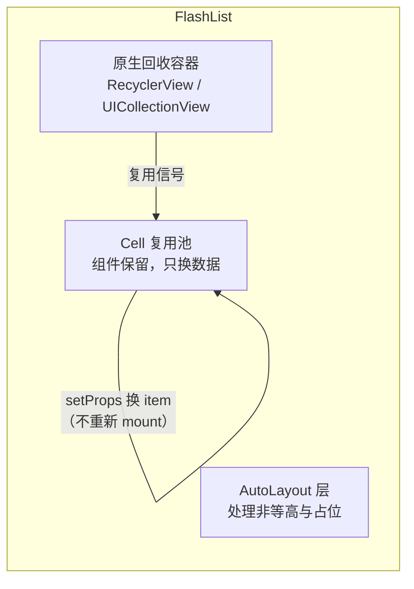
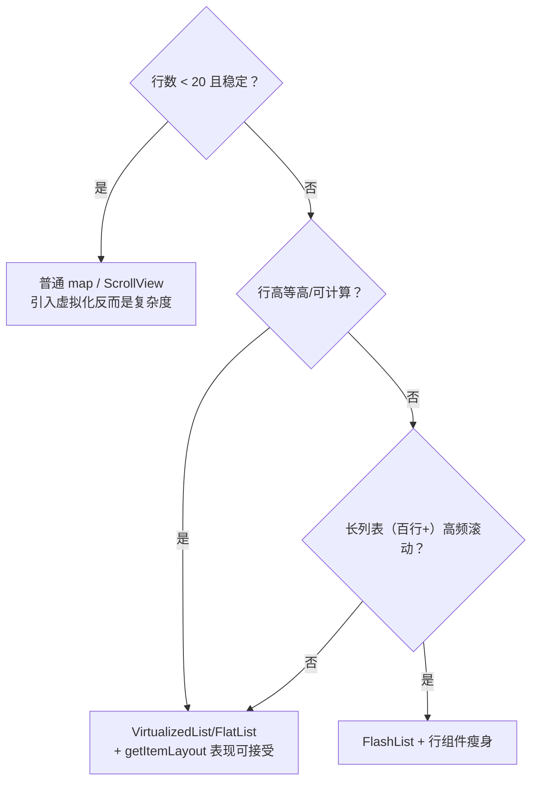

# 列表虚拟化原理

> 长列表是 RN 性能问题的重灾区，而 VirtualizedList 是理解一切列表库的钥匙：**窗口化渲染**它做对了，**组件回收**它没做——FlatList 的卡与 FlashList 的快，全部能从这两个事实推导出来。源码主路径：`Libraries/Lists/VirtualizedList.js`。

## 1. 窗口化：只渲染"看得见 + 一点余量"

VirtualizedList 的核心是一个滑动窗口计算（每次滚动事件后重算）：

参与计算的参数：`initialNumToRender`（首屏行数）、`windowSize`（以"屏"为单位的窗口倍数，默认 21/10≈2.1 屏）、`maxToRenderPerBatch`（每批最多补挂几行）、`updateCellsBatchingPeriod`（补挂批间隔）。四个参数共同决定**内存占用 ↔ 空白风险 ↔ 挂载压力**的三角。

**getItemLayout 为什么重要**：窗口计算需要"第 i 行在哪"，没有 `getItemLayout` 时只能**先渲染再测量**（Yoga 布局后才知道高度）——滚动到深处时窗口是"摸着石头"扩的，表现为滚动中出空白、跳变；给了 `getItemLayout`（等高或可计算高度），窗口计算变成纯数学，O(1) 定位。

## 2. 关键真相：VirtualizedList 不"回收"

窗口滑出 = **卸载**（unmount）该行的 React 子树；滑回 = **重新挂载**并完整执行一遍 render + 布局 + 挂载（模块五 03 的整条管线）。它没有"把行组件留着、只换数据"的机制。

FlatList = VirtualizedList + 常用 props 封装（`data`/`renderItem`）+ 事件透传，**继承同样的不回收模型**。由此推导出 FlatList 的全部经典症状：

| 症状 | 机理 |
|------|------|
| 快速滚动出空白 | 窗口补挂速度 < 滚动速度（每批 maxToRenderPerBatch 行，还要走整条渲染管线） |
| 长列表越滚越卡 | 反复 mount/unmount 的抖动 + renderItem 重的组件每次全量重建 |
| 嵌套列表告警/崩溃 | VirtualizedList 嵌 VirtualizedList，内外两个窗口机制互相打架（官方直接 warn） |
| 掉帧归因 | 新行挂载 = JS 线程 reconcile + 影子布局 + UI 挂载三线程齐动（模块三 02、模块九 01） |

## 3. FlashList：把回收还给原生

FlashList 的设计洞察：**回收是原生平台早已解决的问题**——Android `RecyclerView` / iOS `UICollectionView` 就是干这个的。

- **换数据不换组件**：行滑出屏幕时组件不卸载，滑入时复用已挂载实例、更新 props——省掉整条 mount 管线；
- **占位高度**：先用估算高度占位，实际布局后修正（AutoLayoutView），减少无 getItemLayout 时的跳变；
- **itemType 分池**：多种行型各自成池，避免"文本行复用成图片行"的错配——这也是它的使用约定。

代价与边界：复用意味着**行组件不能假设 mount 生命周期与数据一一对应**（副作用要跟着 item 变化清理）；特殊布局（瀑布流高级形态、复杂 sticky）仍要看它的支持清单。

## 4. 选型与调优清单

行组件本身的优化（决定一切列表库的上限）：

1. **renderItem 便宜化**：行内重组件懒加载/占位，`React.memo` 包裹（模块九 03）；
2. **key 稳定**：用业务 id 而非数组下标——下标 key 会让复用/重挂载错位；
3. **不在行内 bind 新函数/对象**：传参保持引用稳定，让 memo 生效；
4. **onScroll 链路减负**：事件节流参数（模块六 03）与列表虚拟化联动调。

## 小结

- 虚拟化 = 窗口化计算 + 出窗卸载；`getItemLayout` 把窗口计算从"先渲染再测量"变成纯数学，是性价比最高的一个 prop；
- VirtualizedList **不回收**：滑出即卸载、滑入全量重建——FlatList 的卡顿症状全部由此推导；
- FlashList 把回收下沉到 RecyclerView/UICollectionView：**换数据不换组件**，代价是行组件要遵守复用纪律；
- 列表性能 = 虚拟化策略 × 行组件成本 × 事件链路（模块六 03）三者相乘，任何一项为零上限都救不回来。
