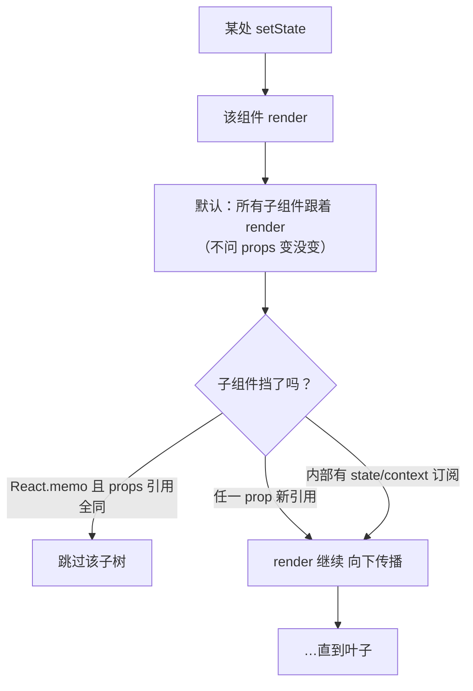
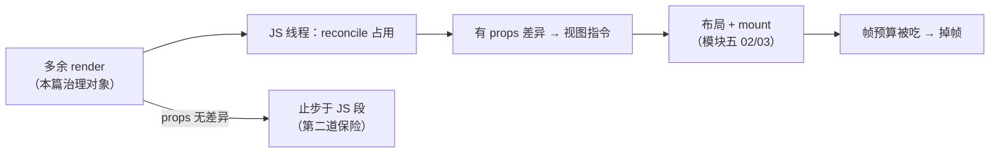

# 渲染与状态优化

> re-render 不是坏事，**多余的 re-render 才是**。本篇把"多余"定义清楚（引用相等性），给出状态放置的空间法则，最后看新架构下并发 API 的真实语义。与 Web React 同源的部分讲差异，不重复教材。

阅读定位：本篇管 JS 侧的"渲染账"——组件为什么渲染、渲染范围如何传播；线程级归因（渲染账单最终压到哪条线程）在[01 篇](01-性能定位方法论.md)，列表场景的特化在[02 篇](02-列表虚拟化原理.md)。

## 1. re-render 的判定：一切看引用

RN 的渲染判定与 React 完全一致：父组件 render → 默认所有子组件 render（不管 props 变没变）→ `React.memo` 做浅比较拦截。**浅比较 = 每层 prop 引用是否相同**，由此推出三个 RN 高频翻车点：

```jsx
<Row
  data={item}              // ✓ item 来自 state，引用稳定
  onPress={() => select(item)}  // ✗ 每次 render 新函数，memo 失效
  style={{ flex: 1 }}      // ✗ 每次新对象，memo 失效
/>
```

- 修法：`useCallback`（注意依赖数组要真稳定）、`style` 提为常量/`useMemo`；
- **memo 的边界**：memo 只挡"props 没变"的子树；若组件内部有自己的 state 或 context 订阅，照样 render。memo 不是"禁用渲染"的开关，是"props 通道的过滤器"；
- Context 是隐形 prop：`value={{ ... }}` 每次新建对象 = 所有消费者全量重渲染。**value 必须 useMemo**，更根本的办法是下节"下推"。

### 1.1 渲染次数的传播路径

"多余的 re-render"为什么会扩散？把默认传播路径画出来：



三个结构性事实：

1. **传播是树形的，不是点状的**：一处 setState 的成本 ∝ 它向下可达的子树大小——这就是"状态放得太高，半棵树陪葬"的机械原因（第 2 节的三法则全部由此推导）；
2. **Context 是第二条传播通道**：它不经过 props——中间组件哪怕 memo 了，只要消费了 context，value 变化照样触发它 render。两条通道独立计数，memo 只封得住 props 通道；
3. **render ≠ 上屏**：RN 里组件 render 只是产出 React 元素与 props diff；props 无差异时没有视图指令（[模块五 01 的指令级 diff](../rn-渲染原理/01-三棵树与Reconciler.md)），原生层纹丝不动。所以"render 多"的直接成本是 JS 线程的 reconcile，**不是每次 render 都惊动原生**——但 reconcile 本身就是 JS 线程大户，列表里叠加就是掉帧（02 篇 2.1 的账单）。

### 1.2 浅比较的机械实现

`React.memo` 默认比较器逐个 prop 用 `Object.is` 判等（引用相等，值语义的原始类型除外）。两个推论：

- **嵌套对象比较的是外壳**：`style={{ flex: 1 }}` 与上一次的 `style={{ flex: 1 }}` 内容一样但引用不同——`Object.is` 判不等，memo 失效。"看起来没变"与"引用没变"是两回事；
- **自定义比较器收窄或放宽**：

```tsx
// 只比影响渲染的字段：比较成本更低，但要保证清单完整
const areEqual = (prev: RowProps, next: RowProps) =>
  prev.item.id === next.item.id &&
  prev.item.updatedAt === next.item.updatedAt &&
  prev.selected === next.selected;
export const Row = React.memo(RowBase, areEqual);
```

漏比一个字段 = 该更新的不更新（界面滞后的隐性 bug）；多比不必要的字段 = 白白重新 render。**默认浅比较是最安全的起点，自定义比较器留给 Profiler 证实的热点行**（第 4 节的度量先行）。

### 1.3 "以为 memo 了其实没有"清单

- **回调链上的再包装**：传下去的是 `useCallback` 的函数，中间某层又 `() => cb(x)` 包了一手——到叶子又是新引用。修法：让中间层透传参数（`onPress={onRowPress}` 携带 id 语义）而不是闭包捕获；
- **对象参数的属性级新建**：`data={item}` 稳定但 `meta={{ ...item.meta }}` 每次展开——对象字面量就是新引用；
- **children 也是 prop**：`<Row><Inner/></Row>` 里每次 render 重新写 JSX，children 元素就是新引用——除非父组件自己不 render，或用第 2 节法则三把 children 固定住；
- ** Hooks 返回值未缓存**：自定义 hook 里 `return { a, b }` 每次新对象，消费方 memo 直接失效——hook 的返回值同样要引用纪律（`useMemo` 包住或返回离散值）。

### 1.4 Hooks 层的引用纪律

自定义 hook 是引用纪律最容易失守的一层——它看起来"只是个函数"，但它的返回值会变成下游组件的 props：

```ts
// 危险写法：每次调用返回新对象/新函数
function useCart() {
  const items = useStore(s => s.items);
  const add = (id: string) => cartStore.add(id); // 每次渲染都是新函数
  return { items, add };                          // 每次渲染都是新对象
}
// 下游 <CartRow actions={cart.add} /> 传进去的东西全部"引用不稳定"

// 纪律版：稳定引用靠 useCallback，或干脆返回离散值
function useCart() {
  const items = useStore(s => s.items);
  const add = useCallback((id: string) => cartStore.add(id), []);
  return { items, add }; // items 引用由 store 管，add 已记忆化
}
```

三条实操纪律：

1. **返回离散值优先**：能返回原始值/稳定引用就不返回聚合对象——每个值独立参与下游浅比较，少一层"打包即失稳"；
2. **hook 内部的对象/函数要记忆化**：`useMemo`/`useCallback` 的依赖数组要真稳定（依赖了每次新建的引用就白记）；
3. **store 的 selector 返回原始值或稳定引用**：`useStore(s => s.total)`（数字）天然稳定；`useStore(s => ({ a: s.a, b: s.b }))`（每次新对象）会让订阅比较形同虚设——需要多字段时用库提供的浅比较订阅选项。

## 2. 状态放置：三条空间法则

性能问题的根源常不是"渲染慢"，是**状态放得太高**——一处 setState，半棵树重渲染。三条法则（按优先级）：

### 法则一：局部化（colocation）

state 放在**使用它的最小共同祖先**。输入框抖动重渲染整页，多半是 `query` state 放在了页面级——挪进搜索组件，问题消失。

判断三问：

1. 这个 state 谁读？（只有 Input 读 → 挪进 Input）
2. 它变化时谁必须跟着变？（没人 → 现在的位置就是错的）
3. 把它下移一层会破坏什么？（没有任何行为变化 → 放心挪）

### 法则二：下推（push down）

重渲染砍不掉时，**把静态部分推下去**：

```jsx
// 优化前：toggle 重渲染 → 整个 ExpensiveTree 重走 render
function Page() {
  const [on, setOn] = useState(false);
  return (<><Header on={on} /><ExpensiveTree /></>);
}

// 优化后：状态下移进小组件，ExpensiveTree 不再是它的子树
function Switch() {
  const [on, setOn] = useState(false);
  return <Header on={on} />;
}
function Page() {
  return (<><Switch /><ExpensiveTree /></>);
}
```

### 法则三：children 组合（composition）

`children` 是**父父辈 render 时就创建好的元素引用**，作为 prop 传下去——中间组件自己的 state 变化时，children 引用不变，子树被 React 自动跳过。这是"组件包装一层就变慢"的解药。

```jsx
// 中间组件自己的 isOpen 变化时，children 引用不变 → 内容区被跳过
function Collapse({ children }: { children: React.ReactNode }) {
  const [isOpen, setIsOpen] = useState(false);
  return (
    <>
      <Button onPress={() => setIsOpen(v => !v)} label={isOpen ? '收起' : '展开'} />
      {isOpen && <Content>{children}</Content>}
    </>
  );
}
// 使用方：元素在 Page render 时创建，引用归 Page 的时间线管
<Collapse><ExpensivePanel /></Collapse>
```

法则二三的组合变体：**槽位（slots）**——把多个区域都做成 children/具名 prop 传进来，容器组件的局部 state 就烧不到这些区域。

配套武器：外部 store 的** selector 订阅**（zustand 等）——订阅粒度精确到字段，替代大范围 context 广播，本质是法则一在状态管理层的投影。

### 2.1 Context 的拆与合

Context 的问题不是机制，是**粒度**。治理三招：

| 手段 | 做法 | 适用 |
|------|------|------|
| 拆 Provider | 把"变得快的"与"变得慢的"拆成两个 context（主题一个、会话一个、输入态干脆别进 context） | 一个大 value 对象里混着不同变化频率的字段 |
| value 记忆化 | `value={useMemo(() => ({ user }), [user])}` | 消费者已经稳定，只是 value 引用在乱跳 |
| 下推消费 | 消费点从大容器挪到真正的叶子小组件 | 只有深处几个组件要读，却让中间层全量订阅 |

一个常见误判：给 Provider 包了 memo 就以为消费者安全——**挡的是 Provider 组件自身的 render，不是 value 变化对消费者的广播**。消费者是否重渲染只看 value 引用与自己的订阅面。

### 2.2 三法则的适用顺序

三条法则不是并列选项，是排查顺序：

1. 先问**能不能不渲染**（法则一：这 state 真的需要在这个高度吗）；
2. 再问**能不能少渲染**（法则二/三：砍掉陪葬的静态部分）；
3. 最后才轮到 memo/useCallback**给剩下的热点收口**。

顺序反了的典型症状：全组件树 memo + useCallback 满天飞，一次输入还是几十个组件 render——因为 context value 每次 rebuild，props 通道封得再严，context 通道照样广播。**先动结构，再动记忆化**。

### 2.3 派生状态放哪：算一次还是算多次

三法则管"状态放哪"，派生数据（由 state 计算出来的东西）有同一维度的选择题：

| 放法 | 写法 | 代价与适用 |
|------|------|-----------|
| 渲染内现算 | `{items.filter(...).sort(...)}` 直接写在 JSX/函数体 | 每次渲染都算；只适合廉价的派生（布尔、拼接字符串） |
| `useMemo` | `const visible = useMemo(() => filter(items), [items, query])` | 依赖不变时引用稳定、跳过重算——昂贵派生的默认位置 |
| 数据层预算 | 拿到数据时就算好字段（selector/归一化 store） | 多个组件共享同一份派生，不在渲染期各算各的 |

判据是**"谁消费、消费几次"**：单一组件消费用 useMemo 足够；多个组件各自 filter 同一份数据，就该上移到数据层算一次——这本质又是法则一的"最小共同祖先"，只不过对象从 state 换成了计算。

配套细节：`setState` 的函数式更新（`setList(prev => [...prev, x])`）不只是并发安全的写法，它还把"新值"的构造与"旧值引用"绑定——避免闭包里读到过期 state 后整体重建（引用稳定性的另一面）。

## 3. RN 特有：并发渲染的真实语义

React 18/19 的并发特性在 RN 的可用性**由 Fabric 决定**（模块一 03、模块七 05）：

| API | 语义 | RN 中的实际行为 |
|-----|------|----------------|
| `useTransition` / `useDeferredValue` | 标记"可中断更新"，让位给高优先级（输入、手势） | Fabric 并发 root 下生效：慢更新不再阻塞交互响应——**对"输入卡顿"类问题是质变** |
| `Suspense` + `React.lazy` | 声明"我在等数据/代码"，先展示 fallback | 数据侧可用（配合支持 Suspense 的库）；`lazy` 在 RN 的意义有限（无网络 chunk，模块八 03），但配合多 bundle 加载可表达"包还没执行完" |
| Actions / `useOptimistic`（React 19） | 表单语义的异步状态 + 乐观更新 | 随新架构版本落地，适合"点赞立刻+1、失败回滚"类交互 |

判断口径（模块三 04 的延续）：**并发 API 解决的是"JS 线程被长 render 占住"的调度问题**；如果你的瓶颈是单次 render 本身太慢（巨型组件树），先做拆分与 memo，再谈并发。

### 3.1 useTransition 实战：搜索输入不再卡

并发前后的写法对照（语义示意）：

```tsx
function ProductSearch() {
  const [query, setQuery] = useState('');            // 紧迫：输入框要立刻跟上手指
  const [deferredQuery, setDeferredQuery] = useState(''); // 可延迟：大列表筛选结果

  const isPending = useTransition()[1]; // 惯用写法：const [isPending, start] = useTransition()

  function onChange(text: string) {
    setQuery(text);                    // 高优先级：本帧同步渲染输入框
    startTransition(() => {
      setDeferredQuery(text);          // 低优先级：让位给输入/手势
    });
  }

  // 渲染：输入框用 query（跟手），列表用 deferredQuery + isPending 置灰
}
```

要点：

- **两个 state 表达同一个值的两种紧迫度**——输入框读快的那个，重列表读慢的那个；
- `isPending` 给出"过渡中"的可视信号（置灰/小菊花），避免用户误以为筛选丢了；
- 旧架构上这段代码"能跑但没疗效"：Paper 的批量提交不可中断，低优先级标记形同虚设——这正是 3 节表格里"由 Fabric 决定"的含义。

### 3.2 useDeferredValue：不想改数据流时的惰性方案

`useDeferredValue(query)` 返回一个"滞后于 query"的值——组件树读它渲染，React 在空闲时追上来。与 useTransition 的分工：

- `useTransition`：**你有触发点**（事件回调里），能明确圈出"哪段 setState 是低优先级"；
- `useDeferredValue`：**你只有消费点**（比如第三方组件内部 fetch 了新值），在读取侧做延迟。

两者本质相同（调度让位），选择看你对数据流的控制位置。

### 3.3 并发 API 与前两节的关系

一个容易混淆的边界：并发 API **不减少**需要渲染的组件数量，只改变**渲染的时机与可中断性**。所以：

- 引用纪律（第 1 节）与状态放置（第 2 节）解决"渲染了多少"；
- 并发 API 解决"渲染时能不能被打断、让位"；
- 两轴正交：结构烂 + 并发 = 可中断地反复渲染大面积子树，还是慢；结构好 + 无并发 = 渲染面小到不需要中断。**先做乘法里的大因子**。

### 3.4 Suspense 在 RN 的现实边界

Suspense 的"等待时先展示 fallback"在 RN 里有两个可用面，也有两个边界：

- **数据面可用**：配合支持 Suspense 的数据层，"请求进行中 → fallback；就绪 → 内容"的声明式写法成立——它替代的是手写 `loading` state 的样板；
- **多 bundle 场景的表达**：纯 RN 工程没有网络 chunk（模块八 03 讲过 Metro 无 code-splitting 的结构性原因），但多 bundle/懒执行包的加载场景（模块八 04 的拆包）可以用 Suspense 表达"这个业务包还没执行完"；
- **边界一：fallback 也是渲染成本**：切换 fallback → 内容意味着两次树变换，快速连续的数据就绪会放大它——fallback 只该给"用户预期要等"的区间；
- **边界二：不要用 Suspense 当布局工具**：它的语义是"资源未就绪"，不是"我想显示骨架屏"。为了视觉而触发挂起（故意 throw promise）是语义滥用，出错时的调试成本远超收益。

## 4. 度量：让"多余"可见

1. **React DevTools Profiler**（连接方式见模块十 04）：看每次 commit 哪些组件渲染了、为什么（props 哪个变了）——"why did this render" 是 builtin 答案，不要猜；
2. **highlight updates** 可视化渲染热区：闪烁最亮的地方就是优化收益最大的地方；
3. **性能预算法**：给关键页定"单次交互允许的 commit 数/耗时"，超了再优化——避免 memo 满天飞的过度工程（每处 useCallback 都有维护成本）。

> 经验排序：**先测量 → 法则一二三（挪状态）→ memo 收口热点 → 最后才考虑并发 API**。顺序反了，会用复杂度买不到收益。

### 4.1 Profiler 的标准读法

一次排查的完整动作序列：

1. 连接 Profiler，录制目标交互（输入、点击）；
2. commit 时间轴上找"预期外"的柱子：用户只敲了一个字，却出现一串 commit——级联更新（state 连环触发）或 effect 链的征兆；
3. 点开柱子看参与的组件清单：理想状态是"只有状态真正变化的子树"；
4. 选中最意外的组件，读"为什么渲染"（props/state/context 哪个变了）——答案直接指向处方：
   - props 某字段变了 → 1.3 的引用清单；
   - context 变了 → 2.1 的拆与合；
   - 父组件变了而它没有理由跟着 → 第 2 节挪状态；
5. 改一处，回 2 重录——**Profiler 的 commit 数/参与组件清单就是复测指标**（定性）。

### 4.2 过度优化的代价表

| 过度手段 | 代价 | 更好的替代 |
|---------|------|-----------|
| 所有组件无差别 memo | 比较成本 + props 变化时的心智负担（"为什么没更新"类 bug 增多） | 只 memo Profiler 证实的热点（列表行、大子树入口） |
| useCallback 包一切 | 依赖数组维护成本，漏依赖捕获旧值（闭包陷阱） | 数据/参数下传，回调透传（1.3 的修法） |
| useMemo 缓存廉价计算 | 缓存本身有成本，代码可读性下降 | 只缓存"引用需要稳定"的对象（给 memo 用的 style/data）或昂贵计算 |
| 到处 Context 化 | 全局广播面越来越大 | selector 订阅的外部 store，粒度到字段 |

判断标准回到 4 的预算法：**没有超预算就没有优化任务**——预防性优化是负资产。

### 4.3 从组件到线程：渲染账单的最终落点

本篇的证据（commit 数、渲染原因）都是组件级的；它们最终怎么变成 [01 篇](01-性能定位方法论.md)的线程级现象，值得把链路写明：



- 治"渲染了多少"（本篇）与治"单次多贵"（组件拆分、行瘦身）分别压缩这条链的前后两段；
- props 无差异的 re-render 止步于 JS 段——这就是"render 多不一定卡"的机械解释，也是它仍然要治的原因：JS 段本身就是交互延迟的第一嫌疑人（01 篇 2.2）；
- 定量证据（这段 reconcile 到底多少毫秒）交给 trace 与采样 profile（[05 篇](05-性能剖析操作手册.md)），本篇的 Profiler 只负责定性圈人。

## 5. 常见误区与反模式

| 误区 | 真相 | 出处 |
|------|------|------|
| "re-render 是 bug，要消灭" | re-render 是 React 的更新机制；多余的、大面积的才要治 | 引言 / 1.1 |
| "memo 了就一定不渲染" | memo 只挡 props 通道；state/context 订阅独立生效 | 1 |
| "useCallback 一包就快" | useCallback 本身不省多少；价值在保住下游 memo 的引用判定 | 1 / 4.2 |
| "Context 是全局变量，随手用" | Context 是广播通道，value 引用一乱全部消费者重渲染 | 1 / 2.1 |
| "并发 API 能让慢组件变快" | 并发只改变调度（时机/可中断），不减少渲染量 | 3.3 |
| "把状态全放全局 store 最干净" | 全局化是"放得太高"的极端形态；订阅粒度才是关键 | 2 / 2.2 |

一个综合反模式收尾：**"上帝 state"**——把整页数据塞一个 state 对象，任何字段更新都 `setPage({...page, x})`。三宗罪：引用全变（memo 全灭）、渲染面最大（半棵树）、更新语义模糊（哪个字段变了说不清）。拆成按变化频率分组的多份 state，是三法则落地的第一课。

### 5.1 误区的统一来源：把"机制"当"承诺"

回头看这张表，几乎所有误区都来自同一个思维错误——把机制当承诺：

- memo 是"props 通道的过滤器"，被当成"永不渲染的封印"；
- useCallback 是"引用稳定的工具"，被当成"更快的函数"；
- Context 是"广播通道"，被当成"全局变量的正当性"；
- 并发 API 是"调度让位"，被当成"渲染加速器"。

每件工具只做它声明的那一件事。读 [模块五 01](../rn-渲染原理/01-三棵树与Reconciler.md) 的 reconciler 契约、再回到本篇的传播路径图，这些"承诺"就再也骗不到你。

## 小结

- 判定基准是引用相等性：新函数/新对象 prop 让 memo 全盘失效，这是 RN 列表与表单卡顿的第一嫌疑人；
- 状态放置三法则：局部化、下推、children 组合——**挪状态永远优先于加 memo**；
- 并发 API（useTransition/Suspense/Actions）在 Fabric 下语义完整，解决的是调度问题而非单次渲染慢；
- Profiler 的 "why did render" 是唯一可信证据，优化顺序：测量 → 挪状态 → memo → 并发。
- 派生状态按"谁消费、消费几次"选位置：useMemo 管单点，数据层预算管共享；
- 自定义 hook 的返回值是隐形 props，离散值与记忆化是它的引用纪律。

## 自测

1. 画出"一次 setState 到叶子组件"的传播路径图，标出所有可以剪断传播的位置（至少三处）。
2. `Object.is` 语义下，哪些"看起来没变"的 props 会让 memo 失效？各举一例并给出修法。
3. context 传播与 props 传播是几条独立通道？memo 能挡住哪条？这解释了哪个常见"memo 无效"现象？
4. 法则二（下推）与法则三（children）都能缩小渲染面，各自的适用场景差在哪？
5. useTransition 与 useDeferredValue 的分工是什么？在旧架构上跑这段代码会发生什么、为什么？
6. "为什么这处 useCallback 没有效果"——按 4.1 的读法，你的排查步骤是哪五步？
7. 设计层面：一个"搜索页 = 输入框 + 筛选器 + 大结果列表"，给出状态放置方案（哪些 state、放在哪、谁读），并说明并发 API 用在哪个环节。
8. 三个组件共享同一份 `filter + sort` 的派生结果，你会把计算放在哪？依据 2.3 的判据说明理由。
