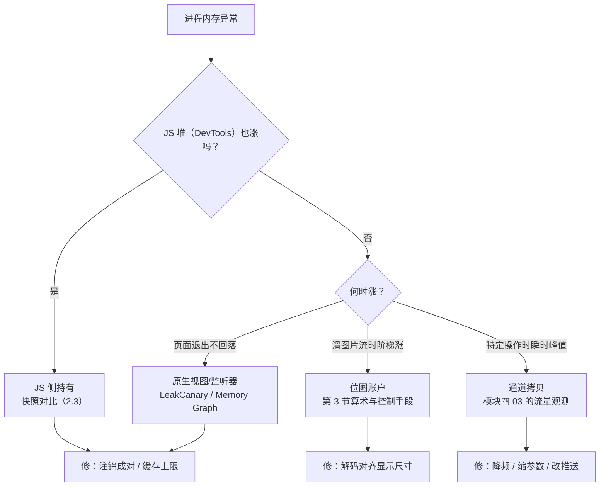
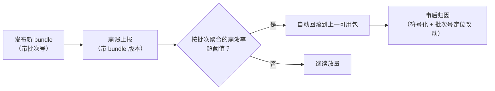

# 内存与稳定性

> 性能模块收官：前两篇管"帧"，本篇管"命"——内存泄漏拖垮长会话，图片解码撑爆低端机，线上崩溃没有符号表就是盲飞。内存问题的归因口径：**先分清在哪一层泄漏/膨胀，再动手**。

线程与 CPU 的归因看[01 篇](01-性能定位方法论.md)，本篇换一个账户体系：内存不是一张账单，是四张。

## 1. 内存版图：四个账户

RN App 的内存不是一张账单，是四张（模块三 02 线程模型的内存投影）：

| 账户 | 内容 | 查看工具 |
|------|------|---------|
| JS 堆 | Hermes 堆：对象、闭包、模块状态 | React DevTools Heap Snapshot / Hermes 采样 |
| 原生视图 | View 层级、ShadowTree、原生对象 | LeakCanary（Android）/ Instruments（iOS） |
| 位图 | 图片解码后的像素缓冲（不压缩！） | 各平台内存分析器 |
| 桥接/通道拷贝 | 序列化中间产物（旧架构）、跨端持有 | 随流量出现，Proflier 里看峰值 |

**归因第一步永远是"哪个账户在涨"**——四个账户的工具与修法完全不同。

### 1.1 各账户的膨胀特征

四个账户不只工具不同，"生病的样子"也不同——先认症状再开工具：

| 账户 | 健康形态 | 膨胀形态 | 典型病因 |
|------|---------|---------|---------|
| JS 堆 | 锯齿状（GC 周期回收，模块三 03 的 Hades） | 台阶式上涨不回落，或锯齿基线持续抬高 | 泄漏（第 2 节）、无界缓存、大响应数据常驻 |
| 原生视图 | 随页面进出起落 | 页面退出后不回落 | 视图未释放、监听器持有组件树 |
| 位图 | 随可见图片波动 | 滑动图片流时阶梯堆高 | 解码尺寸失控（第 3 节）、缓存无上限 |
| 通道拷贝 | 随批量传输的瞬时峰值 | 大参数高频调用的持续高位 | 序列化风暴（模块四 03 的体积敏感段） |

一个高频误判要提前排掉：**JS 堆平稳 ≠ 进程内存平稳**。位图与原生对象根本不住在 JS 堆里——只盯着 DevTools 的 JS 内存，会漏掉最大的那个账户（位图常是四账户里的大头）。

### 1.2 平台侧的查看入口

每个账户在两端各有"开门的钥匙"，列成速查（用法细节见平台文档）：

| 账户 | Android | iOS |
|------|---------|-----|
| 总览/曲线 | `adb shell dumpsys meminfo <pkg>`（命令行快照）、Studio Profiler（曲线） | Instruments Allocations / Xcode 内存报告 |
| JS 堆 | DevTools / CDP 的 Heap Snapshot（Hermes 支持） | 同左（同一套 JS 侧工具） |
| 原生泄漏 | LeakCanary（自动分析 Activity/Fragment 泄漏链） | Xcode Memory Graph（手动查保留链） |
| 位图 | Studio Profiler 的内存构成（native/graphics 分区） | Instruments 的图片相关分配 |

Android 的 `dumpsys meminfo` 输出里有分 compartment 的统计（Java 堆 / native 堆 / graphics 等）——位图与 so 的开销在 native/graphics 侧显形，这与"JS 堆平稳但进程内存涨"的判读互相印证。

### 1.3 Hermes 堆的两个特殊点

JS 堆账户归 Hermes 管（模块三 03），两个工程相关的推论：

1. **GC 有自己的节奏**：锯齿是正常形态，不是"内存有问题"——要看的是锯齿的**基线走势**（缓慢抬高 = 有东西回不去了）；
2. **堆上限可配置**：`-Xmx` 一类的引擎参数能压缩"JS 堆无限膨胀"的排查空间（OOM 时先分清是哪个账户爆的，否则调错账户白忙）。

### 1.4 一张归因决策图

把"哪个账户在涨 → 用什么工具 → 疑点指向哪"串起来：



用法说明：从"总内存异常"进入，第一个分叉先分离 JS 与非 JS——这一刀切错了，后面的工具全部白开。

## 2. 泄漏高发点：跨边界的持有链

泄漏 = 无用对象仍被根持有。RN 里高发的持有链都**跨越 JS/Native 边界**：


清单（按出现频率）：

1. **事件监听未注销**：`DeviceEventEmitter.addListener` / `Notifications` 返回的 subscription 没有在 unmount 时 remove——监听器表（原生侧持有）成为永久根；
2. **timer 未清理**：`setTimeout/setInterval` 持有的闭包在组件卸载后仍会被调度（还伴随 setState on unmounted 告警）；
3. **全局模块里存页面数据**：把页面大 state 塞进 module 级变量/单例 store 且不清理——不是"泄漏"胜似泄漏；
4. **旧架构闭包过桥**：回调 id 挂在原生回调表上，模块不释放则 JS 闭包整条持有链活着（新架构 JSI 对象走 Handle 体系，模块三 03，同样要显式释放 LongLivedObject）；
5. **动画循环**：`Animated.loop` 未 stop，闭包与原生驱动器都常驻。

验证手法（Android 举例）：LeakCanary 报的链路通常长成 `NativeModule → listener → JS closure → Fragment/页面数据`——**看到跨边界的持有链，就去代码里找那次忘记的 remove**。

### 2.1 三类源头的整理

上面五条清单按"泄漏源住在哪"可以归成三类，每类的修法层次不同：

| 源头类型 | 清单对应 | 修法层次 |
|---------|---------|---------|
| ① JS 侧未注销的订阅/timer | 1、2、5 | 组件纪律：注册与注销成对（2.2 的模板） |
| ② 原生侧持有 JS 的跨边界链 | 4（+ 新架构的 Handle/LongLivedObject） | 模块设计：注册表要有卸载路径，JSI 对象显式释放 |
| ③ 无界缓存/全局单例堆积 | 3 | 架构纪律：缓存必须有上限与淘汰，页面数据不进全局 |

分类的价值在**修复的归属**：①是业务组件作者的责任（review 可拦），②是原生模块作者的责任（模块设计评审拦），③是架构责任（缓存策略与数据分层拦）。三类混在一起谈"内存泄漏"，问题就会在三个团队之间踢皮球。

### 2.2 修法模板：注册与注销成对

①类泄漏的通用解是把"注册/注销"钉进同一个生命周期单元：

```tsx
// 事件监听：subscription 在 effect 清理函数里 remove
useEffect(() => {
  const sub = DeviceEventEmitter.addListener('auth.expired', onExpired);
  return () => sub.remove();          // 成对注销——这一行就是全部要点
}, [onExpired]);

// 定时器同理
useEffect(() => {
  const id = setInterval(poll, 10_000);
  return () => clearInterval(id);
}, []);

// 动画循环同理
useEffect(() => {
  const anim = Animated.loop(Animated.timing(opacity, { toValue: 1, useNativeDriver: true }));
  anim.start();
  return () => anim.stop();           // 不 stop：驱动器 + 闭包常驻
}, []);
```

写不进 useEffect 的（模块级监听、全局 service），要给它一个显式的 `dispose/unmount` 协议并由调用方保证执行——**"谁注册谁注销"要落到代码结构上，不能靠记性**。

### 2.3 定位工具链

- **Android：LeakCanary**——debug 构建自动分析 Activity/Fragment 销毁后的保留链，报出的引用路径直接指认"谁忘了放"；
- **iOS：Xcode Memory Graph**——在怀疑时刻暂停进程，查对象的保留链（谁拉着它不放）；
- **JS 堆：快照三点对比法**——"进入页面前 / 退出页面后 / 再进出两轮后"各拍一次 Heap Snapshot，比对同类对象的留存数量：第二轮比第一轮又多了一份，就是"进出一次漏一份"的铁证；
- **通道拷贝**：回到[模块四 03](../rn-Bridge通信原理/03-Bridge瓶颈量化.md)的流量观测（spy 数体积与频率）——这个账户的问题表现为峰值，不是留存。

### 2.4 新架构下的变与不变

跨边界持有链在新架构下变了形态、没变本质：

| 环节 | 旧架构 | 新架构 | 对泄漏的含义 |
|------|--------|--------|-------------|
| 回调持有 | 回调 id 挂原生回调表，闭包整链存活 | JSI 对象经 Handle/LongLivedObject 体系管理 | 换了注册表，仍要显式释放——原生侧持有 JS 的链没有消失 |
| 视图层 | Shadow 节点（平台对象） | C++ ShadowNode（clone-on-write） | 树的生命周期更集中，但"页面退了树还在"的持有问题照样要防 |
| 模块注册 | 启动全量注册 | TurboModules 懒加载 | 模块本身晚实例化了，但实例化后的监听器/缓存纪律不变 |

结论：**三 类源头的清单跨架构通用**——变的只是第②类的内部机制（回调表 → Handle 体系），排查思路（找跨边界持有链）与修法（显式释放/注销）原样适用。

## 3. 图片内存：一道算术题

位图内存 = `宽 × 高 × 4 字节（RGBA）`，与文件体积无关：

```
4000 × 3000 照片 = 4000 × 3000 × 4 ≈ 45.8 MB（解码后）
```

- **解码尺寸是文件尺寸**：模块五 04 讲的 @2x/@3x 选择直接决定这笔账——小位置放大图 = 白白多背几十 MB；
- 控制手段：服务端出多档尺寸按需拉取、`resizeMethod`（Android）/缩放缓存（iOS）、长图分片加载；
- 验证：低端机（内存预算小）+ 快速滑动图片列表（解码堆积）是 OOM 复现的标准配方——压测别只用旗舰机。

### 3.1 同一道算术的对照实验

把公式用到显示尺寸上，体会"小位置放大图"的荒谬：

```
缩略图位显示 100 × 100：
  理想 = 100 × 100 × 4 ≈ 40 KB（数量级）
  实际拉了 4000 × 3000 原图 → 解码 ≈ 45.8 MB
差距 ≈ 三个数量级——文件压缩（JPG 几 MB）救不了它，解码后永远按像素算
```

这就是"图片内存与文件体积无关"的完整含义：**传输侧省的是流量，解码侧省的才是内存**，两个优化不同工。

### 3.2 控制手段的展开

- **服务端多档尺寸**：列表位/详情位/原档按显示场景拉不同端点——治本的方案，解码大小从源头对齐显示大小；
- **`resizeMethod`（Android）**：控制解码时的缩放策略（'resize' 与 'scale' 两种路径的开销与时机不同，语义以文档为准）——显示尺寸远小于原图时这个开关有感；
- **长图分片**：聊天长截图、条漫这类超高图，整张解码既慢又险，按可视区间切片加载（分片高度对齐显示区间）；
- **预量再显示**：`Image.getSize` 一类接口先拿到原始尺寸，算好显示区域再决定拉哪一档——避免"图到了才发现巨大"；
- **缓存上限**：图片磁盘/内存缓存若无上限，快速浏览会话就是一条爬升曲线——缓存策略（LRU 上限）属于 2.1 的③类源头治理。

### 3.3 图片与"越用越卡"的关系

位图账户的问题常常先表现为卡、后表现为崩：解码与上传占 UI 线程（掉帧，[01 篇](01-性能定位方法论.md)暗坑 3）→ 堆积抬高内存水位 → GC 变频（JS 堆锯齿变密）→ 最后 OOM。**"卡"与"崩"是同一笔债的两个还款日**——第 5 节的长会话压测就是为了让它在上线前到期。

### 3.4 图片链路的三个阶段

把"图片从 URL 到屏幕"拆成三段，每段的内存与线程归属不同，优化点也不同：


- **下载段**：决定文件体积（流量）与磁盘缓存占用——与解码内存无关，这是 3.1 强调"两个优化不同工"的原因；
- **解码段**：算术题发生地，输出按 `宽×高×4` 计的像素缓冲——控制手段都作用在这段（3.2）；
- **绘制段**：位图上传纹理与绘制在 UI/渲染侧——大图在这里挤占帧预算（01 篇的 UI 线程归因）。

列表场景的完整处方是三段各管各的：列表位拉小档（下载）、按需解码（解码）、行内定尺寸占位（绘制）——只治一段，另外两段照样出事。

## 4. 稳定性：崩溃的三个工程命题

### 4.1 符号化（不做就是盲飞）

原生崩溃栈是地址，必须用构建时上传的符号表还原：Android 的 NDK `.so` + mapping（配合 Crashlytics/Bugly），iOS 的 dSYM。**CI 产物与符号表必须版本绑定归档**——线上版本没符号表，事后无法补救。

两个容易漏的点：

1. **JS 侧也要"符号化"**：minify 后的 JS 崩溃栈是压缩名，sourcemap 要与 bundle 版本绑定归档——Hermes 产物还要经"文本 bundle → hbc"的组合映射（模块八 04 讲过组合 sourcemap 的来龙去脉）；
2. **归档的完整性清单**：bundle + map + hbc 相关产物 + 原生符号表 + 版本号（+ 热更新批次，见 4.3）——缺任何一样，对应层的崩溃就退化为地址盲文。

### 4.2 JS 与原生崩溃的归因口径

| 现象 | 层 | 工具 |
|------|----|------|
| JS 异常（红屏/上报） | JS | ErrorUtils / Sentry RN SDK |
| 原生崩溃（SIGSEGV 等） | C++/Java/ObjC | 符号化后的 crash 报告 |
| OOM 被系统杀 | 内存 | 各平台内存监控 + 第 1 节四账户 |
| "卡死被杀"（主线程超时） | UI 线程 | ANR（Android）/ watchdog（iOS） |

新架构下 C++ 层比重上升，崩溃栈可能横跨 JSI 帧——**模块七的原理知识直接决定你能不能读懂栈**。

JS 侧的全局兜底是 `ErrorUtils.setGlobalHandler`（RN 的全局错误入口，Sentry 一类 SDK 也从这里接管）：

```ts
// 入口处理挂全局 handler：未捕获的 JS 异常统一上报
ErrorUtils.setGlobalHandler((error, isFatal) => {
  reportToServer({
    message: String(error?.message ?? error),
    stack: String(error?.stack ?? ''),
    fatal: isFatal,                 // fatal 与否在崩溃看板上分列
    bundleVersion: getBundleVersion(), // 关联热更新批次（4.3）
  });
});
```

注意边界：它接住的是 **JS 异常**；原生崩溃、OOM、ANR 各走各的上报通道（上表）——四类崩溃四套口径，别指望一个 handler 包打天下。

### 4.3 与热更新的联动

热更新包的崩溃必须能**自动回滚**（模块八 02）：上报里带上 bundle 版本与更新批次，崩溃率超阈值触发回退——发布纪律的一部分，不是可选优化。

联动的完整链条：



关键设计：**归因键是"批次"不是"版本"**——同一原生版本可能先后推过多个 bundle，不带批次号的崩溃报告无法指认"哪次 OTA 引入"。这也是 4.1 归档清单里把热更新批次列进去的原因。

### 4.4 一次崩溃归因的工作流

把 4.1–4.3 串成拿到一份崩溃报告后的标准动作：

1. **先分类**（4.2 的表）：JS 异常 / 原生崩溃 / OOM / ANR——四类的下一步完全不同；
2. **取符号**（4.1）：按报告的版本号 + 批次号去归档里取对应的符号表/组合 sourcemap——取不到就先补归档流程的漏洞，这份报告暂时只能挂起；
3. **读栈定位层**：JS 帧 → 组件/模块归属；C++/JSI 帧 → 模块七的知识；Java/ObjC 帧 → 原生侧模块；
4. **关联变更**：崩溃首次出现的版本/批次 → 对照该批次的改动清单（发布记录与代码 diff）——多数崩溃在"首次出现批次"的 diff 里就有答案；
5. **修复验证**：修复版本的看板上，该崩溃聚合的曲线应当归零——崩溃修复也要"复测"，与 01 篇的处方闭环同构。

这套流程的每一环都依赖归档与上报里**提前埋好的键**（版本、批次、符号）——稳定性是工程链路的成熟度，不是临场反应速度。

## 5. 长会话压测 checklist

内存问题的暴露需要时间与操作密度，上线前过一遍：

1. 核心路径循环操作 30 分钟（进出页面、滚动、播放），四账户曲线是否平稳（锯齿=GC 正常，持续爬升=泄漏）；
2. 弱网 + 快速切页（请求未回包就卸载，回包后 setState）——除了告警，还可能持有大响应数据；
3. 深层导航栈反复 push/pop（每级持有的监听器是否随卸载释放）；
4. 最低支持机型跑图片最重的页面，观察是否OOM。

### 5.1 压测的执行细节

- **操作脚本化**：与 [01 篇](01-性能定位方法论.md)的基线协议同源——固定序列（进出哪些页、滑几屏、播多久），让每轮曲线可比；
- **曲线双开**：进程总内存（平台工具）+ JS 堆（DevTools）同时记录——两条曲线的分叉点直接指认账户（总涨 JS 不涨 = 位图/原生；JS 涨总不涨 = 概率极小，先查测量本身）；
- **判定标准前置**：开测前定好"连续 N 轮进出后允许的增长幅度"——没有判定的压测只是自我安慰；
- **自动化的底线**：脚本重放（UI 自动化工具驱动的重复操作）可以替代一部分人肉，但"最低机型 + 最重页面"这组至少人工过一遍——自动化环境的内存基线与真机不完全可比；
- **弱网与竞态要专门造**：checklist 第 2 条的"请求未回包就卸载"不是常规路径，要在测试环境主动注入延迟/断网才能覆盖；
- **每轮之间留恢复窗口**：连续压测之间让进程静置片刻再采基线，区分"正在回落"与"真的回不去"；
- **记录页面栈深度**：深层导航栈（第 3 条）每轮 push 的层数要固定——不固定的操作序列连"哪一层漏的"都无法定位。

### 5.2 上线后的延续

压测覆盖不到的组合（机型 × 系统 × 用户行为）在线上暴露，需要运行时的兜底：

- 内存水位的采集上报（按机型分档看分布，不只看平均）；
- OOM/崩溃的看板按 4.2 的四类分列——分类正确，归因才有起点；
- 逃生通道：极端场景下的"自我了断再冷启"（检测到水位持续超限主动重启到干净状态）是最后的用户体验兜底，属于承认缺陷的防御工事后，不能替代修泄漏。

### 5.3 一张压测记录表模板

| 项 | 记什么 |
|----|--------|
| 环境 | 机型档位、系统版本、构建类型（必须 release） |
| 脚本 | 操作序列编号（与 01 篇基线协议共用同一份） |
| 轮次 | 每轮起止时间、操作次数 |
| 曲线 | 进程总内存截图/数据 + JS 堆数据（双开） |
| 事件 | 异常现象时刻（白屏、告警、卡顿主观感受） |
| 判定 | 对照开测前定的阈值，逐项勾选 |

压测记录与 01 篇的处方台账是同一资产的两面：台账记"问题→处方"，压测表记"健康状态的证明"。

## 6. 常见误区速查

| 误区 | 真相 | 出处 |
|------|------|------|
| "JS 堆没涨就没泄漏" | 四账户里 JS 堆只是其一，位图与原生视图不住在 JS 堆 | 1 / 1.1 |
| "图片压缩过就不占内存" | 解码内存 = 像素 × 4，与文件体积无关 | 3 / 3.1 |
| "LeakCanary 没报就是没漏" | 它盯 Activity/Fragment 级保留链；JS 侧持有、缓存堆积要靠快照对比与曲线 | 2.3 |
| "OOM 就调大堆上限" | 先分账户：位图爆的调 JS 堆毫无作用；调大上限只是推迟还款 | 1.3 |
| "崩溃栈看不懂就扔给 SDK 商" | 四类崩溃四套口径，符号化与批次归因是自己的责任 | 4.1–4.3 |
| "压测过了就不会有内存问题" | 压测是抽样式验证，线上水位监控才是全量兜底 | 5.2 |
| " setState on unmounted 只是告警，忽略即可" | 它是 timer/监听器未清理的信号弹——正是①类泄漏的前兆 | 2 / 2.2 |
| "缓存越大越流畅" | 无上限缓存是③类源头的标准形态，流畅的代价是水位失控 | 2.1 / 3.2 |

误区的共同根源与 [01 篇](01-性能定位方法论.md)同构：**没有先归因账户就动手**。内存问题的每一个"通用偏方"（清缓存、调堆、重启大法）都在跳过归因这一步。

## 小结

- 内存四账户：JS 堆、原生视图、位图、通道拷贝——**先定位账户，再选工具**；
- 泄漏高发在**跨边界持有链**：监听器、timer、全局单例、旧回调表，共同修法是"注册必有注销"；
- 图片内存是 `宽×高×4` 的算术题，解码尺寸与显示尺寸无关，低端机压测不可省；
- 稳定性三命题：符号表版本归档、四类崩溃分口径归因、热更新崩溃自动回滚——上线前用长会话压测兜底。
- 泄漏三类源头各有修复归属：组件纪律（订阅成对）、模块设计（显式释放）、架构纪律（缓存上限）；
- 图片链路三段（下载/解码/绘制）各管各账：传输省流量、解码省内存、绘制省帧预算——只治一段不够；
- 崩溃归因是流程成熟度：归档键（版本/批次/符号）提前埋好，报告到手才能一路走完分类→取符→定位→关联→复测。

## 自测

1. 四个内存账户各自由谁分配、谁回收？为什么"JS 堆平稳"不能推出"进程内存平稳"？
2. 把第 2 节的五条泄漏清单归入三类源头，并说明每类的修复责任归属在哪个角色。
3. 设计一个"进出页面泄漏一份"的快照对比实验：三次快照分别拍在什么时刻？比对什么指标？
4. 一张 4000×3000 的图片显示在 200×150 的位置，解码后占多少内存（列式即可）？给出至少三种把它降下来的手段及其作用层面。
5. JS 全局错误 handler 能接住哪类崩溃、接不住哪三类？接不住的各靠什么通道发现？
6. 热更新场景下，崩溃上报为什么要带批次号？回滚阈值的设计要权衡什么？
7. 长会话压测的判定标准为什么必须**开测前**定好？事后定标准会犯什么错误？
8. 新架构下，第 2 节的哪条泄漏清单"换了机制但没换本质"？说出旧新两边的持有机制名称。
9. 一份线上原生崩溃报告没有对应符号表——按 4.4 的工作流，你此刻能做什么、不能做什么？流程上该补什么？
