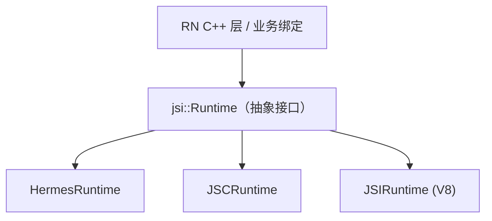
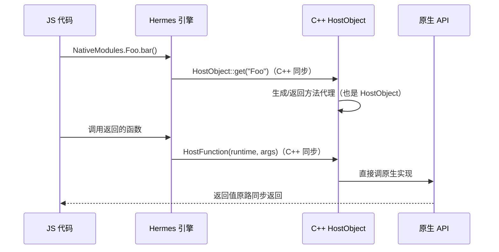

# JSI 原理

> 新架构的地基不是 Fabric，而是 JSI（JavaScript Interface）：一层用 C++ 写的"引擎通用遥控器"。理解了 JSI，"同步调用原生"从口号变成一句可解释的话。

## 1. JSI 是什么

JSI 是一个 **C++ 抽象接口层**：它定义了"引擎能被如何操作"的最小协议（源码：`ReactCommon/jsi/jsi/`），任何引擎（Hermes/JSC/V8）实现这套协议，任何 C++ 代码就可以**不依赖具体引擎 API** 地操作 JS 值。



对比旧架构：JSC 要用 JavaScriptCore C API、Hermes 用自家 API、V8 用 v8 API——每套绑定各写一遍，换引擎=重写桥。JSI 之后，**引擎成了可插拔件**。

### 1.1 这层抽象解决的是"谁依赖谁"

旧架构的依赖方向是**倒挂的**：RN 的通信层（cxxreact 时代的 `JsToNativeBridge` / `NativeToJSBridge`）直接面向 JSC 的 C API 写绑定，于是整条 NativeModules 通路都被钉死在 JSC 上。Hermes 想进来，就得为"另一套引擎 API"再维护一版胶水——每加一个引擎，胶水乘一份。

JSI 把依赖方向反过来：**引擎来实现 RN 定义的协议**（`jsi::Runtime` 的纯虚接口），RN 与所有上层绑定只面向协议编程。引擎从"地基"降级为"插件"，新增或替换引擎的成本从"重写桥"变成"实现一遍 Runtime 接口"。

用矩阵看更直观——设引擎有 N 种、需要跨界的绑定层有 M 处（模块系统、渲染器、调试协议、业务原生库）：

| | 无 JSI（面向各引擎 API 写绑定） | 有 JSI（面向协议编程） |
|--|------------------------------|----------------------|
| 绑定矩阵 | N × M 份胶水，每份都要维护 | M 份绑定 + N 个引擎适配 |
| 新增引擎 | 改动所有绑定层 | 只写一个 Runtime 适配 |
| 绑定层复用 | 不可复用（绑 JSC 的代码绑不了 Hermes） | 全部复用 |

| 工程收益 | 具体表现 |
|---------|---------|
| 引擎可替换 | App 可按包体/启动/JIT 需求选 Hermes/JSC/V8，业务代码零改动 |
| 多 Runtime 共存 | Reanimated 在 UI 线程再建一个 Hermes Runtime 跑 worklet（模块六） |
| C++ 直通 | MMKV/SQLite 等 C++ 库可以不经过 Java/OC 中转，直接暴露给 JS |

这也是"为什么新架构要连引擎一起谈"的答案：JSI、Hermes 默认化、Bridgeless 是同一盘棋——通道、引擎、拆桥。

### 1.2 三种引擎的适配姿势

| 引擎 | 适配方式 | 说明 |
|------|---------|------|
| Hermes | 原生实现 | `HermesRuntime` 直接实现 jsi 接口，`HermesValue` 与 `jsi::Value` 几乎零成本互转 |
| JSC | 包装层 | `JSCRuntime` 把 JavaScriptCore 的 C API（`JSValueRef` 一族）包成 jsi 接口 |
| V8 | 独立适配包 | `@react-native/v8` 提供 v8runtime，社区/厂商按需集成 |

适配成本差异会一路传导到调用性能：Hermes 的值表示与 jsi::Value 同构，JSC 则需要装箱/拆箱（见 4.2）。引擎选型对比展开在[模块三 01 · JS 引擎对比与 Hermes 原理](../rn-JS引擎与线程模型/01-JS引擎对比与Hermes原理.md)。

### 1.3 边界：JSI 不是引擎，也不是业务 API

三个容易混淆的边界：

1. **JSI 不提供 GC、不提供字节码**——那是引擎的事；JSI 只规定"如何被操作"；
2. **JSI 不面向业务 JS 开发者**——它是 C++ 协议，JS 侧看不到 JSI，只能看到它挂上去的 HostObject；
3. **JSI 不等于"新架构"**——它是通道层；模块系统（[03 · TurboModules](03-TurboModules.md)）与渲染管线（[02 · Fabric 渲染管线](02-Fabric渲染管线.md)）才是建在通道上的建筑。

## 2. 核心抽象：Runtime 与 Value

读 `jsi.h` 时先建立一个印象：`Runtime` 的接口按能力分组，每组都能在 JS 语言里找到对应物——JSI 不是发明新概念，而是给"引擎必备能力"画了一张最小清单：

| 能力组 | Runtime 上的典型方法 | JS 里的对应物 |
|--------|--------------------|--------------|
| 执行脚本 | `evaluateJavaScript` | `<script>` / eval |
| 全局对象 | `global()` | `globalThis` |
| 对象操作 | `Object::getProperty/setProperty` | `obj.a` |
| 函数调用 | `Function::call / callAsConstructor` | `fn()` / `new Fn()` |
| 数组 | `Array::size / setValueAtIndex` | `arr[i]` |
| 字符串/符号 | `String::utf8 / Symbol::forUtf8` | 字符串比较、symbol 注册表 |
| 外部内存 | `ArrayBuffer` 工厂 | `ArrayBuffer` |
| 异常 | `JSError` 抛出/捕获 | try/catch |

```cpp
// jsi.h 的骨架（简化）
namespace jsi {
  class Runtime {                       // 引擎的抽象
    virtual Value evaluateJavaScript(...);
    virtual Object global();            // 全局对象
    // property 操作 / 函数调用 ...
  };
  class Value { ... };                  // JS 值的变体（undefined/number/object/...）
  class Object : public Pointer { ... };
  class Function : public Object {      // 可调用
    Value call(Runtime&, const Value* args, size_t count);
  };
  class HostObject {                    // ★ C++ 对象暴露给 JS
    virtual Value get(Runtime&, const PropNameID&);
    virtual void set(Runtime&, const PropNameID&, const Value&);
  };
}
```

两个认知锚点：

1. **同进程直调**：`Function::call` 是一次 C++ 虚函数调用 + 引擎内执行，没有序列化、没有跨线程排队；
2. **HostObject 是任意门的门轴**：把 C++ 对象塞进 JS 世界，JS 访问其属性 = 调用 C++ 的 get。

### 2.1 jsi.h 全家福

`jsi.h`（配合 `jsi-inl.h` 的内联实现）定义了一整个小宇宙，读源码时按这张地图定位：

| 类/类型 | 语义 | 备注 |
|---------|------|------|
| `Runtime` | 引擎抽象 | 一切 API 的第一参数都是 `Runtime&` |
| `Value` | JS 值的变体 | 可为 undefined/null/bool/number/symbol/string/object |
| `Object` / `Function` / `Array` / `ArrayBuffer` | 对象族 | 都是 `Pointer` 子类（持有句柄） |
| `String` / `Symbol` | 字符串/符号 | `String::utf8(rt)` 转出 std::string（有拷贝） |
| `PropNameID` | 属性名标识 | property 操作用它做键，支撑 symbol 键 |
| `HostObject` | C++ 对象暴露给 JS | 本篇主角 |
| `HostFunction` | C++ 函数暴露给 JS | `std::function` 签名，配合 `Function::createFromHostFunction` |
| `Scope` | 批量对象生命周期 | 出作用域自动回收（GC 引擎的"局部根"） |
| `Buffer` / `PreparedJavaScript` | 脚本载体 | evaluateJavaScript 吃 Buffer；预编译脚本吃 PreparedJavaScript |
| `JSIException` / `JSError` | 异常桥接 | C++ 侧捕获 JS 异常的形态 |
| `Runtime::Instrumentation` | 引擎仪表 | GC 统计、堆信息等（调试用） |

### 2.2 Value 是值语义的"句柄 + 内联"混合体

理解 `jsi::Value` 的内存模型，后面的性能直觉才立得住：

- **布尔/数字直接内联**在 Value 结构里，读写零间接；
- **对象/字符串/符号是句柄**：Value 里存的是指针级引用，拷贝一个 Value 只增加引擎侧的引用，不复制内容；
- 判断两个 JS 对象"是不是同一个"要用 `rt.strictEquals(a, b)`，比较 C++ 侧的 `Object` 指针没有意义——同一 JS 对象在不同时刻可能对应不同包装实例。

### 2.3 生命周期纪律：跨调用不存 jsi 值

JSI 编程的第一条军规：

1. **jsi::Value/Object/Function 只在所属 Runtime 存活期间有效**——Runtime 销毁后它们全部悬垂；
2. 想跨调用持久化数据，先**拷出成 C++ 类型**（`utf8()` 出 `std::string`、`asNumber()` 出 double），下次访问再包回 jsi 值；
3. `Scope` 适合"一批临时对象"的自动化回收，而不是长期缓存。

这条纪律在 TurboModule 实现里体现为：原生侧持有自己的 C++ 状态，JSI 值只在单次调用的参数/返回值生命周期内存在。

## 3. 同步直调是怎么发生的

以 Hermes 为例，"JS 同步调原生方法"的完整通路：



对照旧架构的三个死穴：

| 死穴 | JSI 的解法 |
|------|-----------|
| 异步强制 | 同进程同步调用，`return` 即结果 |
| 序列化税 | jsi::Value 直接跨越（数字/对象引用传递），复杂结构仍需转换但无 JSON 文本这一层 |
| 类型不安全 | 配合 Codegen 由类型定义生成 C++ 绑定（[04 · Codegen](04-Codegen.md)） |

旧架构消息模型的完整拆解见[模块四 01 · Bridge 本质与消息队列](../rn-Bridge通信原理/01-Bridge本质与消息队列.md)。

### 3.1 一个可复现的最小 HostObject

下面这段代码是所有纯 JSI 库（react-native-mmkv、react-native-quick-sqlite）共同的骨架——"install 一个 HostObject 到 global"：

```cpp
// 纯 JSI 库的经典 install（骨架示意，来源感：Reanimated/mmkv 的 install 入口同型）
class MathHostObject : public jsi::HostObject {
 public:
  jsi::Value get(jsi::Runtime &rt, const jsi::PropNameID &name) override {
    const std::string prop = name.utf8(rt);   // 注意：这里发生一次字符串拷贝

    if (prop == "add") {
      return jsi::Function::createFromHostFunction(
          rt, name, /*paramCount=*/2,
          [](jsi::Runtime &rt, const jsi::Value &thisVal,
             const jsi::Value *args, size_t count) -> jsi::Value {
            double sum = 0;
            for (size_t i = 0; i < count; ++i) {
              if (!args[i].isNumber()) continue;
              sum += args[i].asNumber();
            }
            return jsi::Value(sum);           // 返回值原路同步回 JS
          });
    }
    if (prop == "version") {
      return jsi::Value(1);                   // 常量：同步返回
    }
    return jsi::Value::undefined();
  }
};

// 安装：把 C++ 对象挂到 JS 的 global 上
void install(jsi::Runtime &rt) {
  rt.global().setProperty(
      rt, "NativeMath",
      jsi::Object::createFromHostObject(rt, std::make_shared<MathHostObject>()));
}
```

JS 侧的体验：

```js
// 与调用普通对象没有任何语法差别
global.NativeMath.add(1, 2);   // 3 —— 同步返回，下一行语句就能用
global.NativeMath.version;     // 1 —— 常量同步读
```

把这次调用拆成逐步表：

| 步 | 发生什么 | 所在层面 |
|----|---------|---------|
| 1 | JS 引擎在 global 上查 `NativeMath` 属性 | 引擎 |
| 2 | 发现是 HostObject → **同步调用**其 C++ `get()` | C++ |
| 3 | `get` 返回一个 `createFromHostFunction` 包装的函数对象 | C++ → JS |
| 4 | JS 执行调用 → 引擎同步执行 HostFunction lambda | C++ |
| 5 | lambda 构造返回 `jsi::Value` → JS 拿到返回值 | C++ → JS |

五步全部发生在**同一次 JS 调用栈**里——这就是"同步直调"的全部含义，没有第六步。

### 3.2 从 JS 视角看 HostObject

- **语法无差别，语义有差别**：HostObject 没有原型链，不能拿普通对象的招数（`Object.keys`、展开运算符）去枚举它；赋值会走 C++ 的 `set`（若未实现则表现为只读）；
- **每次属性访问都是一次跨界**：比访问普通 JS 对象多一层 C++ 虚调用。所以成熟的 JSI 库都把 API 面做浅、方法在 JS 侧缓存到变量再高频调用、常量一次性取出；
- **调试器看到的是外壳**：console.log 只能打印出对象的外形，内部状态得靠原生侧日志。

### 3.3 HostObject 与 HostFunction：两种暴露原语的选型

把能力暴露给 JS 有两种原语，选型规则很简单——按"聚合的是状态还是行为"分：

| 原语 | 适合暴露什么 | 典型形态 |
|------|-------------|---------|
| `HostObject` | 一组相关的属性/方法 + C++ 侧状态 | 命名空间（`NativeMath`）、实例（`new MMKV()` 得到的对象） |
| `HostFunction`（`createFromHostFunction`） | 单个函数、无状态或闭包态 | HostObject 的方法成员、一次性回调 |

实践上两者总是组合出场：HostObject 的 `get` 里按属性名现场返回 HostFunction（如 3.1 的 `add`）。两个进阶细节：

- `createFromHostFunction` 的 `paramCount` 只是给引擎的提示（影响 `fn.length`），不做强校验——参数个数检查要在 lambda 里自己做；
- HostObject 的 C++ 实例用 `std::shared_ptr` 持有，JS 侧对象被 GC 后 C++ 侧自动析构——反过来，**C++ 侧长期持有的状态要自己管理生命周期**，不能反过来依赖 jsi 值（2.3 的纪律）。

## 4. JSI 不是银弹：两个保留约束

1. **线程约束依旧**：jsi::Runtime 非线程安全，跨线程调用仍需切到引擎线程（新架构用 `RuntimeExecutor` 调度）——JSI 消除的是"跨语言"成本，不是"跨线程"成本；
2. **引擎无关 ≠ 免费抽象**：jsi::Value 与引擎原生表示之间可能有装箱/转换开销（Hermes 的 `HermesValue` 基本零成本，JSC 的 JSValue 需包装）。

### 4.1 线程约束展开：单线程亲和没有消失

`jsi::Runtime` 的所有方法都默认"在创建它的线程上调用"。RN 侧的配套调度设施有两个名字要认识：

- **RuntimeExecutor**（`ReactCommon/jsi/RuntimeExecutor.h` 风格）：持有"如何往 JS 线程投递任务"的能力，`execute([](jsi::Runtime &rt) { ... })` 把 lambda 切到引擎线程执行；
- **CallInvoker**（cxxreact 一族）：旧瓶新酒，NativeModules/TurboModules 时代"从任意线程回调 JS"的标准通道。

```cpp
// 原生线程想安全地回调 JS（示意）
void NativeWorkerThread::onDone(int result) {
  jsCallInvoker_->invokeAsync([result](jsi::Runtime &rt) {
    // 现在在 JS 线程上，可以安全操作 rt
    auto &cb = cachedCallback_;           // 注意：缓存的应是 C++ 数据而非 jsi 值
    cb(rt, result);
  });
}
```

三条实践纪律：

1. **永远不要在非引擎线程碰 Runtime**——那是数据竞争与随机崩溃的捷径；
2. **同步链内的同步回调是重入**（JS → C++ → JS），协议上允许但要控制栈深；原生线程直接同步调 JS 则直接违规；
3. **双 Runtime 是合法解**：Reanimated 在 UI 线程建第二个 Hermes Runtime 跑 worklet，各 Runtime 各自单线程亲和，靠共享的 C++ 数据结构交换信息（模块六）。

线程全景见[模块三 02 · 四线程模型](../rn-JS引擎与线程模型/02-四线程模型.md)。

### 4.2 抽象成本展开：钱花在哪几处

- **值表示**：Hermes 基本零成本；JSC 每次跨越要包一层 `JSValueRef`；
- **字符串跨越**：`name.utf8(rt)` / `String::utf8()` 都发生一次到 `std::string` 的拷贝——高频字符串 API 的成本点，能传数字/枚举就别传字符串；
- **二进制大块数据**：走 `ArrayBuffer`——JSI 支持在外部内存上创建 ArrayBuffer（或从 HostObject 暴露），让两侧共享同一段字节，彻底绕开"逐字段转换"；
- **GC 压力**：C++ 侧频繁创建临时 jsi 对象会喂大 GC 的活；`Scope` 与"值即用即弃"的风格是常规缓解。

一句话：JSI 消除了**序列化层**，没有消除**表示转换**——设计 API 时把跨界次数当预算花。Hermes 值表示与 GC 的细节在[模块三 03 · Hermes 深潜](../rn-JS引擎与线程模型/03-Hermes深潜：字节码与GC.md)。

## 5. JSI 落地形态一览

| 用途 | 形态 |
|------|------|
| TurboModules | `TurboModule` 本质是预注入 JS 的 HostObject 族 |
| Fabric | react-reconciler 通过 JSI 直接驱动 C++ ShadowTree |
| Reanimated | worklet 经 JSI 编译/挂载，跑在 UI 线程的 Runtime 上 |
| MMKV / SQLite 等库 | 纯 JSI 绑定（无 JS 层包装），`react-native-mmkv` 是教科书案例 |

> 纯 JSI 库的经典结构：JS 侧只有一个 `import { configure } from 'react-native-quick-sqlite'`，install 时 C++ 往 global 上挂 HostObject——业务调用全程不过 React 层。

逐行展开：

- **TurboModules**：把"模块系统"建在 HostObject 上——按需实例化 + Codegen 生成的强类型绑定，展开见[03 · TurboModules](03-TurboModules.md)；
- **Fabric**：reconciler 的宿主配置（host config）直接用 C++ 实现并经 JSI 注入，render 的产物在 C++ 侧长成 ShadowTree，展开见[02 · Fabric 渲染管线](02-Fabric渲染管线.md)；
- **Reanimated**：把 JS 函数编译成 worklet 字节码，通过 JSI 挂到 UI 线程的独立 Runtime——手势/动画闭环不再等 JS 线程（[模块六 04 · 动画系统原理](../rn-事件系统原理/04-动画系统原理.md)）；
- **MMKV/quick-sqlite**：纯 JSI 库，没有 Codegen、没有 React 依赖，install 即用——它们证明了 JSI 本身就是完整的发布能力，不一定绑死在 RN 框架设施上。

顺带回答一个常见问题：**install 发生在什么时机？** 引擎创建后、业务 JS 执行前的窗口期。Bridgeless 下这个窗口由 `BindingsInstaller` 一类的钩子承担（[模块二 01 · Android 启动链路](../rn-启动流程原理/01-Android启动链路.md)的新架构差异段）——在引擎就绪与 bundle 执行之间，把框架自身的 HostObject（`__turboModuleProxy` 等）与三方库的 install 都注入完毕。这就是为什么纯 JSI 库的 install 通常要求在模块顶层 import 时执行：再晚就来不及赶在首帧之前。

## 6. 动手感受 JSI

```js
// Reanimated 3 的入口就是一次 JSI install
import './reanimated/plugin'; // 内部: worklets.install() → C++ HostObject 上 global

// react-native-mmkv：所有 API 都是 HostObject 直调
const storage = new MMKV();
storage.setString('k', 'v'); // 同步、无桥
```

在 Android logcat 搜 `CatalystInstanceImpl` 不再出现、改搜 `ReactHostImpl`——Bridgeless 模式下整条消息队列被 JSI 调用取代。

### 6.1 一个实验设计：亲手验证"同步、无序列化"

不引用任何结论数字，实验本身就能建立直觉：

1. **验证同步**：写一个 C++ HostObject，方法里记下"进入时刻"，JS 侧在调用前后各记一个时刻（`global.performance.now()`）——三个时刻同一毫秒级刻度内递增，且下一行语句能立即读到返回值；
2. **验证无队列**：在 HostFunction 里 `std::this_thread::sleep_for` 一小段，观察 JS 主线程**同步停住**（UI 冻结）——这既是"同步"的证明，也是"同步调用必须便宜"的反面教材；
3. **对照旧通道**：同一逻辑用旧 `NativeModules`（Promise 形态）实现，观察返回值至少要等一个微任务轮回——两者时序模型的不同一目了然。

实验 2 顺带解释了一条设计准则：**HostFunction 里不做重活**——重活扔到模块自己的执行队列，做完再经 CallInvoker 异步回 JS（[03 · TurboModules](03-TurboModules.md) 的 executor 设计）。

## 7. 调试与观测 JSI

C++ 层的观测手段与 JS 层不同家：

- **断点**：lldb/Android Studio 在你自己的 `HostObject::get` 或 `facebook::jsi::` 命名空间的函数上下断点，能看到每一次属性访问的调用栈；JS 断点看不到这些；
- **崩溃栈**：release 崩溃里的 `facebook::jsi::` 前缀帧是定位"跨界处崩溃"的路标；Hermes 的 JS 栈需要用官方符号化工具还原（模块十 04 的调试链路）；
- **仪表**：`rt.instrumentation()` 可拿到 GC 与堆的概览信息（各引擎实现程度不同，作参考）；
- **性能段**：Perfetto/systrace 里 C++ 侧的段（如 fabric/turbomodule 相关段）才是 JSI 通道的真实耗时来源，JS profiler 只能看到"函数耗时长"，看不到"耗在哪一侧"。

## 8. 常见误区清单

| 误区 | 事实 |
|------|------|
| "JSI 就是 Bridge 的替代品，一个新队列" | JSI 没有队列——它是同进程函数调用协议，"异步批量窗口"这个概念在 JSI 里不存在 |
| "JSI 调用零成本" | 有虚调用、装箱（视引擎）、字符串拷贝等真实开销，只是**量级**远小于序列化+跨线程 |
| "同步原生调用可以随便做重活" | 同步 = 阻塞 JS 线程；重活必须扔到模块自己的队列（03 篇的 executor 设计） |
| "用了 JSI 就自动线程安全" | Runtime 非线程安全；跨线程回调必须走 RuntimeExecutor/CallInvoker 切回引擎线程 |
| "HostObject 可以像普通 JS 对象一样枚举/继承" | 无原型链、枚举语义由引擎决定，库设计要假设"只能按名访问" |
| "JSC 项目用不上本篇" | 新架构下 JSC 同样经 JSI 接入（JSCRuntime 包装层），本篇全部机制照成立，只是装箱成本档位不同 |

## 小结

- JSI = 引擎抽象 + 同进程 C++ 调用协议，HostObject/HostFunction 是"原生暴露给 JS"的原语。
- 它解决"跨语言"（同步、免 JSON），不解决"跨线程"（Runtime 仍需线程亲和）。
- Fabric、TurboModules、Reanimated、MMKV 都是 JSI 之上的建筑——地基一通，上层全通。
- 值语义与生命周期是 JSI 编程的两条军规：跨调用持久化先拷成 C++ 类型，非引擎线程永远不碰 Runtime。
- 抽象不是免费的：字符串拷贝、装箱、GC 压力是真实的账单，API 设计要按"跨界次数"做预算。

## 自测

1. `jsi::Function::call` 与旧架构 `MessageQueue.enqueueNativeCall` 在"线程模型、时序、数据形态"三个维度上各差在哪？
2. 为什么说"JSI 消除的是跨语言成本，不是跨线程成本"？`RuntimeExecutor`/`CallInvoker` 分别在什么场景出场？
3. 一个 TurboModule 实现想在原生线程持有上次调用传入的 `jsi::Object` 以便下次复用，哪里违反了生命周期纪律？正确做法是什么？
4. 为什么 react-native-mmkv 的 `setString` 能同步返回，而旧 AsyncStorage 只能回调？从 HostObject 的属性访问路径解释。
5. Hermes 与 JSC 在 JSI 适配成本上的差异体现在哪个表示层？这对高频调用场景的引擎选型意味着什么？
