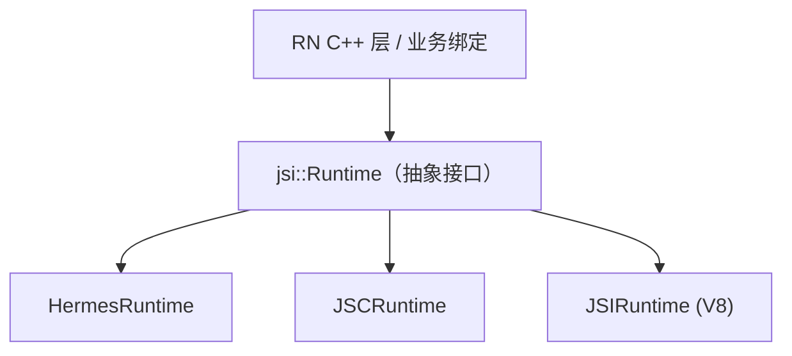
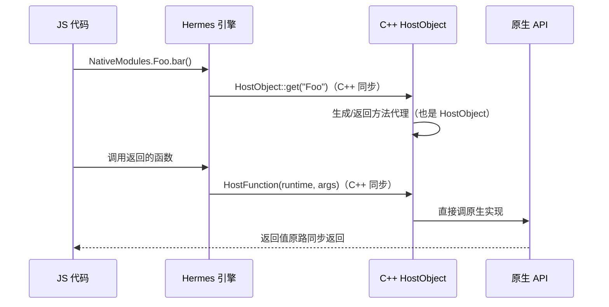

# JSI 原理

> 新架构的地基不是 Fabric，而是 JSI（JavaScript Interface）：一层用 C++ 写的"引擎通用遥控器"。理解了 JSI，"同步调用原生"从口号变成一句可解释的话。

## 1. JSI 是什么

JSI 是一个 **C++ 抽象接口层**：它定义了"引擎能被如何操作"的最小协议（源码：`ReactCommon/jsi/jsi/`），任何引擎（Hermes/JSC/V8）实现这套协议，任何 C++ 代码就可以**不依赖具体引擎 API** 地操作 JS 值。



对比旧架构：JSC 要用 JavaScriptCore C API、Hermes 用自家 API、V8 用 v8 API——每套绑定各写一遍，换引擎=重写桥。JSI 之后，**引擎成了可插拔件**。

## 2. 核心抽象：Runtime 与 Value

```cpp
// jsi.h 的骨架（简化）
namespace jsi {
  class Runtime {                       // 引擎的抽象
    virtual Value evaluateJavaScript(...);
    virtual Object global();            // 全局对象
    // property 操作 / 函数调用 ...
  };
  class Value { ... };                  // JS 值的变体（undefined/number/object/...）
  class Object : public Pointer { ... };
  class Function : public Object {      // 可调用
    Value call(Runtime&, const Value* args, size_t count);
  };
  class HostObject {                    // ★ C++ 对象暴露给 JS
    virtual Value get(Runtime&, const PropNameID&);
    virtual void set(Runtime&, const PropNameID&, const Value&);
  };
}
```

两个认知锚点：

1. **同进程直调**：`Function::call` 是一次 C++ 虚函数调用 + 引擎内执行，没有序列化、没有跨线程排队；
2. **HostObject 是任意门的门轴**：把 C++ 对象塞进 JS 世界，JS 访问其属性 = 调用 C++ 的 get。

## 3. 同步直调是怎么发生的

以 Hermes 为例，"JS 同步调原生方法"的完整通路：



对照旧架构的三个死穴：

| 死穴 | JSI 的解法 |
|------|-----------|
| 异步强制 | 同进程同步调用，`return` 即结果 |
| 序列化税 | jsi::Value 直接跨越（数字/对象引用传递），复杂结构仍需转换但无 JSON 文本这一层 |
| 类型不安全 | 配合 Codegen 由类型定义生成 C++ 绑定（模块七第 4 篇） |

## 4. JSI 不是银弹：两个保留约束

1. **线程约束依旧**：jsi::Runtime 非线程安全，跨线程调用仍需切到引擎线程（新架构用 `RuntimeExecutor` 调度）——JSI 消除的是"跨语言"成本，不是"跨线程"成本；
2. **引擎无关 ≠ 免费抽象**：jsi::Value 与引擎原生表示之间可能有装箱/转换开销（Hermes 的 `HermesValue` 基本零成本，JSC 的 JSValue 需包装）。

## 5. JSI 落地形态一览

| 用途 | 形态 |
|------|------|
| TurboModules | `TurboModule` 本质是预注入 JS 的 HostObject 族 |
| Fabric | react-reconciler 通过 JSI 直接驱动 C++ ShadowTree |
| Reanimated | worklet 经 JSI 编译/挂载，跑在 UI 线程的 Runtime 上 |
| MMKV / SQLite 等库 | 纯 JSI 绑定（无 JS 层包装），`react-native-mmkv` 是教科书案例 |

> 纯 JSI 库的经典结构：JS 侧只有一个 `import { configure } from 'react-native-quick-sqlite'`，install 时 C++ 往 global 上挂 HostObject——业务调用全程不过 React 层。

## 6. 动手感受 JSI

```js
// Reanimated 3 的入口就是一次 JSI install
import './reanimated/plugin'; // 内部: worklets.install() → C++ HostObject 上 global

// react-native-mmkv：所有 API 都是 HostObject 直调
const storage = new MMKV();
storage.setString('k', 'v'); // 同步、无桥
```

在 Android logcat 搜 `CatalystInstanceImpl` 不再出现、改搜 `ReactHostImpl`——Bridgeless 模式下整条消息队列被 JSI 调用取代。

## 小结

- JSI = 引擎抽象 + 同进程 C++ 调用协议，HostObject/HostFunction 是"原生暴露给 JS"的原语。
- 它解决"跨语言"（同步、免 JSON），不解决"跨线程"（Runtime 仍需线程亲和）。
- Fabric、TurboModules、Reanimated、MMKV 都是 JSI 之上的建筑——地基一通，上层全通。
