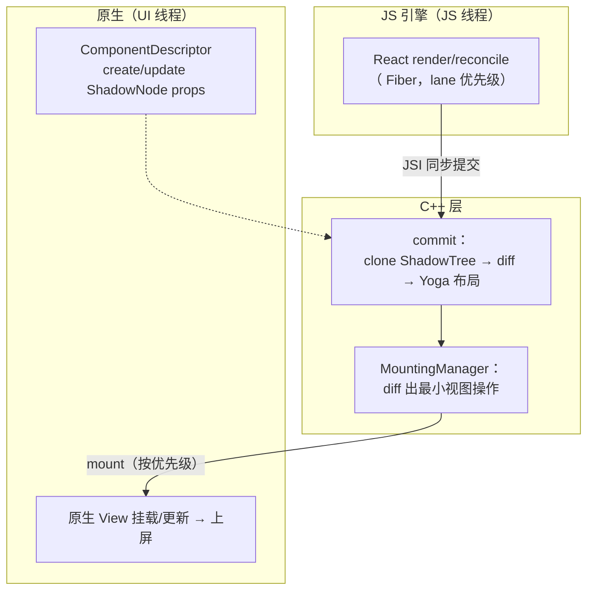
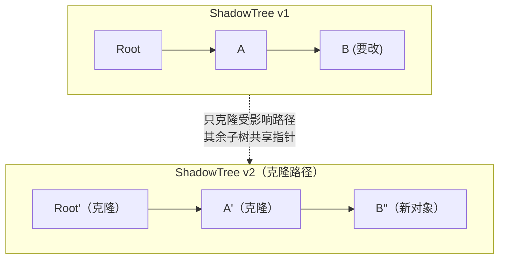

# Fabric 渲染管线

> Fabric 是新架构的渲染器：C++ ShadowTree、同步布局、clone-on-write、带优先级的 commit。本篇沿"render → reconcile → commit → mount"四阶段把新管线走一遍，并与旧管线逐段对照。

## 1. 新管线全景



四个阶段一句话：

1. **render/reconcile**（JS）：React 正常 diff，但 commit 不再发消息；
2. **commit**（C++）：克隆出新 ShadowTree 版本，diff，同步跑 Yoga；
3. **mount**（C++ → 原生）：把新旧树差异翻译成原生视图操作，切 UI 线程执行；
4. **组件描述**：每种控件（View/Text/...）由 ComponentDescriptor 定义 props 映射与原生创建逻辑。

源码入口：`ReactCommon/react/renderer/`（`components/`、`core/ShadowNode.cpp`、`mounting/`）。

### 1.1 一次 setState 到上屏的逐步表

把全景图拉直成时间线（以"点击按钮 → setText"为例）：

| 步 | 动作 | 所在线程 | 关键产物 |
|----|------|---------|---------|
| 1 | 事件经 JSI 直调进 JS（[模块六 01](../rn-事件系统原理/01-触摸事件链路与手势仲裁.md)） | UI → JS | 事件对象 |
| 2 | setState 调度 update（lane 定优先级） | JS | Fiber 更新队列 |
| 3 | React render/reconcile：新旧 Fiber diff | JS | 新的 React 元素树 |
| 4 | reconciler 宿主配置（C++ 实现）创建/克隆 ShadowNode | JS（C++ 调用栈） | 新 ShadowTree 版本 |
| 5 | commit：克隆路径完成、树完整 | JS/C++ | 新版 ShadowTree |
| 6 | Yoga 同步布局 | commit 调用栈内 | 带 layout 坐标的节点 |
| 7 | 计算视图差异指令 | C++ | `MountingTransaction`（指令集） |
| 8 | MountingCoordinator 接管新版本 | C++ | 待挂载版本 |
| 9 | mount：diff 应用为原生视图操作 | 切 UI 线程 | create/update/insert/remove 流 |
| 10 | 原生 View 树更新、invalidate、绘制 | UI | 下一帧上屏 |

注意 4–7 步都在**同一次 JSI 调用栈**里——这是"render→mount 一气呵成"的准确含义；8–9 步才离开 JS 线程。

### 1.2 管线上的关键角色

| 角色 | 源码感 | 职责 |
|------|--------|------|
| react-reconciler 宿主配置 | `ReactCommon/react/renderer/`（renderer 接入层） | 把 React 的操作翻译成 ShadowNode 操作 |
| ShadowNode / ShadowNodeFamily | `core/ShadowNode.cpp`、`core/ShadowNodeFamily.cpp` | 不可变树节点 / 同一逻辑节点的版本线 |
| UIManager | `uimanager/UIManager.cpp` | commit 入口：克隆、布局、生成事务 |
| MountingCoordinator | `mounting/MountingCoordinator.cpp` | 持有"最新已提交版本"，协调挂载时机 |
| MountingTransaction / ShadowViewMutation | `mounting/MountingTransaction.h` | 一批最小视图操作（第 4.1 节） |
| MountingManager（+平台 Delegate） | `mounting/MountingManager.h` | 把指令落到平台 View 世界 |
| ComponentDescriptor | `components/**/ComponentDescriptors.h` | 每种控件的创建/克隆/更新规则 |

三棵树（React 树 / Shadow 树 / View 树）的关系全景见[模块五 01 · 三棵树与 Reconciler](../rn-渲染原理/01-三棵树与Reconciler.md)。

## 2. ShadowNode：clone-on-write 的不可变树

旧架构 ShadowNode 是平台对象（Java/OC），更新就地改；Fabric 的 `ShadowNode` 是 **C++ 不可变对象**——更新 = 从叶到根克隆一条路径：



收益：

- **线程安全免锁**：多线程可并发读旧版本，写者克隆路径；
- **diff 廉价**：新旧树共享节点，`ShadowNode::diff` 只走克隆路径；
- **可回溯**：保留版本即可实现"渲染帧快照"（Concurrent 特性需要）。

### 2.1 克隆的精确动作

`ShadowNode::clone` 有三个重载方向，分别对应 React 更新的三种形态（骨架示意）：

```cpp
// ReactCommon/react/renderer/core/ShadowNode.h（骨架简化）
// ① 只换 props：setText 之类
ShadowNode::clone(family, [](ShadowNode const &old) {
  return std::make_shared<ShadowNode>(old,
      ShadowNodeFragment{propsCopy /* 新 props */});
});
// ② 换 children：列表插入/删除
ShadowNode::clone(family, [](ShadowNode const &old) {
  return std::make_shared<ShadowNode>(old, std::move(newChildren));
});
// ③ 换 state：ScrollView 的 contentOffset 之类
ShadowNode::clone(family, /* newState = */ ...);
```

克隆的三个细节：

1. **路径克隆而非节点克隆**：改一个叶子，它到根的所有祖先都要新版本（父节点持有 children 的 shared_ptr，children 变了父就得变）；
2. **兄弟子树原样共享**：未受影响分支的 `shared_ptr` 引用计数 +1 而已，不复制内容；
3. **克隆出来的新节点在提交前仍可继续克隆**——React 并发渲染里"丢弃一次未完成的渲染"就是简单地把这条克隆链作废，旧版本毫发无伤。

### 2.2 Family：同一逻辑节点的版本线

克隆会产生"很多个 Root"、"很多个 B"，怎么知道哪个是"现在的"？答案是 `ShadowNodeFamily`：

- 每个**逻辑位置**（不是每个版本）对应一个 Family，它记住"这个位置最新的 ShadowNode 版本"；
- React 提交更新时通过 Family 找到最新版本作为克隆基底——避免并发渲染期间基于过期版本克隆；
- UIManager commit 时也以 Family 为锚点把"最终版本"登记为树根。

可以把 Family 理解为 git 的 ref，ShadowNode 版本是 commit——ref 前进，旧 commit 仍可追溯（帧快照能力即来自这里）。

### 2.3 不可变的代价

COW 不是免费的：

- **分配压力**：写密集场景下每次更新都产生新节点对象（哪怕只改了一个 props），堆分配与引用计数开销真实存在；
- **克隆成本 ∝ 树深**：深层组件的 props 更新要克隆整条祖先链——**过深的组件嵌套在新架构下是真实的性能税**（模块九 03 的渲染优化处方因此更重要）；
- **缓解方向**：框架持续在节点内存布局、克隆路径上做优化；业务侧的对应动作是"该 memo 的分支 memo 住"——减少无效克隆的发生，而不是幻想克隆免费。

## 3. commit 阶段：同步布局的意义

Fabric 的 commit 在一次 JSI 调用内完成：`UIManager::commit`（`ReactCommon/react/renderer/uimanager/`）：

1. `ShadowNode::clone` 出新树；
2. `layout::LayoutManager` 跑 Yoga——**同步**，在提交线程内完成；
3. 生成 `MountingTransaction`（差异指令集）。

"同步"的含金量：

| 场景 | 旧架构 | Fabric |
|------|--------|--------|
| 读布局 `measure` | 异步回调（下一帧） | **同步返回**（C++ 布局已完成） |
| 动画前的布局准备 | 提交与布局分帧 | 同帧内完成，动画首帧无抖动 |
| 文本测量 | 跨语言回调平台 | C++ 同步（TextMeasurer 内联） |

### 3.1 commit 内部的完整步骤

把 `UIManager::commit` 拆细（骨架级，不同版本细节有差异）：

| 步 | 动作 | 说明 |
|----|------|------|
| 1 | 取最新树根 | 经 ShadowNodeFamily 定位基底版本 |
| 2 | 应用 React 的克隆 | reconcile 阶段排好的节点操作落地 |
| 3 | 布局 | 对"新树"整体或脏子树跑 Yoga（`layout::LayoutManager`） |
| 4 | 计算视图差异 | 新旧 ShadowView 逐层 diff，产出 mutation 列表 |
| 5 | 打包事务 | `MountingTransaction`（带自增的事务号，用于对账） |
| 6 | 提交给 MountingCoordinator | 新版本成为"待挂载的最新版本"，等待 mount |

第 3 步的"同步"是全表的题眼：布局结果在本步结束时**就存在了**，后面的 measure 读取不需要等任何回调。

### 3.2 同步布局怎么被读到

JS 侧的 `viewRef.current.measure(...)` 在 Fabric 下读的是**已提交版本的布局缓存**——commit 已经算完，回调立即带数。这条能力支撑了一批以前写不好的模式：

- 手势/动画驱动的位移计算：先量再动，不再"下一帧才量准"；
- 弹层定位（popover 锚点）：同步拿到锚点尺寸，首帧即正确；
- 文本截断/换行相关逻辑：测量不再跨语言往返。

边界：measure 读到的是**上一次 commit** 的结果——当前 render 中途（本帧尚未提交）读不到"未来的布局"，这不是缓存 bug，而是"快照"语义的自然推论。

### 3.3 布局在哪个线程跑

Yoga 的执行位置值得单独点出：**布局计算发生在 commit 的调用栈内**，而 commit 通常由 JS 线程上的 React 提交触发。因此：

- 重布局（深树、复杂 flex）会以 **JS 线程卡顿**的形式表现出来，而不是像旧架构那样藏在 shadow 线程；
- 部分版本提供把布局挪出 JS 线程的实验方向，但心智模型上先按"commit 即布局"理解最稳；
- 对应的性能动作：控制首屏树复杂度、列表定高（`getItemLayout`）、避免无谓的嵌套容器（[模块五 02 · Yoga 布局引擎](../rn-渲染原理/02-Yoga布局引擎.md)、[模块九 02 · 列表虚拟化原理](../rn-性能优化原理/02-列表虚拟化原理.md)）。

### 3.4 布局不是每次全树重算

同步 ≠ 全量。布局环节有两层"只算该算的"：

1. **脏子树收敛**：只有克隆路径上（props/结构变化影响测量）的节点重新测量；尺寸没变的兄弟分支直接沿用旧 layout 结果；
2. **测量缓存**：Yoga 内部对"同样约束下的同一节点"有缓存命中——所以"把列表 item 做成稳定结构 + 定高"能显著减少重测（约束不变即命中）。

推论也直白：**让约束稳定是省布局的第一手段**。不定高的 item、随内容变化的 flex、频繁切换的 display，都会把缓存打成MISS，表现为 commit 段变长（[模块九 03 · 渲染与状态优化](../rn-性能优化原理/03-渲染与状态优化.md)）。

## 4. mount 阶段与优先级

`MountingManager` 把 `MountingTransaction` 切到 UI 线程执行（`Scheduler::mount`），产生最小的原生操作流（createView/updateProps/removeClippedChildren…，与旧架构指令同源但**无 JSON、无队列窗口**）。

调度上的新东西——**优先级与可中断**：

- React 18 的 lane 模型传到渲染层：交互触发的更新（高优先级）可插队先渲染；
- Suspense / useTransition 在 RN 成为可能：低优先级树可以先"空着"，数据好了再补；
- 事件处理（`EventListener`）按优先级派发，输入响应不再被长渲染阻塞。

### 4.1 从 transaction 到原生视图：mutation 的形态

`MountingTransaction` 里是一串 `ShadowViewMutation`，种类对得上任何 UI 框架的心智：

| mutation | 语义 | 典型来源 |
|----------|------|---------|
| Create | 创建原生视图 | 新节点出现 |
| Insert | 把子视图挂到父 | 结构变化 |
| Remove | 从父摘除 | 结构变化 |
| Update | 更新 props | setText/样式变化 |
| Replace | 原地替换节点 | 组件类型变了（同名不同 Tag） |
| Delete | 销毁视图 | 节点卸载后延迟清理 |

三个工程细节：

1. **指令是最小集**：diff 只输出变化的 mutation，"整个页面重刷"不是 Fabric 的行为；
2. **事务号对账**：MountingTransaction 带事务号，挂载侧按序应用——防止"旧事务后到覆盖新事务"的乱序问题；
3. **Delete 延迟**：销毁类操作可能被安排在批次尾部（先摘再删），排查"视图还在"类问题时注意这个时序。

### 4.2 挂载的观测：MountingTelemetry

`mounting/MountingTelemetry` 记录 commit→mount 各环节的时间点（事务进入、开始挂载、结束等）。它不上报、不打 log，但：

- dev 模式的性能浮层/调试工具从这里取数；
- Perfetto/systrace 上 fabric 相关 trace 段与此对应——"commit 完成但 mount 迟迟不执行"这类问题，看两段的间隔比看 JS profiler 直观得多（[模块九 05 · 性能剖析操作手册](../rn-性能优化原理/05-性能剖析操作手册.md)）。

### 4.3 事件的两条通道

事件侧配套了按语义分通道的派发：**离散事件**（点击等独立输入）与**连续事件**（滚动、手势移动流）走不同的队列策略——离散事件保证不与挂载批次交错、按序可达；连续事件合并派发以平抑风暴。效果是"点击后那一帧"不再被滚动事件流挤压，输入响应优先级落到实处（事件全景见[模块六](../rn-事件系统原理/01-触摸事件链路与手势仲裁.md)）。

### 4.4 优先级的完整闭环：从 lane 到 mount

把"优先级"串成一条线看，它不是某一段的局部特性，而是贯穿三个层次的同一条信息：

| 层次 | 载体 | 优先级表现为 |
|------|------|-------------|
| React 调度 | lane | 哪个更新先 render（可插队、可丢弃重排） |
| commit | 事务提交顺序 | 高优先级树先提交、先布局 |
| mount | 挂载批次 | 新版本先上屏；低优先级内容保持旧帧 |

这条链打通后，三个 React 18/19 特性在 RN 才真正可用：

1. **useTransition**：把导航切换标记为低优先级，点击响应（高优先级）先上屏，页面切换"后台"慢慢来；
2. **Suspense 的占位语义**：低优先级子树可以先渲染成占位（空着），数据就绪后补齐——Fabric 的版本快照让"补齐"是一次干净的追加提交；
3. **startTransition 下的连续输入**：输入框每敲一个字符是离散高优先级，由它触发的搜索结果是过渡更新——两条 lane 各走各的提交。

旧架构下这三者要么不可用、要么行为打折，根子就在"批量窗口"把所有更新揉成一锅，无从谈插队（[模块一 03 · 版本演进时间线](../rn-全景与演进/03-版本演进时间线.md)里"并发支持"这一行账由此销掉）。

## 5. ComponentDescriptor：控件级的世界观

第 1 节图里的 D 角色单独展开。每种 Fabric 控件（View/Text/Image/ScrollView...）在 C++ 侧有一个 ComponentDescriptor，它垄断了"这种控件的一切规则"：

```cpp
// ReactCommon/react/renderer/components/view/...（骨架示意）
class ViewComponentDescriptor : public ComponentDescriptor {
  // ① 创建/克隆 ShadowNode（绑定该组件的 Fragment 规则）
  ShadowNode::Shared createShadowNode(ShadowNodeFragment fragment);
  ShadowNode::Shared cloneShadowNode(const ShadowNode &src, ...);
  // ② props 解析：raw props（JS 传来的原始值）→ 强类型 ViewProps
  void updateShadowNode(ShadowNode &node, RawProps props);
  // ③ 事件发射器：给该节点配事件能力
  SharedEventEmitter createEventEmitter(...);
};
```

三个认知点：

1. **props 的翻译在这里**：JS 传的是"原始键值"，descriptor（配合 codegen 生成的 props 结构）负责解析成强类型 `Props`——类型不对在这一层就暴露，不会流到 View 层；
2. **事件也归它管**：节点的事件发射器由 descriptor 创建，事件payload 结构同样是 codegen 产物（[04 · Codegen](04-Codegen.md)）；
3. **自定义组件 = 注册一个新 descriptor**：这是模块十 03 Fabric 原生组件开发的核心动作——不是"继承 ViewManager"，而是"在组件表里登记一套 C++ 规则 + 平台实现"。

### 5.1 新旧组件体系对照

| 维度 | 旧 ViewManager 体系 | ComponentDescriptor 体系 |
|------|--------------------|------------------------|
| 语言/位置 | Java/OC，平台各自实现 | C++ 核心 + 平台薄实现 |
| props 定义 | `@ReactProp` / `viewPropTypes` 注解式 | codegen 生成的强类型 Props 结构 |
| props 校验 | 运行时手动判空（漏判即崩） | 解析层类型化（错即早失败） |
| 事件 | RCTEventDispatcher 发送 | descriptor 创建的 EventEmitter |
| 树操作 | 就地改 ShadowNode（平台对象） | 不可变 ShadowNode 克隆 |
| 双端复用 | 双端各写一遍 | 规则收敛在 C++，平台只差视图实现 |

这张表也解释了迁移的真正工作量：旧组件的"注解 + 手写校验"要改写成"spec + 生成结构"，具体流程在[模块十 03 · Fabric 原生组件开发](../rn-原理实战/03-Fabric原生组件开发.md)。

## 6. 与旧管线逐段对照

| 环节 | 旧架构 | Fabric |
|------|--------|--------|
| reconcile 产物 | Bridge 消息（JSON） | JSI 同步调用 |
| ShadowTree | 平台对象、就地修改 | C++ 不可变、COW |
| 布局 | Shadow 线程异步、独立批次 | commit 内同步、可中断恢复 |
| 视图指令 | 消息队列批量窗口 | MountingTransaction 直投 |
| 事件 | 无优先级 | lane 优先级派发 |
| measure | 异步 | 同步 |
| 首屏 | 多一个队列窗口的延迟 | render→mount 一气呵成 |

**性能提升的诚实预期**：Fabric 主要赢在"高频小更新"（表单、动画 props、手势反馈）与首帧；重计算列表的瓶颈更多在 JS 与布局本身（模块九）。

旧管线的完整拆解见[模块五 03 · 视图提交与批量挂载](../rn-渲染原理/03-视图提交与批量挂载.md)——对照阅读时注意：两边的"指令"（createView/updateProps）名字相近，但产生机制（diff vs 批量窗口）完全不同。

### 6.1 常见误区

| 误区 | 事实 |
|------|------|
| "Fabric 会让列表自动变快" | 管线更优 ≠ renderItem 的 JS 成本消失；列表优化处方（模块九 02）依然适用 |
| "同步布局 = 布局免费" | 布局成本还在，只是"发生在何时、能否同步读"变了；重布局照样卡 |
| "COW 不可变 = 到处无锁随便读" | 节点不可变，但 Family/UIManager 的版本登记仍有并发协议；业务侧的教训是别去碰 C++ 内部结构 |
| "mount 立即执行 = 我 setState 后马上能 measure 到新布局" | measure 读的是**已提交**版本；当前帧 render 中途读到的是旧快照 |
| "新架构下不需要 memo 了" | 恰恰相反：无效 render 会带来无效克隆路径，memo 减少的是克隆与 diff 本金 |

## 7. 可观察的验证点

- `React DevTools Profiler`：commit 时间轴上可看到 Fabric 的优先级标记；
- Android systrace / Perfetto：`ReactNativeJS` 段与 `fabric` 段的调用连续（无 NativeQueue 等待窗）；
- 0.76+ 默认开启：`newArchEnabled=true`（gradle.properties）/ Podfile `fabric_enabled`。

展开成三个可动手的验证：

1. **看"连续性"**：Perfetto 里框选一次点击更新，观察 JS 段与 fabric 段首尾相接——旧架构同一操作会看到 JS 段与 Native 段之间有调度空窗；
2. **看优先级**：Profiler 里触发一个"长 render + 快速点击"，观察高优先级更新插队导致的渲染分叉；
3. **看同步 measure**：在动画开始处断点读 `measure` 回调的到数时刻——与调用同一帧，而非下一帧。

### 7.1 首屏路径上的 Fabric

把本篇管线放回启动末段（衔接[模块二](../rn-启动流程原理/01-Android启动链路.md)）：

| 时刻 | Fabric 在做什么 |
|------|----------------|
| bundle 执行、`runApplication` 前 | 组件表（descriptor 注册表）已随原生初始化就绪 |
| 首次 render | 首棵 ShadowTree 从零构建（全量克隆 = 全新建） |
| 首次 commit | 全树布局（首屏树复杂度直接决定这段长度） |
| 首次 mount | 全量 Create/Insert 指令，视图树上屏 |

所以首屏优化在 Fabric 语境下的抓手没有变：**首屏树越小、越扁平，首次 commit/mount 越短**——骨架屏 + 懒加载重内容依旧是第一处方（[模块二 04 · 启动优化原理](../rn-启动流程原理/04-启动优化原理.md)）。

## 小结

- Fabric 四阶段：reconcile（JS）→ commit（C++ COW 克隆 + 同步 Yoga）→ mount（最小指令直投 UI 线程）→ ComponentDescriptor（控件级映射）。
- clone-on-write 买到线程安全、廉价 diff 与帧快照；同步布局买到"读即所得"。
- 它与 JSI 是地基与墙的关系：JSI 供通道，Fabric 供管线，TurboModules 供模块系统。
- 布局跑在 commit 调用栈里：重布局表现为 JS 卡顿——树深与列表设计在新架构下依然是性能主变量。
- 事件分离散/连续两通道，指令以事务号保序——"优先级"不是口号，是数据结构。

## 自测

1. 改一个深嵌套叶子节点的 props，Fabric 要克隆哪些节点？为什么兄弟子树不用动？
2. "同步布局"同步的到底是什么？`measure` 在 render 中途与 commit 之后读，结果有何不同？
3. `MountingTransaction` 的事务号解决什么问题？没有它会出什么乱子？
4. 旧架构的视图指令与 Fabric 的 mutation 列表都叫 createView/updateProps，本质差异在哪？
5. 为什么说"组件嵌套过深"在 Fabric 下是比旧架构更值得治理的问题？
6. ComponentDescriptor 承担了旧架构 ViewManager 的哪些职责，又新增了哪些？
