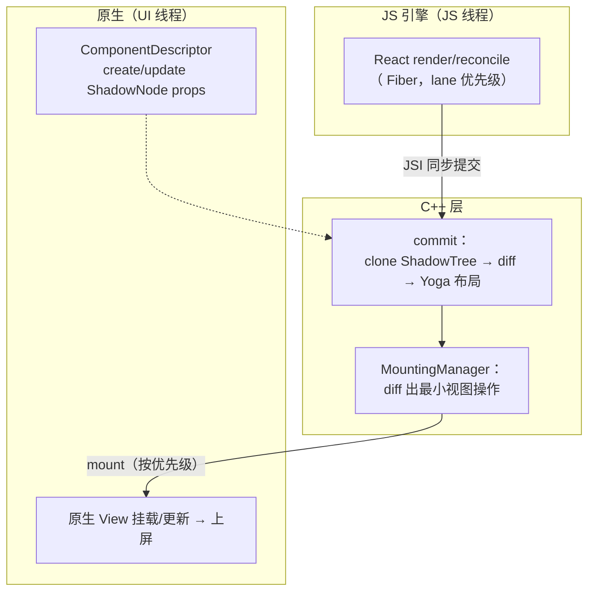
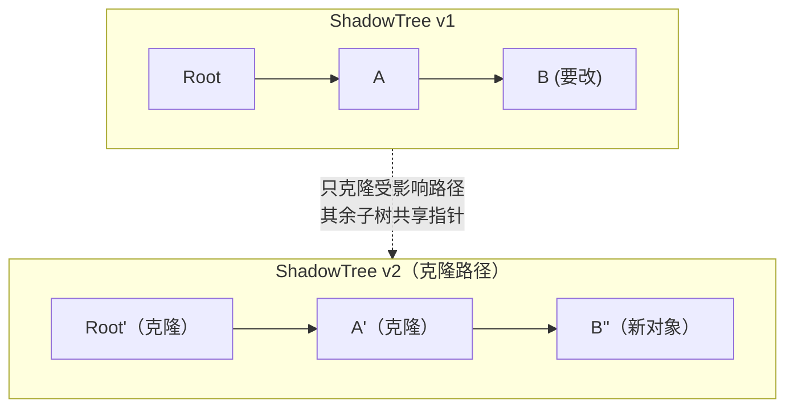

# Fabric 渲染管线

> Fabric 是新架构的渲染器：C++ ShadowTree、同步布局、clone-on-write、带优先级的 commit。本篇沿"render → reconcile → commit → mount"四阶段把新管线走一遍，并与旧管线逐段对照。

## 1. 新管线全景

四个阶段一句话：

1. **render/reconcile**（JS）：React 正常 diff，但 commit 不再发消息；
2. **commit**（C++）：克隆出新 ShadowTree 版本，diff，同步跑 Yoga；
3. **mount**（C++ → 原生）：把新旧树差异翻译成原生视图操作，切 UI 线程执行；
4. **组件描述**：每种控件（View/Text/...）由 ComponentDescriptor 定义 props 映射与原生创建逻辑。

源码入口：`ReactCommon/react/renderer/`（`components/`、`core/ShadowNode.cpp`、`mounting/`）。

## 2. ShadowNode：clone-on-write 的不可变树

旧架构 ShadowNode 是平台对象（Java/OC），更新就地改；Fabric 的 `ShadowNode` 是 **C++ 不可变对象**——更新 = 从叶到根克隆一条路径：

收益：

- **线程安全免锁**：多线程可并发读旧版本，写者克隆路径；
- **diff 廉价**：新旧树共享节点，`ShadowNode::diff` 只走克隆路径；
- **可回溯**：保留版本即可实现"渲染帧快照"（Concurrent 特性需要）。

## 3. commit 阶段：同步布局的意义

Fabric 的 commit 在一次 JSI 调用内完成：`UIManager::commit`（`ReactCommon/react/renderer/uimanager/`）：

1. `ShadowNode::clone` 出新树；
2. `layout::LayoutManager` 跑 Yoga——**同步**，在提交线程内完成；
3. 生成 `MountingTransaction`（差异指令集）。

"同步"的含金量：

| 场景 | 旧架构 | Fabric |
|------|--------|--------|
| 读布局 `measure` | 异步回调（下一帧） | **同步返回**（C++ 布局已完成） |
| 动画前的布局准备 | 提交与布局分帧 | 同帧内完成，动画首帧无抖动 |
| 文本测量 | 跨语言回调平台 | C++ 同步（TextMeasurer 内联） |

## 4. mount 阶段与优先级

`MountingManager` 把 `MountingTransaction` 切到 UI 线程执行（`Scheduler::mount`），产生最小的原生操作流（createView/updateProps/removeClippedChildren…，与旧架构指令同源但**无 JSON、无队列窗口**）。

调度上的新东西——**优先级与可中断**：

- React 18 的 lane 模型传到渲染层：交互触发的更新（高优先级）可插队先渲染；
- Suspense / useTransition 在 RN 成为可能：低优先级树可以先"空着"，数据好了再补；
- 事件处理（`EventListener`）按优先级派发，输入响应不再被长渲染阻塞。

## 5. 与旧管线逐段对照

| 环节 | 旧架构 | Fabric |
|------|--------|--------|
| reconcile 产物 | Bridge 消息（JSON） | JSI 同步调用 |
| ShadowTree | 平台对象、就地修改 | C++ 不可变、COW |
| 布局 | Shadow 线程异步、独立批次 | commit 内同步、可中断恢复 |
| 视图指令 | 消息队列批量窗口 | MountingTransaction 直投 |
| 事件 | 无优先级 | lane 优先级派发 |
| measure | 异步 | 同步 |
| 首屏 | 多一个队列窗口的延迟 | render→mount 一气呵成 |

**性能提升的诚实预期**：Fabric 主要赢在"高频小更新"（表单、动画 props、手势反馈）与首帧；重计算列表的瓶颈更多在 JS 与布局本身（模块九）。

## 6. 可观察的验证点

- `React DevTools Profiler`：commit 时间轴上可看到 Fabric 的优先级标记；
- Android systrace / Perfetto：`ReactNativeJS` 段与 `fabric` 段的调用连续（无 NativeQueue 等待窗）；
- 0.76+ 默认开启：`newArchEnabled=true`（gradle.properties）/ Podfile `fabric_enabled`。

## 小结

- Fabric 四阶段：reconcile（JS）→ commit（C++ COW 克隆 + 同步 Yoga）→ mount（最小指令直投 UI 线程）→ ComponentDescriptor（控件级映射）。
- clone-on-write 买到线程安全、廉价 diff 与帧快照；同步布局买到"读即所得"。
- 它与 JSI 是地基与墙的关系：JSI 供通道，Fabric 供管线，TurboModules 供模块系统。
