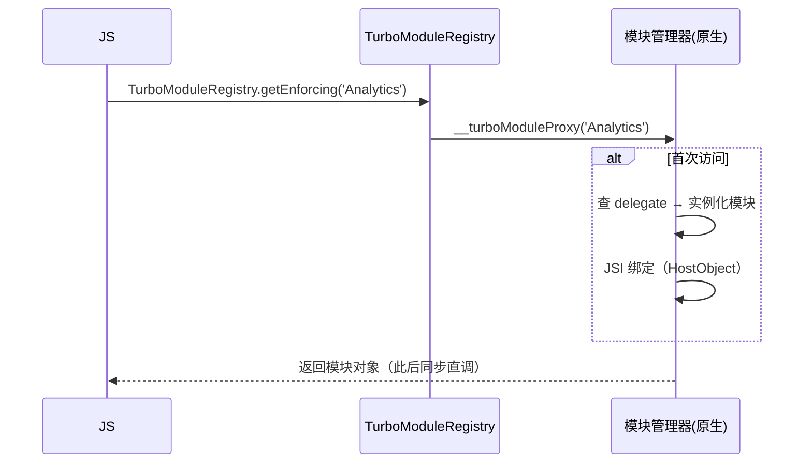
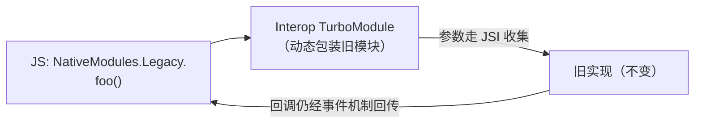

# TurboModules

> 模块四的 NativeModules 有三宗罪：**启动全量注册、JSON 动态调用、类型靠约定**。TurboModules 逐条替换：**按需实例化、JSI 同步绑定、Codegen 静态契约**。本篇拆它的加载机制、双平台模块管理器与兼容旧模块的 Interop 层。

## 1. 从"全量注册"到"按需实例化"

旧架构启动时要把所有 `@ReactMethod` 收集进注册表（模块二 01），因为 JS 代理需要编号表才能发消息。TurboModules 反过来：



- JS 侧 `NativeAnalytics.getEnforcing<Spec>('Analytics')` 触发 `__turboModuleProxy`；
- 原生按名字查 **TurboModuleManagerDelegate**，第一次访问才创建实例（**懒加载**），创建后进入 LongLivedObjectCollection（防 GC 回收跨端持有的对象——模块三 03 的 Handle 体系在模块层的体现）；
- 返回的对象是 JSI `HostObject`：**方法调用就是 C++ 函数调用**，常量读取同步返回。

启动收益：模块初始化成本从"启动时 N 个"变为"用到时 1 个"；调用收益：模块四 01 的三条死穴（异步/序列化/无类型）同步消失。

## 2. 双平台的模块管理器

### Android：TurboModuleManagerDelegate

- 每个 TurboModule 提供 `getModule(String name)`，由 App 的 `TurboReactPackage`/delegate 实现；
- Codegen 生成的抽象类（如 `NativeAnalyticsSpec`）是**强类型基类**——实现类漏写方法，编译期报错（模块四时代的"运行时才炸"消失）；
- 每个模块可声明自己的执行线程（`getExecutorQueue`），与旧 `@ReactMethod` 固定 mqt 不同。

### iOS：RCTTurboModuleManager

- `RCTTurboModuleManagerDelegate` 按名字解析模块（`getTurboModule:forName:`）；
- 实现类遵循 Codegen 生成的 ObjC++ 协议（`NativeAnalyticsSpec` 协议 + `.mm` 实现）；
- 同样支持按模块指定 `getDispatchQueue`（串行队列隔离重 IO 模块）。

| | 旧 NativeModules | TurboModules |
|--|-----------------|--------------|
| 注册时机 | 启动全量 | 首次访问按需 |
| 调用通道 | Bridge 消息（JSON） | JSI HostObject 直调 |
| 类型契约 | 运行时编号约定 | Codegen 静态生成（04 篇） |
| 常量 | 创建时注入 | 同步 getConstants，任意时刻可读 |
| 线程 | 固定 mqt | 每模块可配 executor/queue |

## 3. Interop Layer：旧模块的兜底通道

迁移不可能一夜完成，新架构提供**Interop 层**把旧 `RCTBridgeModule`/`@ReactMethod` 模块包装成 TurboModule 形态：



- **语义保留**：旧模块的方法仍是异步回调——Interop 只是把消息通道从 Bridge 换成 JSI 包装，**不改变异步本质**（因为旧实现没有同步形态）；
- **代价**：享受不到静态类型与同步常量的全部收益，但迁移期内 App 可以整体切到 bridgeless 先跑起来；
- 策略：**核心高频模块优先真迁移，长尾模块靠 Interop 苟着**——05 篇迁移路线图的第一原则。

## 4. 支持的调用形态

一个 spec 里可以同时声明（模块十 02 有完整代码走查）：

```ts
export interface Spec extends TurboModule {
  readonly getDeviceInfo: () => DeviceInfo;        // 同步返回对象
  addEvent(a: string, b: number): Promise<void>;   // 异步 Promise
  onProgress(cb: (percent: number) => void): void; // 回调/事件
  // 常量：$getConstantsTyped 由 Codegen 处理
}
```

设计判断直接用模块三 04 的边界：**不等谁的同步；等 IO 的 Promise；推送语义的事件**。

## 5. 与 JSI/Fabric 的关系定位

- **JSI 是通道**（模块七 01）：TurboModule 是"模块系统"建在这条通道上；
- **Codegen 是契约工厂**（04 篇）：没有静态生成，JSI 绑定就得手写 C++，规模不可控；
- **Fabric 管 UI**（02 篇）：TurboModules 管非 UI 能力——两者共同构成"新架构"，互不包含。

## 小结

- TurboModules 的三个替换：全量注册 → 按需实例化、Bridge 消息 → JSI HostObject 直调、运行时约定 → Codegen 静态契约；
- 双平台各有一个 delegate/manager 做名字 → 实例的解析，模块可自带执行队列；
- Interop 层让旧模块零改动跑在 bridgeless 下（仍是异步语义），是迁移的兜底通道；
- spec 中同步/ Promise /回调三种形态的取舍，就是模块三 04"需要等谁"边界观的直接应用。
